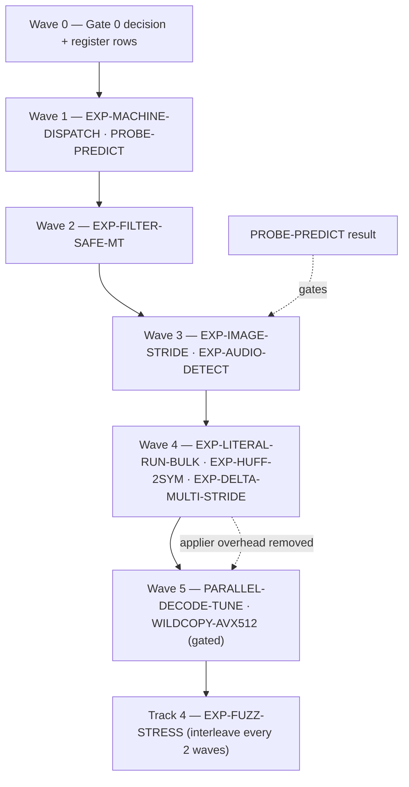

# OpenRAR Experimentation Roadmap — Post-v2.3.0 Filter & Decode Pipeline

**Document Status:** Decision record + candidate intake register (review-corrected)
**Supersedes:** the 2026-11-12 `experimentation-brainstorm.md` (draft), after a source-level sense check
**Trunk baseline:** `main` @ v2.3.0 walkthrough (`docs/milestones/v2.3.0-walkthrough.md`)
**Governance:** Rule G-1 (Single Decision Function), G-3 (Fingerprinted Measurement), G-8 (Charter Discipline); Invariants I-1, I-13, I-15, I-16 (`docs/invariants.md`); interop oracles UnRAR 7.20 + WinRAR 7.20 (`docs/milestones/roadmap.md` §8.1)

**Relationship to the register of record:** this document is the *intake*. A row becomes an active candidate only when it is copied into `docs/milestones/roadmap.md` §7 with a branch name and a kill gate. Nothing here overrides that register.

**Conventions:** all file paths are repo-root relative; `file:line` anchors name the code as it stood at v2.3.0.

---

## 0. Verdict (read this first)

The original brainstorm's *shape* was right — after v2.3.0 the remaining juice is in filters (ratio) and decode (speed). Its *content* was not safe to plan from:

| Finding | Count |
|:---|:---:|
| Already shipped as specified | 2 |
| Partially shipped / downscoped | 1 |
| **Wire-format changes presented as "additive"** | 3 |
| Mechanism or unit errors (idea cannot work as written) | 3 |
| Survive, but only with amended gates | 3 |
| Parked as low-value after measurement reasoning | 1 |
| New candidates added by this review | 6 |

Two hard blockers dominate everything else:

1. **The filter `Type` field is 3 bits and only `0..3` are legal in RAR5.** Emitting anything else makes UnRAR/WinRAR pass filtered bytes through untouched → unpack CRC mismatch → the RQG interop gate fails. See §2.
2. **Selecting any filter forces single-threaded compression** (`compressor50.cpp:2376-2381`). Every ratio experiment that widens detection silently converts MT packs to ST. See §3.

---

## 1. Verified inventory (what is actually true today)

Checked against source, not against the previous brainstorm.

| Mechanism | Evidence | Actual state |
|:---|:---|:---|
| x86 E8/E9 scan | `filters50.cpp:228-234` | SSE2 16-byte compare + mask; transform itself scalar |
| ARM32 `BL` (0xEB) | `filters50.cpp:355-359` | SSE2 scan; PE/ELF/Mach-O 32-bit ARM detection present |
| ARM64 / RISC-V branch filter | `filters50.cpp:79-102` | **absent** (and PE-ARM64 falls through to E8 — see EXP-MACHINE-DISPATCH) |
| Delta 1–32 channels | `filters50.cpp:833-845`, `1138-1150` | SIMD for **2, 3, 4** only; all other strides scalar |
| Delta 3 SSSE3 / NEON | `filters50.cpp:555-660` | 16 pixels/pass, 9 shuffle masks; promoted at 4,131 / 3,863 MB/s |
| WAV detection | `filters50.cpp:143-154` | Fixed offsets `+8`/`+22`/`+34`; no RIFF chunk walk, no RF64/BW64/AIFF/CAF |
| Image detection | `filters50.cpp:45-157` | **none** (no BMP/TIFF/TGA/PPM/DDS) |
| Wildcopy SIMD | `arch/wildcopy_dispatch.hpp:371-379` | SSE2 / AVX2 / NEON; **no AVX-512 kernel** |
| Match comparison | `arch/match_simd.hpp` | SSE2 / AVX2 / **AVX-512** / NEON / WASM(runtime dispatch) |
| AVX2 batch hash | `arch/hash_simd.hpp` | present, digest-identical |
| Huffman decode | `decompressor50.cpp:295-319` | 10-bit quick table + branchless CMOV slow path |
| Huffman encode | `compressor50.cpp:1696-1710` | canonical tables rebuilt **every block** (reuse disabled for interop) |
| Parallel decode | `parallel_decode.cpp:19-46` | 1 MiB spans, 4 MiB packed floor, 32 spans max; filters already flow through the span applier (`decompressor50.cpp:1880-1892`) |
| AES-256 | `crypto/aes256.cpp:239-309` | AES-NI **CBC**, 8-way pipelined decrypt (RAR5 is CBC, not CTR) |
| WASM SIMD | `cmake/openrar_flags.cmake:18-24` | opt-in `-DOPENRAR_WASM_SIMD=ON`; match kernel ported, filters scalar |

---

## 2. Gate 0 — Format legality (blocking)

`docs/spec/04-filters.md:21` defines the filter token as:

```
Type : 3 bits     0=DELTA 1=E8 2=E8E9 3=ARM 4=AUDIO 5=RGB 6=ITANIUM 7=TEXT
                   (only 0..3 are emitted by RAR5 encoders; 4..7 reserved)
```

`Filters50::FilterType` mirrors that (`filters50.hpp:10-16`), and the decoder treats every unknown type as *no filter* (`decompressor50.cpp:787-791`). The unpacked CRC covers post-filter bytes, so a skipped filter does not fail silently — it fails **loudly at extraction** in every reference engine.

**Decision rule:** a candidate is either **kernel/dispatch-only** (legal, W2/W3 as noted) or a **container extension** (out of scope for RAR5, requires a spec change, `unp_ver` gating, and negative interop tests). There is no third category.

| Candidate | Legal? | Disposition |
|:---|:---:|:---|
| Image detection → existing DELTA (type 0) | ✅ | `EXP-IMAGE-STRIDE` |
| Audio detection → existing DELTA (type 0) | ✅ | `EXP-AUDIO-DETECT` |
| Multi-stride delta kernels (channels ≤ 32) | ✅ | `EXP-DELTA-MULTI-STRIDE` |
| MT-safe filtered packing | ✅ | `EXP-FILTER-SAFE-MT` |
| Decode/Huffman/wildcopy kernels | ✅ | W2 rows |
| AArch64 BL filter (new type) | ❌ | `EXP-A64-BRANCH` — **deferred, EXT** |
| RISC-V JAL filter (new type) | ❌ | `EXP-RISCV-JAL` — **deferred, EXT** |
| Paeth/row predictor (new type + stride param) | ❌ | `EXP-PAETH-IMAGE` — **deferred, EXT** |

**Due diligence before any EXT work:** confirm whether RAR 7.x already defines a 64-bit-ARM or image filter inside the 3-bit space. If it does, the transform must match it bit-exactly — inventing a different one is an interop defect, not an extension. There is no evidence either way in `docs/spec/` today; record the finding before writing code.

> [!IMPORTANT]
> A type-0 DELTA token only carries `channels` (5 bits, 1..32). There is **no stride/row field**, so row-wise prediction is impossible without an extension. That is why `EXP-PAETH-IMAGE` cannot be "just a new filter function".

---

## 3. The hidden cost of widening detection

`compressor50.cpp:2376-2381`:

```cpp
if (Filters50::detect_filter(src, src_size, det_channels, filter_cfg) != FilterType::None) {
    return compress_buffer(...);   // sequential, single-threaded
}
```

The chunked `-mt` pipeline cannot honour position-dependent transforms because chunk offsets are chunk-relative. So today, **any detected filter disables MT packing for that member.** Adding BMP/TIFF/ARM64 detection without fixing this trades ratio for pack wall-clock on exactly the large members where MT matters most.

`EXP-FILTER-SAFE-MT` (§4) removes that objection: chunk on filter-block (4 MiB) boundaries and pass each chunk its true member-relative `file_offset`. This is a prerequisite for image/audio detection to be a net win, not a follow-up.

Every filter-detection gate below therefore carries a **pack wall-clock at `-mt4`** clause.

---

## 4. Candidate register

**Classes:** **MEAS** = measurement only, no bytes produced; **W2** = must be byte/digest-identical on the 30 ratchet cells (I-1); **W3** = ratio-changing, needs the §4.3 re-baseline in `docs/milestones/v2.3.0-implementation-plan.md` and a ratchet lowering; **EXT** = container extension, out of scope.

| ID | Class | LEGAL | Target | Kill gate (short form) | Wave |
|:---|:---:|:---:|:---|:---|:---:|
| **EXP-MACHINE-DISPATCH** | W2 + MEAS | ✅ | Wrong-filter hygiene on non-x86 containers | 0 digest change on C1; no size growth on C2/C5 | 1 |
| **PROBE-PREDICT** | MEAS | ✅ | Choose the image predictor/channel mapping before any code | Probe report + decision; no encoder change | 1 |
| **EXP-FILTER-SAFE-MT** | W2 | ✅ | Keep MT for filtered members | Filtered member `-mt4` ≤ 0.7× `-mt1`; decode-correct on C7; size ≤ seq + 0.5% | 2 |
| **EXP-IMAGE-STRIDE** | W3 | ✅ | BMP/TIFF/TGA/PPM/DDS → DELTA with correct bpp/channels and row-aligned regions | ≥5.0% size on C3; 0 growth on C1/C2; `-mt4` ≤ +10%; decode ≤ −5% | 3 |
| **EXP-AUDIO-DETECT** | W3 | ✅ | RIFF chunk walk, RF64/BW64, AIFF/CAF, headerless PCM | ≥2.0% size on C4; 0 growth on C1/C2; `-mt4` ≤ +2% | 3 |
| **EXP-LITERAL-RUN-BULK** | W2 | ✅ | Batch literal decode, hoist per-literal cadence | +5% decode on C6 literal-heavy; 0 regression on C6 match-heavy; digests identical | 4 |
| **EXP-HUFF-2SYM** | W2 | ✅ | 2-symbol quick table (replaces the AVX2-gather idea) | +6% decode on C6 text/code after baseline profile; 0 regression; digests identical | 4 |
| **EXP-DELTA-MULTI-STRIDE** | W2 | ✅ | SIMD for strides 12/16/18/24/32 | ≥2.0× kernel vs scalar; bit-exact odd tails; 0 digest change | 4 |
| **EXP-PARALLEL-DECODE-TUNE** | W2 | ✅ | Applier-first tuning, then span topology | −5% wall-clock on ≥64 MiB C6 (not −10%); applier profile attached | 5 (gated) |
| **EXP-WILDCOPY-AVX512** | W2 | ✅ | 64-byte wildcopy kernel | +3% on long-match C6; 0 regression short-match; sustained-clock check | 5 (gated) |
| **EXP-WASM-SIMD128** | W2 | ✅ | Port SSE2 filter kernels to SIMD128 | ≥3× vs scalar in V8; module size ≤ +8%; scalar fallback retained | platform |
| **EXP-AVX2-E8-SCAN** | W2 | ✅ | — | **Parked**: end-to-end ceiling ≈ +0.2% (see §5) | — |
| **EXP-A64-BRANCH** | EXT | ❌ | AArch64 BL translation | Deferred behind Gate 0 + RAR7 due diligence | — |
| **EXP-RISCV-JAL** | EXT | ❌ | RISC-V JAL translation | Deferred; no container slot | — |
| **EXP-PAETH-IMAGE** | EXT | ❌ | Row predictor for images | Deferred; blocked by PROBE-PREDICT result | — |
| **EXP-FUZZ-STRESS** | Track 4 | ✅ | Continuous fuzz + I-15/I-16 stress | Unchanged from register; interleave every 2 waves | ∥ |

### 4.1 EXP-MACHINE-DISPATCH (W2, Wave 1)

**Problem (live defect, not a hypothesis).** `detect_filter` defaults *any* unrecognised PE machine to `E8` (`filters50.cpp:66-74`). Windows-on-ARM64 (`0xAA64`) therefore receives the x86 CALL transform today — a wrong transform on real content. Additionally:

- Mach-O **fat/universal** (`0xCAFEBABE`) is not detected at all; big-endian magics (`0xCEFAEDFE`, `0xCFFAEDFE`) are read as LE.
- ELF `EM_AARCH64` (0xB7) / `EM_RISCV` (0xF3) get *no* filter (safe by accident), but there is no explicit "recognised, unsupported" branch.
- `PE 0x0200` (IA64), `0x5064` (RISC-V), `0xA641` (ARM64EC) are unhandled.

**Change.** Machine-dispatch table, not a default. PE: `0x014C`/`0x8664`/`0x3A64` (CHPE_X86) → E8; `0x01C0`/`0x01C2`/`0x01C4` → Arm; `0xAA64`/`0xA64E` (ARM64X)/`0x0200`/`0x5064`/`0xA641` → None; unknown → **None** (counter plus an `OPENRAR_FILTER_DIAG` stderr line so a future real machine is visible). ELF: only `0x03`/`0x3E` reach E8, `0x28` is Arm, every other `e_machine` is explicitly None. Mach-O: thin 32/64 in both byte orders, plus fat 32 (`0xCAFEBABE`) and fat 64 (`0xCAFEBABF`) headers in both byte orders, with every slice inspected (E8 only when all slices are x86) and Java `.class` disambiguated by nfat/header/slice-range validity.

**Gate.** 0 digest change on the 30 ratchet cells (I-1). No archive growth on C2 or C5. Size must not increase on any C5 member at any level; settled 2026-11-13, no exemption — the large real ARM64 samples are diagnostic and measured with `--report-only`, which keeps curl 8.23.0's +839 B at `-m1` on record without gating it. Tests added in `tests/unit/compress_tests.cpp` beside `test_forward_filters`.

**Landed evidence (2026-11-12).** `tools/measure_c5.py` re-runs the size gate against a `main`-built binary (0 B on four members, −6 B on PE-ARM64); `tools/prove_dispatch_parity.py` proves the two clauses the size gate does not cover: **30/30 ratchet cells byte-identical** between `main` and the branch (`-m1`..`-m5` over the guard's corpora), and **12/12 reference extractions byte-exact** under UnRAR 7.20 and WinRAR 7.20 for every archive the change alters. The original x86-payload ARM64 stub is kept as a hash-pinned **non-gating control** (+2 B at `-m1`, +6 B at `-m3`/`-m5`) so the synthetic-corpus correction is auditable. Q-7 is closed by CI: `.github/workflows/wave1-c5-parity.yml` builds `main` and the branch with clang on Ubuntu, cross-compiles the pinned freestanding `tests/fixtures/c5/pinned.c` for aarch64/riscv64/x86_64 (`tools/build_c5_real_corpus.py`), and re-runs both the size gate and the parity tool on the real objects; the reference-extraction half is UnRAR-only there, with WinRAR remaining the Windows leg. The job now links real PE32+ images too (`--pe` with lld), so the PE half is no longer synthetic: real PE-ARM64 output is 8/10/15 B smaller at `-m1/-m3/-m5`, still with 30/30 ratchet cells identical. Large-image follow-up (2026-11-13): the 2 KB win does not scale proportionally — 0.6–1.1% of a 2 KB archive becomes 0.01–0.34% of a 1.6–6.3 MB one (7-Zip 25.01 −211/−127/−129 B; `python313.dll` −3,533/−2,965/−7,360 B; `python.exe` −26/−24/−31 B at `-m1/-m3/-m5`) — and it **reverses** on curl 8.23.0, which grows **+839 B at `-m1`** while shrinking at `-m3`/`-m5`; hence `--report-only` for the diagnostic samples while the committed corpus stays gated at every level.

**Why first:** hours of work, zero format risk, removes a wrong transform from shipping behaviour, and C5 doubles as the corpus for the deferred A64 work.

### 4.2 PROBE-PREDICT (MEAS, Wave 1)

**Why.** "Our delta-3 would absolutely crush BMP" is an assumption, and delta is *plane* prediction only — it cannot express row/vertical correlation, and BMP row padding breaks channel phase at most widths. Measure before building.

**What.** Log-only offline probe (pattern: `tools/tokencensus.cpp` / `tools/walk_probe.cpp`, wired like `cmake/openrar_tests.cmake:298-335`). For every C3/C4 member and for candidate channel counts {1,2,3,4,12,16,18,24,32}, report:

- residual-histogram entropy and byte-plane entropy after left-delta / up-delta / Paeth;
- fraction of 8-byte windows repeated within 4 MiB (LZ-friendliness of the residual);
- the same for the un-filtered baseline, so the delta *gain* is a difference, not a guess.

**Exit.** A one-page report plus a decision: which predictor to use (almost certainly "plane delta, because it is the only legal one"), which bpp→channels mapping, whether row alignment matters at all on C3, and whether UTF-16 (channels=2) clears the bar as a bonus.

#### 4.2.1 Empirical Decision Note (Wave 1b Probe Results)

Evaluated across the 32-file C3/C4 experiment corpus (`tests/fixtures/experiment/`; `manifest.sha256` pins inputs only) via `tools/predict_probe.cpp` over candidate channel strides $\{1, 2, 3, 4, 12, 16, 18, 24, 32\}$ and upper-bound 2D predictors (Up-delta, Paeth). The probe reports entropy and 8-byte repeat rate only; every archive-size figure in this note comes from `openrar a` (isolated member, `-ep`; no filter `-mc-` vs forced DELTA `-mc<ch>D+`) on the same build.

1. **Predictor Selection: DELTA-3 is the only emittable predictor, and its entropy gain does not survive an archive-size measurement on photographs.**
   - On the four 24-bit Kodak photographs, DELTA-3 reduces byte entropy by **+2.406 bits/byte** on average (7.27 → 4.86), but the 8-byte repeat rate **falls on every one**: −5.4%, −23.0%, −16.0%, −7.8%. The codec is LZ-first, so destroying exact repeats costs more than the entropy gain earns.
   - Measured archives at `-m3`, same file, same build:

     | Photo | no filter | DELTA-3 | Δ |
     |:---|---:|---:|---:|
     | `photo_kodim01.bmp` | 797,216 B | 826,292 B | **+3.65%** |
     | `photo_kodim02.bmp` | 640,737 B | 711,833 B | **+11.10%** |
     | `photo_kodim03.bmp` | 568,888 B | 614,495 B | **+8.02%** |
     | `photo_kodim04.bmp` | 760,329 B | 725,467 B | −4.59% |

   - The same ordering holds at the other levels: `-m1` gives −6.08% on `kodim04` and +0.96/+5.50/+7.45% on 01–03; `-m5` gives −4.61% and +3.56/+11.34/+6.67%.
   - **The §4.4 ≥5% archive-size gate is not met on photographic content** (1 of 4 photos at `-m1`; 0 of 4 at `-m3`/`-m5`). Synthetic and paletted members pass easily at `-m3`: 24 bpp 133,181 → 51,089 B (−61.6%), 16 bpp 58,659 → 500 B, 32 bpp 121,461 → 47,809 B (−60.6%), 8 bpp 59,874 → 30,589 B (−48.9%). This is a content-selectivity failure, not a transform failure.
   - The theoretical 2D Paeth upper bound yields only an incremental 0.1 to 0.3 bits/byte further reduction (e.g. 4.049 → 3.959 on `kodim03`), so 2D prediction does not rescue the result; `EXP-PAETH-IMAGE` remains permanently deferred / out of scope.
   - **Consequence:** automatic DELTA emission for 24 bpp photographic BMP is **refuted as a size win**. `EXP-IMAGE-STRIDE` may proceed only if emission is gated on a cheap LZ-retention check (the probe's repeat-rate delta, which flags all four photos), and the ≥5% gate must be re-run with that gate in place.

2. **bpp → Channels Mapping:**
   - **8 bpp:** `channels = 1` (grayscale/paletted). After the probe was aligned to `bfOffBits`, `bmp_w1920_8bpp` prefers ch=1 at +4.09 bits/byte over ch=4 at +4.05, and `sample.pgm` gains +4.17. The archive disagrees slightly on the synthetic ramp (ch=4 is 2% smaller, 30,589 vs 31,275 B), but ch=4 over a paletted byte stream is not a meaningful bpp→channels rule.
   - **16 bpp:** `channels = 2` (optimal for RGB 555/565, entropy 7.77 → 1.17, gain +6.60 bits/byte, +54.7% LZ repeat gain).
   - **24 bpp:** `channels = 3` (optimal for RGB true-color; +4.26 bits/byte on synthetic ramps, +1.44 to +3.41 bits/byte on Kodak photographs).
   - **32 bpp:** `channels = 4` (optimal for RGBA true-color, entropy 6.65 → 3.14, gain +3.51 bits/byte, +41.1% LZ repeat gain).
   - **Audio Multichannel:**
     - 5.1 @ 16-bit: `channels = 12` (+1.06 bits/byte, +44.0% LZ match gain)
     - 5.1 @ 24-bit: `channels = 18` (+0.55 bits/byte, +36.0% LZ match gain)
     - 5.1 @ 32-bit: `channels = 24` (+0.34 bits/byte, +30.3% LZ match gain)
     - 7.1 @ 16-bit: `channels = 16` (+0.95 bits/byte, +52.9% LZ match gain)
     - 7.1 @ 24-bit: `channels = 24` (+0.48 bits/byte, +38.4% LZ match gain)
     - 7.1 @ 32-bit: `channels = 32` (+0.29 bits/byte, +29.4% LZ match gain)
     - JUNK-prefixed WAV / RIFF: channel stride = `channels * (bps/8)` once chunk header parsed.
   - **Audio archive check (`-m3`):** unlike the photographs, the audio strides survive a size measurement — 5.1 shrinks 47.3/25.2/18.8% at 16/24/32-bit, 7.1 shrinks 48.8/26.2/21.7%, and the JUNK-prefixed 2ch/16-bit file shrinks 46.6%. The existing WAV auto-detection is therefore earning its keep.

3. **Row Alignment on C3:**
   - On full-image transforms, odd row padding (widths 1919 vs 1920 vs 1921) degrades full-file entropy by less than 0.006 bits/byte (+4.256 vs +4.262 vs +4.261 bits/byte).
   - However, to prevent inter-row phase drift when chunking or emitting bounded filter regions, region boundaries must align to row boundaries (`row_stride`), or full-member filtering should only be activated when `row_stride % bpp_bytes == 0`.

4. **UTF-16 Channels=2 Hypothesis:** **REFUTED.**
   - On `text_utf16_le.txt`, raw uncompressed byte entropy is 3.303 bits/byte.
   - DELTA with `channels = 2` yields an entropy of 3.756 bits/byte (**regression of -0.453 bits/byte**).
   - While plane 1 (all zero high bytes) compresses to 0.00 bits/byte, plane 0 (character diffs) disrupts the character frequency distribution of natural text, increasing plane 0 entropy from ~4.3 to 5.51 bits/byte. UTF-16 will not receive DELTA filtering.

5. **Measurement corrections.**
   - The probe now starts DELTA at `bfOffBits` for images instead of byte 0, so 32 bpp is no longer two bytes out of phase (54 % 4 = 2). Only the 32 bpp rows changed; ch=4 still measures +3.51 bits/byte.
   - The probe no longer treats `predict_probe_report.csv`/`.md` as corpus members, and `manifest.sha256` lists the 32 inputs only (it previously mixed inputs and outputs).
   - The probe still compresses nothing. Any future promotion of an image filter must quote archive bytes, not entropy.

### 4.3 EXP-FILTER-SAFE-MT (W2, Wave 2)

**Change.** Allow the chunked pipeline when a filter is detected:

1. detect once over the whole member (same call, same data — keeps `-mt1`/`-mtN` agreement);
2. chunk on 4 MiB filter-block boundaries instead of the current adaptive chunk size;
3. pass each chunk its true member-relative base so the emitted `block_start`/`file_offset` match a sequential stream.

**Gate.** Unfiltered members byte-identical to today's `-mt4` output. Filtered members: decode-correct under OpenRAR and UnRAR 7.20; size ≤ sequential filtered size + 0.5%; `-mt4` wall-clock ≤ 0.7× `-mt1` on C7. 30 ratchet cells (`-mt1` runs) digest-identical. Record that `-mt4` bytes change (expected, not a W2 violation — the ratchet is an `-mt1` contract).

### 4.4 EXP-IMAGE-STRIDE (W3, Wave 3)

**Scope ladder (stop at the first failure):** BMP → PPM/PGM → uncompressed TIFF strips → DDS → TGA type 2.

**Detection.** `'BM'`; `biBitCount` at `0x1C`, `biCompression` at `0x1E` — accept **0 and 3** (BI_BITFIELDS is common at 16/32 bpp); pixel data starts at `bfOffBits` (`0x0A`). TIFF: only `Compression == 1`; JPEG-in-TIFF and PackBits/CCITT are explicitly **out** (already entropy-coded; delta would hurt). PPM: `P6`/`P5` with a parsed header. Extension hint from the archive layer is allowed and preferred over magic bytes alone.

**Emission.** Map bpp→channels (8→1, 16→2, 24→3, 32→4), start regions at `bfOffBits`, and align region boundaries to **row starts** — or, preferably, only emit a frame-wide region when `row_stride % bpp_bytes == 0`, which keeps the region count at ~1 per 4 MiB. Per-row regions are legal but consume the 8,192-filter budget, so they must be capped and documented.

> [!WARNING]
> `filters50.cpp`'s `detect_filter` receives bytes only. Passing a name/extension hint requires plumbing from `archive_mutator`/`parallel_compressor`; treat it as part of this experiment, not a follow-up.

**Gate.** ≥5.0% archive-size reduction on C3 (measured per file class, reported separately: BMP-24, BMP-32, TIFF, PPM). 0 growth on C1 and C2. `-mt4` pack wall-clock ≤ +10% *after* EXP-FILTER-SAFE-MT (≤ +2% target). Decode throughput ≥ −5% on C3. Roundtrip bit-exact including odd widths 1919/1921 and 8-bit palettes.

### 4.5 EXP-AUDIO-DETECT (W3, Wave 3)

**Change.** Replace the fixed-offset WAV test (`filters50.cpp:143-154`) with a RIFF chunk walk (skip `JUNK`/`LIST`/`bext`), then handle RF64/BW64 (`ds64`), AIFF/CAF (big-endian sample data — **note**: the DELTA transform is byte-oriented, so endianness only affects the plane split, not correctness), and headerless `.pcm/.raw` via extension hint + entropy sanity check.

**Gate.** ≥2.0% on C4 (report WAV-canonical vs JUNK-prefixed vs RF64 vs AIFF separately). 0 growth on C1/C2. `-mt4` ≤ +2%. Correct `channels` (bytes/frame) for every fixture, asserted in tests.

### 4.6 EXP-LITERAL-RUN-BULK (W2, Wave 4)

**Problem.** The sequential literal path is one symbol → `write_literal` → `cadence()` per byte, and `cadence()` re-checks the filter queue every time (`decompressor50.cpp:1128-1158`, `1098-1103`; `decompressor50.hpp:645-664`). That is ~8-12 instructions of overhead per literal on top of the Huffman decode, on the corpus class where decode is already the weakest number.

**Change.** Decode up to 255 literals into a stack run buffer, then bulk-copy wrap-aware into the window, evaluating cadence and filter completion once per run. The span applier already does exactly this (`decompressor50.cpp:1480-1527`) — mirror it in the sequential decoder. Split the run at the 64 KiB cadence boundary and at any pending filter end so flush positions are identical by construction.

**Gate.** +5% decode on C6 literal-heavy; 0 regression on C6 match-heavy and zeros; 30 cells digest-identical; ASan/UBSan clean; `ScopedAllocTracker` clean (fixed stack buffer only).

### 4.7 EXP-HUFF-2SYM (W2, Wave 4)

**Why not AVX2 gather.** The original "speculative positions, validate at the end" mechanism is circular: symbol *k+1*'s bit position is only known after *k* decodes. One wrong length assumption desynchronises the whole tail — there is no local correction. `vpgatherdd` is also slower than scalar table loads for 8-element gathers on current Intel/AMD parts.

**Change.** Build a **2-symbol** quick table: one lookup returns `(sym1,len1,sym2,len2)` when both codes fit in the probe width, with a single-symbol fallback otherwise (`HUF_decompress`-style). Pairs naturally with 4.6.

**Gate.** A baseline profile first (share of decode wall in `HuffmanDecoder::decode` on C6). Only proceed if ≥20%. Then +6% decode on text/code, 0 regression on high-entropy, digests identical.

### 4.8 EXP-DELTA-MULTI-STRIDE (W2, Wave 4)

**Unit correction.** `channels` is **bytes per frame**, not audio channels (`filters50.cpp:145-150` sets `channels = audio_channels × bits/8`). Real surround strides are **12** (5.1/16), **18** (5.1/24), **16** (7.1/16), **24** (7.1/24), **32** (7.1/32). Strides 6 and 8 only occur at 8-bit multichannel, which is rare. The previous "6ch/8ch" framing targeted the wrong set.

**Change.** Planar→interleaved kernels per stride. Stride 16 is a clean multi-level unpack transpose (`epi8 → epi16 → epi32 → epi64`; `vst2q`/`vst4q` equivalents on NEON). Strides 12, 24 and 32 are multiples of 4 and tile into 16-byte stores with pshufb gathers. **18 is the awkward one** (not a multiple of 4, not a power of two) — it needs a 3-byte-unit shuffle path or a split into two 9-lane halves, and is likely scatter-bound; measure it before committing. Fall back to scalar per plane for anything else.

**Gate.** ≥2.0× kernel throughput vs scalar on C4 (report per stride; do not average). Bit-exact against scalar on odd block tails and all `size % channels` residues. 0 digest change (kernel-only, W2).

### 4.9 EXP-PARALLEL-DECODE-TUNE (W2, Wave 5, gated)

Corrected scope: filter application is **already** in the span pipeline, and the measured binder is the serial applier (README: 1.17-1.25× at `-mt4`/`-mt8`). So:

1. profile the applier (`write_literal`, `copy_match`, `cadence`, filter apply) before touching span size;
2. land 4.6 first — it removes applier overhead that span tuning cannot;
3. then sweep span target (512 KiB / 1 MiB / 2 MiB) and `SPAN_COUNT_MAX`.

**Gate.** −5% wall-clock on ≥64 MiB C6, unfiltered *and* filtered, with the applier profile attached. The old −10% number is withdrawn as unsupported by the measured 1.2-1.35× parallel ceiling.

### 4.10 EXP-WILDCOPY-AVX512 (W2, Wave 5, gated)

Keep, but with the corrected rationale: I-15's 64-byte margin (`docs/invariants.md:160-164`) was sized for 16/32-byte stores; it *does* accommodate a 64-byte store, so no invariant change is needed. The kernel is small and dispatch already exists (`wildcopy_dispatch.hpp:371-379`).

**Gate.** +3% (not +5%) on long-match C6; 0 regression on short-match; sustained-frequency measurement on the reference host, not instruction count.

### 4.11 EXP-WASM-SIMD128 (W2, platform)

Reclassified from "experiment" to "port + build decision". `match_length_wasm` already exists behind `-DOPENRAR_WASM_SIMD=ON`; `filters50.cpp` has no WASM path. Work = port SSE2 filter/delta kernels, measure V8, and decide whether the +module-size trade is acceptable given the documented intent to keep the baseline module small (`openrar_flags.cmake:18-21`).

**Gate.** ≥3× filter throughput vs scalar in V8; module size ≤ +8% with SIMD enabled; scalar build unchanged.

---

## 5. Closed, parked, and reclassified

| From the brainstorm | Disposition | Reason |
|:---|:---|:---|
| EXP-VECTORIZED-MEMCMP | **Closed — shipped** | `arch/match_simd.hpp` + `match_avx512.cpp`: SSE2/AVX2/AVX-512/NEON/WASM match kernels with runtime dispatch. |
| EXP-AES-NI-CTR | **Closed — shipped and wrong mode** | RAR5 uses AES-256-**CBC**; `aes256.cpp:239-309` already has AES-NI CBC with 8-way pipelined decrypt. CTR would be a format change. |
| EXP-HUFFMAN-AVX2 | **Closed — mechanism invalid** | Circular dependence; gather slower than scalar. Replaced by EXP-HUFF-2SYM. |
| EXP-BMP-DETECT | **Merged** into EXP-IMAGE-STRIDE | Detection alone is not enough: needs bpp mapping, row alignment, and the MT fix. |
| EXP-DELTA-6CH-8CH | **Re-scoped** to EXP-DELTA-MULTI-STRIDE | Wrong stride set (see 4.8). |
| EXP-DELTA-PREDICTION (Paeth) | **Deferred** as EXP-PAETH-IMAGE (EXT) | No container slot for a stride parameter. Blocked on PROBE-PREDICT. |
| EXP-AVX512-VBMI-DELTA3 | **Closed** | `vpermb` permutes within one 64-byte register; three source planes need `vpermt2b` + merges, not one instruction. Delta3 already runs at 4,131 MB/s (near streaming bandwidth), so a 2× gate is not credible. Reopen only with a bandwidth measurement. |
| EXP-AVX2-E8-SCAN | **Parked** | The scan is <0.2% of pack wall-clock (10 MiB scan at GB/s vs pack at 15 MB/s). A +30% kernel gate is easy and meaningless; an end-to-end gate would be noise. Reopen only if a profile says otherwise. |
| EXP-A64-BRANCH | **Deferred (EXT)** | Needs a new filter type; also PE-ARM64 is currently mis-filtered as E8, which must be fixed first. |
| EXP-RISCV-JAL | **Deferred (EXT)** | Same; plus no real corpus in typical archive workloads yet. |
| "Pipeline filters into the span pipeline" | **Already satisfied** | Filter ops are records applied by the span applier (`decompressor50.cpp:1880-1892`). |
| "JPEG-in-TIFF benefits from delta" | **Withdrawn** | Already entropy-coded; delta mildly hurts. |

---

## 6. Corpora & measurement protocol (G-3)

No gate in §4 is evaluable without these. Each corpus gets a manifest with SHA-256 per file plus a generation recipe, checked into `tests/fixtures/` (or referenced by hash if too large).

| ID | Corpus | Contents | Purpose |
|:---|:---|:---|:---|
| **C1** | Ratchet | The 30 deterministic cells used by `tools/release_regression_guard.py` | I-1 / I-13 |
| **C2** | Negative controls | random, text, JPEG, ZIP, and a **mislabelled** file (BMP header + random payload) | False-positive detection |
| **C3** | Image | BMP 8/16/24/32 bpp at widths **1919, 1920, 1921** (padding on/off), uncompressed TIFF strips LE+BE, TGA type 2, PPM/PGM; synthetic ramps **and** 4 Kodak Lossless True Color photos (pinned by hash) | EXP-IMAGE-STRIDE |
| **C4** | Audio | 5.1/7.1 WAV at 16/24/32-bit; JUNK-prefixed WAV; RF64/BW64; AIFF; CAF; seeded (sine + noise) generation | EXP-AUDIO-DETECT, EXP-DELTA-MULTI-STRIDE |
| **C5** | ISA | aarch64 + riscv64 ELF objects; x86-64 ELF/PE controls; one PE-ARM64 object. Committed at `tests/fixtures/c5/` as ISA-shaped synthetic stubs (seed 1337, `tools/generate_c5_corpus.py`) built by the clang/lld CI job (`--pe`) with the stubs kept as the no-toolchain fallback | EXP-MACHINE-DISPATCH, deferred EXT work |
| **C6** | Decode | literal-heavy (minified JS, text), match-heavy (zeros, runs), binary, ≥64 MiB members | Wave 4/5 decode gates |
| **C7** | Filtered-MT | ≥8 MiB members that trigger E8 / DELTA | EXP-FILTER-SAFE-MT |

**C5 recipe** (reproducible, licence-clean, no sysroot needed): `clang --target=aarch64-linux-gnu -O2 -c pinned.c -o pinned.a64.o`, same for `riscv64-linux-gnu`. If clang cannot target a triple on the Windows host, generate the corpus in CI (ubuntu leg) and pin the hashes — do not skip the corpus. The committed stub set exists because of Q-7; the size gate is `tools/measure_c5.py --baseline main=<main build> --candidate branch=<branch build>` and the current result is in `tests/fixtures/c5/README.md`.

**Protocol.** `openrar_bench` (1 warm-up + 7 timed, median and spread, host disclosed) for throughput; archive byte counts from the same build for size; **every** archive whose bytes change is cross-extracted by UnRAR 7.20 and WinRAR 7.20 before a row may be promoted. Speeds are never compared across builds without a same-session baseline.

**Stop rule.** A failed gate archives the branch to `arc/exp-*`, records the measurement in `docs/milestones/roadmap.md` §7, and closes the row. No partial promotion, no "mostly passing".

---

## 7. Sequencing



Rationale for the order:

- **Wave 1 first** because both items are cheap, legal, and reduce uncertainty: dispatch hygiene removes a wrong transform, and the probe prevents building an image filter that cannot win.
- **Wave 2 before Wave 3** because image/audio detection costs MT throughput without it.
- **Wave 4 before Wave 5** because the applier's per-literal overhead must go before span topology or AVX-512 copies can show up in the measurement.
- **Wave 0 is not optional**: a candidate without a register row and a corpus is an opinion.

> [!IMPORTANT]
> **EXP-FUZZ-STRESS** remains PLANNED. Interleave one Track 4 experiment with every two waves, as the prior register requires.

---

## 8. Open questions (do not resolve by guessing)

| # | Question | Blocks |
|:---:|:---|:---|
| Q-1 | Does RAR 7.x define an ARM64 or image filter inside the 3-bit type space? | All EXT work |
| Q-2 | What fraction of pack wall-clock is the E8 scan end-to-end? | EXP-AVX2-E8-SCAN (currently parked) |
| Q-3 | What fraction of extract wall-clock is Huffman decode vs copy vs filter vs BLAKE2sp vs fsync? | EXP-HUFF-2SYM, EXP-WILDCOPY-AVX512, EXP-PARALLEL-DECODE-TUNE |
| Q-4 | Measured gain of plane-delta on real photographs (not ramps) at 24/32 bpp? | EXP-IMAGE-STRIDE go/no-go |
| Q-5 | Actual cost of the `-mt` → `-mt1` fallback on a 100 MB filtered member? | EXP-FILTER-SAFE-MT priority |
| Q-6 | Is delta3 memory-bandwidth-bound at 4,131 MB/s on the reference host? | Any further delta ISA work |
| Q-7 | Can clang on the Windows reference host target `aarch64`/`riscv64` with `-c`? | C5 corpus sourcing |

---

## 9. Provenance

Derived from the 2026-11-12 brainstorm, corrected against source on 2026-11-12. Corrections applied: filter-type legality (§2), MT fallback interaction (§3), already-shipped candidates (§5), delta channel units (§4.8), Huffman mechanism (§4.7), VBMI claim and bandwidth ceiling (§5), JPEG-in-TIFF claim (§5), span-pipeline status (§4.9), I-15 margin wording (§4.10), plus corpora, class labels and measurable gates. New candidates added: EXP-FILTER-SAFE-MT, EXP-LITERAL-RUN-BULK, EXP-HUFF-2SYM, EXP-MACHINE-DISPATCH, EXP-AUDIO-DETECT, PROBE-PREDICT.
