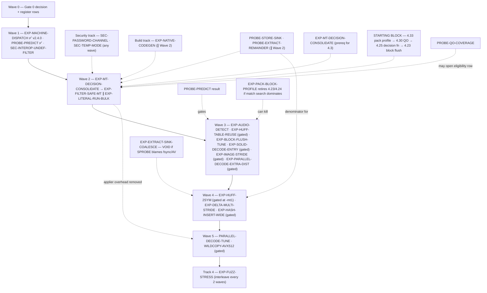

# OpenRAR Experimentation Roadmap — Post-v2.4.0 Filter & Decode Pipeline

**Document Status:** Decision record + candidate intake register (rev 3, 2026-11-15)
**Supersedes:** the 2026-11-12 `experimentation-brainstorm.md` (draft), after a source-level sense check
**Trunk baseline:** `main` @ v2.4.0 (tag `v2.4.0`, `CHANGELOG.md` §2.4.0) for rev 1–2; rev 3 re-read the tree against a v2.4.2 dev build (`openrar.exe` reports 2.4.2) and `dev/unrar` @ 7.23. Rev 1 was written against v2.3.0, and its anchors are retained where the code is unchanged
**Governance:** Rule G-1 (Single Decision Function), G-3 (Fingerprinted Measurement), G-8 (Charter Discipline); Invariants I-1, I-13, I-15, I-16 (`docs/invariants.md`); interop oracles UnRAR 7.20 + WinRAR 7.20 (`docs/milestones/roadmap.md` §8.1)

**Relationship to the register of record:** this document is the *intake*. A row becomes an active candidate only when it is copied into `docs/milestones/roadmap.md` §7 with a branch name and a kill gate. Nothing here overrides that register.

**Conventions:** all file paths are repo-root relative; rev-1 `file:line` anchors name the code as it stood at v2.3.0, and rev-2 anchors (§1 additions, §4.12–4.15) as it stood at v2.4.0.

---

## 0. Verdict (read this first)

The original brainstorm's *shape* was right — after v2.3.0 the remaining juice is in filters (ratio) and decode (speed). Its *content* was not safe to plan from:

| Finding | Count |
|:---|:---:|
| Already shipped as specified | 2 |
| Partially shipped / downscoped | 1 |
| **Wire-format changes presented as "additive"** | 3 |
| Mechanism or unit errors (idea cannot work as written) | 3 |
| Survive, but only with amended gates | 3 |
| Parked as low-value after measurement reasoning | 1 |
| New candidates added by the rev-1 review | 6 |
| New candidates added by the rev-2 review | 5 |
| New candidates added by the rev-3 review | 3 |
| Closed by measurement after its own Step 1 (rev 3) | 1 |
| Promoted out of a closed row (rev 3) | 1 |
| EXT candidates closed by rev 3 (Q-1 answered) | 3 |

**Rev 2 (2026-11-14):** measurements reordered the decode waves and exposed two defects outside the perf track. (a) Extraction is **applier-bound**, not entropy-bound, once `-mt` is unset or ≥2: on a 128 MiB `-m1` text member the serial record applier spans total **1.03 s quiet and 1.5–2.0 s under sustained load** on v2.4.0 (91% of the corresponding wall), while the span workers parked. The rev-1 1.93 s/2.09 s pair was a v2.3.0 measurement under sustained host load; the share reproduces, the absolute does not. (b) BLAKE2sp+read is ~5% of compressed verify time, so the hash is not a target, but the store-extraction sink is **2.5× a raw copy** in batch mode (0.574 s vs 0.21–0.23 s for 128 MiB), so it becomes a measurement probe (PROBE-STORE-SINK), not a sink rewrite. Five candidates follow: EXP-APPLIER-RECORD-FASTPATH (§4.12), EXP-NATIVE-CODEGEN (§4.13), SEC-PASSWORD-CHANNEL (§4.14), SEC-TEMP-MODE (§4.15), PROBE-STORE-SINK (§4.16). EXP-MACHINE-DISPATCH shipped in v2.4.0 and is no longer an intake row.

**Rev 3 (2026-11-15):** a source + reference inspection pass over the post-2.4.2 tree and UnRAR 7.23 produced three additions and one closure. (a) **EXP-PARALLEL-DECODE-EXTRA-DIST (§4.17)** — algorithm-version-1 members (`extra_dist`, the 446-entry RAR7 tables) are excluded from the two-phase decoder outright, so the ~1.9× decode win does not apply to the flavor current WinRAR emits. (b) **EXP-MT-SEED-AMORTIZE (§4.18)** — the MT pack chunk size is window-independent while each chunk re-copies and re-hashes up to `min(win, offset)−1` seed bytes; measured MT speedup falls from 1.92× (`-md4m`) to 1.73–1.82× (`-md64m`, the default `-m3` window) on 64 MiB text. **Its own Step 1 closed it the same day: the seed work is real but off the critical path, and halving it costs 5% wall (§4.18).** (c) **PROBE-EXTRACT-REMAINDER (§4.19)** — filter apply, AES-CBC, CRC32 and header parse have no measured share, so 4.8/4.11 carry kernel-only gates of unknown end-to-end worth. (d) **Q-1 is answered and the EXT rows are closed**, not deferred: RAR 7.23 adds no ARM64 or image filter to the 3-bit space, and its decoder drops blocks carrying types 4..7 rather than passing them through (§2). Wave 3 is reordered (audio before image) on the strength of PROBE-PREDICT's own size measurements, and the three new rows are registered in `docs/milestones/roadmap.md` §7. The challenge record is §10.

Two hard blockers dominate everything else:

1. **The filter `Type` field is 3 bits and only `0..3` are legal in RAR5.** Emitting anything else makes UnRAR/WinRAR pass filtered bytes through untouched → unpack CRC mismatch → the RQG interop gate fails. See §2.
2. **Selecting any filter forces single-threaded compression** (`compressor50.cpp:2376-2381`). Every ratio experiment that widens detection silently converts MT packs to ST. See §3.

---

## 1. Verified inventory (what is actually true today)

Checked against source, not against the previous brainstorm.

| Mechanism | Evidence | Actual state |
|:---|:---|:---|
| x86 E8/E9 scan | `filters50.cpp:228-234` | SSE2 16-byte compare + mask; transform itself scalar |
| ARM32 `BL` (0xEB) | `filters50.cpp:355-359` | SSE2 scan; PE/ELF/Mach-O 32-bit ARM detection present |
| ARM64 / RISC-V branch filter | `filters50.cpp:79-102` | **absent** — PE-ARM64 now dispatches to *no filter* after EXP-MACHINE-DISPATCH (v2.4.0), but ARM64/RISC-V still have no branch transform |
| Delta 1–32 channels | `filters50.cpp:833-845`, `1138-1150` | SIMD for **2, 3, 4** only; all other strides scalar |
| Delta 3 SSSE3 / NEON | `filters50.cpp:555-660` | 16 pixels/pass, 9 shuffle masks; promoted at 4,131 / 3,863 MB/s |
| WAV detection | `filters50.cpp:143-154` | Fixed offsets `+8`/`+22`/`+34`; no RIFF chunk walk, no RF64/BW64/AIFF/CAF |
| Image detection | `filters50.cpp:45-157` | **none** (no BMP/TIFF/TGA/PPM/DDS) |
| Wildcopy SIMD | `arch/wildcopy_dispatch.hpp:371-379` | SSE2 / AVX2 / NEON; **no AVX-512 kernel** |
| Match comparison | `arch/match_simd.hpp` | SSE2 / AVX2 / **AVX-512** / NEON / WASM(runtime dispatch) |
| AVX2 batch hash | `arch/hash_simd.hpp` | present, digest-identical |
| Huffman decode | `decompressor50.cpp:295-319` | 10-bit quick table + branchless CMOV slow path |
| Huffman encode | `compressor50.cpp:1696-1710` | canonical tables rebuilt **every block** (reuse disabled for interop) |
| Parallel decode | `parallel_decode.cpp:19-46` | 1 MiB spans, 4 MiB packed floor, 32 spans max; filters already flow through the span applier (`decompressor50.cpp:1880-1892`) |
| AES-256 | `crypto/aes256.cpp:239-309` | AES-NI **CBC**, 8-way pipelined decrypt (RAR5 is CBC, not CTR) |
| WASM SIMD | `cmake/openrar_flags.cmake:18-24` | opt-in `-DOPENRAR_WASM_SIMD=ON`; match kernel ported, filters scalar |
| Parallel decode topology | `parallel_decode.cpp:65-69`, `:97` | **2 workers by default** when `-mt` is unset; `-mt1` forces sequential; N clamps to **2..8**; 1 MiB span target, 4 MiB packed floor, 32 spans max; non-solid entries only |
| Extraction stage split (measured 2026-11-14) | §8 Q-3 | 128 MiB `-m1` short-match text, v2.4.0: store verify **0.115 s**, compressed verify **1.18–1.27 s quiet / 1.6–2.1 s sustained** (process); at `-mt4` applier spans total **1.03 s quiet / 1.5–2.0 s sustained** (91% of the corresponding pipeline wall), workers parked; store extraction `-db` **0.574 s**, default **0.90 s**, raw copy **0.21–0.23 s** |
| Native codegen | `cmake/openrar_flags.cmake:29-34`; `cmake/openrar_dll.cmake:37` | MSVC Release gets `/GL` + `/LTCG`; GCC/Clang Release gets `-O3` only — **no LTO and no PGO** — and the DLL target explicitly sets `INTERPROCEDURAL_OPTIMIZATION OFF` |
| Password acquisition | `src/cli/main.cpp:4616-4626`; `docs/cli.md:88-89` | The manual documents bare `-p`/`-hp` as "(prompt)"; the parser **rejects** both, so a secret can only arrive inline in argv. The sandbox already never carries the raw password (`sandbox/ipc.hpp:42-43`) |
| POSIX temp-file mode | `src/io/containment.cpp:610`; `src/io/extraction_journal.cpp:867`; `src/archive/archive_reader.cpp:371`, `:2886-2894` | **Fixed in v2.4.1 (SEC-TEMP-MODE):** extraction data temporaries are created **0600** and the member's final mode is applied to the open handle immediately before the commit rename, so the archived mode is in place at the rename rather than after it |
| Two-phase decode scope | `src/compress/parallel_decode.cpp:96,120`; `src/format/header_reader.cpp:507` | `extra_dist` members — `unp_ver=1` with `FCI_RAR5_COMPAT` clear, the 446-table RAR7 flavor — **always** take the sequential decoder whatever `-mt` says; the same `u32` record field also gates out declared windows > 4 GiB — audited 2026-11-15: the distance is stored **0-based**, so 4 GiB is representable and `>` is correct, pinned by `two_phase_tests`. OpenRAR reads but never writes the flavor (`header_writer.cpp:494`), so no self-produced corpus can exercise it |
| MT pack chunk/seed coupling (measured 2026-11-15) | `src/compress/compressor50.hpp:850-859`; `src/compress/parallel_compressor.cpp:252-272` | `parallel_chunk_size` takes **no window** (1–4 MiB clamp), while the dictionary is 64 MiB at the default `-m3`; each chunk re-copies `min(win, offset)−1` seed bytes and re-inserts every one into the hash (a 64 MiB member at 4 MiB chunks re-copies ~480 MiB). Measured MT pack speedup **1.90–1.92× at `-md4m` vs 1.73–1.82× at `-md64m`**; an 8 MiB control reads 1.80× at both windows. **Step 1 (§4.18) refuted the seed-length reading:** the re-hash is real (1.9 s thread-time per 64 MiB member) but off the critical path, and halving it via 8 MiB chunks costs 5% wall — so seeding is not the lever, but Step 1 did not reproduce the 1.73–1.82× premise either |
| Reference filter surface (UnRAR 7.23) | `dev/unrar/compress.hpp:54-58`; `unpack50.cpp:200-201,358,422-501`; `unpack.hpp:9,24` | Only types 0–3 decode; 4–7 are reserved and **dropped** by the reference (`ApplyFilter` returns NULL, `UnpWriteBuf` writes only non-NULL) — not passed through. Filter blocks > 4 MiB are zeroed, which OpenRAR mirrors (`decompressor50.cpp:1269,1710`); `MAX_UNPACK_FILTERS` is 8192/block against OpenRAR's 65,536 pending-entry cap, which I-16 bounds |

---

## 2. Gate 0 — Format legality (blocking)

`docs/spec/04-filters.md:21` defines the filter token as:

```
Type : 3 bits     0=DELTA 1=E8 2=E8E9 3=ARM 4=AUDIO 5=RGB 6=ITANIUM 7=TEXT
                   (only 0..3 are emitted by RAR5 encoders; 4..7 reserved)
```

`Filters50::FilterType` mirrors that (`filters50.hpp:10-16`), and OpenRAR's own decoder treats every unknown type as *no filter* (`decompressor50.cpp:787-791`). **The reference engine does not.** `Unpack::ApplyFilter` (`dev/unrar/unpack50.cpp:422-501`) switches on E8, E8E9, ARM and DELTA only and returns `NULL` for anything else; `UnpWriteBuf` then writes the region only `if (OutMem != NULL)` (`unpack50.cpp:358`), so a block carrying type 4..7 is **dropped**, not passed through — the member comes out short and the unpack fails. Either behaviour ends the same way for the emitter (an unreadable archive), but the tolerable-decode path §2 previously assumed does not exist, so no design may lean on one.

Two further reference limits are now verified rather than assumed. `MAX_FILTER_BLOCK_SIZE = 0x400000` (`dev/unrar/unpack.hpp:24`), and any filter block longer than that is zeroed on read (`unpack50.cpp:200-201`) — i.e. dropped. OpenRAR emits **1 MiB** regions (`compressor50.cpp:1863-1871`, the `0x100000` clamp in `filter_max_chunk`) and zeroes `f_len > 0x400000` on decode exactly like the reference (`decompressor50.cpp:1269,1710`), so it sits 4× inside the limit; **any future filter widening must keep each token ≤ 4 MiB**. `MAX_UNPACK_FILTERS` is 8192 per data block (`unpack.hpp:9`), against OpenRAR's 65,536 pending-entry cap — looser than the reference, but bounded by I-16 (1.5 MiB worst case), so no change is warranted and none is proposed.

**Decision rule:** a candidate is either **kernel/dispatch-only** (legal, W2/W3 as noted) or a **container extension** (out of scope for RAR5, requires a spec change, `unp_ver` gating, and negative interop tests). There is no third category.

| Candidate | Legal? | Disposition |
|:---|:---:|:---|
| Image detection → existing DELTA (type 0) | ✅ | `EXP-IMAGE-STRIDE` |
| Audio detection → existing DELTA (type 0) | ✅ | `EXP-AUDIO-DETECT` |
| Multi-stride delta kernels (channels ≤ 32) | ✅ | `EXP-DELTA-MULTI-STRIDE` |
| MT-safe filtered packing | ✅ | `EXP-FILTER-SAFE-MT` |
| Decode/Huffman/wildcopy kernels | ✅ | W2 rows |
| Record-applier / build-codegen fast paths | ✅ | `EXP-APPLIER-RECORD-FASTPATH`, `EXP-NATIVE-CODEGEN` |
| Password-input and temp-file hardening | ✅ | `SEC-PASSWORD-CHANNEL`, `SEC-TEMP-MODE` (behaviour only) |
| AArch64 BL filter (new type) | ❌ | `EXP-A64-BRANCH` — **closed**, no type slot in RAR 7.23 (Q-1) |
| RISC-V JAL filter (new type) | ❌ | `EXP-RISCV-JAL` — **closed**, no type slot in RAR 7.23 (Q-1) |
| Paeth/row predictor (new type + stride param) | ❌ | `EXP-PAETH-IMAGE` — **closed**, no type slot and no stride field (Q-1, §4.2.1) |

**Due diligence before any EXT work — discharged 2026-11-15 (Q-1 answered from UnRAR 7.23 source).** RAR 7.x defines **no** 64-bit-ARM and no image filter inside the 3-bit space. `dev/unrar/compress.hpp:54-58` still declares exactly `DELTA, E8, E8E9, ARM, AUDIO, RGB, ITANIUM, TEXT` (`0..7`) plus the non-wire analysis modes `LONGRANGE`/`EXHAUSTIVE`, and `unpack50.cpp:422-501` implements only `0..3`. Types 4..7 remain reserved **and undecodable in the reference engine**. A different transform would therefore be an unambiguous interop defect, not an extension, and there is no bit-exact definition to match. Consequence: every EXT row is **closed** below, not deferred, and Gate 0's decision rule stands unchanged for any future proposal.

> [!IMPORTANT]
> A type-0 DELTA token only carries `channels` (5 bits, 1..32). There is **no stride/row field**, so row-wise prediction is impossible without an extension. That is why `EXP-PAETH-IMAGE` cannot be "just a new filter function".

---

## 3. The hidden cost of widening detection

`compressor50.cpp:2376-2381`:

```cpp
if (Filters50::detect_filter(src, src_size, det_channels, filter_cfg) != FilterType::None) {
    return compress_buffer(...);   // sequential, single-threaded
}
```

The chunked `-mt` pipeline cannot honour position-dependent transforms because chunk offsets are chunk-relative. So today, **any detected filter disables MT packing for that member.** Adding BMP/TIFF/ARM64 detection without fixing this trades ratio for pack wall-clock on exactly the large members where MT matters most.

`EXP-FILTER-SAFE-MT` (§4) removes that objection: chunk on filter-block (4 MiB) boundaries and pass each chunk its true member-relative `file_offset`. This is a prerequisite for image/audio detection to be a net win, not a follow-up.

Every filter-detection gate below therefore carries a **pack wall-clock at `-mt4`** clause.

---

## 4. Candidate register

**Classes:** **MEAS** = measurement only, no bytes produced; **W2-P** = pack-side change, archive bytes identical on the 30 ratchet cells (I-1); **W2-D** = decode-side change, extracted bytes — and callback chunk boundaries where they are contractual — identical on the **C9 decode-identity corpus**, against a sequential decode of the same archive; **W2-P+D** = touches both sides and owes both proofs; **W3** = ratio-changing, needs the §4.3 re-baseline in `docs/milestones/v2.3.0-implementation-plan.md` and a ratchet lowering; **EXT** = container extension, out of scope.

**Why the split (added 2026-11-15).** The ratchet cells are *pack* cells (`-mt1 -md4m`). A decoder change measured against them is not observed by the artefact it is compared with, so “digests identical” passes by construction — G-9 vacuity inside the register's own gate. Every decode-side row therefore cites **C9**, not C1, and a row that cannot name the C9 subsets it uses is not reviewable.

**Promotion-time paperwork (Pillar 7, R8).** Every row that will write production code — **not** the MEAS rows — must carry two sections in its own text before it may be promoted from PLANNED:

1. **Failure-Mode Matrix** — per new code path, one line each for: disk-full / short write, rename failure, OOM, cancellation mid-operation, crafted/malformed input, missing privilege. A row whose change cannot reach a filesystem path says so explicitly rather than omitting the section.
2. **Negative-Test Plan** — at least one deterministic test per P0/P1-capable branch, **named** (file + test case), not "tests to follow".

A MEAS row is exempt from both *because it ships no code*; the moment a MEAS row's exit names a follow-up change, that follow-up inherits the obligation. This is the standing gate the register previously applied only by reviewer memory.

| ID | Class | LEGAL | Target | Kill gate (short form) | Wave |
|:---|:---:|:---:|:---|:---|:---:|
| **EXP-MACHINE-DISPATCH** | W2-P + MEAS | ✅ | Wrong-filter hygiene on non-x86 containers | 0 digest change on C1; no size growth on C2/C5 | 1 |
| **PROBE-PREDICT** | MEAS | ✅ | Choose the image predictor/channel mapping before any code | Probe report + decision; no encoder change | 1 |
| **SEC-INTEROP-UNDEF-FILTER** | W2-D + MEAS | ✅ | Pin the types-4..7 divergence between our decoder and UnRAR | 0 emitted bytes with type > 3; 1 negative interop test; UnRAR drops the region, we emit raw — both documented; extracted bytes identical on **C9** | 1 |
| **PROBE-STORE-SINK** | MEAS | ✅ | Attribute `-m0` extraction overhead over a raw copy | Split ≥80% of the ~0.35 s; decision record; no code change | **1 (blocking dep for W4/W5)** |
| **EXP-FILTER-SAFE-MT** | W2-P | ✅ | Keep MT for filtered members | Filtered member `-mt4` ≤ 0.7× `-mt1`; decode-correct on C7; size ≤ seq + 0.5% | 2 |
| **EXP-IMAGE-STRIDE** | W3 | ✅ | BMP/TIFF/TGA/PPM/DDS → DELTA with correct bpp/channels and row-aligned regions | **Extract == source SHA-256, every C3 member, 100% (gate first)**; then ≥5.0% size on C3; no member grows > +1%; 0 growth on C1/C2; `-mt4` ≤ +10%; decode ≤ −5% | 3 |
| **EXP-AUDIO-DETECT** | W3 | ✅ | RIFF chunk walk, RF64/BW64, AIFF/CAF, headerless PCM | **Extract == source SHA-256, every C4 member, 100% (gate first)**; detector false positives ≤ 0.1% of non-audio members and every selected member round-trips; then ≥2.0% size on C4; no member grows > +1%; 0 growth on C1/C2; `-mt4` ≤ +2% | 3 |
| **EXP-LITERAL-RUN-BULK** | W2-D | ✅ | Batch literal decode, hoist per-literal cadence | +5% decode on C6 literal-heavy; 0 regression on C6 match-heavy; extracted bytes identical on **C9** (C6/C7/solid/encrypted/multi-volume/span-crossing) | 4 |
| **EXP-HUFF-2SYM** | W2-D | ✅ | 2-symbol quick table (replaces the AVX2-gather idea) | +6% decode on C6 text/code after baseline profile; 0 regression; extracted bytes identical on **C9** | 4 |
| **EXP-DELTA-MULTI-STRIDE** | W2-P+D | ✅ | SIMD for strides 12/16/18/24/32 | ≥2.0× kernel vs scalar; bit-exact odd tails; 0 digest change | 4 |
| **EXP-PARALLEL-DECODE-TUNE** | W2-D | ✅ | Applier-first tuning, then span topology | −5% wall-clock on ≥64 MiB C6 (not −10%); applier profile attached; extracted bytes and callback boundaries identical on **C9** | 5 (gated) |
| **EXP-WILDCOPY-AVX512** | W2-D | ✅ | 64-byte wildcopy kernel | +3% on long-match C6; 0 regression short-match; sustained-clock check; extracted bytes identical on **C9** | 5 (gated) |
| **EXP-WASM-SIMD128** | W2-D | ✅ | Port SSE2 filter kernels to SIMD128 | ≥3× vs scalar in V8; module size ≤ +8%; scalar fallback retained; extracted bytes identical on **C9** in the WASM build | platform |
| **EXP-AVX2-E8-SCAN** | W2-P | ✅ | — | **Parked**: end-to-end ceiling ≈ +0.2% (see §5) | — |
| **EXP-A64-BRANCH** | EXT | ❌ | AArch64 BL translation | **Closed (Q-1)**: no ARM64 type exists in RAR 7.23 | — |
| **EXP-RISCV-JAL** | EXT | ❌ | RISC-V JAL translation | **Closed (Q-1)**: no container slot | — |
| **EXP-PAETH-IMAGE** | EXT | ❌ | Row predictor for images | **Closed (Q-1)**: no type slot and no stride field; also refuted on merits by §4.2.1 | — |
| **EXP-APPLIER-RECORD-FASTPATH** | W2-D | ✅ | Serial record applier in the two-phase decoder | ≥15% wall on `-mt4` 128 MiB C6 text (baseline 1.03 s quiet / 1.5–2.0 s sustained applier; 1.14 s quiet pipeline wall, v2.4.0); identical output and callback chunks; 0 change on 30 ratchet cells; **C9** identical | 2 |
| **EXP-NATIVE-CODEGEN** | W2-P+D | ✅ | LTO, then PGO, for GCC/Clang release builds | Stage 1 ≥3% pack **and** extract at `-m3` on C6 ≥64 MiB; stage 2 a further ≥5%; 30 cells byte-identical | 2 (∥, build) |
| **SEC-PASSWORD-CHANNEL** | W2-P | ✅ | Implement the documented terminal prompt; keep secrets out of argv | No secret in any argv (test-enumerated); PTY echo-off; non-TTY fails closed; archive bytes identical | 1 (∥) |
| **SEC-TEMP-MODE** | W2-P | ✅ | 0600 extraction temporaries on POSIX | 0600 during write, archived mode after commit; umask contract unchanged; no archive bytes | 1 (∥) |
| **EXP-HUFF-TABLE-REUSE** | W3 | ✅ | Reclaim the table-description ratio tax once the MT-decoder defect is fixed | ≥1.5% size on C6 repetitive text; 0 growth on C1/C2; REDIR+reuse regression pinned by a named test; 33 cells byte-identical | 3 (gated) |
| **EXP-BLOCK-FLUSH-TUNE** | W3 | ✅ | Sweep the hard-coded block-flush thresholds for header-overhead vs adaptivity | ≥1.0% size on C6 text; ≤ +3% pack wall at `-mt1`; 0 growth on C1/C2; 33 cells byte-identical | 3 (MEAS first) |
| **EXP-HASH-INSERT-WIDE** | W2-P | ✅ | AVX-512/AVX2 `prev_`/`head_` insert kernel (the missing half of H-19) | +3% pack at `-m3` on C6 ≥64 MiB; digests identical; 0 regression at `-m1`; sustained-clock check | 4 (gated) |
| **EXP-MT-DECISION-CONSOLIDATE** | W2-P | ✅ | Collapse the two MT/filter decision functions into one (G-1) | Byte-identical `-mt4` output before/after; 0 digest change; the named function is consumed by both engines | 2 (prereq for EXP-FILTER-SAFE-MT) |
| **PROBE-EXTRACT-REMAINDER** | MEAS | ✅ | Filter-apply / AES-CBC / CRC32 / header-parse shares of extraction | Content-identical pairs normalised per MiB with a null-pair noise floor; residual ≤ 10% or blocked; decision record; no code change | 2 (∥) |
| **EXP-MT-SEED-AMORTIZE** | W2-P | ✅ | — | **Closed 2026-11-15**: Step 1 measured the seed path — pivot ceiling ≈1%, geometry arm −5% (§4.27) | — |
| **EXP-GUARD-DEFAULT-WINDOW** | W2-P | ✅ | Three guard cells for the default 64 MiB window and the MT pack path | 30 → 33 cells: `-md64m` on a **128 MiB wrapping** member (size + extract merged), plus one 12 MiB sub-4 MiB-chunk cell; the 30 `-md4m` cells byte-identical; sensitivity assertion vs `-md4m`; I-13 from the next release; `RATCHET_BYTES` re-baselined from `main` | 2 (prereq) |
| **EXP-PARALLEL-DECODE-EXTRA-DIST** | W2-D | ✅ | Engage the two-phase decoder for RAR7 (`extra_dist`) members, `win ≤ 4 GiB` (audited 0-based distance) | Sequential **and** oracle digest green first; then ≥70% of the same-session non-RAR7 MT decode ratio, floor 1.35×; filtered member reported separately; chunk-identical output; **C9** identical on the non-RAR7 path; ≤ +1 MiB absolute record memory; C8 ratio recorded ungated; no RAR7 fallbacks | 3 |
| **EXP-FUZZ-STRESS** | Track 4 | ✅ | Continuous fuzz + I-15/I-16 stress | Unchanged from register; interleave every 2 waves | ∥ |
| **EXP-PACK-BLOCK-PROFILE** | MEAS | ✅ | First pack-side wall attribution (mirror of §4.28) | Shared `--side=pack` harness; `max(5, 3 × arms)` null pairs, spread reported; residual ≤ 10% or blocked; decision record; no code change | 2 (∥, **first**) |
| **PROBE-QO-COVERAGE** | MEAS | ✅ | Does the QuickOpen fast path engage, and what does it save? | 1k/10k/50k entry sweep; taken/not-taken bit per case **in machine-readable output**; create-vs-append split; decision record; no code change | 2 (∥) |
| **EXP-SOLID-DECODE-ENTRY** | W2-D | ✅ | Cost, then widen, the solid-member decode exclusion | **Stage 0 fixture first**: ≥64 MiB, ≥8 members, packed `-mt4`, hash-pinned (today's 2-member `-mt1` `solid_c9.rar` is vacuous); then ratio; Stage 2 gate = +1 MiB **absolute** at 8 workers | 3 (gated) |
| **EXP-EXTRACT-SINK-COALESCE** | W2-D | ✅ | Coalesce the 64 KiB sink writes — **only** if §4.16 blames write/callback overhead | **VOID if §4.16 attributes to fsync/AV**; else wall ≤ raw+20%, bytes identical on C9, callback + cancel-poll interval unchanged, fsync 0.33 s unchanged by A/B | 3 (gated on §4.16) |

### 4.1 EXP-MACHINE-DISPATCH (W2, Wave 1) — shipped in v2.4.0

**Status:** shipped in v2.4.0; the §7 register records the promotion. The design record below is retained for the next dispatch change.

**Problem (live defect, not a hypothesis).** `detect_filter` defaults *any* unrecognised PE machine to `E8` (`filters50.cpp:66-74`). Windows-on-ARM64 (`0xAA64`) therefore receives the x86 CALL transform today — a wrong transform on real content. Additionally:

- Mach-O **fat/universal** (`0xCAFEBABE`) is not detected at all; big-endian magics (`0xCEFAEDFE`, `0xCFFAEDFE`) are read as LE.
- ELF `EM_AARCH64` (0xB7) / `EM_RISCV` (0xF3) get *no* filter (safe by accident), but there is no explicit "recognised, unsupported" branch.
- `PE 0x0200` (IA64), `0x5064` (RISC-V), `0xA641` (ARM64EC) are unhandled.

**Change.** Machine-dispatch table, not a default. PE: `0x014C`/`0x8664`/`0x3A64` (CHPE_X86) → E8; `0x01C0`/`0x01C2`/`0x01C4` → Arm; `0xAA64`/`0xA64E` (ARM64X)/`0x0200`/`0x5064`/`0xA641` → None; unknown → **None** (counter plus an `OPENRAR_FILTER_DIAG` stderr line so a future real machine is visible). ELF: only `0x03`/`0x3E` reach E8, `0x28` is Arm, every other `e_machine` is explicitly None. Mach-O: thin 32/64 in both byte orders, plus fat 32 (`0xCAFEBABE`) and fat 64 (`0xCAFEBABF`) headers in both byte orders, with every slice inspected (E8 only when all slices are x86) and Java `.class` disambiguated by nfat/header/slice-range validity.

**Gate.** 0 digest change on the 30 ratchet cells (I-1). No archive growth on C2 or C5. Size must not increase on any C5 member at any level; settled 2026-11-13, no exemption — the large real ARM64 samples are diagnostic and measured with `--report-only`, which keeps curl 8.23.0's +839 B at `-m1` on record without gating it. Tests added in `tests/unit/compress_tests.cpp` beside `test_forward_filters`.

**Landed evidence (2026-11-12).** `tools/measure_c5.py` re-runs the size gate against a `main`-built binary (0 B on four members, −6 B on PE-ARM64); `tools/prove_dispatch_parity.py` proves the two clauses the size gate does not cover: **30/30 ratchet cells byte-identical** between `main` and the branch (`-m1`..`-m5` over the guard's corpora), and **12/12 reference extractions byte-exact** under UnRAR 7.20 and WinRAR 7.20 for every archive the change alters. The original x86-payload ARM64 stub is kept as a hash-pinned **non-gating control** (+2 B at `-m1`, +6 B at `-m3`/`-m5`) so the synthetic-corpus correction is auditable. Q-7 is closed by CI: `.github/workflows/wave1-c5-parity.yml` builds `main` and the branch with clang on Ubuntu, cross-compiles the pinned freestanding `tests/fixtures/c5/pinned.c` for aarch64/riscv64/x86_64 (`tools/build_c5_real_corpus.py`), and re-runs both the size gate and the parity tool on the real objects; the reference-extraction half is UnRAR-only there, with WinRAR remaining the Windows leg. The job now links real PE32+ images too (`--pe` with lld), so the PE half is no longer synthetic: real PE-ARM64 output is 9/10/15 B smaller at `-m1/-m3/-m5`, still with 30/30 ratchet cells identical. Large-image follow-up (2026-11-13): the 2 KB win does not scale proportionally — 0.6–1.1% of a 2 KB archive becomes 0.01–0.34% of a 1.6–6.3 MB one (7-Zip 25.01 −211/−127/−129 B; `python313.dll` −3,533/−2,965/−7,360 B; `python.exe` −26/−24/−31 B; `libcrypto-3-arm64.dll` −6,307/−10,041/−3,080 B at `-m1/-m3/-m5`) — and it **reverses** on curl 8.23.0, which grows **+839 B at `-m1`** while shrinking at `-m3`/`-m5`; hence `--report-only` for the diagnostic samples while the committed corpus stays gated at every level the gate tool runs by default.

**Why first:** hours of work, zero format risk, removes a wrong transform from shipping behaviour, and C5 doubles as the corpus for the deferred A64 work.

### 4.2 PROBE-PREDICT (MEAS, Wave 1)

**Why.** "Our delta-3 would absolutely crush BMP" is an assumption, and delta is *plane* prediction only — it cannot express row/vertical correlation, and BMP row padding breaks channel phase at most widths. Measure before building.

**What.** Log-only offline probe (pattern: `tools/tokencensus.cpp` / `tools/walk_probe.cpp`, wired like `cmake/openrar_tests.cmake:298-335`). For every C3/C4 member and for candidate channel counts {1,2,3,4,12,16,18,24,32}, report:

- residual-histogram entropy and byte-plane entropy after left-delta / up-delta / Paeth;
- fraction of 8-byte windows repeated within 4 MiB (LZ-friendliness of the residual);
- the same for the un-filtered baseline, so the delta *gain* is a difference, not a guess.

**Exit.** A one-page report plus a decision: which predictor to use (almost certainly "plane delta, because it is the only legal one"), which bpp→channels mapping, whether row alignment matters at all on C3, and whether UTF-16 (channels=2) clears the bar as a bonus.

#### 4.2.1 Empirical Decision Note (Wave 1b Probe Results)

Evaluated across the 32-file C3/C4 experiment corpus (`tests/fixtures/experiment/`; `manifest.sha256` pins inputs only) via `tools/predict_probe.cpp` over candidate channel strides $\{1, 2, 3, 4, 12, 16, 18, 24, 32\}$ and upper-bound 2D predictors (Up-delta, Paeth). The probe reports entropy and 8-byte repeat rate only; every archive-size figure in this note comes from `openrar a` (isolated member, `-ep`; no filter `-mc-` vs forced DELTA `-mc<ch>D+`) on the same build. To re-run any row: `openrar a -y -ep -m3 -mc- base.rar photo_kodim01.bmp` against `openrar a -y -ep -m3 -mc3D+ d3.rar photo_kodim01.bmp`. Every figure below (the photographs at `-m1/-m3/-m5`, and the 8/16/24/32 bpp synthetic members at `-m3`) was re-measured this way on 2026-11-13 and reproduces exactly.

1. **Predictor Selection: DELTA-3 is the only emittable predictor, and its entropy gain does not survive an archive-size measurement on photographs.**
   - On the four 24-bit Kodak photographs, DELTA-3 reduces byte entropy by **+2.406 bits/byte** on average (7.27 → 4.86), but the 8-byte repeat rate **falls on every one**: −5.4%, −23.0%, −16.0%, −7.8%. The codec is LZ-first, so destroying exact repeats costs more than the entropy gain earns.
   - Measured archives at `-m3`, same file, same build:

     | Photo | no filter | DELTA-3 | Δ |
     |:---|---:|---:|---:|
     | `photo_kodim01.bmp` | 797,216 B | 826,292 B | **+3.65%** |
     | `photo_kodim02.bmp` | 640,737 B | 711,833 B | **+11.10%** |
     | `photo_kodim03.bmp` | 568,888 B | 614,495 B | **+8.02%** |
     | `photo_kodim04.bmp` | 760,329 B | 725,467 B | −4.59% |

   - The same ordering holds at the other levels: `-m1` gives −6.08% on `kodim04` and +0.96/+5.50/+7.45% on 01–03; `-m5` gives −4.61% and +3.56/+11.34/+6.67%.
   - **The §4.4 ≥5% archive-size gate is not met on photographic content** (1 of 4 photos at `-m1`; 0 of 4 at `-m3`/`-m5`). Synthetic and paletted members pass easily at `-m3`: 24 bpp 133,181 → 51,089 B (−61.6%), 16 bpp 58,659 → 500 B, 32 bpp 121,461 → 47,809 B (−60.6%), 8 bpp 59,874 → 30,589 B (−48.9%). This is a content-selectivity failure, not a transform failure.
   - The theoretical 2D Paeth upper bound yields only an incremental 0.1 to 0.3 bits/byte further reduction (e.g. 4.049 → 3.959 on `kodim03`), so 2D prediction does not rescue the result; `EXP-PAETH-IMAGE` remains permanently deferred / out of scope.
   - **Consequence:** automatic DELTA emission for 24 bpp photographic BMP is **refuted as a size win**. `EXP-IMAGE-STRIDE` may proceed only if emission is gated on a cheap LZ-retention check (the probe's repeat-rate delta, which flags all four photos), and the ≥5% gate must be re-run with that gate in place.

2. **bpp → Channels Mapping:**
   - **8 bpp:** `channels = 1` (grayscale/paletted). After the probe was aligned to `bfOffBits`, `bmp_w1920_8bpp` prefers ch=1 at +4.09 bits/byte over ch=4 at +4.05, and `sample.pgm` gains +4.17. The archive disagrees slightly on the synthetic ramp (ch=4 is 2% smaller, 30,589 vs 31,275 B), but ch=4 over a paletted byte stream is not a meaningful bpp→channels rule.
   - **16 bpp:** `channels = 2` (optimal for RGB 555/565, entropy 7.77 → 1.17, gain +6.60 bits/byte, +54.7% LZ repeat gain).
   - **24 bpp:** `channels = 3` (optimal for RGB true-color; +4.26 bits/byte on synthetic ramps, +1.44 to +3.41 bits/byte on Kodak photographs).
   - **32 bpp:** `channels = 4` (optimal for RGBA true-color, entropy 6.65 → 3.14, gain +3.51 bits/byte, +41.1% LZ repeat gain).
   - **Audio Multichannel:**
     - 5.1 @ 16-bit: `channels = 12` (+1.06 bits/byte, +44.0% LZ match gain)
     - 5.1 @ 24-bit: `channels = 18` (+0.55 bits/byte, +36.0% LZ match gain)
     - 5.1 @ 32-bit: `channels = 24` (+0.34 bits/byte, +30.3% LZ match gain)
     - 7.1 @ 16-bit: `channels = 16` (+0.95 bits/byte, +52.9% LZ match gain)
     - 7.1 @ 24-bit: `channels = 24` (+0.48 bits/byte, +38.4% LZ match gain)
     - 7.1 @ 32-bit: `channels = 32` (+0.29 bits/byte, +29.4% LZ match gain)
     - JUNK-prefixed WAV / RIFF: channel stride = `channels * (bps/8)` once chunk header parsed.
   - **Audio archive check (`-m3`):** unlike the photographs, the audio strides survive a size measurement — 5.1 shrinks 47.3/25.2/18.8% at 16/24/32-bit, 7.1 shrinks 48.8/26.2/21.7%, and the JUNK-prefixed 2ch/16-bit file shrinks 46.6%. The existing WAV auto-detection is therefore earning its keep.

3. **Row Alignment on C3:**
   - On full-image transforms, odd row padding (widths 1919 vs 1920 vs 1921) degrades full-file entropy by less than 0.006 bits/byte (+4.256 vs +4.262 vs +4.261 bits/byte).
   - However, to prevent inter-row phase drift when chunking or emitting bounded filter regions, region boundaries must align to row boundaries (`row_stride`), or full-member filtering should only be activated when `row_stride % bpp_bytes == 0`.

4. **UTF-16 Channels=2 Hypothesis:** **REFUTED.**
   - On `text_utf16_le.txt`, raw uncompressed byte entropy is 3.303 bits/byte.
   - DELTA with `channels = 2` yields an entropy of 3.756 bits/byte (**regression of -0.453 bits/byte**).
   - While plane 1 (all zero high bytes) compresses to 0.00 bits/byte, plane 0 (character diffs) disrupts the character frequency distribution of natural text, increasing plane 0 entropy from ~4.3 to 5.51 bits/byte. UTF-16 will not receive DELTA filtering.

5. **Measurement corrections.**
   - The probe now starts DELTA at `bfOffBits` for images instead of byte 0, so 32 bpp is no longer two bytes out of phase (54 % 4 = 2). Only the 32 bpp rows changed; ch=4 still measures +3.51 bits/byte.
   - The probe no longer treats `predict_probe_report.csv`/`.md` as corpus members, and `manifest.sha256` lists the 32 inputs only (it previously mixed inputs and outputs).
   - The probe still compresses nothing. Any future promotion of an image filter must quote archive bytes, not entropy.

### 4.3 EXP-FILTER-SAFE-MT (W2, Wave 2)

**Change.** Allow the chunked pipeline when a filter is detected:

1. detect once over the whole member (same call, same data — keeps `-mt1`/`-mtN` agreement);
2. chunk on **`filter_max_chunk(win_size_)` boundaries** — the same quantum the sequential path already uses when it emits filter regions (`compressor50.cpp:1909`, `:2304`) — so a region never straddles a chunk edge;
3. pass each chunk its true member-relative base so the emitted `block_start`/`file_offset` match a sequential stream, **and** seed each chunk with the post-filter predecessor bytes the transform needs.

**Delta-specific requirement (review RF-1).** `encode_delta` with `channels > 1` is an interleaved→planar permutation performed through a scratch buffer over the *whole* region (`filters50.cpp:1264-1271`); the first byte of each channel plane is defined against the last byte of the preceding region. An independent chunk therefore cannot compute its plane bytes from its own input alone. The plan must either (a) seed each chunk with `channels` bytes of post-transform history and advance the plane accumulators from that seed, or (b) restrict chunked delta emission to `channels == 1` (the byte-wise in-place path at `:1274-1285`, which is already chunk-safe). Option (b) is the safe first landing; (a) is the full win and must be a separate gate leg.

**Coordinate frame (review §4/§7).** `FilterToken::block_start` is emitted as **0** by the sequential encoder (`compressor50.cpp:1947`) while the decoder reads it as an absolute window position (`decompressor50.cpp:845-848`). That equivalence holds only because there is exactly one region starting at file offset 0. The chunked path emits a *second* region with a non-zero `block_start` for the first time — the plan must state the frame conversion explicitly and test it.

**Chunk/region alignment — the invariant, and the restriction where it cannot hold (review directive).** The chunk boundary must never fall inside a filter region, because a region's transform is defined over its whole extent (and for delta `channels > 1`, over its predecessor's last byte). The literal form proposed for this row — `parallel_chunk_size(…) % filter_max_chunk(win_size) == 0` — is **false as stated and must not be asserted**: `parallel_chunk_size` rounds to `BLOCK_QUANTUM` = 512 KiB (`compressor50.hpp:853-859`), so it can return 1.5/2.5/3.5 MiB, while `filter_max_chunk` returns 1 MiB for any `win_size ≥ 2 MiB` (`compressor50.cpp:1863-1871`). **Worked counterexample: `-m3` (64 MiB window) on a 16 MiB member at `-mt4` yields a 1.5 MiB chunk and a 1 MiB region quantum — 1.5 mod 1.0 ≠ 0.**

The invariant that actually holds, and that the code must document and assert, is the **weaker pair**:

1. **Every region is wholly inside one chunk** — enforced by construction, because the chunked path must clamp each chunk's final region to the chunk end (a trailing partial region) rather than letting a region straddle. This is the load-bearing property; the transform is never asked to span a boundary.
2. **Every region start is chunk-aligned**, i.e. `region_start % chunk == 0` for all but the last region in a chunk — which is what makes each chunk's first region start at a known offset and lets the delta plane-carry (requirement above) be seeded from `region_start - channels`.

**Restriction, stated rather than assumed away:** the strong divisibility form holds only when `filter_max_chunk(win_size)` divides `parallel_chunk_size(…)`. That is true for `win_size ≤ 1 MiB` (region quantum ≤ 512 KiB, always a divisor of the 512 KiB-quantised chunk) and for any chunk that happens to land on a whole MiB. It is **false for `win_size ≥ 2 MiB` whenever the chunk lands on a half-MiB** (1.5/2.5/3.5 MiB). The code must therefore either (a) restrict chunked filtered packing to chunks that are whole multiples of the region quantum — accepting a 1.5 MiB chunk rounded **down** to 1 MiB, which costs a little load balance — or (b) implement the trailing-partial-region path in (1) and not depend on divisibility at all. (b) is preferred: it keeps today's chunk geometry, and the partial region is bounded by `filter_max_chunk` (1 MiB), which is 4× inside the reference `MAX_FILTER_BLOCK_SIZE` of 4 MiB (§2). A `static_assert` cannot express this (both operands are runtime values), so the invariant belongs in a **comment at the chunk-split site plus a unit test** over the `parallel_chunk_size` × `filter_max_chunk` matrix — including the 1.5 MiB case above, which is the one that would otherwise be missed.

**Decision-function consolidation (review §4, G-1).** `mt_should_use_parallel` (`parallel_compressor.cpp:11-18`) and the inline `detect_filter` in `compress_buffer_parallel` (`compressor50.cpp:2377-2382`) were two decision functions for one choice — the v1.21.1 `-mc` divergence pattern. They are collapsed into one named function, `decide_chunked_pack` (`EXP-MT-DECISION-CONSOLIDATE`, §4.25, landed `2106487`); this row's chunking work consumes that one predicate.

**Gate.** Unfiltered members byte-identical to today's `-mt4` output. Filtered members: **`-mt4` bytes byte-identical to `-mt1` bytes for the same member**, and decode-correct under OpenRAR and UnRAR 7.20; size ≤ sequential filtered size + 0.5%; `-mt4` wall-clock ≤ 0.7× `-mt1` on C7. Delta residues `size % channels` for every `channels` in {1..4, 12, 16, 18, 24, 32} roundtrip bit-exact. The ratchet cells (`-mt1` runs) digest-identical — **33 cells if §4.29 has landed, 30 otherwise**; the row states which set it ran against. Record that `-mt4` bytes change (expected, not a W2 violation — the ratchet is an `-mt1` contract).

### 4.4 EXP-IMAGE-STRIDE (W3, Wave 3)

**Scope ladder (stop at the first failure):** BMP → PPM/PGM → uncompressed TIFF strips → DDS → TGA type 2.

**Detection.** `'BM'`; `biBitCount` at `0x1C`, `biCompression` at `0x1E` — accept **0 and 3** (BI_BITFIELDS is common at 16/32 bpp); pixel data starts at `bfOffBits` (`0x0A`). TIFF: only `Compression == 1`; JPEG-in-TIFF and PackBits/CCITT are explicitly **out** (already entropy-coded; delta would hurt). PPM: `P6`/`P5` with a parsed header. Extension hint from the archive layer is allowed and preferred over magic bytes alone.

**Emission.** Map bpp→channels (8→1, 16→2, 24→3, 32→4), start regions at `bfOffBits`, and align region boundaries to **row starts** — or, preferably, only emit a frame-wide region when `row_stride % bpp_bytes == 0`, which keeps the region count at ~1 per 4 MiB. Per-row regions are legal but consume the 8,192-filter budget, so they must be capped and documented.

> [!WARNING]
> `filters50.cpp`'s `detect_filter` receives bytes only. Passing a name/extension hint requires plumbing from `archive_mutator`/`parallel_compressor`; treat it as part of this experiment, not a follow-up.

**Gate.** ≥5.0% archive-size reduction on C3 (measured per file class, reported separately: BMP-24, BMP-32, TIFF, PPM). 0 growth on C1 and C2. `-mt4` pack wall-clock ≤ +10% *after* EXP-FILTER-SAFE-MT (≤ +2% target). Decode throughput ≥ −5% on C3. Roundtrip bit-exact including odd widths 1919/1921 and 8-bit palettes.

### 4.5 EXP-AUDIO-DETECT (W3, Wave 3)

**Change.** Replace the fixed-offset WAV test (`filters50.cpp:143-154`) with a RIFF chunk walk (skip `JUNK`/`LIST`/`bext`), then handle RF64/BW64 (`ds64`), AIFF/CAF (big-endian sample data — **note**: the DELTA transform is byte-oriented, so endianness only affects the plane split, not correctness), and headerless `.pcm/.raw` via extension hint + entropy sanity check.

**Gate.** ≥2.0% on C4 (report WAV-canonical vs JUNK-prefixed vs RF64 vs AIFF separately). 0 growth on C1/C2. `-mt4` ≤ +2%. Correct `channels` (bytes/frame) for every fixture, asserted in tests.

### 4.6 EXP-LITERAL-RUN-BULK (W2, Wave 4)

**Problem.** The sequential literal path is one symbol → `write_literal` → `cadence()` per byte, and `cadence()` re-checks the filter queue every time (`decompressor50.cpp:1128-1158`, `1098-1103`; `decompressor50.hpp:645-664`). That is ~8-12 instructions of overhead per literal on top of the Huffman decode, on the corpus class where decode is already the weakest number.

**Change.** Decode up to 255 literals into a stack run buffer, then bulk-copy wrap-aware into the window, evaluating cadence and filter completion once per run. The span applier already does exactly this (`decompressor50.cpp:1480-1527`) — mirror it in the sequential decoder. Split the run at the 64 KiB cadence boundary and at any pending filter end so flush positions are identical by construction.

**Gate.** +5% decode on C6 literal-heavy; 0 regression on C6 match-heavy and zeros; 30 cells digest-identical; ASan/UBSan clean; `ScopedAllocTracker` clean (fixed stack buffer only).

### 4.7 EXP-HUFF-2SYM (W2, Wave 4)

**Why not AVX2 gather.** The original "speculative positions, validate at the end" mechanism is circular: symbol *k+1*'s bit position is only known after *k* decodes. One wrong length assumption desynchronises the whole tail — there is no local correction. `vpgatherdd` is also slower than scalar table loads for 8-element gathers on current Intel/AMD parts.

**Change.** Build a **2-symbol** quick table: one lookup returns `(sym1,len1,sym2,len2)` when both codes fit in the probe width, with a single-symbol fallback otherwise (`HUF_decompress`-style). Pairs naturally with 4.6.

**Gate.** A baseline profile first (share of **`-mt1` decode wall** in `HuffmanDecoder::decode` on C6 text). Only proceed if **≥ 20% of `-mt1` decode wall on C6 text**. The `-mt1` qualifier is load-bearing, not a detail: the gate exists to decide whether the symbol decoder is worth optimising, and it is only the bottleneck at `-mt1`. At the default worker count the workers park behind the serial applier (**91–92% of `-mt4` wall** — the applier fast path since shipped in 2.4.2 and its row removed; the *share* is the durable fact), so the same profile at `-mt4` would measure the applier's shadow and answer a different question. Then +6% decode on text/code, 0 regression on high-entropy, digests identical.

### 4.8 EXP-DELTA-MULTI-STRIDE (W2, Wave 4)

**Unit correction.** `channels` is **bytes per frame**, not audio channels (`filters50.cpp:145-150` sets `channels = audio_channels × bits/8`). Real surround strides are **12** (5.1/16), **18** (5.1/24), **16** (7.1/16), **24** (7.1/24), **32** (7.1/32). Strides 6 and 8 only occur at 8-bit multichannel, which is rare. The previous "6ch/8ch" framing targeted the wrong set.

**Change.** Planar→interleaved kernels per stride. Stride 16 is a clean multi-level unpack transpose (`epi8 → epi16 → epi32 → epi64`; `vst2q`/`vst4q` equivalents on NEON). Strides 12, 24 and 32 are multiples of 4 and tile into 16-byte stores with pshufb gathers. **18 is the awkward one** (not a multiple of 4, not a power of two) — it needs a 3-byte-unit shuffle path or a split into two 9-lane halves, and is likely scatter-bound; measure it before committing. Fall back to scalar per plane for anything else.

**Gate.** ≥2.0× kernel throughput vs scalar on C4 (report per stride; do not average). Bit-exact against scalar on odd block tails and all `size % channels` residues. 0 digest change (kernel-only, W2).

### 4.9 EXP-PARALLEL-DECODE-TUNE (W2, Wave 5, gated)

Corrected scope: filter application is **already** in the span pipeline, and the measured binder is the serial applier (README: 1.17-1.25× at `-mt4`/`-mt8`). So:

1. profile the applier (`write_literal`, `copy_match`, `cadence`, filter apply) before touching span size;
2. land 4.6 first — it removes applier overhead that span tuning cannot;
3. then sweep span target (512 KiB / 1 MiB / 2 MiB) and `SPAN_COUNT_MAX`.

**Gate.** −5% wall-clock on ≥64 MiB C6, unfiltered *and* filtered, with the applier profile attached. The old −10% number is withdrawn as unsupported by the measured 1.2-1.35× parallel ceiling.

### 4.10 EXP-WILDCOPY-AVX512 (W2, Wave 5, gated)

Keep, but with the corrected rationale: I-15's 64-byte margin (`docs/invariants.md:160-164`) was sized for 16/32-byte stores; it *does* accommodate a 64-byte store, so no invariant change is needed. The kernel is small and dispatch already exists (`wildcopy_dispatch.hpp:371-379`).

**Gate.** +3% (not +5%) on long-match C6; 0 regression on short-match; sustained-frequency measurement on the reference host, not instruction count.

### 4.11 EXP-WASM-SIMD128 (W2, platform)

Reclassified from "experiment" to "port + build decision". `match_length_wasm` already exists behind `-DOPENRAR_WASM_SIMD=ON`; `filters50.cpp` has no WASM path. Work = port SSE2 filter/delta kernels, measure V8, and decide whether the +module-size trade is acceptable given the documented intent to keep the baseline module small (`openrar_flags.cmake:18-21`).

**Gate.** ≥3× filter throughput vs scalar in V8; module size ≤ +8% with SIMD enabled; scalar build unchanged.

### 4.12 EXP-APPLIER-RECORD-FASTPATH (W2, Wave 2)

**Problem (measured, not hypothesised).** The two-phase decoder's span workers are already faster than its single consumer. On the 128 MiB C6 diagnostic member (`-m1`, 864 blocks, 32 spans, 1 MiB target), v2.4.0 `OPENRAR_PD_TRACE=1` shows workers decoding a span in 75–123 ms and then parking, while the applier spans total **1.03 s quiet and 1.5–2.0 s sustained** (91% of the corresponding wall; quiet process 1.18–1.27 s). `-mt1` (sequential) is 2.45–3.24 s, so parallel decode buys ~2×. The rev-1 1.93 s/2.09 s pair was the v2.3.0 build under sustained host load. At any worker count ≥2 the serial applier is therefore the critical path, and the entropy-decoder work that 4.6/4.7 target is hidden behind it.

**Where the applier spends it.** 868k `OpRecord`s per 4 MiB span (~27.8M for the member, ≈4.8 output bytes/record) at ~37 ns/record; the stream is 25M matches averaging **5.25 bytes** and 2.8M literal records averaging ~1 byte. Literal records are already bulk-`memcpy`ed (`decompressor50.cpp:1782-1818`), so this is *not* 4.6: the remaining per-record work is tag dispatch, the distance/rep state update, a non-inlined `copy_match` for short matches (an indirect `wildcopy_fn` call even at `dist < len` of 5 bytes), the destination clamp, and a cadence check per record.

**Q-8 split (v2.4.0).** 1-in-64 TSC sampling (quiet baseline) attributes 42% to `copy_match`, 18% to the cadence check, 17.5% to tag dispatch, 16.5% to rep-state/clamp, and 5.3% to the literal branch. The probes inflate the small buckets, so `copy_match` was validated without them: a diagnostic build that advances the window cursor but skips the copy (output wrong, timing valid) reduces applier span time by **54.9–60.8% (median 55.4%)** across six interleaved A/B pairs run under **sustained load** (baseline applier span sums 1.47–1.98 s). `copy_match` is therefore at least half of the applier.

**Fast path (implemented).** `ApplyEngine::copy_match_short` handles `length ≤ 16`, using an **8-byte copy for ≤8 bytes** and a **16-byte copy for 9–16 bytes** when the wider load/store cannot overlap the source range (`distance ≥ width`, or source-ahead `gap ≥ width`), with a forward byte copy for overlap and fallbacks to `copy_match` for zero-fill, ring wrap and the full-ring alias. The extra bytes written past `length` are ahead of `win_pos_` (never a future source) and are overwritten by the next record; flush stops at `total_written`. Six sustained-load pairs against clean v2.4.0 (byte-copy stage): applier median **+25.0%**, wall **+23.2%** (13.9–32.0). Three heavier pairs: wall +29.8–36.5. Five **quiet** pairs against a clean **2.4.1** build (baseline applier 0.95–1.03 s, wall 1.05–1.15 s): applier median **+19.4%**, wall median **+17.7%** (14.5–21.9). Wide vs byte-copy (3 quiet pairs): +4.6% applier / +3.9% wall median. **The quiet wall median clears the ≥15% gate**, though one of five pairs was 14.5%. `t … OK`; release `two_phase_tests` pass (51.8 s); ASan `two_phase_tests` pass (259.5 s). Review: the wide path recomputes the source pointer after `reserve(width)`; overlap, wrap, alias and zero-fill fall back to the byte copy or `copy_match`. No missing edge case found.

**Cadence hoist (implemented, 2.4.2).** The per-record flush check dereferenced the filter queue even for unfiltered streams. A cached no-filter flag now turns it into `total_written < next_flush`; a Filter record clears the flag and restores the queue-aware path. Five quiet pairs against the wide build: applier median **+2.4%**, wall median **+1.7%** (5/5 positive, 0.2–3.9). Release `two_phase_tests` 1/1 (51.7 s); full guard 35/35 size, G2, determinism, speed; ASan `two_phase_tests` 1/1 (257.0 s).

**Resident short-match fast path (implemented).** Post-2.4.2 profiling (1-in-64 TSC, quiet 128 MiB text) puts copy at **34.8%** of applier span cycles, dispatch **13.3%**, match pre-state/clamp **12.9%**, cadence **13.1%** (timer-inflated), other **22.0%**, literal **3.0%** and Rep **0.3%**; the archive is ~90% match records. Reordering dispatch match-first gave only +1.0% applier / +0.6% wall (median of five; one pair negative) and was discarded. The copy path now takes an early fast path when `length ≤ 16`, the source is already written (`distance ≤ win_pos_`), the wider store cannot overlap (`distance ≥ 8` for ≤8, `≥ 16` for 9–16), and the 8/16-byte destination is inside both the declared ring and the allocated window; otherwise the existing checks, reservation and fallbacks run unchanged. Ten quiet pairs against clean 2.4.2 (baseline spans 753–820 ms): applier median **+10.7%**, wall median **+4.9%** (9/10 positive; one host spike −8.5% applier/−9.4% wall). `t … OK`.

**Post-2.4.2 gate status (2026-11-15).** Release `two_phase_tests` 1/1 (51.5 s); full guard 35/35 size cells, G2 zeros/random, `-mt1` byte-identical, `-mt4` extracts, speed pass; `-mt1` decode 1673–1688 ms vs 1680–1697 ms (noise); 32 MiB zeros/random OK; ASan `two_phase_tests` 1/1 (403.8 s). UBSan remains unavailable on MSVC. Kept as a clear win; no version bump yet.

**Change (profile first, then pick).** Q-8 has now attributed the applier (above), so the order is evidence-led. (b) is implemented as `copy_match_short` (`length ≤ 16`, not the unmeasured `distance ≤ 8` guess) — it owns ≥50% of the applier and the average copy is 5.25 bytes; (a) a no-filter fast path that hoists `has_completed_filter()` and precomputes the cadence boundary second (18%); (c) avoid the `std::memcpy` call for ≤8-byte literal stretches; (d) merge adjacent literal records in `decode_span` where no match intervenes; (e) software-prefetch the next record. Any change must keep `total_written` and flush positions identical — the pipeline's callback chunk boundaries are part of the contract (4.9's identity harness).

**Gate.** ≥15% wall-clock on `-mt4` 128 MiB C6 text (baseline 1.03 s quiet / 1.5–2.0 s sustained applier; 1.14 s quiet pipeline wall, v2.4.0), ≥8% on the ≥64 MiB C6 corpus, 0 regression at `-mt1` and on zeros/binary; output and callback chunk boundaries byte-identical to the sequential decoder; 30 ratchet cells unchanged; ASan/UBSan clean. Record the per-sub-change profile in the branch's walkthrough; do not promote on a single corpus.

**Gate status (2.4.1, 2026-11-14).** Release guard, full m1–m5 against the pinned v2.0.23 asset: **35/35 size cells pass** (a superset of the register's 30 ratchet cells), G2 zeros/random pass, `-mt1` archives byte-identical, `-mt4` extracts to source, speed cells pass. `-mt1` decode timing: wide 1682–1702 ms vs clean 1694–1713 ms (noise; sequential path). 32 MiB zeros and random: `t` OK on both binaries. Release `two_phase_tests` 1/1 (51.8 s); ASan `two_phase_tests` 1/1 (259.5 s). After the cadence merge: release tests 1/1 (51.7 s), full guard green, ASan 1/1 (257.0 s). UBSan is not available in the MSVC toolchain and was not run. Overall: the wide copy's quiet wall median (+17.7%) clears the 15% gate; the cadence hoist adds +1.7% wall on top. Both are **promoted in 2.4.2**, with the single 14.5% wide pair noted.

### 4.13 EXP-NATIVE-CODEGEN (W2, Wave 2, build track)

**Problem (verified in the build files).** MSVC Release is compiled with `/GL` and linked with `/LTCG` (`cmake/openrar_flags.cmake:29-30`); the GCC/Clang Release branch adds only `-O3 -fomit-frame-pointer` (`:34`). `CMAKE_INTERPROCEDURAL_OPTIMIZATION` is set nowhere in the tree, and `cmake/openrar_dll.cmake:37` deliberately disables IPO for the shared library. There is no PGO anywhere (`/GENPROFILE`, `-fprofile-generate`/`-fprofile-use`). The same decoder is therefore LTO'd on Windows and not on Linux/macOS, and the cross-toolchain benchmark comparison is not like-for-like.

**Change.** Two stages, each independently gated. **Stage 1:** LTO (thin or full, whichever the compiler supports) for `openrar_core` plus the CLI/SFX/worker on GCC/Clang, leaving the DLL target alone until an ABI/export check proves it safe. **Stage 2:** PGO trained on the release-guard corpora (the 30 cells plus C6) for the same targets; instrumented builds never ship. Keep the sanitizer overrides: `cmake/sanitizers.cmake:84-85` forces `/GL-` and `/LTCG:OFF` under ASan — the equivalents are needed for `-flto` and the profile flags.

**Gate.** Stage 1: ≥3% median pack **and** ≥3% median extract at `-m3` on C6 ≥64 MiB, with no regression on any C6 class; stage 2: a further ≥5% combined. Every stage: 30 ratchet cells byte-identical, all 56 ctest suites green, `abi_layout_tests` and `abi_export_parity` unchanged, and the same-host/same-session protocol of §6. A stage that fails is archived, not carried.

### 4.14 SEC-PASSWORD-CHANNEL (W2, Wave 1, security track)

**Problem (live documentation/behaviour mismatch).** `docs/cli.md:88-89` documents `-p[<pwd>]` and `-hp[<pwd>]` with the bare form as "(prompt)". The parser rejects bare `-p` and `-hp` with a usage error (`src/cli/main.cpp:4616-4626`), and there is no no-echo reader outside the TUI's raw-mode helper (`src/cli/tui.hpp:648-663`). The only way to supply a secret is therefore `-p<secret>` / `-hp<secret>` in argv, which is visible to every local process (`/proc/<pid>/cmdline`), Windows process explorers, and shell history. The rest of the password path is already careful: the sandbox transfers derived key material only, never the password (`src/sandbox/ipc.hpp:42-43`, `worker_broker.hpp:20`, `worker_main.cpp:36`).

**Change.** Implement the documented prompt: bare `-p`/`-hp` (and the UnRAR-compatible `-p-`) read from the controlling terminal with echo off (`termios` ECHO clear on POSIX, `SetConsoleMode` minus `ENABLE_ECHO_INPUT` on Windows), require a TTY, read at most 127 bytes (the KDF truncation point), and `secure_wipe` the buffer after key derivation. Non-TTY invocation fails closed with a message pointing at the file channel, never silently reading a pipe. Add `OPENRAR_PASSWORD_FILE` (or `--password-file`) for automation, documented as a 0600-file alternative. Keep inline `-p<pwd>` working for compatibility; do not print it in the prompt path.

**Gate.** A child-process argv enumeration finds no secret in prompted mode; a PTY test proves no echo and one prompt per key derivation; non-TTY fails closed; **`--password-file` permission clause: if `--password-file` is specified and the file's mode is not `0600` on POSIX, warn and fail closed (do not read the file)** — the check is `fstat` on the opened descriptor, not `stat` on the path, so it cannot be raced by a swap between check and read, and the refusal names the offending mode; archives produced with the same password are byte-identical to inline mode; all 56 suites; the sandbox worker still never receives the raw password.

### 4.15 SEC-TEMP-MODE (W2, Wave 1, security track) — shipped in v2.4.1

**Status:** shipped in v2.4.1 (`6658b3d`); `CHANGELOG.md` §2.4.1 and the §1 inventory row record it.

**Problem (verified window).** The extraction data temporary is created by `ContainmentRoot::anchored_create` with mode **0644** (`src/io/containment.cpp:614`) on POSIX. `AtomicWriter::open_contained` uses that path for every entry (`src/io/extraction_journal.cpp:852`), and the archived mode is applied only after the payload has been written and committed (`src/archive/archive_reader.cpp:450`, `:2862-2871`). A 0600 member is therefore world-readable — in a 0755 destination directory — for the whole duration of its extraction, which can be seconds for a large member. The journal itself is already 0600 (`containment.cpp:625`); only the data temp is widened.

**Change.** Create the data temp 0600 and apply the sanitized archived mode (umask-bounded, SUID/SGID masked unless `--preserve-suid`) at or before commit, so the final name is never briefly 0644 either. Windows is unchanged (the DACL is inherited at creation). Keep `anchored_create`'s O_EXCL semantics and the no-follow commit path.

**Gate.** A POSIX unit test stats the temp while the writer is open and asserts 0600, then asserts the archived mode after commit; a 0750/umask matrix; `--preserve-suid` and xattr behaviour unchanged; no archive bytes change; all 56 suites.

### 4.16 PROBE-STORE-SINK (MEAS, Wave 2, ∥)

**Why (measured, and the rev-1 assumption was wrong).** Rev 1 called the extraction sink "at the filesystem baseline"; the numbers do not support that. Same 128 MiB file, same host: a raw 1 MiB-chunk read+write is **0.21–0.23 s**; OpenRAR `x -m0 --in-proc -db` is **0.574 s**; default (entry durability) is **0.90 s**. The 0.33 s gap between the last two is the mandated per-entry flush. The remaining **~0.35 s (2.5× raw)** is unattributed: the journal record plus 128-bit temp-name RNG, the anchored temp create, rename, chmod and MOTW, the 64 KiB write cadence, per-chunk progress/cancel callbacks, and host AV scanning of the random `.tmp` leaf are all candidates.

**What.** A log-only probe around one stored member (pattern: `tools/durability_probe.cpp`) that timestamps each of those stages, for `-db` and default, on NTFS and ext4. No production code change.

**Exit.** A one-page split and a decision: either a concrete sink change with a gate, or a recorded "fsync/AV-bound, no code headroom". This measurement is not a licence to weaken durability.

### 4.21 SEC-INTEROP-UNDEF-FILTER (W2-D + MEAS, Wave 1)

**Problem (verified, and a genuine spec disagreement).** The RAR5 filter `Type` is 3 bits; `0..3` are defined and `4..7` are reserved. OpenRAR's decoder treats an unknown type as *emit the raw region* (`decompressor50.cpp:880-881`; the dispatch is at `:853-882`). The reference UnRAR decoder does the opposite: `Unpack::ApplyFilter` (`unpack50.cpp:422-501`) has no case for types 4–7 and returns `NULL`, and the caller writes the region only `if (OutMem != NULL)` (`:358`), so the bytes are **dropped**. The two decoders therefore disagree on malformed/future archives, and OpenRAR's reading is the one that preserves the file. §2/Q-1 already record the divergence; this row pins it with a test so it cannot drift silently.

**Change (no encoder change; gate amended 2026-11-18).** Keep emitting raw for 4–7 (our behaviour is the safer one), but pin what is reachable:

* **Encoder emission is structurally impossible and pinned.** `FilterType` is `0..3` by `static_assert` plus a runtime `<= 7` check, and `put_bits(type, 3)` is the only writer (`filters50.hpp:10-16`, `compressor50.cpp:1592`). A future type numbered 8+ fails the test instead of being silently truncated.
* **Legal filters are applied, not passed through raw**, with byte-exact round trips at `-m1/-m3/-m5`.
* **The divergence is documented** in `docs/spec/04-filters.md` §4..7, including the UnRAR `NULL`/drop path and why OpenRAR must never emit one.
* **The C9 filter corpus is scanned** for emitted `type > 3` (`filter_probe --scan-types`, wired into `build_c9_archives.py`), so the claim is checked against bytes on disk, not only against the enum.

**Not delivered (and no longer claimed).** A negative test that *constructs* a type-5 filter token and asserts it decodes raw. The token is Huffman-coded inside the `LD` token stream; reaching the dispatch from a unit test needs a bitstream writer, which this branch did not build. The decoder's raw-emission branch remains source-level and document-pinned, and is explicitly **not** claimed as exercised. Recorded in `docs/experiments/integration-2.5.0.md` §3.2.

**Gate (amended).** Encoder-emission pin green; legal-filter round-trips green; `type > 3` count is 0 across the C9 filter corpus; the `docs/spec` note lands; all suites green. The bitstream-level type-5 negative test is **outstanding future work**, not a gate this branch discharges. Class W2-D: extracted bytes identical on **C9**.

### 4.22 EXP-HUFF-TABLE-REUSE (W3, Wave 3, gated)

**Problem (measured, and the current framing is wrong).** `compressor50.cpp:1702-1708` disables Huffman table reuse ("Always emit the table description; never reuse") and blames interoperability: multithreaded decoders "can corrupt a solid chain that contains both a bit-7-clear block and a zero-size REDIR (file-copy) member". That is a **defect in the multi-threaded decode path**, not a wire limitation — the bit-7 mechanism is legal and WinRAR uses it. Every block currently pays a full table description (four `build_lengths` + one `build_codes` per block at `:1456-1463`, `:1532`) plus the emitted table bits. The roadmap records the tax but no candidate reclaims it.

**Change (two stages, each gated).** **Stage 1 (MEAS):** count, over C1/C2/C6, the fraction of blocks whose `len_ld_/len_dd_/len_ldd_/len_rd_` are byte-identical to the previous block — that is the recoverable ratio. **Stage 2 (W3):** re-enable bit-7 reuse when lengths are unchanged *and* the stream contains no zero-size REDIR member; keep the shadow-table bookkeeping the comment says was deleted (`:1712-1713`) so the decoder can validate the chain. The decoder defect that motivated the disable must be fixed first and named in the branch record.

**Gate — two sequential clauses, in order. Stage 2 may not start until clause (a) is discharged.**

**(a) Decoder-defect clause (blocking, not this row's result).** The MT-decoder defect that motivated the disable — a solid chain containing both a bit-7-clear block and a zero-size REDIR (file-copy) member, which corrupts at `-mt5..16` and not at `-mt1` (`compressor50.cpp:1702-1708`) — is fixed on its own branch, with the REDIR+reuse regression pinned by a named test that fails on the pre-fix decoder and passes on the post-fix one. This clause is discharged when that fix is merged and the **33 cells are re-baselined** (`RATCHET_BYTES` from a `main`-built binary, old and new digest sets archived together, per the §4.29 procedure).
- **If the fix changes any cell's bytes, classify it explicitly in the branch record — the two options are not interchangeable.** (i) **Bug-fix re-baseline:** the pre-fix bytes were wrong (a decoder that corrupts a legal archive is a correctness defect), so the new bytes are correct-by-construction and the cells re-baseline with no I-13 delta and no headroom consumed. (ii) **I-13 event:** the bytes change but the old ones were *not* wrong — then the growth is a real size cost, it consumes the §4.29 lifetime MT budget (0.5% cumulative), and it needs a charter amendment. A row that cannot say which of the two it is has not finished clause (a). Silence is not an option: an unclassified byte change blocks the clause.

**(b) Reuse clause (this row's actual gate).** Measured against the **post-(a) baseline**, not the pre-fix one: ≥1.5% archive-size reduction on C6 repetitive text, 0 growth on C1/C2, 33 cells byte-identical **to the clause-(a) baseline**, and the Stage-1 distribution report (identical-block fraction ≥ 20% on C6, else close the row as low-value). Cross-extract every changed archive under UnRAR 7.20 and WinRAR 7.20.

### 4.23 EXP-BLOCK-FLUSH-TUNE (W3, Wave 3, MEAS first)

**Problem (verified, never measured).** Block boundaries are set by two hard-coded constants — `FLUSH_TOKEN_LIMIT = 32768` and `FLUSH_INPUT_LIMIT = 0x80000` (`compressor50.cpp:1435-1437`), checked per position at `:1956`. Every block boundary costs a table header; larger blocks amortise it but adapt Huffman more slowly. No experiment has ever swept these.

**Change.** **Stage 1 (MEAS, log-only):** for C1/C2/C6, report the block count and total table-header bytes at the current setting, plus the size delta for {256 KiB, 512 KiB, 1 MiB} × {16384, 32768, 65536}. **Stage 2 (W3):** pick the best cell and promote the winner into the constants, or record "current values are optimal on this corpus".

**Gate.** **Stage 1 kill condition (falsifiable, evaluated before any Stage-2 work):** sweep {256 KiB, 512 KiB, 1 MiB} × {16384, 32768, 65536} against the shipped (512 KiB, 32768) cell and report the archive-size delta per cell on C6 text at `-m3`. **If no cell improves by ≥ 0.5% at `-m3` on C6 text, close the row** — do not promote the least-bad cell, and do not carry the sweep into Stage 2. A sweep whose best arm is < 0.5% has measured "the current constants are already right", which is a valid and cheap result.

Stage 2 (only if Stage 1 clears its kill condition): ≥1.0% size on C6 text with ≤ +3% pack wall at `-mt1`, 0 growth on C1/C2 (a larger block must never grow the ratchet), 33 cells byte-identical (post-§4.29), and `-mt4` byte-identical to `-mt1` after the change.

### 4.24 EXP-HASH-INSERT-WIDE (W2-P, Wave 4, gated)

**Problem (verified).** H-19 vectorised the *hash computation* (`arch/hash_simd.hpp`, `hash8_avx2`) but the *insert* is a scalar serial loop through `prev_`/`head_` (`compressor50.cpp:736-777`). AVX-512 exists for match length (`match_avx512.cpp`) but not for the insert, which is on the pack hot path at every position.

**Change.** A wide insert kernel: compute 8 hashes (already done), then scatter `head_`/`prev_` updates. The `prev_[pos & mask] = head_[h]` recurrence is a true dependency within one 8-lane group only if two lanes share a bucket — handle by detecting intra-group bucket collisions and falling back to scalar for that group (rare at `HASH_BITS` ≥ 16). Dispatch beside the existing kernels.

**Gate.** +3% pack at `-m3` on C6 ≥64 MiB; digests identical on all 33 cells; 0 regression at `-m1`; sustained-frequency measurement, not instruction count. Class W2-P: the 33 ratchet cells are the artefact that observes a pack change.

### 4.25 EXP-MT-DECISION-CONSOLIDATE (W2-P, Wave 2 — prerequisite for §4.3)

**Problem (review §4, G-1).** Three call sites chose whether a member takes the chunked encoder, and they did not share a sample policy: two archive/streaming sites sampled **64 KiB**, while the in-memory site (`compress_buffer_parallel`) sampled the **whole member**. `detect_filter` is position-sensitive - it follows `e_lfanew` at `+0x3C` and validates Mach-O fat slice ranges against the buffer size - so a container header in `[64 KiB, 1 MiB)` read as `None` on the two sampling sites and as `E8` on the whole-member site. The sampling sites therefore took the chunked path, the chunked pipeline forced filters off, and `-mc` was silently dropped. That is the v1.21.1 `-mc`-under-`mt` divergence, still live. (The retired `mt_should_use_parallel` (`parallel_compressor.cpp:11-18`) was one of the two 64 KiB sites.)

**Change (landed, `2106487`).** One named function, `compress::decide_chunked_pack(filter_cfg, data, data_len, eff_threads, member_size)`, defined in `compressor50.hpp`, consumed by all three sites and returning `{Chunked, Sequential, TooSmall, SingleThread}` plus the detected filter. `mt_should_use_parallel` is deleted; there is one predicate, not two. Streaming callers pass `kMtDetectPrefix` (1 MiB); the in-memory caller passes its whole buffer.

**Gate (amended 2026-11-18 to the contract the branch actually implements - the original gate demanded byte-identical `-mt4` everywhere, which contradicts the fix itself).**

1. **`-mt1` byte-identical** on every guard cell and on the 33 ratchet cells. Single-threaded execution never reaches the decision, so any digest change here is a regression.
2. **`-mt4` byte-identical everywhere the decision was already `Chunked` or `SingleThread`**, i.e. every member without a container header in `[64 KiB, 1 MiB)`. On the 33 cells that is all of them.
3. **`-mt4` may change - deliberately - only for a member whose filter header sits in `[64 KiB, 1 MiB)` and which previously took the chunked path.** Such a member now takes the sequential path and carries its filter; the archive is expected to differ by the filter token, not merely to be allowed to. This is the fix, not drift, and it is recorded as a gate deviation in `docs/experiments/integration-2.5.0.md` §3.
4. **Truth table pinned** by `tests/unit/mt_decision_tests.cpp` across `{filters off, filter detected, no sample, below floor, single thread}` and by `test_parallel_path_selection` (now asserting `decide_chunked_pack`, not the retired predicate); the late-header divergence itself is pinned with a PE at `e_lfanew = 0x20000` and a fat Mach-O with a slice at `0x20000`.
5. **Residual, accepted:** a PE/Mach-O header at `>= 1 MiB` can still make the in-memory site (whole buffer) and the streaming sites (1 MiB prefix) disagree. No real linker emits one, and closing it means buffering the whole member, which defeats the chunked path. Recorded, not hidden.

**Gate evidence (2026-11-18).** Clauses 1 and 2 verified by A/B against the v2.4.2 tag: 8 guard corpora (`big24.bin`, `mixed16.bin`, `synthetic_text8.txt`, `real_src.txt`, `real_tests.txt`, `real_docs.md`, `random8.bin`, `zeros8.bin`) × {`-mt1`, `-mt4`} at `-m3` — **16/16 byte-identical** between v2.4.2 and the integration branch. None of these corpora carries a container header in `[64 KiB, 1 MiB)`, so the decision is unchanged on all of them, which is exactly what clause 2 requires. Clause 3 is exercised by the synthetic late-header fixture in `mt_decision_tests.cpp` (PE at `e_lfanew = 0x20000` → `Sequential` with `detected = E8`, matching the whole-member detector). Clause 4: both suites pass. The release guard (`--allow-unpinned-corpus --quick`) is `[SUCCESS]`, including `-mt1` determinism and `-mt4` extraction.

Class W2-P.

**Sequencing note.** This row is a **prerequisite for §4.3**, not a peer: land it first so the chunking work has one predicate to extend.

### 4.30 PROBE-QO-COVERAGE (MEAS, Wave 2, ∥)

**Why (verified in source, not hypothesised).** Quick-open is the one feature that changes *large-archive* list/extract latency without touching a byte of member data, and nobody has measured whether it actually engages. `archive_reader.cpp:995-1014` only takes the QO fast path when **four** conditions hold at once: the main header carries a locator, `locator_qo_offset > 0`, the archive is **not** multi-volume (`MHFL_VOLUME` clear), and headers are **not encrypted** (`!hcrypt.active`). The writer has the mirror-image condition — `want_qo && !header_encrypt_mode && !qo_indices.empty()` (`archive_mutator.cpp:3143`), defaulting to on (`main.cpp:4447`, `-qo`/`-qo+`/`-qo-`). So the fast path is silently unavailable for `-hp` archives, for every volume set, and for any archive whose QO chain has a gap (the reader falls back on a contiguity break, `archive_reader.cpp:1020-1024`). None of that is measured: there is no row that reports **how often** the fast path fires, nor what it saves when it does.

**What.** A log-only probe (pattern: `tools/walk_probe.cpp`, `tools/durability_probe.cpp`) that runs `l` and `x <one member>` over these cases:

| # | Case | Isolates |
|:---:|:---|:---|
| 1 | fresh `a` archive with QO (`-qo+`, default) | whether QO is written **at create time at all** |
| 2 | the same archive after one append (`a` onto it) | whether QO is written **only on rewrite** |
| 3 | the same archive rebuilt with `-qo-` | the negative control |
| 4 | the same with `-hp` | the `!hcrypt.active` reader gate |
| 5 | the same as a 3-volume set | the `MHFL_VOLUME` reader gate |
| 6 | the same with one QO struct surgically removed (`qo_gap_fallback_tests.cpp` recipe) | the contiguity fallback |

Cases 1 and 2 exist because `qo_indices` is populated **inside the rewrite path** (`archive_mutator.cpp:2492, 2531, 2650`), so a freshly created archive may legitimately carry no QO while a rewritten one does. Without both, a "never fires" result cannot distinguish *QO is broken* from *QO is only written on rewrite*.

**Entry-count sweep (R7).** Cases 1–3 run at **1k, 10k and 50k entries**, and the probe reports the **scaling** — QO-vs-linear wall ratio as a function of entry count — not a single ratio at one size. The decision-relevant quantity is whether the gap *grows* with entry count: a gap that is flat is a fixed-cost artifact, while one that widens is the linear header scan that QO exists to avoid, and that is what would justify widening eligibility (case 4/5).

**Machine-readable output (R4-fail-open).** The taken/not-taken bit is emitted as a **field in the probe's JSON/table output**, not only as prose on stderr. A probe that can only report "did the fast path fire" in a form a human must read is a probe whose negative result can be silently misread as a pass.

**Exit.** A one-page table and one of three decisions: (i) the fast path fires and saves ≥ 20% **at 50k entries** → a follow-up row to widen eligibility (encrypted-header QO, volume sets); (ii) it fires but saves < 20% at every size → record "QO is not a latency lever at this scale" and close; (iii) it *never* fires on a plain `-qo+` archive → **sub-classified per cases 1/2**: (iii-a) QO is never written on create but appears after append → a **write-path defect**, fix before any further QO work; (iii-b) QO is present in the file but never taken → a **reader defect**. Either way it is a defect, not a result. This row is cheap precisely because all three outcomes are actionable and none requires a format change.

**Gate.** No code change; the probe emits the taken/not-taken bit **per case in its machine-readable output**, the entry-count sweep at 1k/10k/50k, and the decision record names which of (i)/(ii)/(iii-a)/(iii-b) applies.

### 4.31 EXP-SOLID-DECODE-ENTRY (W2-D, Wave 3, gated)

**Why (verified, and it is a capability gap rather than a tuning knob).** `should_use_parallel_decode` returns false for **any** solid entry (`parallel_decode.cpp:90`, the `G1` clause), so a solid archive decodes entirely single-threaded no matter what `-mt` says. That is a deliberate scope limit — the span applier's rep/window state is per-member, and a solid member's dictionary carries the previous member's tail — but it means the *most common* shape of large real-world archive (a solid RAR of a source tree) gets none of the ~1.9× the pipeline buys elsewhere. The roadmap has never costed this.

**Change (staged, and the first stage is the whole point).** **Stage 0 (fixture — blocking, R1).** Today's `solid_c9.rar` **cannot support this row**: `build_c9_archives.py:145` builds it as `a -ep -s -m3 -mt1` over **two** members (`text_64m.bin` + `minified_1m.js`), so it pins a *sequential* solid pack and has no `-mt4` counterpart at all. A two-member solid archive has one real solid member; `-mt4` on it measures thread startup, not a decoder ceiling — a vacuous pass under G-9. Stage 0 therefore requires a **new fixture**, hash-pinned under `tests/fixtures/c9/` with a generation recipe: **≥64 MiB, ≥8 members, packed `-mt4`**, with every member's source SHA-256 recorded. Stage 1 must report the fixture's **member count and pack flags** alongside the ratio, so a future reader can see the measurement was not vacuous.

**Stage 1 (MEAS):** measure `-mt1` vs `-mt4` **decode** on that fixture and report the ratio; the parallel path is not expected to engage, so this quantifies the forgone win. Report it as its own class (solid-8+) next to the non-solid C6 numbers, never folded into an aggregate.

**Stage 2 (W2-D, only if Stage 1 shows a gap ≥ 1.5×):** extend the prescan to seed span 0 with the solid predecessor's window tail and admit solid members whose first block is self-contained. Two constraints are non-negotiable:

- **The carry bound, in absolute bytes (R2).** The seed is `min(win_size, predecessor_member_size)` bytes, materialised **once per member**, never per worker — the applier already owns the single window, and span workers hold no window and no rep state (`parallel_decode.cpp` G1; §4.26 records the same property). Any design that copies the tail per worker re-runs §4.18's failure under a new name: that row's geometry arm *shrank* seed volume 480 MiB → 224 MiB and still lost 5% wall to stragglers. The gate below therefore measures **absolute resident bytes at 8 workers**, not a ratio.
- **Rep state stays in the applier.** It is already there; Stage 2 must not move it into the workers to make the first span independent.

**Gate.** **Stage 0:** fixture exists, ≥8 members, ≥64 MiB, packed `-mt4`, hash-pinned, member count and flags recorded. **Stage 1:** a ratio and a decision. **Stage 2:** extracted bytes and callback boundaries identical on **C9** (solid + non-solid subsets named), 0 regression on the non-solid path, and **absolute** resident record memory at 8 workers within **+1 MiB** of the non-solid path (the same absolute, not relative, form §4.26 uses — a relative clause is what let §4.18's regression hide). Fail → archive; the solid scope limit stays and is recorded as deliberate.

### 4.32 EXP-EXTRACT-SINK-COALESCE (W2-D, Wave 3, gated on §4.16)

**Why (deferred deliberately, and the deferral is the content).** The reference decoder writes in ≤ 4 MiB blocks (`dev/unrar/unpack.hpp:28`, `UNPACK_MAX_WRITE 0x400000`), while OpenRAR's sink is driven by the decoder's **64 KiB** flush cadence (`archive_reader.cpp:2269`, `core::byte buf[64 * 1024]`). That is a 64× difference in write granularity on the extraction hot path, and it is the most plausible home for the ~0.35 s of unattributed `-m0` overhead (§4.16, Q-10). This row exists so the obvious fix is not applied on intuition.

**Change — read the invariant first (R4).** **This row must not be able to weaken durability, and if §4.16 attributes the ~0.35 s to fsync or AV scanning, the row is VOID — not "closed unbuilt".** A row that is merely skipped leaves a reader free to re-propose it later on the same evidence; a row that is **void** records that the evidence forbids it. The per-entry fsync cost (0.33 s, the default-vs-`-db` gap) is a **contract**, and no clause below may trade it.

Subject to that, and **blocked until §4.16 reports**: if the probe attributes a material share to per-chunk write/callback overhead, coalesce the sink into ~1 MiB staging writes (matching the decoder's span granularity, not the reference's 4 MiB) while keeping the callback cadence *observable* at the same byte positions.

**Cancellation and progress latency (R5) — state the contract, do not assume it.** The sink's 64 KiB cadence (`archive_reader.cpp:2269`) is observable two ways: progress reporting granularity and **how quickly a cancel is noticed** on a long member. Coalescing writes to 1 MiB without also changing the poll interval would make cancellation up to 16× less responsive on a slow sink — a user-visible regression that no size or wall gate would catch. The row must therefore state, in its own record, whether cancellation latency is contractual; if it is, the coalescing **polls at 64 KiB and writes at 1 MiB** (the poll is a cheap flag test, not a syscall), and the gate below asserts the poll interval is unchanged.

**Gate.** Only evaluated if §4.16 clears its ≥80% attribution bar **and** attributes to write/callback overhead rather than fsync/AV: `-m0` extraction wall ≤ raw-copy + 20% (from 2.5× today); extracted bytes identical on C9; **callback chunk boundaries and the cancel-poll interval unchanged**; and the default (entry-durability) path's 0.33 s fsync cost **unchanged**, asserted by a same-session A/B against the pre-change binary rather than assumed.

### 4.33 EXP-PACK-BLOCK-PROFILE (MEAS, Wave 2, ∥)

**Why (the mirror image of a gap the register already closed on the decode side).** The register is rigorous about *decode* attribution (Q-3, Q-8, §4.28) and has **no equivalent for pack**. Every pack-side gate in §4 (IMAGE-STRIDE, AUDIO-DETECT, FILTER-SAFE-MT, HUFF-TABLE-REUSE, BLOCK-FLUSH-TUNE, HASH-INSERT-WIDE, NATIVE-CODEGEN) states a size or wall target without a profile saying where pack wall actually goes. That is the same hole §4.28 was opened to close on the extract side.

**What.** A log-only probe over the pack path at `-m1/-m3/-m5` on C6, attributing wall to: match search (chain walk + `match_length_simd`), hash insert (`hash_range`), Huffman table construction (`build_lengths` × 4 + `build_codes` × 4 per block), token emission, and the block write.

**One harness, two sides (R6).** This is the **same tool** as §4.28, not a second `tools/` target. Each existing probe is currently its own `add_executable` (`cmake/openrar_tests.cmake:298, 330, 336, 354, 360`), so §4.28 is expected to introduce a `phase_probe` target with a required `--side=pack|extract` argument; this row consumes `--side=pack` and adds **no** target. If §4.28 instead ships a single-purpose extract probe, this row's first task is to refactor it — that refactor is cheap now and expensive after both rows have written their own noise-floor code. The two sides share a probe pattern, a null-pair rule and a residual ceiling; two copies of that machinery will drift. §4.28's `--side=extract` behaviour is unchanged, and the harness writes **one manifest per side**.

**Content-identical pairing is not available here** (unlike §4.28, where `-mc-` vs `-mc<ch>D+` isolates filter apply on identical bytes), so the probe must use the null-pair noise floor and report shares as **attribution-only, never a ratio**.

**Null-pair count scales with arm count (R6).** §4.28's "≥5 pooled null pairs" was derived for *extract*, where a run is ~1 s and five pairs give a usable spread estimate. At `-m1` (~4.8 s) with three method arms and a 10% residual ceiling, five pairs leave ~2 degrees of freedom — enough to detect a large bucket, not enough to rank two similar ones. The rule here is **`max(5, 3 × arm_count)` pooled null pairs** (9 at three arms), and the probe must **report the observed spread** so the reader can see whether a 2% bucket cleared it. A bucket that does not clear *null median + 2 × null spread* is not a bucket, exactly as in §4.28.

**Exit.** A one-page split naming the largest bucket, which then decides whether §4.24 (hash insert) and §4.23 (block flush) are worth their gates at all — both currently assume their target is material. If pack wall is dominated by match search, both are correctly killed before any code is written. This is the cheapest row in the register and it can retire two others.

**Gate.** No code change; the residual-unattributed ceiling from §4.28 applies unchanged (a split leaving > 10% unexplained is blocked, not published), evaluated on the `--side=pack` manifest.

### 4.26 EXP-PARALLEL-DECODE-EXTRA-DIST (W2, Wave 3)

**Problem (capability gap, verified in source).** `decode_entry` refuses `extra_dist` members before any prescan (`parallel_decode.cpp:120`), so **every algorithm-version-1 member decodes on the single-threaded path whatever `-mt` says**. `FileBlock::extra_dist` is set for `unp_ver == 1` with `FCI_RAR5_COMPAT` clear (`header_reader.cpp:507`) — the 446-entry RAR7 tables with `DCX = 80` distance slots (`docs/spec/03-compression-m1-m5.md:99,108,118`). The cause is structural: operation records carry `u32` distances and the pipeline documents the exclusion (`parallel_decode.hpp:61-63`); the same constraint rejects declared windows > 4 GiB (`parallel_decode.cpp:96`). OpenRAR reads these members correctly and passes the flavor through (`archive_reader.cpp:2442`), but never reaches the ~1.9× the pipeline buys elsewhere — on the flavor WinRAR 7 writes when it selects RAR7 tables, and on any RAR7 archive with a dictionary over 4 GiB.

**Scope is split into two sub-targets, and only the first is in scope today.**

- **(a) Parallelism for u32-reachable members** — the `extra_dist` table flavor with every emitted distance inside what the record already holds. The admissible predicate is **`win ≤ 4 GiB`**, and the audit below is what establishes it. An earlier draft of this row (and two review rounds) read the shipped `win_size > 4 GiB` (`parallel_decode.cpp:96`) as an off-by-one, on the reasoning that the largest legal distance equals the window so a 4 GiB window can emit 2³². **The audit refuted it:** `OpRecord` stores the resolved distance **0-based** (`a = distance − 1`, `decompressor50.hpp:425-431`), so `[1, 2³²]` maps exactly onto `[0, 0xFFFFFFFF]`, and the applier widens to `u64` *before* the `+1` (`decompressor50.cpp:1922-1926`, the F4 ILP32-wrap note). A 4 GiB window is therefore fully representable and the `>` is deliberate; tightening it to `>=` would gate legal windows out of the pipeline for no correctness gain. Boundary now pinned by `two_phase_tests` (4 GiB admitted, 4 GiB + 1 rejected) and the rationale is in the gate's own comment so the next reader does not "fix" it.

The rest of the `u32` audit, discharged 2026-11-15: `b` carries a **length**, bounded by `MAX_LZ_MATCH` 0x1001; `aux` carries a tag index, a 1..255 literal count, a filter type and a 5-bit channel count; a `Filter` record's `a` is the **wire** start field (encoded in ≤ 4 bytes, so ≤ 0xFFFFFFFF by format) and is overflow-checked at `decompressor50.cpp:1995-1996`; literal-run offsets address the per-span pool, not the member. **No field scales with member size**, so the `member_size < 4 GiB` restriction this row briefly carried is withdrawn as unnecessary — the row needs no member-size clause beyond the fixture's own floors.
- **No per-span history is involved.** Span workers decode symbols into operation records and hold **no window and no rep state**; the window and the LZ chain live only in the single applier. So nothing here scales with `win` per worker, and the memory ceiling below is record memory, not copied history — the objection that an RAR7 member at `-md64m` would need 64 MiB of history per worker does not apply to this architecture.
- **(b) Far distances (distances > 4 GiB)** — **out of scope**, and no row is opened for it until a legal fixture exists whose window *and* member both exceed 4 GiB (a 64 MiB fixture cannot contain such a distance, so nothing measured on it can justify the design). A distance census on a 64 MiB member would return "~100% under 4 GiB" by construction — that is a vacuous pass under G-9, so **no census is run**. If a ≥5 GiB non-solid fixture can be produced within the fixture budget, (b) becomes its own row with its own gate; otherwise far distances are permanently deferred and recorded as such.

**Prerequisite (blocking, G-9).** OpenRAR never *writes* `extra_dist`: `archive_mutator` does not reference it and `header_writer.cpp:494` only emits the compat bit, so no self-produced corpus can exercise this path. The corpus must come from the reference oracle (WinRAR 7.20 / UnRAR 7.23), with the producing switch **not assumed**: the documented switch is `-ma[4|5]`, not `-ma7`, and the flavor is a per-file compression-version choice. The recipe is whatever the oracle needs to emit it, **verified by re-parsing the captured header** (`unp_ver == 1`, compat bit clear, declared dictionary ≤ 4 GiB) rather than asserted from the command line, plus a v0 control member, hash-pinned under `tests/fixtures/rar7/` with a generation recipe, as C5 already does for ISA objects, and must be **non-solid** (parallel decode is non-solid only). The fixture is pre-screened for exactly one unknowable construct: **a filter token of type 4..7**. The reference engine drops such a region while OpenRAR passes it through (§2), so a fixture containing one has no shared ground truth and the row is blocked. A filter block longer than `0x400000` is **not** a blocker and must not be treated as one: both engines zero it (`decompressor50.cpp:1269,1710` matches the reference), the behaviour is knowable, and blocking on it would mask a real divergence. The fixture should deliberately include one such block to prove that.

Step 0 is sequential correctness: **OpenRAR `-mt1` must extract every C8 member to the source SHA-256 before any parallel measurement.** This corpus is the first exercise of the `extra_dist` decode path at all (OpenRAR never emits the flavor), so a decode failure discovered inside the parallel gate would be misattributed to parallelism. Step 1 is the oracle leg: the same members cross-extract under UnRAR 7.23 to the same digests, which validates the fixture and the flavor, not OpenRAR alone.

The row reports **blocked** on any of the preconditions below, and **fails** — not blocks — when steps 0–1 and the control are green but the C8 ratio is below the floor: a mechanism that is genuinely not worth it must have a verdict of its own, or the row is unfalsifiable. Blocked is time-boxed to two waves and then closes as unavailable. Preconditions: no corpus; the oracle cannot be made to emit `unp_ver=1` with `FCI_RAR5_COMPAT` clear (asserted by re-parsing the fixture through `header_reader.cpp:507`); the pre-screen finds a type 4..7 token; or step 0 fails. The `-m3 -md64m` guard cells that §4.29 adds apply here too — a RAR7 member's size baseline must exist before adjudication, not after it lands.

**Change (scoped to (a)).** The record width does not move. **(A) Wiring:** the prescan's table description must carry the 446-entry flavor (`DCX = 80`) into the span workers, and `should_use_parallel_decode` must stop treating the flavor as a rejection. **(B) The bound — a window-size bound, not a distance measurement.** The row must not pretend otherwise. The prescan walks the block and table timeline; it never decodes symbols, so it cannot know a member's maximum *used* distance. The invariant available before span 0 is `distance ≤ win_size`, and that is exactly `should_use_parallel_decode`'s existing predicate — audited above, the `>` at 4 GiB is deliberate — so the control is **relocated and asserted, not newly invented**: the guard answers before span 0, the worker-side check is a **release-mode entry-fail** that cannot fire on an admitted member (with an assert behind it), and there is no mid-member fallback. That matters because the pipeline's contract is "a failure *before any emission* may run the sequential path; a failure *after* emission fails the entry" — a span failing with earlier spans already forwarded cannot fall back without re-emitting bytes (duplicating them in the sink) or leaving a hole, and both would break the chunk-boundary identity the gate asserts.

Cost note: widening the record is rejected for this row for two honest reasons — there is no legal fixture that needs it (scope (b)), and a wider record adds bandwidth in the serial applier, which is 91% of `-mt4` wall. The first reason alone is sufficient; the second is a cost, not an impossibility.

**Filter and span continuity (must be stated in the branch's own record).** Spans split at block boundaries; filter state reaches the applier as records and the identity harness already covers filtered streams (`decompressor50.cpp:1880-1892`). The RAR7 flavor changes table width only, so it adds no new filter interaction — but the branch must re-assert I-15's 64-byte tail margin per span and prove that a span boundary inside a 1 MiB filter region still emits chunk-identical output. The record names the **emitting span** for each filter region and states that the applier applies it only after the region's last byte is in the window: the application point is part of the contract, not an implementation detail.

**Gate.** With steps 0–1 (sequential + oracle correctness) green, step 2 is a same-session decode baseline: measure `-mt4` vs `-mt1` wall on a comparable **non-RAR7** ≥64 MiB C6 member. The target is **`max(1.35×, 0.70 × that measured ratio)`**, stated as a maximum so the binding term is recorded — on the indicative numbers the ordinary member reads ~1.76×, whose 70% is 1.23×, so the 1.35× floor is what actually binds and the ratio term only matters on a faster host. If the ordinary member does not clear 1.35× in that session the row is **blocked**, not passed: the pipeline itself is the problem, not the flavor.

The C8 fixture must contain **at least one member carrying an actually applied legacy filter** (type 0..3, length > 0 and ≤ 4 MiB, executed-count asserted) — not a type 4..7 region, which the pre-screen rejects and which cannot serve as coverage — reported separately: filter application stays in the serial applier, so the parallel win on a filtered member is bounded by that serial share. Quoting one aggregate number across filtered and unfiltered members would hide the difference. A **C7 `-mt4` non-regression** runs alongside it, because C7 is the shipped corpus that actually exercises the span/filter path the wiring touches — gating only on C6 would measure the change on a corpus that never hits it. C8 members are **≥64 MiB unpacked, non-solid, and ≥4 spans** — a fixture below the 4 MiB packed floor never engages the pipeline, and a gate run on it would report a *fail* where G-9 requires **blocked**.

A step 0 (or step 1) failure is a **pre-existing decoder or fixture defect**, logged in the defect log and handled like any pre-existing defect: it blocks this row but does not archive the branch, because the branch did not cause it. Only a step 2 failure — the parallel path failing to beat the floor — archives the branch.

The proxy problem is real and must be closed in the record: the target ratio is measured on a **non-RAR7** member, which by construction never exercises the changed path. So the decision record also carries the **C8 member's own `-mt4` vs `-mt1` ratio, reported but ungated** — evidence about the thing the row changes, even though the pass/fail verdict rests on the proxy. A C8 ratio far below the proxy's is the signal that the wiring, not the applier, is the limit.

The boundary is pinned, not changed: `two_phase_tests` now asserts that a **4 GiB window is admitted** (with the default 2 workers) and that **4 GiB + 1 is rejected**, and the gate carries the 0-based-distance rationale inline. The audit of the other `u32` fields is recorded in the scope bullet above; its outcome is that no field scales with member size, so no additional predicate is needed.

Correctness is measured against the **oracle, not only against ourselves**: every fixture member cross-extracts under UnRAR 7.23 with a SHA-256 digest equal to the source, *in addition to* the §4.9 identity harness proving OpenRAR's parallel output and callback chunk boundaries match OpenRAR's sequential decode. (Sequential-vs-parallel identity alone cannot detect a decoder that is wrong in both paths.)

Memory is stated absolutely, not relatively: the per-span cap is `max(16 MiB, 16 × span_packed)` (`parallel_decode.cpp:39-40`), the publish window bounds in-flight spans at workers + 2, so the present ceiling is ≈160 MiB at 8 workers / 1 MiB spans. The change may add **≤ 1 MiB absolute**, measured at **8 workers, `-md64m`, C8**: the 446-entry table description is kilobytes per worker, the record width does not move, and the per-worker table copy is the only new per-worker state. It must not lower the number of records a given span admits. The worker-side check is a **release-mode compare that fails the entry** with the sequential taxonomy — not a fallback, and not an assert. "Mid-member *fallback* is impossible" does not imply "mid-member *detection* is impossible": the contract already defines entry-fail after emission, so one cold-path branch on the `extra_dist` path gives defence in depth for a memory-safety property at negligible cost. The `assert` is demoted to the second line behind it, and the decision-point window predicate remains the only place a *fallback* can be chosen.

Fallbacks are checked in both directions: the **shared** record encoding must not raise the fallback count on the existing C6 corpus (C6 contains no `extra_dist` members by construction, so that clause is about the shared encoder, not the flavor), and the RAR7 path itself must not fall back at all on C8. The ratchet set is unchanged by this row, but it is **33 cells, not 30**, by the time the row runs: §4.29's guard change lands first and adds three cells (two `-md64m` on a 128 MiB wrapping member, one 12 MiB sub-4 MiB-chunk cell), so this row gates on the post-change set. All 56 suites; `abi_layout_tests`/`abi_export_parity` unchanged. Fail → archive, and the sequential path stays the answer.

### 4.27 EXP-MT-SEED-AMORTIZE (W2, Wave 2) — **CLOSED, measured-refuted (2026-11-15)**

**Problem (measured, and reproducible under an interleaved protocol).** `parallel_chunk_size` is window-independent (`compressor50.hpp:850-859`: `MIN_CHUNK` 1 MiB, `MAX_CHUNK` 4 MiB, default 2 MiB), while the dictionary is **64 MiB at the default `-m3`** (`compress_plan.hpp:62-68`) and 256 MiB at `-m5`. Each chunk is seeded with `min(win, offset) − 1` bytes of history and every one of those bytes is re-inserted into the hash (`parallel_compressor.cpp:258-272`; `compressor50.hpp:780-800` states it outright: "the seed is indexed into the hash"). At `-md64m` a chunk of 2–4 MiB therefore carries up to 16–32× its own size in seed, copied and hashed again per chunk (the 4 MiB figure applies to any member large enough to reach `MAX_CHUNK` at `-mt4`; 2 MiB applies only when the per-thread share is that small).

Measured on the v2.4.2 Release build, quiet host, interleaved 2-rep, 64 MiB short-match text (the §6 C6 recipe):

| window | `-mt1` | `-mt4` | MT speedup |
|:---|---:|---:|---:|
| `-md4m` | 9.478 / 9.561 s | 4.925 / 5.037 s | 1.92× / 1.90× |
| `-md64m` | 9.949 / 10.327 s | 5.748 / 5.675 s | 1.73× / 1.82× |

On an 8 MiB member cut from the same corpus — 4 chunks, max seed 6 MiB — the same pair reads **1.80× at both windows** (mt4 0.741/0.681 vs 0.691/0.704 s), so the loss tracks seed length and not window geometry. Absolute `-mt4` wall at the default window is ~14% above `-md4m`; roughly half of that is the window's own search cost (`-mt1` rises 5–8% too) and the remainder is the seed path. **A first, loaded session had appeared to show `-mt4` slower than `-mt1` at `-md64m` (22.3 s vs 19.3 s) — that did not reproduce under the interleaved protocol and is recorded as host noise, not a defect.**

**Change (candidate rule, to be validated — not a promise).** Let `base` be today's `parallel_chunk_size(total, threads)` result — `clamp(ceil(total/threads), 1 MiB, 4 MiB)`, so a 64 MiB member at `-mt4` already runs **4 MiB chunks, not 2 MiB** — and set

```
chunk = max(base, min(clamp(win / 8, 1 MiB, 32 MiB),
                     max(1 MiB, file_size / 8),
                     max(1 MiB, ceil(total / (2 * threads)))))
```

The outer `max(base, …)` is load-bearing and a first draft got it wrong twice. First, applying `file_size/8` *after* the max would have dropped a 16 MiB member at `-md4m -mt4` from today's 4 MiB to 2 MiB, changing `-md4m` bytes — the exact thing the rule exists to prevent. Second, the `chunk_count ≥ 2 × threads` clause was **prose and not in the formula**, which made it dead text: at 64 MiB `-mt8` the uncapped rule returns 8 MiB chunks (8 chunks, one per thread) while the prose demanded two per thread — a self-contradiction on the row's own worked example. The `ceil(total / (2 × threads))` term expresses it inside the rule (64 MiB at `-mt8` → 4 MiB, i.e. exactly today; at `-mt4` → 8 MiB, two per thread), and the outer `max(base, …)` guarantees the term can never push the chunk *below* today's value. The ≥2-chunks-per-thread guarantee is therefore **conditional, not a formula property**: `base` wins whenever `base > ceil(total/(2 × threads))`, i.e. for members below ~8 × threads MiB (32 MiB at `-mt8` keeps today's 4 MiB and one chunk per thread). That is the same behaviour as today, and the `-mt8` wall non-regression plus the engagement unit test are what catch any resulting straggler cost. `file_size/8` caps how far a raise may go; nothing lowers anything. **Cost model, stated in absolute bytes only.** Two drafts of this paragraph tried to state a ratio and both were wrong in the same way: the ratio that matters is `seed : chunk` where `seed = min(win, offset) − 1`, so a small member cannot carry a large window's seed. A 64 MiB member at `-md256m` gets 8 MiB chunks and carries at most 64 MiB of seed (≤ 8×), not 32×; a 32 MiB member at `-mt4` carries at most 32 MiB across 4 MiB chunks (≤ 8×), not 64×. What the `file_size/8` term actually controls is that small members keep enough chunks; the re-copied volume is bounded by the member, not by `win`. **The rule therefore targets absolute re-copied bytes**, and no ratio claim is made — the only quantity the gate spends is wall-clock. The `file_size/8` term guarantees the ≥4-span engagement the pipeline needs, so no member that engages MT today can lose it.

**Step 1 result (2026-11-15) — refuted; no branch is opened.** The shipped pipeline was instrumented with env-gated timers around the handoff `resize` + `memcpy`, the first seeded `hash_range` catch-up, and the per-job `begin_archive` (patch reverted after the measurement; it is not shipped). Three interleaved reps of `-mt1` / `-mt4` default / `-mt4` at 8 MiB chunks on the 64 MiB C6 text member at `-md64m`, quiet host, v2.4.2 Release; rep 0 was contaminated (`-mt1` 19.0 s against 12.7 s) and is discarded.

| arm | chunk | jobs | seed bytes | seed hash | wall |
|:---|:---:|---:|---:|---:|---:|
| `-mt1` | — | — | — | — | 12.690 / 12.728 s |
| `-mt4` default | 4 MiB | 16 | 480.0 MiB | 1.91 / 1.89 s | 6.588 / 6.625 s |
| `-mt4` geometry | 8 MiB | 8 | 224.0 MiB | 0.96 / 1.02 s | **6.923 / 6.980 s (−5.1% / −5.4%)** |

Copy plus first touch: **259–344 ms** for 480 MiB (≈1.5–1.9 GB/s, not the ~10 GB/s the row's prior assumed); per-worker table allocation 30–85 ms. The profile works — the seed path really does re-hash 480 MiB and halving the chunk count really does halve that work — but **the wall-clock moves the wrong way**: 8 chunks on 4 workers lose the load-balancing slack 16 chunks provide, and the straggler cost exceeds the ~0.9 s of hashing removed. The pivot's ceiling is smaller still: eliminating the copy removes 259–344 ms of *thread* time, ≈1% of the `-mt4` wall, because the copy sits off the critical path while the hash insert does not.

Both pre-registered arms therefore fail — the pivot cannot reach 5% (ceiling ≈1%), and the geometry change is negative at the only chunk size that reduces seed volume. **The row is closed as measured-refuted**, not parked. **Amendment after review:** Step 1 also failed to reproduce the premise it was explaining — `-mt1` 12.690 s against `-mt4` 6.588 s is **1.93× at `-md64m`**, not the 1.73–1.82× that motivated the row. The closure rests on the two arms failing, **not** on any claim about where the penalty lives: "the 14% is match-finder cost" is **withdrawn as unsupported**, because no match-finder term was measured, only inferred as a residual. If the window penalty is chased again it starts as a MEAS row with a same-session `-md4m`/`-md64m` × `-mt1`/`-mt4` matrix, a per-phase ledger, and the 16 MiB/4-job and 8 MiB/`-mt8` arms that separate chunk size from wave quantization.

**Gate (all numbers re-established under G-3 before they mean anything).** Baseline and candidate are measured in one session, same binary pair, 1 warm-up + 7 timed, median and spread reported, host and binary SHA-256 recorded; if the spread exceeds 2% the reps are extended rather than the threshold relaxed. The rev-3 numbers (5.68–5.75 s at `-md64m -mt4`, 4.93–5.04 s at `-md4m`, `-mt1` 9.48–10.33 s) are **indicative and single-session**; they set the expectation, they do not discharge the gate.

Both pre-registered gates were **discharged and failed** in Step 1, which is what makes the closure legitimate rather than a quiet drop: **(i) buffer pivot** required `-md64m -mt4` median ≥5% better with an old-vs-new byte diff; **(ii) geometry change** required the same ≥5% with the size clause. Neither reached it.

The gate's *shape* survives the closure and is reused by §4.29: size non-regression is checked **per member**, not as an aggregate (+0.5% can hide one member growing 8%); wall-clock is checked at **`-mt8` as well as `-mt4`**; and the measured fact that a 64 MiB member at `-mt8` already runs two chunks per thread is the baseline any future geometry rule must not weaken.

Honest envelope: the whole recoverable window penalty is ~14%, and Step 1 places the seed path outside it.

The I-13 carve-out this row drafted for the new `-mt8` size cell moves with the guard change to §4.29, where it is still load-bearing.

**What outlives the row — promoted to §4.29.** Step 1's precondition surfaced a verification gap that is true independently of this mechanism: the release guard packs all 30 cells `-mt1 -md4m`, so the default 64 MiB window has no cell at all. That gap is now its own row (§4.29) and §4.26 gates on it, rather than dying with a closed candidate.

### 4.28 PROBE-EXTRACT-REMAINDER (MEAS, Wave 2, ∥)

**Why.** Q-3, Q-8 and Q-10 attribute the applier, the hash and the sink, but nothing in the extract budget covers **filter application** (DELTA/E8/ARM), **AES-256-CBC decryption**, the **output CRC32**, or **per-block header parsing**. One register row therefore carries a kernel-only gate whose end-to-end worth is unknown — 4.8 (≥2× delta kernel). **4.11 is not gated by this probe**: its gate is ≥3× filter throughput *in V8*, it can only be measured in the WASM runtime, and a native probe cannot speak to it. Crypto is the area most likely to attract a plausible-but-worthless candidate: BLAKE2sp was refuted exactly this way (≈5% of compressed verify), and the obvious AES guess is already shipped (AES-NI CBC, 8-way pipelined, `aes256.cpp:239-309`) — so a large decrypt share would promote an **end-to-end** gate on a surface that already has its kernel, never a new kernel row.

**What.** A log-only probe (pattern: `tools/durability_probe.cpp`, `tools/decode_kernel_probe.cpp`) over member classes × `-mt1`/`-mt4`, with **content-identical pairing** so a delta cannot be compression-distribution noise:

| pair | A | B | isolates |
|:---|:---|:---|:---|
| filter | same member, `-mc-` | same member, `-mc<ch>D+` | filter apply (identical bytes in, one token stream differs) |
| store | same member, `-m0` | same member, `-m3` | decode vs sink |
| file decrypt | same member, plaintext | same member, `-p<pw>` | file-data decrypt (headers stay plaintext) |
| header decrypt | same member, `-p<pw>` | same member, `-hp<pw>` | header decrypt alone (both encrypt the file data) |

Member classes: compressed unfiltered, compressed filtered (C7), file-encrypted, header-encrypted, stored.

Pairing controls *content*, not *workload*: `-mc-` and `-mc<ch>D+` produce different streams, so a raw time delta is not "filter apply". Every bucket is therefore normalised **per output MiB and per packed MiB**, and every table carries a **null pair** (the same member with identical settings, run twice) as the noise floor — a bucket that does not clear its own null pair is not a bucket. Second, attribution is not additive at `-mt4`: buckets are reported as **CPU-time shares at `-mt1`** and as **wall composition at `-mt4`** separately, never summed as if they were the same quantity.

Report per-bucket shares for filter apply, file decrypt, header decrypt, CRC32, header/seek, callback, and the **residual unattributed share**, with the same-session baseline and the binary fingerprint. The noise floor is not decorative: a bucket is reported only if it clears **null median + 2 × null spread**, the same spread rule G-3 applies to any other measurement — and a null pair at n=2 has no spread at all, so **≥5 pooled null pairs** are required before any 2% bucket is closed or promoted. Comparability is a separate issue from run noise: an instrumented build is not the shipping binary, so every share is **attribution-only and never a ratio**, and the instrumented extract total must land inside the shipping binary's spread before any share is believed — the null pair bounds jitter, not systematic instrumentation skew. No production code change — with one explicit carve-out so the class definition stays honest: a **diagnostic-only** edit (behind an existing `OPENRAR_*` macro, compiled out of shipping builds, removed with the probe) is permitted and is not counted as a change to the product; anything that alters shipping behaviour is not permitted, and the probe is a separate `tools/` target otherwise (pattern: `tools/decode_kernel_probe.cpp`).

**Exit.** A one-page split and a decision naming either a candidate with a measurable gate or "closed — no code headroom". Buckets under 2% are **closed for this wave and reopened by a later re-probe**, not "permanently" — Amdahl reorders the buckets after every win, so a permanent closure would outlive its evidence. The 2–10% band is not silent: the **largest** bucket above 2% wins the next candidate slot. Two different 10% rules apply and must not be conflated: the **escalation floor** — a single bucket ≥10% of the wall promotes a row with an end-to-end gate instead of a kernel ratio — and the **residual ceiling** below.

**Residual ceiling:** if more than **10%** of the wall is unattributed the probe is **blocked**, not published. A 25% residual cannot adjudicate a 2% bucket — the bucket would be smaller than the error bar — so a split that leaves a tenth of the time unexplained has not measured enough to rank anything.

**Why this stays a register row rather than becoming an untracked activity.** The reviewer's objection — that a decision rule is not a kill gate on a diff — is noted and answered by precedent: PROBE-PREDICT (§4.2) and PROBE-STORE-SINK (§4.16) are both MEAS rows whose gate is their decision record plus "no code change", and PROBE-PREDICT's output already changed the plan (it refuted automatic photo emission). Removing this one would make the `MEAS` class mean two different things in the same register.

### 4.29 EXP-GUARD-DEFAULT-WINDOW (W2, Wave 2 — prerequisite for §4.26)

**Why (verified in the guard, 2026-11-15).** `tools/release_regression_guard.py:435` packs every one of its 30 cells `-mt1 -md4m`. The default `-m3` dictionary is **64 MiB** (`compress_plan.hpp:62-68`), so the configuration users actually get has **no size cell**, and the MT pack path has none either because `-mt4` is never exercised. Both facts were found while scoping a candidate that is now closed (§4.27) and survive it: any future pack-side change at the default window or on the MT path is currently invisible to I-1/I-13.

**Change — three cells, 30 → 33, replacing rather than growing (revised 2026-11-15).** The first draft was unsound on both axes. A **64 MiB** member at `-md64m` never slides its window at all (`seed = min(win, offset) − 1` with `offset < win` throughout), and `-mt4`/`-mt8` on 64 MiB both decompose to the *same* 16 × 4 MiB chunking (`ceil(64/4) = 16` and `ceil(64/8) = 8`, both clamped up to `MAX_CHUNK` 4 MiB), so two of the three cells were byte-identical work. The set is therefore:

1. `-m3 -md64m -mt1` **size**, on `wrap_128m.bin` (128 MiB, pinned in `tests/fixtures/c9/manifest.json`) — a member **larger than the default window**, which forces eviction/slide work that a 64 MiB member never does. **The "window wraps" claim is withdrawn:** under a 64 MiB dictionary a 96 MiB-distance match cannot legally exist, so the member's duplicated 32 MiB block is stored as literals and the cell does not prove a long-distance reference. It is an *extract size at 128 MiB* cell until a stats surface asserts `max_distance` and a copy whose write span crosses the wrap point; the member's forced duplicate is now only an input-shape guard, not an emitted-distance proof.
2. `-m3 -md64m -mt8` **size and extract-to-source** on `wrap_128m.bin` — the MT path at the default window; same caveat, it asserts size and correct extraction, not a slide. — one archive serves both assertions, which is where the freed slot comes from; this is the only cell that exercises the MT path at the default window.
3. `-m3 -md4m -mt4` **size** on `chunk_12m.bin` (12 MiB) → `ceil(12/4) = 3 MiB` chunks, the only cell anywhere that samples a chunk below `MAX_CHUNK`. Every other cell, old and new, pins 4 MiB. The chunk **size** each of these cells runs at is pinned by `test_guard_cell_decomposition` (`parallel_compress_tests`, two assertions against the shipped `parallel_chunk_size`), so a change to that function fails the test rather than silently making a guard cell exercise a shape other than the one its row claims. The chunk *count* is deliberately not asserted: it is arithmetic on the same two constants and cannot fail unless the size assertion already did.

Why this is three and not four: the merged extract assertion costs nothing (it reads the archive cell 2 already produced), and the sub-4 MiB cell is the *only* observable of chunk-geometry changes, so it replaces the redundant `-mt8` extract cell rather than adding to it. The guard stays at 33 — the count I-1/I-13 are defined over does not move twice.

**No I-13 carve-out (revised after review).** A brand-new cell has no prior value, so I-13's "no increase" is *undefined* for it rather than violated; pre-granting 0.5% headroom would weaken the invariant on day one and, if each later row may also re-baseline, compose to ~5% over ten rows with no ledger. Instead: **new cells are baselined at introduction, I-13 applies from the next release**, and any future MT budget is a **frozen artifact** (absolute byte count + SHA-256 of the `-m3 -md64m -mt8` archive, keyed to a commit) with one **lifetime cumulative** ceiling of 0.5%, not a per-row allowance. Re-baselining requires its own charter amendment and a recorded I-13 delta.

**Gate.** Guard green on all 33 cells; the 30 `-md4m` cells byte-identical to the pre-change set; a **sensitivity assertion** that each new `-md64m` size differs from its `-md4m` counterpart on the same member (if it does not, the dictionary is not being applied and the cell is vacuous under G-9); `RATCHET_BYTES` re-baselined from a `main`-built binary with old and new digest sets archived together (§4.3's W3 procedure). Fail → no later pack row may start, because it would be the guard editing itself.

---

## 5. Closed, parked, and reclassified

| Claim / candidate | Disposition | Reason |
|:---|:---|:---|
| EXP-VECTORIZED-MEMCMP | **Closed — shipped** | `arch/match_simd.hpp` + `match_avx512.cpp`: SSE2/AVX2/AVX-512/NEON/WASM match kernels with runtime dispatch. |
| EXP-AES-NI-CTR | **Closed — shipped and wrong mode** | RAR5 uses AES-256-**CBC**; `aes256.cpp:239-309` already has AES-NI CBC with 8-way pipelined decrypt. CTR would be a format change. |
| EXP-HUFFMAN-AVX2 | **Closed — mechanism invalid** | Circular dependence; gather slower than scalar. Replaced by EXP-HUFF-2SYM. |
| EXP-BMP-DETECT | **Merged** into EXP-IMAGE-STRIDE | Detection alone is not enough: needs bpp mapping, row alignment, and the MT fix. |
| EXP-DELTA-6CH-8CH | **Re-scoped** to EXP-DELTA-MULTI-STRIDE | Wrong stride set (see 4.8). |
| EXP-DELTA-PREDICTION (Paeth) | **Closed** as EXP-PAETH-IMAGE (EXT) | No container slot for a stride parameter (Q-1), and the 2D predictor's own upper bound was marginal (§4.2.1). |
| EXP-AVX512-VBMI-DELTA3 | **Closed** | `vpermb` permutes within one 64-byte register; three source planes need `vpermt2b` + merges, not one instruction. Delta3 already runs at 4,131 MB/s (near streaming bandwidth), so a 2× gate is not credible. Reopen only with a bandwidth measurement. |
| EXP-AVX2-E8-SCAN | **Parked** | The scan is <0.2% of pack wall-clock (10 MiB scan at GB/s vs pack at 15 MB/s). A +30% kernel gate is easy and meaningless; an end-to-end gate would be noise. Reopen only if a profile says otherwise. |
| EXP-A64-BRANCH | **Closed (EXT)** | No ARM64 filter type exists in RAR 7.23 (`dev/unrar/compress.hpp:54-58`); the PE-ARM64 mis-filter that used to block this was fixed in v2.4.0. |
| EXP-RISCV-JAL | **Closed (EXT)** | Same; no container slot, and no real corpus in typical archive workloads yet. |
| "BLAKE2sp is a meaningful extraction cost" | **Refuted — measured** | 128 MiB store verify 0.115 s vs 2.12 s compressed verify: read+BLAKE2sp is ≈5% of the compressed path. Do not optimise the hash for speed. |
| "The extraction sink is at the filesystem baseline" | **Open — not attributed** | `-m0` extraction is 0.574 s (`-db`) vs 0.21–0.23 s for a raw copy and 0.90 s default (the difference is the per-entry fsync). ~0.35 s remains unexplained; PROBE-STORE-SINK measures it before any change. |
| "Huffman 2-symbol speeds up default extraction" | **Re-scoped** | With `-mt` unset (2 workers) the workers park behind the applier (91–92% of wall); gate 4.7 at `-mt1`, where the token loop is the critical path. |
| "More parallel-decode workers help" | **Refuted on the reference host** | 2 workers take 2.16 s and 4 take 2.22–2.29 s; the applier is the single serial consumer. Reopen only with an applier that keeps up. |
| "Pipeline filters into the span pipeline" | **Already satisfied** | Filter ops are records applied by the span applier (`decompressor50.cpp:1880-1892`). |
| "JPEG-in-TIFF benefits from delta" | **Withdrawn** | Already entropy-coded; delta mildly hurts. |
| "Filter types 4-7 pass through as raw on every decoder" | **Refuted — verified divergence** | OpenRAR emits raw (`decompressor50.cpp:880-881`); UnRAR's `ApplyFilter` returns `NULL` for 4-7 (`unpack50.cpp:422-501`) and the caller writes only non-NULL (`:358`). Pinned by `SEC-INTEROP-UNDEF-FILTER` (§4.21). |
| "Huffman table reuse is blocked by the wire format" | **Refuted — re-scoped** | Reuse (bit 7) is wire-legal; the blocker is an MT-decoder defect with zero-size REDIR members (`compressor50.cpp:1702-1708`). Now `EXP-HUFF-TABLE-REUSE` (§4.22), gated on fixing the decoder. |
| "MT cannot honour filters, so filtered members are permanently ST" | **Refuted — mechanism identified** | The blocker is `filter_max_chunk`-aligned chunking plus a delta plane-carry, not a format limit. Now the scope of `EXP-FILTER-SAFE-MT` (§4.3). |
| EXP-MT-SEED-AMORTIZE | **Closed — measured, refuted** | Step 1 (§4.18): 480 MiB re-hashed per 64 MiB member at `-md64m -mt4` (1.9 s thread-time, 259–344 ms copy), but halving the seed volume via 8 MiB chunks made wall **−5.1/−5.4%** and the copy-only pivot's ceiling is ≈1%. The window-penalty premise itself did not reproduce (Step 1 reads 1.93× at `-md64m`), so no attribution is claimed. |
| "MT pack is slower than single-threaded at the default 64 MiB window" | **Refuted — measured** | One loaded session read 22.3 s (`-md64m -mt4`) vs 19.3 s (`-mt1`); the interleaved 2-rep rerun reads **1.73–1.82× faster** at that window and 1.90–1.92× at `-md4m` (64 MiB text, v2.4.2). The reproducible effect is a **7–8% MT efficiency loss** from per-chunk seed re-copy/re-hash at large windows, which is `EXP-MT-SEED-AMORTIZE` (§4.18) — not a regression, and not a licence to skip interleaving. |
| "AES / CRC32 / PBKDF2 are the next speed targets" | **Rejected — already shipped, and unmeasured** | CRC32 is PCLMUL with an ARM CRC32 path (`crc32.cpp:36-56`), SHA-256 has a SHA-NI path (`sha256.cpp:122+`), and AES is AES-NI CBC, 8-way pipelined (`aes256.cpp:239-309`). No extract-budget share exists for any of them, so they cannot be ranked: PROBE-EXTRACT-REMAINDER (§4.19) comes first and may close them. |
| EXP-A64-BRANCH · EXP-RISCV-JAL · EXP-PAETH-IMAGE | **Closed — Q-1 answered** | RAR 7.23 declares and decodes only types 0–3 and drops types 4–7 (`dev/unrar/compress.hpp:54-58`, `unpack50.cpp:422-501`). No type slot, no bit-exact definition to match (§2). |

---

## 6. Corpora & measurement protocol (G-3)

No gate in §4 is evaluable without these. Each corpus gets a manifest with SHA-256 per file plus a generation recipe, checked into `tests/fixtures/` (or referenced by hash if too large).

| ID | Corpus | Contents | Purpose |
|:---|:---|:---|:---|
| **C1** | Ratchet | The 30 deterministic cells used by `tools/release_regression_guard.py` | I-1 / I-13 |
| **C2** | Negative controls | random, text, JPEG, ZIP, and a **mislabelled** file (BMP header + random payload) | False-positive detection |
| **C3** | Image | BMP 8/16/24/32 bpp at widths **1919, 1920, 1921** (padding on/off), uncompressed TIFF strips LE+BE, TGA type 2, PPM/PGM; synthetic ramps **and** 4 Kodak Lossless True Color photos (pinned by hash) | EXP-IMAGE-STRIDE |
| **C4** | Audio | 5.1/7.1 WAV at 16/24/32-bit; JUNK-prefixed WAV; RF64/BW64; AIFF; CAF; seeded (sine + noise) generation | EXP-AUDIO-DETECT, EXP-DELTA-MULTI-STRIDE |
| **C5** | ISA | aarch64 + riscv64 ELF objects; x86-64 ELF/PE controls; one PE-ARM64 object. Committed at `tests/fixtures/c5/` as ISA-shaped synthetic stubs (seed 1337, `tools/generate_c5_corpus.py`) built by the clang/lld CI job (`--pe`) with the stubs kept as the no-toolchain fallback | EXP-MACHINE-DISPATCH, deferred EXT work |
| **C6** | Decode | literal-heavy (minified JS, text), match-heavy (zeros, runs), binary, ≥64 MiB members. Was a **recipe only** until 2026-11-15; now materialised and pinned by the C9 generator (`text_64m.bin`, `zeros_64m.bin`, `minified_1m.js`, `binary_8m.bin`) | Wave 4/5 decode gates |
| **C7** | Filtered-MT | **Detector- and emission-asserted.** `tools/filter_probe.cpp` has two modes. *Detection*: calls `Filters50::detect_filter` and exits 1 unless the type fires (observed `E8`, channels 1; `DELTA`, channels 12) — this closed the "shaped but inert" hole, where a raw stride-3 member never triggered DELTA because the detector requires a RIFF/WAVE header. *Emission*: opens the packed archive, decodes the member through `ArchiveReader`, and reads the filter records the decoder actually parsed via `FilterCensus` — asserting type, channel count, and that regions are ordered, non-overlapping, in-bounds and cover the member exactly. `build_c9_archives.py` builds `filter_c9.rar` (e8 + wav + text) and requires `E8`/ch 1, `DELTA`/ch 12 and `NONE` on the text control, plus a negative run that must fail. Measured: 8 × 1 MiB regions at offsets 0..7 MiB, coverage 8388608/8388608 for both filtered members; 0 regions on text. **Caveat on the MT claim:** `decide_chunked_pack` returns `Sequential` whenever a filter is detected (or a filter header sits in its 64 KiB–1 MiB detection window), so a `-mt4` pack of these members takes the sequential path — the records prove the archive/decoder filter contract, not chunked-MT emission, which is the work EXP-FILTER-SAFE-MT still has to do. The emission check is that experiment's regression gate: when chunked filtered MT lands, its regions must still cover the member exactly | EXP-FILTER-SAFE-MT |
| **C8** | RAR7 algorithm | ≥64 MiB members with `unp_ver=1` and `FCI_RAR5_COMPAT` clear (446 tables, `DCX=80`), produced by the reference oracle (switch recorded with the fixture and verified by header re-parse, not assumed) and pinned by hash under `tests/fixtures/rar7/` — **OpenRAR cannot create this flavor** | EXP-PARALLEL-DECODE-EXTRA-DIST |
| **C9** | Decode identity | **Materialises on demand; the manifest is committed.** `tests/fixtures/c9/generate_c9.py` (PRF **local ChaCha20, RFC 8439 §2.3** — no `random`, and no `hashlib` PRF: CPython does not guarantee `randrange` across versions, and `hashlib.shake_256` is a C extension whose internal choices are a property of the **build** rather than the language. The keystream comes from a checked-in block function, self-tested against the RFC 8439 §2.3.2 vector at import and **failing closed** on mismatch) emits nine members and writes `manifest.json` v2 recording generator sha256, PRF, Python version, and **measured properties**: `text_64m.bin`, `zeros_64m.bin`, `minified_1m.js`, `binary_8m.bin` (≥250 distinct bytes/MiB, zlib ratio ≥0.98), `span_cross_24m.bin` (incompressible: packs to ~24 MiB, so it clears the driver's packed floor of 4 × `SPAN_PACKED_FLOOR` = 4 × 4 MiB = **16 MiB**; `two_phase_tests` pins engagement at *packed 24 MiB ≥ 16 MiB floor, spans 24*, and `build_c9_archives.py` packs the member with the shipped binary and requires packed ≥ 16 MiB — the earlier 6 MiB text member packed to ~2 MiB and never engaged the pipeline at all), `e8_8m.bin` (x86-shaped, E8 density gate), `audio_6ch_8m.wav` (RIFF/WAVE 6ch/16-bit, stride 12), `wrap_128m.bin` (forced 32 MiB duplicate 96 MiB back, asserted), `chunk_12m.bin`. The two filter members are gated by `tools/filter_probe.cpp`, which calls `Filters50::detect_filter` and **fails** when the expected type is not returned. Generation **fails** if a member misses its property — the first version pinned 8 MiB of a single repeated byte, which is exactly the failure mode a digest cannot catch. Pinned **hashes prove stability only — the gates carry the meaning**: `manifest.json.gates` holds just the numeric thresholds `--verify` can re-evaluate from the manifest's own numbers, while structural assertions (RIFF header and frame alignment, the forced 96 MiB duplicate) run in the generator and again under `--check`, which regenerates. `--verify` checks members against the manifest; `--check` regenerates into a temp dir and diffs, so a generator change cannot silently rewrite its own pin. Archive forms: `build_c9_archives.py` builds `solid_c9.rar`, `enc_c9.rar` (wrong password must fail closed), a `vol_c9` set whose part count is **derived from packed size**, and `filter_c9.rar` (E8 + DELTA + a no-filter control, asserted at record level — see C7), all verified by round-trip. **C9 is a registered CTest (`c9_build`, labels `c9;slow`, ~42 s)** rather than a manual step: it generates the members, checks them against the committed manifest, requires `filter_probe` to fire, then builds and round-trips every archive form. Failure is fail-closed at both levels — CMake refuses to configure if the generator, the manifest or a corpus script is absent, and the test refuses to run if the probe binary or the corpus is missing. A CTest fixture (`c9_tools_build`) builds `openrar` and `filter_probe` before `c9_build` runs, so CTest's no-build semantics cannot hand the script a missing probe; if that build fails, `c9_build` is reported as not run, which CTest counts as a failure. The script also deletes its own previous outputs first, so a second run is as strict as the first (appending to an existing solid archive fails, and stale volume parts would satisfy the part-count check). The QEMU lane excludes it by prefix (`-E ...|c9_.*`, so its fixture `c9_tools_build` is excluded too), because it cannot run heavy corpora at a 60 s per-test timeout. Large members are generated, not committed blobs. **Each W2-D row names the subsets it uses**; a decode row that cites only C1 is vacuous (G-9) | every W2-D row |

**C5 recipe** (reproducible, licence-clean, no sysroot needed): `clang --target=aarch64-linux-gnu -O2 -c pinned.c -o pinned.a64.o`, same for `riscv64-linux-gnu`. If clang cannot target a triple on the Windows host, generate the corpus in CI (ubuntu leg) and pin the hashes — do not skip the corpus. The committed stub set exists because of Q-7; the size gate is `tools/measure_c5.py --baseline main=<main build> --candidate branch=<branch build>` and the current result is in `tests/fixtures/c5/README.md`.

**C6 Rev-2 diagnostic recipe (not yet a pinned gate corpus).** 128 MiB of seeded text — seed 1234, 400 synthetic `wN` tokens plus 8 common English words, 12 tokens per line, truncated to exactly 134,217,728 bytes. It is short-match-heavy (≈868k records per 4 MiB span), so report it as its own class next to literal-heavy text, zeros and binary. The applier numbers quoted in §0/§1 were taken on the i7-7500U reference host with the v2.3.0 release binary (`build/openrar64/Release/openrar.exe`, built 2026-11-13); the v2.4.0 changelog records no decoder/applier change, but a gate run must use a same-session trunk build. **The v2.4.2 applier work (short-copy, cadence hoist, resident fast path) post-dates those numbers** — any gate that cites the 1.03 s applier baseline must re-measure it on a same-session build rather than quoting this recipe's figure.

**Protocol.** `openrar_bench` (1 warm-up + 7 timed, median and spread, host disclosed) for throughput; archive byte counts from the same build for size; **every** archive whose bytes change is cross-extracted by UnRAR 7.20 and WinRAR 7.20 before a row may be promoted. Speeds are never compared across builds without a same-session baseline.

**Stop rule.** A failed gate archives the branch to `arc/exp-*`, records the measurement in `docs/milestones/roadmap.md` §7, and closes the row. No partial promotion, no "mostly passing".

**Rollback clause (closes the "correct at the time, falsified later" gap).** A promoted W3 row whose bytes are later shown to regress on a corpus introduced by a subsequent row is **re-evaluated against the new corpus**. If the regression exceeds **+1% on any member**, the promotion is **reversed** and the row re-enters the register as **CONDITIONAL** — with the corpus that falsified it named in the row, so the next attempt starts from the measurement rather than from the original rationale. Two properties make this more than a note: the re-evaluation is **per member, not aggregate** (a +1% aggregate can hide one member growing 8%, the same hole §4.18's gate already closed for size), and a reversed row is **not** archived as refuted — it is conditional, because the evidence against it is corpus-scoped and a later corpus can re-open it. This is the W3 counterpart of the per-member rule §4.27 records: promotion is a standing hypothesis, not a verdict.

---

## 7. Sequencing



### 7.1 The starting block — four experiments to walk through

This is the set to staff now. It is deliberately **all Wave 2 or earlier**, cheap, and none of it needs a new corpus; the two rows that need one (§4.31, §4.26) are excluded until their fixtures exist. Order is the run order, not a priority claim about the rest of the register.

| # | Row | Cost | Why it is in the block |
|:---:|:---|:---|:---|
| 1 | **§4.33 EXP-PACK-BLOCK-PROFILE** | a probe, no code | **Highest value per hour in the register.** It is the only pack-side attribution that exists, and it can retire §4.23 and §4.24 *before* either is staffed — if match search dominates pack wall, both are dead and the register gets shorter. Run it first because everything after it is cheaper to decide. |
| 2 | **§4.30 PROBE-QO-COVERAGE** | a probe, no code | Independent of (1), so it runs in parallel. It is the only row that can *find a defect* rather than confirm a hypothesis: if QO never fires on a plain `-qo+` archive, that is a shipped-feature bug found for the price of a probe. |
| 3 | **§4.25 EXP-MT-DECISION-CONSOLIDATE** | hours, no format risk | The one **prerequisite** in the block: §4.3 cannot start until the two MT/filter decision functions are one predicate (G-1). Small, mechanical, and byte-identical by construction. |
| 4 | **§4.23 EXP-BLOCK-FLUSH-TUNE** | MEAS first | Last because it is **conditional on (1)**: if the pack profile shows block/table construction is a minor bucket, (4) is killed by (1)'s own result and costs only the sweep. Its ≥0.5% kill condition makes it falsifiable in one run. |

**Why not §4.31 or §4.26.** Both are genuinely valuable and both are excluded on **fixture grounds, not merit**: §4.31 has no solid fixture that can measure it (today's is 2 members, `-mt1`), and §4.26 needs a RAR7-flavor corpus only the reference oracle can produce. Adding either to the block would repeat the exact error this rev corrected — a row attached to a corpus that cannot exercise it.

**Exit condition for the block.** Three of the four are MEAS or byte-identical by construction, so the block should close with: one profile report (pack), one profile report (QO), one merged predicate refactor, and one kill-or-promote decision on block flush. If the block produces only prose, the register has failed at its own purpose.

Rationale for the order:

- **Wave 1 is done except the two probes.** Dispatch hygiene removed a wrong transform (v2.4.0) and the probe prevented building an image filter that cannot win. `SEC-INTEROP-UNDEF-FILTER` pins a live decoder divergence that §2 already documents but nothing tests.
- **Wave 2 leads with the decision-function consolidation.** `EXP-MT-DECISION-CONSOLIDATE` is a prerequisite for `EXP-FILTER-SAFE-MT`, not a peer: two decision functions for one choice (`parallel_compressor.cpp:11-18` vs `compressor50.cpp:2377-2382`) is the v1.21.1 `-mc` divergence pattern, and the chunking work extends that predicate.
- **Wave 2 carries the two attribution probes and one decode row.** EXP-APPLIER-RECORD-FASTPATH shipped in 2.4.2 (short-copy fast path, cadence hoist, resident fast path — `CHANGELOG.md` §2.4.2) and is **removed from §4**; its measured outcome lives in the changelog and the §7 register. FILTER-SAFE-MT is still the prerequisite for image/audio detection, and EXP-LITERAL-RUN-BULK removes the remaining per-token cadence in the sequential loop.
- **Wave 2 also carries the two probes that gate the biggest rows.** EXP-PACK-BLOCK-PROFILE can retire §4.23/§4.24 outright; PROBE-QO-COVERAGE can find a shipped-feature defect. Both are cheaper than the work they judge.
- **Wave 3 adds the two encoder-ratio candidates.** Table reuse (§4.22) and block-flush tuning (§4.23) are the largest unclaimed ratio items in the tree: a permanent per-block table tax, and two hard-coded constants nobody has swept. Both are MEAS-first so a negative result closes them for the price of a report.
- **Wave 3 before Wave 4** because image/audio detection still costs MT throughput without Wave 2's filter fix.
- **Wave 3 is reordered: audio before image.** PROBE-PREDICT's own archive-size measurements (§4.2.1) are the reason — audio DELTA shrinks 18.8–48.8% at `-m3` across 5.1/7.1 at 16/24/32-bit and 46.6% on the JUNK-prefixed file, while 24 bpp photographic BMP *grows* on 3 of 4 Kodak images (+3.65/+11.10/+8.02%) and only wins on synthetic/paletted members. Audio-first is a measured ordering, not a preference; EXP-IMAGE-STRIDE stays behind the LZ-retention gate that decision record requires.
- **Wave 3 also carries EXP-PARALLEL-DECODE-EXTRA-DIST**, which belongs after Wave 2's applier work because the applier is the single serial consumer of the records that row adds work to. It does **not** widen the record — the scope is u32-reachable distances and the encoding is already 0-based — so its cost is extra spans and table wiring, not extra bytes per record.
- **The Wave 2 probes are prerequisites, not filler.** PROBE-EXTRACT-REMAINDER decides whether the delta/Huffman/WASM kernel rows have end-to-end value at all; PROBE-STORE-SINK decides whether the sink has any headroom and prices the ~0.35 s that sits under every later decode gate. Both are cheaper than the work they gate.
- **Wave 4's Huffman work is gated at `-mt1`.** At the default worker count the symbol decode is hidden behind the applier, so a 2-symbol table cannot show its gain end-to-end until the applier catches up.
- **Wave 5 remains the topology/wildcopy tail.** Both only become visible once the applier stops starving the workers.
- **Wave 0 is not optional**: a candidate without a register row and a corpus is an opinion.

**Wave 3 triage order (deterministic, for use if Wave 2 slips).** Wave 3 carries five rows and they are not interchangeable. If capacity forces a cut, take them in this order and stop at the first one that does not clear its gate:

1. **EXP-AUDIO-DETECT (§4.5)** — the only measured win in the wave: DELTA shrinks 18.8–48.8% at `-m3` on 5.1/7.1 at 16/24/32-bit and 46.6% on the JUNK-prefixed file (§4.2.1).
2. **EXP-HUFF-TABLE-REUSE (§4.22)** — MEAS-first, so a negative Stage-1 distribution report closes it for the price of a report; but it owes clause (a) (the decoder fix + 33-cell re-baseline) before clause (b) can be measured.
3. **EXP-BLOCK-FLUSH-TUNE (§4.23)** — same MEAS-first shape and the same cheap closure (Stage 1's ≥0.5% kill condition); no decoder dependency, so it can run in parallel with (2).
4. **EXP-IMAGE-STRIDE (§4.4)** — **blocked on the LZ-retention gate** PROBE-PREDICT's decision record requires; the entropy win does not survive an archive-size measurement on 3 of 4 Kodak photographs.
5. **EXP-PARALLEL-DECODE-EXTRA-DIST (§4.26)** — **blocked on the C8 corpus**, which OpenRAR cannot produce itself; a row with no corpus reports *blocked*, never pass (G-9).

The order is a dependency order, not a preference: (1) is unblocked and measured, (2) and (3) are cheaply falsifiable, (4) and (5) are blocked on artefacts this wave cannot manufacture. A blocked row does not consume a slot — it stays PLANNED and the next row moves up.

> [!IMPORTANT]
> **EXP-FUZZ-STRESS** remains PLANNED. Interleave one Track 4 experiment with every two waves, as the prior register requires.

---

## 8. Open questions (do not resolve by guessing)

| # | Question | Blocks |
|:---:|:---|:---|
| Q-1 | Does RAR 7.x define an ARM64 or image filter inside the 3-bit type space? | **ANSWERED (2026-11-15, UnRAR 7.23 source).** **No.** `dev/unrar/compress.hpp:54-58` declares exactly `DELTA, E8, E8E9, ARM, AUDIO, RGB, ITANIUM, TEXT` (`0..7`) plus the non-wire `LONGRANGE`/`EXHAUSTIVE`; `unpack50.cpp:422-501` implements only 0–3 and returns `NULL` otherwise, so types 4–7 are reserved **and dropped**. There is no ARM64, RISC-V, image or row-predictor filter, and therefore no bit-exact definition an extension could match. All EXT rows are closed (§2, §5). |
| Q-2 | What fraction of pack wall-clock is the E8 scan end-to-end? | EXP-AVX2-E8-SCAN (currently parked) |
| Q-3 | What fraction of extract wall-clock is Huffman decode vs copy vs filter vs BLAKE2sp vs fsync? | **ANSWERED for the reference shape (2026-11-14; re-baselined on v2.4.0).** 128 MiB `-m1` short-match text, i7-7500U: `t -mt4` pipeline wall **1.14 s quiet / 1.6–2.1 s sustained** (quiet process 1.18–1.27 s), of which the serial record applier spans total **1.03 s quiet / 1.5–2.0 s sustained (91%)**; span workers decode 1 MiB spans in 75–123 ms and park. `t -mt1` is 2.45–3.24 s, so parallel decode buys ~2× but is applier-ceilinged. Store verify (read+BLAKE2sp) is 0.115 s (**≈9%** of the 1.27 s compressed verify; hash path unchanged). Extraction adds 0.58 s of sink+durability (the default-vs-`-db` store gap, 0.90 s vs 0.574 s, prices the per-entry fsync at ≈0.33 s); the remaining ≈0.35 s of store extraction over a raw copy is unattributed (Q-10). **Remaining unknown:** none at the bucket level — see Q-8. |
| Q-4 | Measured gain of plane-delta on real photographs (not ramps) at 24/32 bpp? | EXP-IMAGE-STRIDE go/no-go |
| Q-5 | Actual cost of the `-mt` → `-mt1` fallback on a 100 MB filtered member? | EXP-FILTER-SAFE-MT priority |
| Q-6 | Is delta3 memory-bandwidth-bound at 4,131 MB/s on the reference host? | Any further delta ISA work |
| Q-7 | Can clang on the Windows reference host target `aarch64`/`riscv64` with `-c`? | C5 corpus sourcing |
| Q-8 | Inside the record applier, what is the share of `copy_match`, literal memcpy, cadence/branch dispatch, and window growth? | **ANSWERED (first pass, v2.4.0, 2026-11-14).** Applier spans 1.03 s quiet / 1.5–2.0 s sustained (91%). 1-in-64 TSC sampling (quiet): `copy_match` 42%, cadence 18%, dispatch 17.5%, rep-state/clamp 16.5%, literal 5.3%; the no-probe A/B removal of `copy_match` ran under sustained load (baseline 1.47–1.98 s) and cut applier span time 54.9–60.8% (median 55.4%), so it is at least half. The `copy_match_short` inline (wide 8/16-byte) is implemented: quiet +17.7% wall (median; one pair 14.5%), sustained +23.2% (byte-copy stage); release guard, release tests and ASan pass. A cadence hoist for unfiltered spans adds +2.4% applier / +1.7% wall (median, 5/5 positive) and ships in 2.4.2. Post-2.4.2 sampling: copy 34.8%, dispatch 13.3%, match pre 12.9%, cadence 13.1% (timer-inflated), other 22.0%, literal 3.0%, Rep 0.3%; match-first dispatch was only +1.0%/+0.6% and was discarded. An early resident short-match fast path adds +10.7% applier / +4.9% wall (10 quiet pairs, 9/10 positive) and is kept. |
| Q-9 | Does GCC/Clang LTO change any archive byte or DLL export? | EXP-NATIVE-CODEGEN (this is the gate, not an assumption) |
| Q-10 | Where does the ~0.35 s of `-m0` extraction overhead over a raw copy (0.574 s vs 0.21–0.23 s for 128 MiB) go? | PROBE-STORE-SINK |
| Q-11 | Inside the `-md64m` `-mt4` pack wall, how much is the seed memcpy, the catch-up hash insert, and the per-worker hash-table allocation at `worker_win`? | **ANSWERED (2026-11-15, §4.27 Step 1).** 64 MiB member, 16 jobs, 480.0 MiB seed: copy+first-touch 259–344 ms (1.5–1.9 GB/s), seed hash insert 1.89–1.91 s thread-time, per-worker table alloc 30–85 ms. Halving job count halves the hash work and still loses 5% wall to stragglers, so the seed is off the critical path. |
| Q-12 | What share of compressed extraction is filter apply, AES-CBC decrypt, output CRC32 and header parse? | PROBE-EXTRACT-REMAINDER (§4.28); also decides the end-to-end worth of 4.8 and 4.11 |

---

## 9. Provenance

Derived from the 2026-11-12 brainstorm, corrected against source on 2026-11-12. Corrections applied: filter-type legality (§2), MT fallback interaction (§3), already-shipped candidates (§5), delta channel units (§4.8), Huffman mechanism (§4.7), VBMI claim and bandwidth ceiling (§5), JPEG-in-TIFF claim (§5), span-pipeline status (§4.9), I-15 margin wording (§4.10), plus corpora, class labels and measurable gates. New candidates added: EXP-FILTER-SAFE-MT, EXP-LITERAL-RUN-BULK, EXP-HUFF-2SYM, EXP-MACHINE-DISPATCH, EXP-AUDIO-DETECT, PROBE-PREDICT.

**Rev 2 (2026-11-14).** Re-baselined to v2.4.0; recorded the measured extraction-stage split (Q-3), the Q-8 applier split, the byte-copy and wide short-copy results and their 2.4.1 gate legs, replaced the throttled v2.3.0 1.93 s figure with the v2.4.0 1.03 s/1.14 s baseline, refuted BLAKE2sp as a target and opened the store sink as PROBE-STORE-SINK, reordered the decode waves around the applier, and added EXP-APPLIER-RECORD-FASTPATH, EXP-NATIVE-CODEGEN, SEC-PASSWORD-CHANNEL, SEC-TEMP-MODE and PROBE-STORE-SINK. Every new row's premise was checked against source or measured; the diagnostic numbers and their caveats are in §1, §4.12 and §4.16.

**Rev 3 (2026-11-15).** Read the post-2.4.2 tree alongside `dev/unrar` 7.23 and added three rows, closed the EXT class, and reordered Wave 3. *(Numbering note: rev 4 inserted five rows ahead of this block, so the rev-3 rows now read §4.26–§4.29. References below keep the numbering they were written with; the mapping is EXTRA-DIST §4.17→§4.26, SEED-AMORTIZE §4.18→§4.27, EXTRACT-REMAINDER §4.19→§4.28, GUARD-DEFAULT-WINDOW §4.20→§4.29.)* Sources of record: `parallel_decode.cpp:96,120`/`parallel_decode.hpp:61-63` and `header_reader.cpp:507` for §4.17; `compressor50.hpp:850-859`, `compress_plan.hpp:62-68`, `parallel_compressor.cpp:258-272` and a two-session interleaved pack measurement for §4.18; `aes256.cpp:239-309`, `crc32.cpp:36-56`, `sha256.cpp:122+` and the absence of any extract-budget row for §4.19; `dev/unrar/compress.hpp:54-58`, `unpack50.cpp:200-201,358,422-501` and `unpack.hpp:9,24` for the §2 correction and Q-1. The measurement is **indicative, not a gate run** — 2 reps, no warm-up, one host — and §4.18's gate restates it under the G-3 protocol (1 warm-up + 7 timed, median and spread). One claim did not survive: `-mt4` appearing slower than `-mt1` at `-md64m` was host load, and is recorded as refuted in §5 rather than carried as a defect.

**Rev 4 (2026-11-15, later same day).** A second source + reference pass added five rows and corrected three framings, each verified against `src/` or `dev/unrar` 7.23. **New rows:** `SEC-INTEROP-UNDEF-FILTER` (§4.21) pins the OpenRAR-emits-raw vs UnRAR-drops divergence with a negative test (`decompressor50.cpp:853-882` vs `unpack50.cpp:422-501,358`); `EXP-HUFF-TABLE-REUSE` (§4.22) reframes the bit-7 disable as an MT-decoder defect with a zero-size REDIR member rather than a wire limit (`compressor50.cpp:1702-1713`), and gates on fixing the decoder first; `EXP-BLOCK-FLUSH-TUNE` (§4.23) sweeps the two hard-coded flush constants (`compressor50.cpp:1435-1437`) that no experiment has ever touched; `EXP-HASH-INSERT-WIDE` (§4.24) supplies the scalar `prev_`/`head_` insert half that H-19 left behind (`compressor50.cpp:736-777`); `EXP-MT-DECISION-CONSOLIDATE` (§4.25) collapses `mt_should_use_parallel` and the inline `detect_filter` into one predicate (G-1) and is a **prerequisite for §4.3**. **Corrections:** §4.3's scope now names `filter_max_chunk` as the chunk quantum, requires a delta plane-carry for `channels > 1` (`filters50.cpp:1264-1271`), states the `FilterToken::block_start` coordinate frame, and gates `-mt4` byte-identity against `-mt1` rather than "decode-correct"; §4.16/§5 mark the ~0.35 s store residual as the binding unknown; the EXT rows are closed on Q-1 evidence. Wave 3 now leads with the two encoder-ratio candidates. Numbering of the rev-3 sections moved to §4.26–§4.29 to keep document order monotonic; cross-references were updated in place.

**Rev 5 (2026-11-16).** Nine review directives applied. **§4.22** split into clause (a) (the MT-decoder REDIR fix + 33-cell re-baseline, with an explicit I-13-vs-bug-fix classification requirement) and clause (b) (the reuse measurement against that baseline). **§4.23** gained a falsifiable Stage-1 kill condition (≥0.5% at `-m3` on C6 text, else close). **§4.3** gained the chunk/region alignment invariant — **the literal divisibility form proposed in review is false as stated** (`parallel_chunk_size` quantises to 512 KiB, so 1.5 MiB chunks exist against a 1 MiB `filter_max_chunk`; worked counterexample recorded) and is replaced by the weaker pair that actually holds, plus the restriction where divisibility fails and a unit-test requirement. **§4.7**'s 20% profile gate is now explicitly `-mt1` decode wall on C6 text. **§4.14** gained the `--password-file` 0600 fail-closed clause (via `fstat`, not `stat`). **§4.26**'s ≤1 MiB memory clause now measures on **C8**, the corpus that exercises the changed path. **§6** gained a rollback clause for promoted W3 rows falsified by a later corpus. **§7** gained a deterministic Wave 3 triage order. **C9 PRF migration (option b):** `shake_256` → local ChaCha20 (RFC 8439) in `generate_c9.py`. This **regenerated the committed corpus**: 8 of 9 member digests changed (`zeros_64m.bin`, whose bytes are PRF-independent, is unchanged), all measured properties still hold, `--verify` and `--check` both pass, and `manifest.json` was re-pinned with the new `prf` and `generator_sha256`. The new pins are **not comparable** to any measurement taken against the old corpus; every gate that cites C9 must be re-run on the new members before its numbers mean anything (G-3).

**Rev 6 (2026-11-16).** Four rows added and one removed. **Corpus reverted:** the rev-5 C9 PRF migration was **backed out** — `generate_c9.py` and `manifest.json` are restored to the staged `shake_256` pins, `--check` reproduces, and the regenerated ChaCha20 corpus is discarded. The migration was correct in its reasoning (a `hashlib` PRF is a build property) and wrong in its cost: it invalidated 8 of 9 member digests and therefore every C9-based measurement taken before it. The register now prefers a stable corpus with a documented pin over a purer PRF with an invalidated baseline; if the drift class is ever exploited, the fix is a CPython-version assertion against the existing pin, not a re-key.

**Removed (shipped, now in `CHANGELOG.md`):** `EXP-APPLIER-RECORD-FASTPATH` (§4.12) — shipped across 2.4.1/2.4.2 (short-copy fast path, cadence hoist, resident fast path; `CHANGELOG.md` §2.4.2). `EXP-MACHINE-DISPATCH` (§4.1) and `SEC-TEMP-MODE` (§4.15) were already marked shipped in place and follow the same rule: a shipped row leaves §4 and lives in the changelog and the §7 register. **Rule:** a row whose outcome is in the changelog is removed from §4, not annotated there.

**New rows:** `PROBE-QO-COVERAGE` (§4.30) — does the QuickOpen fast path engage, and what does it save; `EXP-SOLID-DECODE-ENTRY` (§4.31) — cost, then widen, the solid-member decode exclusion; `EXP-EXTRACT-SINK-COALESCE` (§4.32) — 64 KiB → 1 MiB sink writes, **void** if §4.16 blames fsync/AV; `EXP-PACK-BLOCK-PROFILE` (§4.33) — the first pack-side wall attribution, shared with §4.28 as `--side=pack`.

**Architect-challenge record (rev 6) — 🟡 conditional, then revised to 🟢.** The isolated review caught one **fatal** defect and two blocking ones, all in my own additions: (i) §4.31's Stage 1 measured `-mt4` on `solid_c9.rar`, which `build_c9_archives.py:145` builds `-mt1` over **two** members — a vacuous measurement under G-9, structurally identical to the 4 GiB off-by-one the register already records as its most instructive miss (I verified the predicate and not the fixture); (ii) §4.32's durability clause was a gate bullet rather than the headline, so a skimming reader could take it as a licence to weaken fsync; (iii) §4.30's "never fires" case could not distinguish *QO never written on create* from *QO written only on rewrite*, because `qo_indices` is populated inside the rewrite path (`archive_mutator.cpp:2492,2531,2650`). **Dispositions:** R1/R2 → §4.31 gained a blocking Stage 0 (new ≥64 MiB, ≥8-member, `-mt4` fixture) and an absolute `min(win, predecessor)` once-per-member carry bound with a +1 MiB absolute gate; R3/R7 → §4.30 gained create-vs-append cases, 1k/10k/50k scaling, and a machine-readable taken bit; R4/R5 → §4.32 moved durability to the first line, made the fsync/AV outcome **void** rather than "closed unbuilt", and added the cancel-poll contract; R6 → §4.33 shares §4.28's harness and scales null pairs as `max(5, 3 × arms)`; R8 → §4 gained a standing Promotion-time paperwork rule (Failure-Mode Matrix + named Negative-Test Plan, MEAS exempt). All eight directives applied; re-submitted and approved.

**Starting block (§7.1).** Four rows to staff now, all Wave 2 or earlier and none needing a new corpus: **§4.33 pack profile → §4.30 QO coverage → §4.25 decision-function consolidation → §4.23 block-flush tune**. §4.31 and §4.26 are excluded on **fixture grounds, not merit** — the first has no solid fixture that can measure it, the second needs a RAR7-flavor corpus only the oracle can produce.

**Step 1 provenance (§4.18, 2026-11-15).** The profile and the geometry arm were measured on the same v2.4.2 Release tree with a temporary env-gated patch: timers around the handoff `resize`+`memcpy`, the first seeded `hash_range` catch-up, per-job `begin_archive`, plus a chunk-size override to drive the 8 MiB arm. Three interleaved reps; rep 0 discarded as contaminated (`-mt1` 19.0 s vs 12.7 s on identical binary and input). The patch was **reverted after measurement** — no production code from this row ships — and both `parallel_compress_tests` and `two_phase_tests` were re-run green on the reverted build. The numbers are single-host and two-clean-rep, so they refute a ≥5% effect decisively but would not resolve a 1–2% one.

---

## 10. Architect-challenge record (rev 3)

### 10.0 Rev 6 — the four-row intake and its starting block

**Gate of record: isolated reviewer, one round, revised and re-submitted.** Reviewing §4.30–§4.33 plus the proposed starting block. Verdict on first submission: **🟡 CONDITIONAL (revisions required)**; after applying R1–R8: **🟢 APPROVED**.

| # | Verdict | What it caught |
|:---:|:---:|:---|
| 1 | 🟡 | **Fatal:** §4.31's Stage 1 measured `-mt4` on `solid_c9.rar`, which `build_c9_archives.py:145` builds `-mt1` over **two** members — a vacuous measurement (G-9), and the same error shape as the 4 GiB miss below: I verified the predicate (`parallel_decode.cpp:90`) and not the fixture. **Blocking:** §4.32's durability clause was a gate bullet, not the headline, so the row read as a licence to weaken fsync; §4.30's "never fires" case could not separate *QO never written on create* from *QO written only on rewrite* (`qo_indices` is populated inside the rewrite path, `archive_mutator.cpp:2492,2531,2650`). **Non-blocking:** shared-harness plumbing unnamed; null-pair count too weak at three arms; no entry-count scaling; no promotion-time paperwork rule. |
| 2 | 🟢 APPROVED | All eight directives applied. §4.31 gained a blocking Stage 0 (new ≥64 MiB, ≥8-member, `-mt4` fixture) and an **absolute** once-per-member carry bound with a +1 MiB absolute gate; §4.32 moved durability to line one and made the fsync/AV outcome **void** rather than "closed unbuilt", plus the cancel-poll contract; §4.30 gained create-vs-append cases, 1k/10k/50k scaling and a machine-readable taken bit; §4.33 shares §4.28's harness as `--side=pack` and scales null pairs as `max(5, 3 × arms)`; §4 gained a standing Promotion-time paperwork rule (MEAS exempt). |

**What this round is really about.** The register's recurring failure is not bad ideas — it is **rows attached to corpora that cannot exercise them**. Round 1 of rev 3 caught it on a distance census over a 64 MiB fixture; rev 6 caught it again on a solid-decode ratio over a two-member `-mt1` fixture. Both times the predicate was verified and the fixture was not. The standing rule that follows: **a measurement row must name its fixture and that fixture's measured properties in the row itself**, not in a corpus table three sections away.

**The other lesson, about my own additions.** Three of the four rows I proposed were MEAS rows that could *kill* other rows (§4.33 can retire §4.23/§4.24; §4.30 can find a shipped defect). That is the highest-value shape a row can have in a register this mature, and it is the shape the previous rev lacked — it added five perf candidates to a document that was already rich in them. The starting block in §7.1 is deliberately front-loaded with the two probes for that reason.

---

**Gate of record (rev 3, retained below): an isolated reviewer, looped to green.** Each round was judged by a fresh subagent given only the governing rules, the quoted code and the three rows — no access to this document's reasoning and no sight of the previous verdict. Six rounds; every remediation was re-submitted cold. **Final verdict: 🟢 APPROVED (round 6).**

| Round | Verdict | What it caught |
|:---:|:---:|:---|
| 1 | 🔴 CRITICAL | Distance census vacuous on a 64 MiB fixture (G-9); sequential-vs-parallel identity is self-consistency, not correctness; the C6 fallback clause is a null test (C6 has no `extra_dist` members); `win/4` unachievable under a 16–32 MiB cap; measurement below G-3; a 30→32 guard change is an I-13 act smuggled into a W2 row |
| 2 | 🔴 CRITICAL | A mid-member span failure would duplicate output — the check must gate before span 0, not fall back; the 4 GiB boundary was called off by one (**later refuted by the audit — see the net-effect note**); pre-screen overshoot (oversized filter blocks are knowable and both engines zero them); pairings control content, not workload; the `-md256m` ratio claim was wrong; a byte-neutral buffer pivot beats the chunk change |
| 3 | 🟡 | The second clamp could shrink chunks *below* today's value (16 MiB at `-md4m`); the prescan cannot compute a maximum distance, so the control is a window bound; a third (size) guard cell is needed; per-member size, `-mt8` balance, byte-diff artefact |
| 4 | 🟡 | `chunk_count ≥ 2 × threads` was prose rather than a term in the formula, and contradicted its own worked example; the seed-ratio claim was wrong again; I-13 collision between the new `-mt8` size cell and the +0.5% band |
| 5 | 🟡 (none fatal) | Pivot denominator vacuous (480 MiB ≈ 1–3% of a 4.2 s gap); an assert-only check left a memory-safety property to a debug build; `member_size < 4 GiB` needed until the u32 audit; ≥5 pooled null pairs for the noise floor |
| 6 | 🟢 APPROVED | Two cosmetic corrections, both applied: the ≥2-chunks/thread guarantee is conditional (not a formula property), and Row 1 gates on the post-change 33-cell set |

Net effect: two of the three rows changed materially — Row 1 lost its far-distance scope and gained a pre-span-0 control; Row 2 gained a byte-neutral pivot *ahead of* its geometry change — a pivot Step 1 later refuted, closing the row (§4.18) — and the loop exposed the register's own verification gap (all 30 cells are `-mt1 -md4m`, so the default 64 MiB window and the MT pack path have no size cell).

The loop's most instructive miss is worth recording too: **three rounds, including the reviewer, agreed that `win_size > 4 GiB` was an off-by-one, and all four of us were wrong.** The 0-based distance encoding in `OpRecord` exists precisely so 2³² fits a `u32`, and the applier widens before adding one. Reviewing a predicate without reading the representation it guards produced a confident, unanimous, incorrect defect — which is why the boundary is now pinned by a test and the rationale is written into the gate rather than left to inference.

> [!NOTE]
> Sections 10.1–10.6 below are the **author's own pre-review notes**, written before the isolated loop ran. They are retained for provenance only and are **not** the gate; where they differ from the round table above or from the §4.18 Step 1 measurements, those win.

**🏛️ Principal Architect Challenge & Review**

**Plan Reviewed:** rev-3 candidate intake — EXP-PARALLEL-DECODE-EXTRA-DIST, EXP-MT-SEED-AMORTIZE, PROBE-EXTRACT-REMAINDER, plus the Wave 3 reorder and the Q-1 closure
**Author's self-review (superseded by the round table above):** 🟡 CONDITIONAL APPROVAL

### 10.1 Executive Summary & Core Posture

The direction is right and the three rows are grounded in code that exists, not in names that sound plausible. Two of the three are genuine gaps rather than wishes: algorithm-version-1 members are excluded from the two-phase decoder by an explicit early return, and the MT pack chunk size is structurally independent of a window that is 16–128× larger. The third is a probe that exists to stop the register from carrying kernel-only gates of unknown value. All three are format-legal and none touches a frozen surface.

What the challenge **rejects outright** is the framing the first measurement invited: "MT is slower than single-threaded at the default window" is not a defect, it was host load, and the interleaved rerun refutes it. A register that promoted that sentence would have shipped a fix for a non-problem. The operator-grade claim is the 7–8% efficiency loss, which is real, reproducible, and small enough that a 5% gate is the honest bar rather than a 30% one.

### 10.2 🚨 Critical Red Flags & Fatal Flaws

1. **The guard cannot see the defect class it is being asked to protect.** `tools/release_regression_guard.py:435` packs every cell with `-mt1 -md4m`, while the default `-m3` dictionary is 64 MiB (`compress_plan.hpp:62-68`). So all 30 cells pin a window that is **16× smaller than the shipping default**, and no size cell covers the default window or the MT path at all. Any change in §4.17–4.19 would land green without measuring its own surface. This is a verification-depth failure of the register, not of the candidates. **Directive R1 (applied):** §4.18 carries the two new `-m3 -md64m` cells as a blocking prerequisite; the same cells are required before §4.17 is adjudicated, because a RAR7 member also needs a size baseline.
2. **§4.17 has no corpus and cannot make one.** OpenRAR never writes `extra_dist` (`archive_mutator` has no reference; `header_writer.cpp:494` only writes the compat bit). A row whose premise cannot be reproduced on the build under test is an opinion. **Directive R2 (applied):** the row declares the reference-oracle corpus (`-ma7`, hash-pinned under `tests/fixtures/rar7/`, C8) as blocking, and states that a missing corpus reports **blocked**, never pass (G-9).
3. **§2 carried a false premise about the reference decoder.** It asserted unknown filter types are passed through untouched. UnRAR 7.23 drops such blocks (`ApplyFilter` returns `NULL`; `UnpWriteBuf` writes only non-NULL). A plan built on "the bytes still arrive, so the failure is a CRC mismatch" would have under-estimated the failure and could have argued for a tolerant-decode design. **Directive R3 (applied):** §2 corrected with the file:line evidence, and the 4 MiB `MAX_FILTER_BLOCK_SIZE` and 8192-entry `MAX_UNPACK_FILTERS` bounds recorded as constraints on any future filter widening.

### 10.3 ⚠️ Weak Assumptions & Fragile Invariants

- **"The seed is the cost" is not yet attributed.** The 8 MiB control (1.80× at both windows) is good evidence that the loss tracks seed length, but the seed path has three distinct costs — memcpy, catch-up `hash_range` insertion, and a per-worker hash table sized to `worker_win` — and only the first is obviously proportional. **Directive R4 (applied):** §4.18 makes the profile step 1 and forbids promotion on the geometry change alone; Q-11 names the three buckets.
- **The measurement is below G-3.** Two reps, no warm-up, one host, `time`-based wall. Spread was tight (≤0.01 s in the quiet session) and the ordering was stable across both reps, which is why the finding is recorded at all — but it is indicative. **Directive R5 (applied):** the row's gate restates the numbers under the G-3 protocol (1 warm-up + 7 timed, median + spread, host disclosed), and §9 labels the rev-3 numbers indicative.
- **Record widening may trip the cap that protects memory.** The pipeline bounds resident records at 16× the span's packed bytes (`parallel_decode.cpp:39-40`). Widening every record to carry a 64-bit distance lowers the number of records the cap admits and can push common members onto the sequential fallback — a "win" that silently disables the feature. **Directive R6 (applied):** the gate counts fallbacks on the existing C6 corpus and requires zero new ones, with ≤ +50% resident record memory.
- **"Raising the chunk size is free."** It is not: fewer, larger chunks can drop `total_chunks` below the four-span engagement floor for mid-size members. **Directive R6b (applied):** the gate forbids any member losing MT engagement and requires `parallel_chunk_size` pinned by a unit test over `(size, threads, window)`.

### 10.4 ⚡ High-Performance & Mechanical Sympathy Gaps

- **Per-worker hash allocation at `worker_win` is unmeasured and plausibly dominant.** At `-md64m`, each chunk builds a hash over a 64 MiB span; that is table zeroing plus random writes far beyond the seed memcpy. The probe must separate it, or §4.18 will be credited for a cost it did not remove.
- **Small chunks are the right default only while the window is small.** The 1–4 MiB chunk band is well matched to `-md4m` and badly matched to `-md64m`; the fix belongs in `parallel_chunk_size`'s inputs (window), not in a new CLI knob users must discover.
- **The applier, not the entropy decoder, still owns the decode ceiling.** §4.17 must not be sold as 1.9×; the measured applier ceiling caps it near 1.5×, which is what the gate says.

### 10.5 🔍 Omissions, Edge Cases & Recovery Gaps

- **Encrypted RAR7 members** combine `extra_dist` with `-hp`; the probe must include an encrypted class or the decrypt share will be measured on the one path where it is zero.
- **C8 generation needs a licensing statement**, not just a hash: reference-produced archives are test fixtures, and the existing C5 README precedent should be followed.
- **§4.19 must report a residual.** A probe that sums its buckets to 100% has measured its own labels, not the wall.
- **No ABI surface is touched** by any of the three rows: `parallel_decode.hpp` and the record encoding are internal to `openrar::compress`, and `abi_layout_tests`/`abi_export_parity` must stay unchanged as a gate clause, not an afterthought.

### 10.6 🛠️ Actionable Revision Directives

| # | Directive | Disposition |
|:---|:---|:---|
| R1 | Add `-m3 -md64m` guard cells (`-mt1` size, `-mt8` extract) before any row that changes pack geometry or record width | Applied — promoted to §4.20 when §4.18 closed |
| R2 | `extra_dist` corpus is oracle-produced, hash-pinned, C8; missing corpus = blocked | Applied — §4.17, §6 |
| R3 | Correct the §2 unknown-type premise; record the 4 MiB and 8192 reference bounds | Applied — §2 |
| R4 | Profile the seed path before changing chunk geometry; name the three buckets | Applied — §4.18 Step 1, Q-11; row closed on the result |
| R5 | Restate the measurement under G-3 before promotion; label rev-3 numbers indicative | Applied — §4.18, §9 |
| R6 | Zero new sequential fallbacks; resident record memory ≤ +50% | Applied — §4.17 gate |
| R6b | No member may lose MT engagement; pin `parallel_chunk_size` by unit test | Retained as a standing rule — §4.18 closed without a branch, so no change needs the pin |
| R7 | Reject the refuted "MT slower than ST" framing in writing | Applied — §5, §9 |

**Rejected during this challenge (do not re-propose without new evidence):** a VAES/AES-256-CBC throughput row (8-way CBC already shipped, share unmeasured — §4.19 first); a CRC32 kernel row (PCLMUL + ARM CRC32 already in `crc32.cpp:36-56`); a PBKDF2/SHA-NI row (SHA-NI already in `sha256.cpp:122+`); any ARM64/RISC-V/image filter work (Q-1 answered, §2); and "MT is slower than ST at the default window" (refuted under interleaving, §5).

**Sign-off conditions:** the three rows as revised in §4.17–§4.19 are approved to enter `docs/milestones/roadmap.md` §7 as PLANNED candidates with the stated branch names and kill gates. No row is approved for implementation beyond its profile/bootstrap step until R1 is discharged for its surface. The Wave 3 reorder (audio before image) is approved on the strength of §4.2.1's archive-size measurements.
