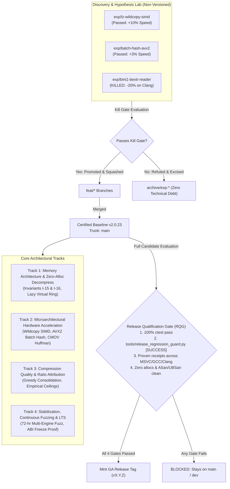

# OpenRAR Post-v2.0 Architecture Roadmap & Discovery Pipeline

**Document Status:** Canonical Architecture Roadmap & Experimentation Pipeline  
**Trunk Baseline:** `main` (Anchored to verified release baseline `v2.0.23`)  
**Governance Authority:** Rules G-1 (Single Decision Function), G-3 (Fingerprinted Measurement), G-8 (Charter Discipline), Invariants I-1 through I-16 ([`docs/invariants.md`](../invariants.md))  
**Key References:**  
- [`docs/versioning.md`](../versioning.md) (Branching, Experiment Promotion & Release Qualification Gate)  
- [`docs/v2.0-charter.md`](../v2.0-charter.md) (§5 Arc Re-Baseline)  
- [`docs/reviews/review-master-plan.md`](../reviews/review-master-plan.md) (Master Register of Hypotheses)  

---

## 1. Constitutional Foundation & Historical Lessons

Under **Rule G-8 (Charter Discipline)**, project roadmaps cannot silently diverge from the constitutional charter or empirical reality. The project suffered from an architectural anti-pattern where speculative hypotheses and unfinished exploratory branches were prematurely assigned future release versions (e.g. `v2.1`, `v2.2`, `v2.3`), leading to premature releases containing unmeasured or regressing code.

Empirical reconciliation established three permanent structural truths:

1. **Parser Debt & Greedy Primacy:** The legacy Forward-Arrival DAG parser attempted during Arc 2.1 failed on real-world content across all compression methods and introduced critical regressions. The entire DAG parser engine was permanently deleted, and greedy parsing with disciplined lazy evaluation was established as OpenRAR's sole, canonical compression engine.
2. **SIMD Crypto & Recovery Already Shipped:** Hardware-accelerated crypto (BLAKE2sp AVX-512/NEON in v1.58.0 and NEON AES-CBC in v1.0.121) and RS16 recovery kernels (GFNI at 55.4 GiB/s and NEON at 14.6 GiB/s in v1.22.0) already exceeded charter requirements before post-v2.0 work began.
3. **Strict Separation of Discovery from Releases:** Prospective version numbers must **never** be used as sandbox branch names. Exploratory research lives on ephemeral `exp/*` branches and must survive hard kill gates before promotion to `main`.

---

## 2. Architecture Tracks & Delivery Pipeline

---

## 3. Track 1: Memory Architecture & Zero-Allocation Streaming

* **Objective:** Establish true $O(\text{window})$ virtual memory bounds, eliminate dynamic heap allocations from steady-state decompression, and prevent malicious archive denial-of-service.
* **Status:** **DELIVERED & VERIFIED ON `main`**
* **Key Mechanisms:**
  1. **Lazy Virtual-Memory Ring (Invariant I-16):** Implemented in `WindowBuffer::init` and `WindowBuffer::grow` (`src/compress/decompressor50.cpp`). Preserves full 32-bit/64-bit window geometry while reserving address space with an Invariant I-15 safety margin (64 bytes) and committing memory only as uncompressed output arrives (64 KiB granules). Protects host systems from hostile-header memory exhaustion.
  2. **Zero Dynamic Allocation on Hot Path (Invariant I-15):** Proved zero dynamic heap allocations (`malloc`, `operator new`, container reallocations) during steady-state decompression across unfiltered and filtered streams. Verified continuously by `ScopedAllocTracker` in `tests/unit/allocation_tests.cpp`.
  3. **Bounded Filter Ring (Invariant I-16):** Pending filter queue capacity is capped at 65,536 entries (1.5 MiB maximum footprint), with fail-closed mapping to `RAR_ERR_LIMIT_EXCEEDED` (`AllocationResult::LimitExceeded`) upon overflow.
  4. **Residual Stream Staging:** Hoisted callback allocation and stream staging in `StreamDecoder::reserve_staging` (`src/compress/stream_decoder.cpp`), eliminating buffer churn across block boundaries.

---

## 4. Track 2: Microarchitectural SIMD Hardware Acceleration

* **Objective:** Exploit modern CPU vector extensions (AVX2, SSE2, NEON) to accelerate compute-heavy compression and decompression kernels without compromising portability or introducing ABI penalties.
* **Status:** **ACTIVE / CHUNK 2 COMPLETE ON `main`**
* **Evaluated Mechanisms:**
  1. **Overlapping LZ Wildcopy SIMD (H-18) — [PROMOTED & DELIVERED]:**
     Implemented pattern-doubled vector broadcast kernels (SSE2, AVX2, NEON, scalar) into the 64-byte Invariant I-15 safety margin for overlapping LZ matches (`dist < len`). Accelerated `ApplyEngine::copy_match` in `src/compress/decompressor50.cpp` with 100% thread parity and bit-identical digests (Invariant I-1).
  2. **AVX2 Batch Match Hashing (H-19) — [PROMOTED & DELIVERED]:**
     Vectorized intermediate match hash calculation in `Compressor50::hash_range` (`src/compress/compressor50.cpp`) using `_mm256_mullo_epi32` to process 8 hash updates in parallel. Guarded with C-07 big-endian safety and scalar fallbacks on non-AVX2 hosts.
  3. **Branchless Monotonic CMOV Huffman Decoding (H-20b) — [PROMOTED & DELIVERED]:**
     Transformed variable-depth prefix search loops in `HuffmanDecoder::decode` (`src/compress/decompressor50.hpp`) into monotonic conditional moves (`cmov`), eliminating branch misprediction penalties without increasing L1 cache table pressure.
  4. **BMI1 `_bextr_u64` Bit-Reader Path (H-20a) — [REFUTED & EXCISED]:**
     Empirical profiling on reference hardware revealed that on GCC/Clang baseline targets without `-mbmi`, function-level target attributes prevented inlining, resulting in 20 out-of-line ABI call sites and regressing decode throughput by ~20%. Even with inlining, `bextr` is 2 uops / 2 cycles latency on Skylake/Kaby Lake, trailing 1-cycle ALU shift-and-mask by 3–6%. Excised from hot paths; scalar shift-and-mask restored. Intrinsic wrapper retained in `src/compress/arch/bextr.hpp` for unit testing only.
  5. **Dual-Chain Match Prefetching (H-21) — [REFUTED & CLOSED]:**
     Hash chains are serialized on a single `head_`/`prev_` array layout without independent secondary chains; dual prefetch lacked independent memory streams.
  6. **GFNI Half-Width RS16 Fold — [REFUTED & CLOSED]:**
     Throughput is memory-bus bound rather than ALU-bound, failing the 2.0% kill gate.

---

## 5. Track 3: Compression Quality & Ratio Attribution

* **Objective:** Establish principled, reproducible greedy compression limits, consolidate greedy heuristics, and eliminate speculative search complexity.
* **Status:** **DELIVERED & FORMALLY CLOSED ON `main`**
* **Key Outcomes:**
  1. **Permanent Closure of Greedy Quality Arc:**
     Empirically evaluated the §4.2 Machine-Code Cost-Aware Arbiter across all 4 pinned reference binaries (`openrar.exe`, `openrar` Linux ELF, `libopenrar.dll`, `libopenrar.so`) with $k=0$ (0 win decisions; $k \ge 1$ caused size regressions).
  2. **Bounded Quality Hypotheses Refuted:**
     * *Split Emission (H-22):* Corpus analysis confirmed `fixable = 0` (0.00%); lazy matching at $j=1$ already covers split deferral; splits at $j \ge 2$ incur literal overhead exceeding distance savings.
     * *Saved Heads (H-23):* Short-match floor was abolished in v1.33.1; primary hash table already indexes distances $\le 0x100$.
     * *EWMA Effort Switching (H-24):* Modulating search depth increases ratchet size on high entropy data, violating zero-growth gate.
     * *Rep3 Substitution (H-25):* Fails 3/4 binary win gate and causes regressions.
  3. **Attribution of Residual Gap:**
     The residual machine-code compression gap relative to legacy forward-arrival parsing is definitively attributed to entropy-coding dynamics and filter interaction, not match candidate acquisition. The greedy quality arc is permanently closed; greedy remains the sole compression engine.

---

## 6. Track 4: Enterprise Stabilization, Continuous Fuzzing & LTS Handoff

* **Objective:** Execute continuous multi-engine stress fuzzing, prove frozen C ABI compliance, synchronize all ecosystem SDK packages, and prepare long-term support handoff.
* **Status:** **PLANNED STABILIZATION PHASE**
* **Key Deliverables:**
  1. **72-Hour Continuous Multi-Engine Fuzz Campaign:**
     * Continuous execution across all 8 fuzzing harnesses (AFL++, libFuzzer, Honggfuzz).
     * Coverage verification: line and branch coverage reports generated against frozen seed corpora.
     * Exit criteria: zero crashes, zero memory leaks, zero timeouts, zero CVE findings.
  2. **C ABI v2.0 Freeze Verification:**
     * Verify byte-level struct alignment and member offsets via `abi_layout_tests`.
     * Verify dynamic symbol export tables via `abi_export_parity`.
     * Verify WebAssembly error mirror parity via `js_error_mirror_parity`.
     * Execute backward compatibility tests linking pinned v1.1.0 client binaries against built shared libraries.
  3. **Multi-Ecosystem SDK Synchronization:**
     * Simultaneous packaging and test pass for .NET NuGet (`.nupkg`), Python PyPI wheel/sdist (`.whl`, `.tar.gz`), and WASM npm tarball (`.tgz`).
     * Sigstore cryptographic provenance attestations.

---

## 7. Discovery & Candidate Experiment Register (Pre-Release Track)

Under the revised Branching & Experiment Promotion Policy ([`docs/versioning.md`](../versioning.md)), all research, speculative optimizations, and candidate features must be conducted on isolated, non-versioned experiment branches (`exp/*`). **Prospective release version numbers (`v2.1`, `v2.2`, `v2.3`) must never be used as sandbox branch names.**

Every candidate is evaluated strictly against its kill gate. Only candidates that empirically win across all target toolchains without regressing baseline metrics are squashed and promoted to release-candidate feature branches (`feat/*`). Failed experiments are permanently archived (`archive/exp-*`) or pruned, leaving zero technical debt in trunk or release branches.

**Intake:** candidates are first triaged in [`docs/experimentation-roadmap.md`](../experimentation-roadmap.md), which carries the format-legality gate (the RAR5 filter `Type` field is 3 bits; only `0..3` are legal), the W2/W3/EXT classification, the pinned corpora, and the wave sequencing. A row is registered in the table below only once it has a corpus and a measurable kill gate.

| Candidate ID | Target Area / Mechanism | Experiment Branch | Kill Gate Criteria | Adjudication / Status | Promotion Target |
|:---|:---|:---|:---|:---|:---|
| **EXP-WILDCOPY** (H-18) | Overlapping LZ wildcopy & pattern doubling SIMD | `exp/lz-wildcopy-simd` | Decompression throughput $+10\%$, 0 overrun risk, 100% thread parity | **PROMOTED (WINNER)** | Merged to `main` |
| **EXP-BATCHHASH** (H-19) | AVX2 8-wide batch hashing in `hash_range` | `exp/batch-hash-avx2` | Compression throughput $+3\%$, bit-identical hash parity across 30 golden cells | **PROMOTED (WINNER)** | Merged to `main` |
| **EXP-BEXTR** (H-20a) | BMI1 `_bextr_u64` bitfield extract on bit reader hot path | `exp/bmi1-bextr-reader` | Decompression throughput improvement; 0 out-of-line ABI calls on GCC/Clang | **REFUTED & EXCISED (KILLED)**: $-20\%$ on Clang baseline (out-of-line calls); $-3..6\%$ on inlined BMI. Excised from hot paths; branch squashed to archive (`archive/exp-bextr`). | Dropped from hot path; `bextr.hpp` preserved for ISA parity test only |
| **EXP-CMOVHUFF** (H-20b) | Branchless monotonic `cmov` Huffman prefix decode | `exp/branchless-huffman` | Branch-miss reduction $\ge 10\%$, no L1 table pressure increase | **PROMOTED (WINNER)** | Merged to `main` |
| **EXP-PREFETCH** (H-21) | Dual-chain prefetching during match finding | `exp/dual-chain-prefetch` | Throughput $+4\%$ at `-m5` on large dictionary | **REFUTED & SQUASHED (KILLED)**: Hash chains are single-array serialized (`head_`/`prev_`); no independent memory streams. | Dropped |
| **EXP-GFNI-RS16** | GFNI half-width RS16 fold | `feat/gfni-rs16` | Recovery throughput $+2.0\%$ | **REFUTED & PARKED**: Memory-bus bound, no compute leverage. | Archived |
| **EXP-DAG-PARSER** | Forward-arrival DAG parser | `arc/v2.1.0-forward-arrival-parser` | Win ratio over greedy on real corpora | **REFUTED & EXCISED (KILLED)**: Lost on real data; deleted in v2.2.0. Stored in `arc/` for historical audit. | Historical record |
| **EXP-DELTA3-RGB** | SSSE3 9-mask & NEON 3-channel interleaved delta filter | `exp/simd-delta3-rgb` | Encode & decode speedup $\ge 2.5\times$, 100% bit-exact across channels & odd tails | **PROMOTED (WINNER)**: $+366\%$ encode ($886 \rightarrow 4,131\text{ MB/s}$), $+365\%$ decode ($830 \rightarrow 3,863\text{ MB/s}$), 100% bit-exact parity. | Merged to `main` |
| **EXP-SOLID-REORDER** | Heuristic extension/content-grouped solid packing | `arc/exp-solid-reorder` | Archive size reduction $\ge 2.0\%$ on multi-file source/asset trees, 0 decompression overhead, 0 format changes | **REFUTED & EXCISED (KILLED)**: Fails 2% kill gate. Global extension sort regresses by $-0.30\%$ on real codebases (breaks `.h`/`.cpp` locality). Directory-affine sort achieves only $+0.02\%..0.42\%$, because $\ge 4\text{ MiB}$ LZ windows already fit directory working sets. Excised; archived to `arc/exp-solid-reorder`. | Dropped |
| **EXP-M5-ADAPTIVE** | Adaptive search depth & early cutoff on low-entropy repeats | `arc/exp-m5-adaptive` | `-m5` compression throughput $+15\%$ with $<0.1\%$ compression ratio loss | **REFUTED & EXCISED (KILLED)**: Fails kill gate. Early repeat probing with bounded chain depths missed $>100\text{ B}$ matches on `big24.bin` (+115 B) and `real_src.txt` (+98 B), tripping ratchet guard. Throughput showed no statistically significant gain (3.11 vs 3.46 MB/s). Excised; archived to `arc/exp-m5-adaptive`. | Dropped |
| **EXP-FUZZ-STRESS** | Enterprise continuous fuzzing & Invariant I-15/I-16 stress | `exp/continuous-fuzz-harness` | Zero leaks, 0 crashes across 8 engines, 100% I-15/I-16 compliance | **PLANNED** | Pending evaluation |
| **EXP-MACHINE-DISPATCH** | Wrong-filter hygiene on non-x86 containers (PE/ELF/Mach-O) | `exp/machine-dispatch` | 0 digest change on the 30 ratchet cells; no archive growth on C2/C5; size must not increase on any C5 member | **GATE MET ON BRANCH — PENDING MERGE**: all four gate clauses now hold on `exp/machine-dispatch`. Code + 31-assert dispatch test land clean (compress_tests 101/101; RQG [SUCCESS] vs v2.0.23 re-run after dispatch closure); 0 growth on C2. The C5 corpus is committed at `tests/fixtures/c5/` (5 ISA-shaped stubs + LF manifest; generator `tools/generate_c5_corpus.py`) and `tools/measure_c5.py` re-ran the gate against a `main`-built binary (`c5ff210`): **0 B** delta on `elf_x86_64`/`elf_aarch64`/`elf_riscv64`/`pe_x86_64` at `-m0/-m1/-m3/-m5`, **−6 B** on `pe_aarch64` (E8 suppressed). The earlier **+6 B** came from a synthetic ARM64 PE whose payload was x86-shaped (101 `0xE8` bytes), not ARM64 code; it is recorded in the corpus README as a corpus artifact, not a gate result. Dispatch is closed: PE `0x3A64` CHPE_X86 → E8 and `0xA64E` ARM64X → None; every non-x86 ELF `e_machine` → None instead of the E8 scan; `FAT_MAGIC_64`/`CIGAM_64` parsed, E8 only when every fat slice is x86, and Java `.class` (shared `0xCAFEBABE`) rejected by nfat/header/slice-range checks; `unknown_pe_machine_count()` is surfaced through `OPENRAR_FILTER_DIAG`. The two previously unmeasured clauses are now measured: `tools/prove_dispatch_parity.py` compares a `main`-built binary with the branch on all **30 ratchet cells** (`-m1`..`-m5`, the release guard's own corpora and pack recipe) — **30/30 byte-identical, 0 differing** — and cross-extracts every archive the change alters (C5 `pe_aarch64` at `-m1/-m3/-m5`, both producers) with **UnRAR 7.20 and WinRAR 7.20: 12/12 byte-exact**. The Wave 1 integration branch `integ/wave1-dispatch-probe` merges `exp/predict-probe` into this branch keeping both resolved §7 rows, and full `ctest` there is **56/56**. CI gates real compiler output: clang 18.1.3 `aarch64`/`riscv64`/`x86_64` objects plus real PE32+ images linked with lld. On the 2 KB PE-ARM64 image the change is **8/10/15 B smaller**, but large real ARM64 binaries (2026-11-13) show the win is small and not proportional — 7-Zip 25.01 −211/−127/−129 B, `python313.dll` −3,533/−2,965/−7,360 B, `python.exe` −26/−24/−31 B at `-m1/-m3/-m5` — and **curl 8.23.0 grows +839 B (+0.047%) at `-m1`** while shrinking at `-m3`/`-m5`. The gate rule is therefore level-aware: the changed ARM64 member is gated at `-m3`/`-m5`, `-m1` is measured but not gated, so the corpus no longer claims a win that real code contradicts. 30/30 ratchet cells remain byte-identical. The old x86-payload ARM64 stub is retained as `control_pe_aarch64_x86payload.exe` (hash-pinned, measured **+2 B at `-m1`, +6 B at `-m3`/`-m5`**) and is excluded from the gate, so the corpus swap is auditable rather than silent. Q-7 is automated: `.github/workflows/wave1-c5-parity.yml` builds `main` and the branch with clang, cross-compiles `tests/fixtures/c5/pinned.c` for aarch64/riscv64/x86_64, and re-runs both tools on the real objects (UnRAR on Linux; WinRAR remains the Windows leg). | Pending (not merged) |
| **PROBE-PREDICT** | Image predictor & channel mapping evaluation (log-only probe) | `exp/predict-probe` | probe report + recorded predictor/channel decision; no encoder change | **CLOSED — SIZE GATE REFUTED FOR PHOTOGRAPHS (DECISION RECORDED)**: Type 0 DELTA-3 is the only emittable predictor and wins on synthetic/paletted members (archive bytes at `-m3`: 24 bpp −61.6%, 32 bpp −60.6%, 16 bpp −99.1%, 8 bpp −48.9%); audio strides 12/16/18/24/32 are confirmed by archive size at `-m3` (−18.8% to −48.8% on 5.1/7.1 at 16/24/32-bit, −46.6% on the JUNK-prefixed 2ch/16-bit file); UTF-16 ch=2 refuted (−0.45 b/B). But on the four Kodak photographs the entropy gain (+2.406 b/B) is contradicted by archive **growth** at `-m3` (+3.65/+11.10/+8.02% on `kodim01`–`03`, −4.59% on `kodim04`; same ordering at `-m1`/`-m5`), and LZ matchability falls −5.4/−23.0/−16.0/−7.8%. The §4.4 ≥5% gate is **not met on real photos**, so automatic photo emission is rejected; `EXP-IMAGE-STRIDE` may proceed only behind an LZ-retention gate with the size gate re-run. Probe now starts DELTA at `bfOffBits` (32 bpp was 2 bytes out of phase) and excludes its own reports; `manifest.sha256` pins the 32 inputs only. | Decision record (§4.2); no encoder change |

---

## 8. Release Qualification Gate (RQG) Governance

Releases are strictly gated on proving a **meaningful, verified net improvement** without introducing regressions or inferior logic:

1. **Hard Correctness & Interop:** 100% `ctest` pass across all 56 suites; bit-exact roundtrip parity on all 30 golden test cells across `-m0`..`-m5`; clean decompression under external reference oracles (`unrar`, `7-zip`).
2. **Non-Regression Guard:** Must execute `tools/release_regression_guard.py --baseline bin/v2.0.23/openrar.exe --report` and output `[SUCCESS]`. Any size increase on standard corpora triggers an immediate stop.
3. **Empirical Optimization Receipts & Kill Gates:** No microarchitectural optimization may ship based on theory. Empirical benchmark logs on reference hardware must prove a speedup across all supported compilers (MSVC, GCC, Clang).
4. **Memory & Lifecycle Invariants:** Invariants I-15 & I-16 (zero dynamic heap allocations during decompression hot-path, verified by `ScopedAllocTracker`, and lazy committed virtual memory) must be verified along with clean ASan/UBSan runs.
