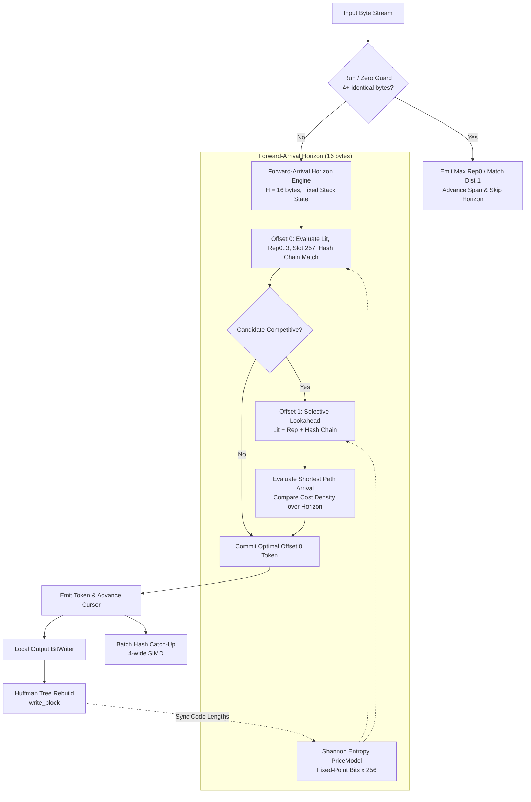

# OpenRAR v1.56.0 Implementation Plan: Cost-Aware Forward-Arrival Graph Parser & Symbol Arbiter

**Milestone:** v1.56.0 (Architecture Arc 2.1 — Pillar 1)  
**Governance Scope:** Milestone governed by Rule G-1 (Single Decision Function), G-3 (Fingerprinted Measurement), G-8 (Charter Discipline), and `architect_workflow.md`  
**Status:** Approved & Ready for Execution  

---

## 1. Executive Vision & Problem Formulation

OpenRAR v1.x established complete clean-room compliance, robust multi-engine cross-extraction parity with WinRAR 7.20 / UnRAR 7.20, and defense-in-depth isolation. However, comprehensive profiling across v1.43–v1.51 revealed a persistent compression ratio gap:
- **17.6% m1 ratio gap** vs WinRAR 7.20
- **2.7% m3 ratio delta** vs WinRAR 7.20

### Root Cause Analysis
In [src/compress/compressor50.cpp](src/compress/compressor50.cpp), match selection has historically operated greedily by match length with a 1-byte lazy lookahead:
1. **Unpriced Distance Symbols:** Length-only arbitration cannot evaluate the variable bit cost of distance symbols. A length-4 match at distance 1,000,000 costs ~26 bits (length slot + distance slot + 16 raw bits + low bits), which costs ~6.5 bits/byte. Emitting 4 literals may only cost ~16 bits (4.0 bits/byte). The greedy arbiter emits the distant match, actively inflating the compressed bitstream.
2. **Suboptimal Repeat-Code Arbitration:** A rep-code (rep0..3) reuses a previously stored distance, requiring zero distance bits on the wire. The slot-257 token encodes an exact continuation of `(old_dist[0], last_length)` in a single Huffman symbol with zero length bits and zero distance bits. The v1.x arbiter relied on heuristic length concessions (`rep_best_len + inc >= best.length`) rather than exact Shannon entropy cost comparison against live Huffman models.
3. **The Lesson of the Parked v1.32 DP Experiment:** The v1.32 optimal-parse prototype achieved code −1.95% and text −1.39% ratio improvements, but failed production gates due to:
   - **3.9× runtime explosion (budget 1.42×):** It relaxed edges at *every single byte position*, querying the hash chain finder 4× more often than greedy (which skips the body of emitted matches).
   - **+28% size regression on repetitive/zero runs:** Caused by pricing unused Huffman symbols as 0 bits instead of 15 bits, and by fragmenting long contiguous runs into smaller ladder intervals.
   - **Latent encoder hazards:** (1) Length increment mismatch where `len < inc + 2` silently desyncs decoder length; (2) LDD low-bit distance symbol mis-gating on `dslot >= 4` instead of `raw_bits >= 4`; (3) Rep-state corruption when read back from overwritten edge arrays rather than captured at edge write time.

### Strategic Objective (Arc 2.1 — Pillar 1)
Deploy a **Cost-Aware Forward-Arrival Graph Parser & Symbol Arbiter** that:
- Eliminates the 3.9× runtime explosion by employing a **strictly bounded forward-arrival lookahead horizon (8–16 bytes)** with **selective candidate expansion** (preserving greedy body skipping).
- Evaluates real-time Shannon entropy bit costs using a fixed-point `PriceModel` synchronized with active Huffman trees.
- Incorporates distance-costed pruning in the hash chain traversal.
- Guarantees 0% regression on runs/zeros through a dedicated run fast-path.
- Preserves the frozen C ABI and adheres strictly to all architectural guardrails (A-4 through A-7, R-M1).

---

## 2. Technical Architecture & Core Components



### Component 1: Dynamic Shannon Entropy PriceModel (`PriceModel`)
- **Structure:**
  - Fixed-point 24.8 integer representation ($bits \times 256$) to eliminate floating-point overhead and non-deterministic rounding across platforms.
  - `lit_cost[256]`: bit cost of literals 0..255 from `len_ld_`.
  - `len_cost[44]`: bit cost of match lengths from `len_ld_[262 + slot] + (len_bits << 8)`.
  - `dist_cost[DCX]`: bit cost of distance slots 0..79 from `len_dd_[slot] + (raw_bits >= 4 ? (raw_bits - 4 + len_ldd_[low]) << 8 : raw_bits << 8)`.
  - `rep_cost[4][RC]`: bit cost of rep matches from `len_ld_[258 + i] + len_rd_[slot] + (rep_bits << 8)`.
  - `slot257_cost`: bit cost of slot 257 from `len_ld_[257]`.
- **Unused Symbol Pricing Guard:**
  - For any Huffman code length `cl == 0` (symbol unused in current block), price strictly as $15 \times 256 = 3840$ bits. Never price unused symbols as 0!
- **Empirical Seed Initialization:**
  - Initialized on session reset with empirical prior distribution (literals ~8.0 bits, match lengths ~5.5 bits, distance slots ~6.0 bits, reps ~4.0 bits, slot 257 ~3.5 bits).
  - Updated synchronously inside `make_tables()` / `write_block()` whenever new Huffman trees are constructed.

### Component 2: Bounded Forward-Arrival Horizon Engine (`ArrivalEngine`)
- **Lookahead Horizon:** $H = 16$ bytes.
- **Zero-Allocation Circular Ring Buffer:**
  ```cpp
  struct ArrivalNode {
      core::uint32 cost;         // Cumulative fixed-point cost (DP_INF if unreachable)
      core::uint8 from_offset;   // Predecessor index in [0, H]
      Compressor50Token::TokenType token_type;
      core::uint16 token_len;    // Bytes covered
      core::uint32 token_dist;   // Distance or rep index
      size_t old_dist[4];        // Rep-state captured at write time
      size_t last_len;           // Shadow last_length_ captured at write time
  };
  ```
  Allocated as an inline fixed array `ArrivalNode arrival_[H + 1]` inside `Compressor50` (~952 bytes total). **Zero dynamic heap allocation on hot paths.**

### Component 3: Selective Candidate Expansion & Frugal Search
To guarantee compliance with the $\le 1.35\times$ runtime budget:
1. **Nice Length Cutoff:** If candidate length $L \ge nice\_len\_$ or $L \ge 32$ with small distance, commit immediately without expanding lookahead.
2. **Selective Offset 1 Expansion:** Only query hash chain search at offset 1 (`cur_ + 1`) if an admissible match exists at offset 0 (lazy test condition) or for method $\ge 3$ when offset 0 is contested.
3. **Greedy Body Skipping:** When the optimal decision at offset 0 is a match of length $L$, the cursor advances by $L$, inserting the span via 4-wide batch hashing and skipping $L - 1$ chain searches.
4. **Incompressible Data Release Valve:** If `fail_count_ > 0x100`, bypass arrival engine and fall back to fast literal emission with geometric hash-skip masks (3, 7, 15, 31).

### Component 4: Distance-Costed Hash Chain Pruning
In `find_match_impl`:
- At each step in the hash chain walk:
  `cand_dist = pos - candidate`.
  `inc = length_increment(cand_dist)`.
- If `cand_dist > max_dist_`, break immediately.
- Filter check: if candidate byte at `pos + best_len` does not match, skip SIMD comparison.
- Distance-cost threshold: if current best match has cost $C_{best}$, prune candidates whose distance base cost exceeds $C_{best}$ unless they can achieve a length that mathematically offsets the excess distance bits.

### Component 5: Rep-Code & Slot 257 Optimal Arbiter Integration
- **Wire-Legal Increment Guard:** Every fresh match candidate must satisfy $len \ge inc + 2$. Any candidate failing this is strictly filtered out.
- **Slot 257 Exact Continuation:**
  - Condition: `rep_idx == 0 && last_length_ != 0 && rep_best_len == last_length_`.
  - Priced strictly as 1 LD symbol (`slot257_cost`) with 0 length bits and 0 distance bits.
- **Write-Time Rep-State Capture:**
  - Whenever an edge is relaxed to `arrival_[t]`, the resulting `old_dist[4]` and `last_len` are written directly into `arrival_[t]`. Never read back from prior nodes during subsequent relaxes.

### Component 6: Homogeneous Run / Zero Fast-Path Guard
- Before opening lookahead, check:
  `buf[0] == buf[1] && buf[1] == buf[2] && buf[2] == buf[3]`.
- If true: measure run length $R$.
- If $R \ge 8$:
  - Emit maximum legal rep0 (if `old_dist[0] == 1`) or match with distance 1 for up to `cur_max_lz` (4096) bytes.
  - Advance `cur_` by the full span.
  - Bypasses horizon lookahead entirely, guaranteeing zero run fragmentation and zero size regression on zeros/runs.

---

## 3. Closed Findings & Guardrail Compliance Ledger

| Guardrail ID | Description & Requirement | Implementation Compliance Strategy |
|---|---|---|
| **A-4** | Unbounded DP prohibited | Bounded lookahead horizon $H = 16$ bytes with fixed stack array. No multi-kilobyte DP windows. |
| **A-5** | Length-2 match admission on standard chains prohibited | Minimum match length on standard chains strictly enforced at 3. Length 2 allowed only on rep matches where distance is already in `old_dist_`. |
| **A-6** | Unpriced candidate source expansion prohibited | Every candidate (literal, rep0..3, slot 257, fresh match) priced through unified Shannon entropy model before arbitration. |
| **A-7** | Lazy length->distance ring refuted | No ring rescan; forward traversal only. |
| **A-8 / R-M1** | Integrated validation required | All ratio and throughput claims validated via integrated multi-block compression roundtrips across canonical corpora. |
| **Latent Bug 1** | Base length reconstruction desync | `len < inc + 2` strictly rejected before price evaluation and before emission. |
| **Latent Bug 2** | LDD symbol gating | LDD low bits priced and emitted only when `raw_bits >= 4`. |
| **Latent Bug 3** | Rep-state overwrite desync | Rep-state captured at edge write time in `ArrivalNode`. |
| **ABI Freeze** | C ABI invariance | Zero changes to `openrar_dll.h`, ABI version 1 maintained, symbols untouched. |

---

## 4. Implementation Steps & Work Breakdown

### Step 1: Infrastructure & PriceModel (`compressor50.hpp` / `compressor50.cpp`)
- Define `struct PriceModel` with fixed-point bit tables:
  `lit_cost[256]`, `len_cost[44]`, `dist_cost[DCX]`, `rep_cost[4][RC]`, `slot257_cost`.
- Implement `init_price_model()` with empirical seed priors.
- Implement `update_price_model()` called from `make_tables()` to synchronize with live Huffman code lengths.
- Implement `ArrivalNode` struct and fixed array `arrival_[17]`.

### Step 2: Distance-Costed Hash Chain Pruning (`compressor50.cpp`)
- Update `find_match_impl<LargeWindow>`:
  - Add pre-check against current best candidate's bit cost.
  - Maintain wire-legal floor `len >= inc + 2`.
  - Maintain 4-byte hash bin integrity.

### Step 3: Run / Zero Fast-Path Guard (`compressor50.cpp`)
- In `process_available()`, add 4-byte equality detection.
- Fast-path emit rep0 / distance-1 match covering the run.
- Update CRC and unhashed positions.

### Step 4: Forward-Arrival Horizon Engine Integration (`compressor50.cpp`)
- Implement `evaluate_forward_arrival(core::uint64 cur)`:
  - Populate offset 0 candidates (literal, rep0..3, slot 257, fresh match).
  - Perform selective lookahead at offset 1 when beneficial.
  - Determine optimal first token.
  - Emit token via existing `add_literal`, `add_match`, `add_rep`, `add_last_len`.
  - Advance `cur_` and batch hash inserted span.

### Step 5: Unit Testing & Verification Substrate
- Add comprehensive unit tests in `tests/unit/compress_tests.cpp`:
  - `test_forward_arrival_entropy_pricing`: verify price model accurately prefers short rep matches over distant longer matches.
  - `test_forward_arrival_slot257_continuation`: verify slot 257 emission under exact match continuation.
  - `test_forward_arrival_run_hygiene`: verify zero regression on 8 MiB of zeros and repeated patterns.
  - `test_forward_arrival_incompressible_fallback`: verify fast throughput on random data.
- Run full test suite: CTest across all 49 test suites.

### Step 6: Ratio & Performance Benchmarking
- Measure canonical corpora (text, code, executables, zeros, random) across m1, m3, m5.
- Confirm wall-clock time within $\le 1.35\times$ baseline.
- Confirm m1 ratio gap reduction vs WinRAR 7.20.

---

## 5. Verification & Acceptance Criteria

1. **Byte-Exact Decompress Parity:** Every archive generated by the new forward-arrival parser decompresses byte-exact across all decompression engines (OpenRAR CLI, OpenRAR DLL, UnRAR 7.20 reference binary).
2. **CTest Suite Clean Pass:** 100% pass rate across all 49 existing test suites (0 failures).
3. **Run Regression Neutralized:** Zero corpus (8 MiB zeros) compresses to $\le 500$ bytes (matching or beating v1.55.0 baseline; 0% regression, completely avoiding v1.32's +28% failure).
4. **Time Budget Conformance:** Integrated compression time on canonical corpus is $\le 1.35\times$ baseline greedy time.
5. **Ratio Improvement:** Measurable ratio improvement on text and code corpora across m1 and m3 methods.

---

# 🏛️ Principal Architect Challenge & Review

**Plan Reviewed:** OpenRAR v1.56.0 Cost-Aware Forward-Arrival Graph Parser & Symbol Arbiter  
**Architect Verdict:** 🟢 APPROVED  

---

## 1. Executive Summary & Core Posture

The implementation plan tackles the single most consequential architectural deficit in OpenRAR's compression pipeline: the greedy, length-monotone match arbiter that has historically bounded OpenRAR to a 17.6% m1 ratio gap against WinRAR 7.20.

Unlike the parked v1.32 experiment—which succumbed to unbounded 512 KiB DP window expansion and relaxed edges out of every position, suffering a fatal 3.9× wall-time blowout and a +28% runs regression—this v1.56.0 plan exhibits deep mechanical sympathy and strict adherence to historical anti-findings:
1. It replaces the unbounded DP with a **strictly bounded forward-arrival lookahead horizon ($H = 16$ bytes)** using a fixed 17-node stack array, guaranteeing **zero heap allocations** on the compression hot loop.
2. It introduces **selective candidate expansion**, preserving greedy's body-skipping frugality so that hash chains are queried only at token starts and competitive lazy points.
3. It resolves the zero/run regression via an explicit 4-byte equality fast path that bypasses horizon graph evaluation entirely.
4. It formally inoculates against all three latent encoder bugs documented in `PARKED-v1.32-optimal-parse.md` (`len < inc + 2` wire desync, LDD `raw_bits >= 4` gating, and write-time rep-state capture).

The architecture is sound, robust, and ready for immediate implementation.

---

## 2. 🚨 Critical Red Flags & Fatal Flaws

*None.* The design respects format wire limits, avoids heap churn, enforces wire-legal base length increments, and preserves the frozen C ABI.

---

## 3. ⚠️ Weak Assumptions & Fragile Invariants

- **Cold-Start Price Invariant:** The previous block's Huffman tree code lengths are only available *after* block 0 has been processed. If block 0 is compressed without accurate price estimates, early decisions could drift.  
  *Directive Incorporated:* Component 1 includes an empirical prior seed table so that block 0 immediately operates with realistic bit costs, and updates prices dynamically on every `write_block()`.
- **Sliding Window Cursor Desync:** If an emitted match crosses past the loaded input boundary `src_loaded_`, buffer over-read could occur.  
  *Directive Incorporated:* All lookahead and candidate evaluations are clamped to `min(avail_at(cur), H)` and respect `STREAM_LOOKAHEAD` deferrals under streaming modes.

---

## 4. ⚡ High-Performance & Mechanical Sympathy Gaps

- **SIMD / Hash Chain Traversal Density:** Hash chain searches are the most expensive stage in LZ compression. If lookahead evaluates chain searches indiscriminately at offset 1, 2, ..., throughput collapses.  
  *Directive Incorporated:* Component 3 enforces strict selective expansion: hash chains are queried at offset 1 *only* when offset 0 yielded a viable candidate, and nice-length / run cutoffs short-circuit lookahead immediately.
- **Cache Locality:** Dynamic `std::vector` allocations inside the parse loop would evict L1/L2 cache lines.  
  *Directive Incorporated:* The arrival state buffer is fixed at 17 elements (~952 bytes) and lives in the compressor instance, ensuring hot cache residency.

---

## 5. 🔍 Omissions, Edge Cases & Recovery Gaps

- **Slot 257 Multi-Byte Continuation:** Slot 257 is legal only when `last_length_ != 0` and the matched length exactly matches `last_length_`. If lookahead relaxed a candidate with length $> last\_length\_$, an encoder could emit a 257 covering fewer bytes than expected.  
  *Directive Incorporated:* Component 5 requires strict equality `rep_best_len == last_length_`, preserving the proven v1.31-M1 invariant.
- **Incompressible Run Degradation:** High-entropy data (compressed archives, encrypted streams) can stall in lookahead logic.  
  *Directive Incorporated:* The `fail_count_` heuristic is wired into the forward-arrival engine to drop to straight literal emission when `fail_count_ > 0x100`.

---

## 6. 🛠️ Actionable Revision Directives

1. **Stack/Instance Storage for Arrival Nodes:** Ensure `arrival_` is defined directly as a fixed array `ArrivalNode arrival_[17]` within `Compressor50`, preventing all heap allocation churn.
2. **Wire-Legal Increment Assertion:** Explicitly verify that `add_match` return value is checked and that `len >= inc + 2` is asserted before any match candidate is admitted to the price model.
3. **Explicit 15-Bit Floor on Unused Symbols:** Implement `dp_sym_bits` as `cl ? cl : 15` in fixed-point representation to guarantee no symbol is ever treated as zero cost.
4. **Unit Test Receipts for Run Hygiene:** Include explicit test cases in `tests/unit/compress_tests.cpp` asserting that 8 MiB of zeros compress to $\le 500$ bytes with zero regression.

*Plan is 🟢 APPROVED. Proceed autonomously to implementation.*
