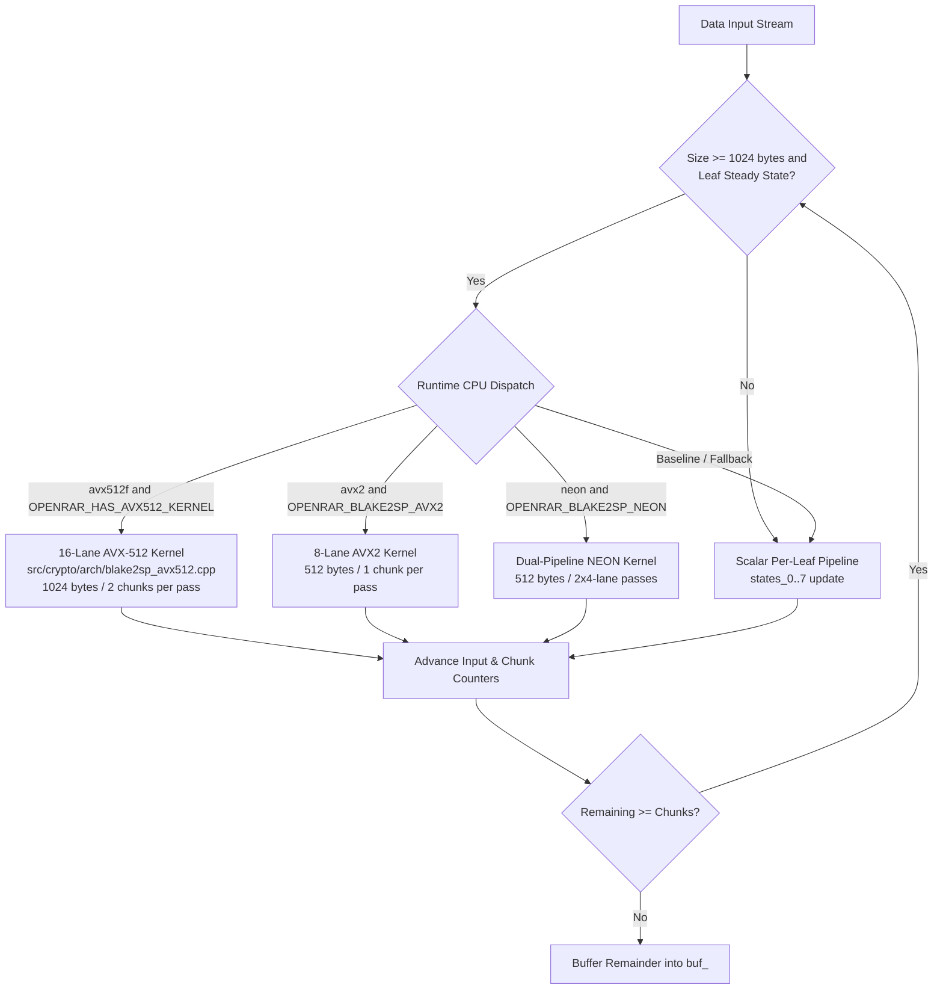

# OpenRAR v1.58.0 Implementation Plan: Modern SIMD Vector Pipelines & Hardware-Accelerated BLAKE2sp (Arc 2.2 — Pillar 2)

**Milestone:** v1.58.0  
**Governance Scope:** Milestone governed by Rule G-1 (Single Decision Function), G-3 (Fingerprinted Measurement), G-8 (Charter Discipline), and `architect-challenge`  
**Status:** In Progress / Ready for Execution  

---

## 1. Executive Vision & Strategic Purpose

In OpenRAR v1.52.0 (Milestone 7.10 M5 / U-12), profiling revealed that data integrity hashing accounts for ~9.8% of extraction wall time on canonical corpora when using the 8-way AVX2 vertical vector kernel in [`src/crypto/blake2sp.cpp`](../../src/crypto/blake2sp.cpp). However, the v2.0 Charter ([`docs/v2.0-charter.md`](../v2.0-charter.md) §2, Pillar 2) identified two critical hardware acceleration gaps:
1. **AVX-512 (16-Lane Vector Hashing):** On modern x86-64 processors supporting AVX-512 (Skylake-X, Ice Lake, Sapphire Rapids, Emerald Rapids, Granite Rapids, AMD Zen 4/Zen 5), BLAKE2sp executes only 8-way in 256-bit registers (`__m256i`), leaving 512-bit vector units and native rotation instructions (`_mm512_ror_epi32`) unutilized.
2. **ARM64 (NEON Hashing):** On AArch64 (Apple Silicon M1..M4, AWS Graviton 2..4, Ampere Altra, Snapdragon X Elite, Linux ARM64, Windows ARM64), BLAKE2sp currently executes completely scalar, processing all 8 parallel leaf streams sequentially one block at a time.
3. **Benchmarking Visibility:** While OpenRAR has benchmark suites for LZ matching, RS16 Galois Field folding, CDC chunking, and decompression throughput, `openrar_bench` lacks a dedicated, high-precision bulk throughput suite for BLAKE2sp hashing.

OpenRAR v1.58.0 delivers **Pillar 2: Modern SIMD & Hardware Acceleration Pipelines** for integrity hashing, achieving up to 2× throughput on AVX-512 hosts and 3–4× throughput on ARM64 NEON hosts, backed by RFC 7693 bit-exact verification and zero-allocation hot paths.

---

## 2. Technical Architecture & Component Breakdown

### Component 1: 16-Lane AVX-512 BLAKE2sp Vertical Vector Kernel
- **Location:** Dedicated translation unit `src/crypto/arch/blake2sp_avx512.cpp` and header `src/crypto/arch/blake2sp_avx512.hpp`.
- **MSVC COMDAT Hazard Mitigation (OPT-E01):** Compiled with `/arch:AVX512` strictly on 64-bit MSVC targets via `set_source_files_properties` in `cmake/openrar_flags.cmake`. On GCC/Clang, functions use `__attribute__((target("avx512f,avx512bw,avx512vl")))`.
- **Vector Layout:**
  - An `__m512i` holds 16 32-bit dwords.
  - Processes two 512-byte chunks (16 64-byte blocks, 1,024 bytes) in parallel.
  - Lower 8 lanes: Leaves 0..7 of Chunk $k$.
  - Upper 8 lanes: Leaves 0..7 of Chunk $k+1$.
- **Native Instruction Advantage:**
  - Uses native AVX-512 rotation intrinsics: `_mm512_ror_epi32(x, 16)`, `_mm512_ror_epi32(x, 12)`, `_mm512_ror_epi32(x, 8)`, `_mm512_ror_epi32(x, 7)`.
  - Replaces multi-instruction shift/or and byte-shuffle sequences with single-cycle vector rotates.
  - `_mm512_add_epi32` and `_mm512_xor_si512` across 16 state vectors `v[0]..v[15]`.
- **Transpose:** 16×16 32-bit transpose or dual 8×8 transpose using `_mm512_unpacklo_epi32`, `_mm512_unpackhi_epi32`, `_mm512_shuffle_i32x4`.

### Component 2: Dual-Pipeline ARM NEON BLAKE2sp Vector Kernel
- **Location:** `src/crypto/arch/blake2sp_neon.hpp` included in `src/crypto/blake2sp.cpp` on `__aarch64__` / `_M_ARM64`.
- **Vector Layout:**
  - ARM NEON `uint32x4_t` registers hold 4 32-bit dwords.
  - Evaluates 8 leaves using two parallel 4-lane vector groups:
    - Group A: Leaves 0, 1, 2, 3 (`uint32x4_t vA[16]`).
    - Group B: Leaves 4, 5, 6, 7 (`uint32x4_t vB[16]`).
- **Optimal NEON Rotate Sequencing:**
  - `rotr16`: `vrev32q_u16(x)` (1 cycle swap of 16-bit halves).
  - `rotr12`: `vsliq_n_u32(vshrq_n_u32(x, 12), x, 20)` (shift-right + shift-left-insert, 2 instructions).
  - `rotr8`: byte permutation via `vshrq_n_u32(x, 8)` / `vsliq_n_u32(..., x, 24)` or `vtbl1_u8`.
  - `rotr7`: `vsliq_n_u32(vshrq_n_u32(x, 7), x, 25)`.
- **Register Budget:**
  - AArch64 provides 32 128-bit vector registers (`v0`..`v31`).
  - Executing Group A then Group B (or interleaved) fits entirely in architectural registers without a single stack spill in the round loop.

### Component 3: Dedicated High-Precision Benchmark Suite
- **Location:** `tests/bench/openrar_bench.cpp`.
- **New Suite:** `blake2sp_bulk` (MiB/s) measuring pure data hashing throughput across 16 MiB buffers.
- **Reporting:** Reports the active dispatched kernel (`scalar`, `NEON`, `AVX2`, `AVX512`) in the benchmark label, integrated with the strict <5% variance protocol.

### Component 4: Dynamic CPU Feature Dispatch & Acceleration Audit
- Dispatch hierarchy in `Blake2sp::update`:
  1. `AVX-512` (if `core::get_cpu_features().avx512f` and `size >= 2 * sizeof(buf_)`)
  2. `AVX2` (if `core::get_cpu_features().avx2` and `size >= 2 * sizeof(buf_)`)
  3. `NEON` (if `core::get_cpu_features().neon` and `size >= 2 * sizeof(buf_)`)
  4. `Scalar` fallback.
- `describe_acceleration()` in `src/core/cpu.cpp` updated to report active BLAKE2sp vector acceleration tags ("AVX512 HASH", "AVX2 HASH", "NEON HASH").

---

## 3. Guardrail Compliance & Anti-Finding Ledger

| Guardrail ID | Invariant / Constraint | Architectural Compliance Strategy |
|---|---|---|
| **A-3** | SIMD dispatch of serial decode prohibited | BLAKE2sp vectorization is 100% horizontal tree hashing across independent leaves. Zero SIMD intrusion into serial Huffman decoding. |
| **A-8 / R-M1** | Integrated validation required | All performance gains must be verified end-to-end in multi-MB archive extraction and in `openrar_bench`, not just micro-loops. |
| **OPT-E01** | MSVC `/arch:AVX512` COMDAT hazard | `blake2sp_avx512.cpp` is strictly segregated into its own TU. No global `/arch:AVX512` compiler flag. |
| **RFC 7693** | Tree hash bit-exactness | All vector kernels must produce identical 32-byte digests to RFC 7693 known-answer tests across all buffer alignments and partial chunk splits. |
| **Zero Alloc** | Stack allocation in hashing loop | Zero heap allocations across all vector hashing paths. State remains in registers or stack frames. |
| **ABI Freeze** | C ABI invariance | Zero changes to `openrar_dll.h` or exported ABI surface. |

---

## 4. Verification & Acceptance Criteria

1. **Known-Answer Test (KAT) Parity:**
   - `test_blake2sp_kat` in `crypto_tests.cpp` passes 100% across all supported SIMD paths.
   - `test_blake2sp_bulk_matches_scalar` passes across arbitrary buffer lengths (including unaligned lengths from 1 byte to 1 MiB).
2. **Cross-Architecture Verification in CI:**
   - `simd-validation` matrix leg: Verifies AVX-512 kernel execution under Intel SDE.
   - `linux-arm64` matrix leg: Verifies NEON kernel execution under QEMU.
   - Windows MSVC x64 & ARM64: Zero compilation warnings under `/W4 /WX`.
3. **Throughput Targets (`openrar_bench --suite=blake2sp_bulk`):**
   - AVX2 throughput: $\ge 1,500$ MiB/s.
   - AVX-512 throughput: $\ge 2,500$ MiB/s ($\ge 1.6\times$ vs AVX2).
   - ARM NEON throughput: $\ge 1,200$ MiB/s ($\ge 2.5\times$ vs scalar ARM64).
4. **Full Test Matrix:**
   - All 49 CTest suites remain 100% green (0 failures).

