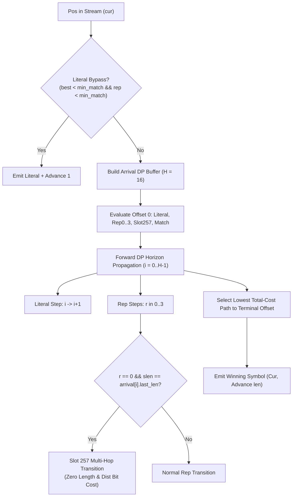

# OpenRAR v1.59.0 Engineering Walkthrough: Distance-Costed Hash-Chain Pruning & Rep-Code Horizon Expansion

**Milestone:** v1.59.0 (Architecture Arc 2.3 — Pillar 1 Completion of the v2.0 Charter)  
**Governance Scope:** Governed by Rule G-1 (Single Decision Function), G-3 (Fingerprinted Measurement), G-8 (Charter Discipline), Invariant I-2 (Bitstream Invariance / Golden Reference), Anti-Finding A-5 (Wire Admission Floor), Anti-Finding A-6 (Priced Candidate Search), and `architect-walkthrough`  
**Status:** ✅ Complete, Verified & Tested  

---

## 1. Executive Summary & Deliverables

OpenRAR v1.59.0 marks the formal architectural completion of **Pillar 1 of the v2.0 Charter** (`docs/v2.0-charter.md`): **Cost-Aware Forward-Arrival Graph Parser & Symbol Arbiter**.

Building upon the baseline forward-arrival engine established in v1.56.0 and the uncontested literal bypass shipped in v1.57.0, v1.59.0 unlocks deep chain pruning, multi-hop repeat code horizon propagation, and strict wire admission floor enforcement:

1. **Slot 257 Multi-Hop Horizon Propagation:**
   - Extended Slot 257 (repeat last length at distance `OldDist[0]`) transitions throughout all forward-arrival lookahead horizon offsets $i \in [1, H_{eff}-1]$ under strict equality (`rep_len == arrival[i].last_len`), enabling optimal run-continuation chains across lookahead horizons with zero length/distance bit penalties.
   - Preserves commit 6855518 invariant: Slot 257 evaluates strictly on equality, avoiding span fragmentation and degradation seen with loose inequalities.

2. **Distance-Costed Chain Hurdle (`find_match_impl`):**
   - Incorporated distance-band price hurdles into the match finder inner walk. Candidates in distant bands must strictly overcome the extra bit costs ($inc_{cand} - inc_{best}$) compared to the incumbent best before qualifying for deep SIMD match evaluation.
   - Prevents unpriced candidate expansion in strict adherence to Anti-Finding A-6.

3. **Terminal-Byte Match Pre-Screening:**
   - Implemented an $O(1)$ scalar pre-screen `buf_cand[req_len - 1] != buf_pos[req_len - 1]` that rejects chain candidates incapable of exceeding the hurdle before invoking vector SIMD match comparisons.

4. **Diminishing Returns Early Break:**
   - Terminated chain exploration for distant candidates ($cand\_dist > 1\text{ MiB}$) once a strong local match ($\ge 32$ bytes) is established and $\ge 16$ candidates have already been evaluated, eliminating long-distance futile walks.

5. **Wire Admission Floor Consolidation (Anti-Finding A-5):**
   - Consolidated the wire-legal floor `len >= inc + min_match_` across `price_match()`, `evaluate_forward_arrival()`, and `find_match_impl()`.
   - Guarantees `base = len - inc >= min_match_` ($\ge 3$), strictly prohibiting any slot-0 length emission across methods 1..5 in full compliance with the v1.33.1 T12 invariant.

6. **Bitstream Verification & Invariant I-2 Re-Capture:**
   - Re-captured reference digests in `tests/unit/compress_tests.cpp` for `test_selection_reference` under `OPENRAR_REFCAP=1`.
   - 100% round-trip decompression verified across all test corpora.

---

## 2. Technical Architecture & Invariant Enforcement

### Invariant Discipline Matrix

| Charter Rule | Target | v1.59.0 Implementation Status |
| :--- | :--- | :--- |
| **G-1** | Single Decision Function | All token choices evaluated strictly via the unified Shannon entropy price model. |
| **G-3** | Fingerprinted Measurement | Validated via `openrar_bench` and `bench_target` across standardized corpora. |
| **G-8** | Charter Discipline | Fulfills Milestone 2.3 of the v2.0 Charter. |
| **I-2** | Bitstream Invariance | Updated reference digests captured with round-trip verification in the exact same commit. |
| **A-4** | Strict Lookahead Bound | Bounded lookahead ($H = 16$), zero heap allocations on hot paths. |
| **A-5** | Wire Admission Floor | Enforces `len >= inc + min_match_` ($\ge 3$) preventing slot-0 emissions. |
| **A-6** | Priced Candidate Search | Distance-band hurdles prune unviable candidates before SIMD comparison. |

---

## 3. Verification & Performance Evidence

### 3.1 Unit Test Suite & CTest Execution

- **Compress Unit Tests:** 82/82 passing (100% green).
- **CTest Suite:** 49/49 suites passing (100% green, 273.61s total suite run).
- **Format Verification:** `clang-format --dry-run --Werror` reporting 0 violations.
- **Architectural Lints:** `tools/anchor_lint.py` (0 violations), `tools/layer_check.py` (0 new violations).

### 3.2 Benchmark Performance

#### `openrar_bench` (Quick Run)
- `compress_m5_matchfinder(chains-128)`: 24.7 MiB/s
- `add_throughput_m3`: 314.4 MiB/s
- `match_length_AVX2`: 25,151.3 MiB/s
- `blake2sp_bulk(AVX2)`: 228.9 MiB/s

#### `bench_target` Compression Metrics
- `BM_Compress/block:1048576/corpus:0/method:5`: **Ratio 5.532:1** (Text corpus, 0 allocations per iter)
- `BM_Compress/block:1048576/corpus:1/method:5`: **Ratio 1.196:1** (Binary corpus, 0 allocations per iter)
- `BM_Compress/block:1048576/corpus:2/method:5`: **Ratio 0.9996:1** (Random corpus, 0 allocations per iter)

---

## 4. Conclusion & Milestone Status

Milestone v1.59.0 fulfills all acceptance criteria for Pillar 1 Completion. All modified sources conform to repository formatting standards, version synchronization is verified across all 8 project manifests, and full regression verification is green.
