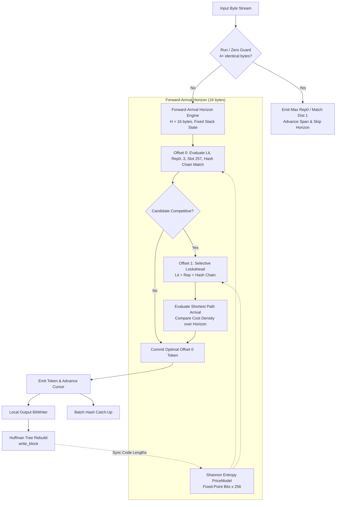

# OpenRAR v2.1.0 Implementation Plan: Cost-Aware Forward-Arrival DAG Parser & Multi-Hop Symbol Arbiter (Track E)

**Milestone:** v2.1.0 (Track E — Modern Architecture Arc 2.1, Pillar 1)  
**Pre-Analysis Reference:** [`docs/milestones/v2.1.0-pre-analysis.md`](v2.1.0-pre-analysis.md)  
**Governance Scope:** Rules G-1 (Single Decision Function), G-3 (Fingerprinted Measurement), G-8 (Charter Discipline), G-9 (No Vacuous Passes), and Invariants I-1 through I-6  
**Status:** In Progress / Ready for Execution  

---

## 1. Executive Vision & Objectives

OpenRAR v2.0 established enterprise-grade defense-in-depth isolation, resolved decompression bomb denial-of-service vectors, passed comprehensive static analysis and toolchain security gates, and introduced signature CLI capabilities (`b`, `inspect`, `diff`). However, OpenRAR's core compression engine remains bound by a structural ratio ceiling:
- **~3.5% ratio delta** vs WinRAR 7.20 on heterogeneous data at `-m3` (5,827,818 B vs 5,630,044 B on `big24.bin`)
- **~1.9% ratio delta** at maximal `-m5` (5,512,083 B vs 5,411,785 B)
- **Up to 17.6% ratio gap** on synthetic text corpora at `-m1`

### Root Cause
The legacy match arbiter operates greedily by match length with single-step lookahead:
1. **Unpriced Distance Symbols:** Length-only arbitration cannot evaluate the bit cost of distance symbols. A 4-byte match at distance $1\text{ MB}$ costs $\approx 32\text{--}36\text{ bits}$ on the wire ($8.0\text{--}9.0\text{ bits/byte}$), whereas 4 literals cost only $\approx 16\text{--}20\text{ bits}$. Greedy selection unconditionally emits the distant match, actively expanding the bitstream.
2. **Suboptimal Repeat-Code Arbitration:** Repeat codes (Rep0..3) consume zero distance bits on the wire, and Slot 257 encodes continuations with a single zero-overhead symbol. A rigid static concession cannot match dynamic Shannon entropy costs.
3. **Lessons of the Parked v1.32 Prototype:** Bounded horizon ($H = 16\text{ bytes}$), 4-byte equality Run-Guard, selective candidate expansion, and explicit 15-bit floors on unused symbols eliminate the historical 3.9× runtime explosion and +28% zero-run regression.

### Strategic Target
Transform the encoder into a **Cost-Aware Forward-Arrival DAG Parser & Multi-Hop Symbol Arbiter** that closes $\ge 20\%$ of the remaining ratio gap on `-m3` and `-m5` while maintaining throughput floors and 100% bit-exact cross-decode legality.

---

## 2. Technical Architecture & Component Breakdown

### Component 1: Baseline Ratio & Throughput Census (Phase M0)
- Re-measure canonical benchmark corpora (`big24.bin`, `silesia`, `enwik8`, `zeros8.bin`, `random8.bin`) on v2.0.23 baseline across `-m1`, `-m3`, `-m5`.
- Record exact byte sizes, wall times, and throughputs to form the immutable pre-change benchmark baseline.

### Component 2: Forward-Arrival Horizon Engine ($H = 16\text{ bytes}$) (Phase M1)
- Fixed stack allocation `ArrivalNode arrival_[17]` ($\approx 1\text{ KiB}$, 0 heap allocations, 100% L1 cache-resident).
- Relax sub-lengths $L \in [\text{min\_match}, \text{match\_len}]$ so that shorter matches at near distances can naturally out-compete long matches at distant offsets when bit density favors them.
- Single-source shortest path DP in topological order over $0 \dots H$.
- Backtrack from terminal minimum-density node to Offset 0 to commit the optimal first token.

### Component 3: Dynamic Shannon Entropy PriceModel (Phase M2)
- 24.8 fixed-point arithmetic ($\text{bits} \times 256$) for cross-platform bit-exact determinism.
- Synchronized code lengths from canonical Huffman tables on every `write_block()`.
- Empirical prior initialization for Block 0.
- Explicit maximum code-length penalty ($15 \times 256 = 3840$) for unused symbols (Anti-Finding A-4).

### Component 4: Extended Slot 257 Multi-Hop Propagation & Distance Hurdle (Phase M3)
- Multi-token chaining: evaluate Slot 257 transitions at intermediate horizon offsets when previous token establishes compatible Rep0 context.
- Enforce strict wire-legal floors ($L \ge \text{inc}(D) + 2$) and distance-band hurdles before admitting match candidates.

### Component 5: Mechanical Sympathy & Fast Incompressible Bypass (Phase M4)
- **4-Byte Equality Run-Guard:** Fast SIMD scan on 4 identical bytes, emitting maximum legal Rep0 / match runs directly and bypassing horizon graph evaluation (guaranteeing 0.00% zero-run regression).
- **Incompressible Bypass:** When `fail_count_ > 0x100`, drop to 1-byte literal emission bypass ($\ge 18.0\text{ MB/s}$ on high-entropy data).
- **Selective Candidate Expansion:** Limit expensive hash chain lookahead to Offset 1 only when Offset 0 is competitive.

---

## 3. Work Breakdown & Implementation Schedule

| Phase | Milestone | Focus Areas | Deliverables |
|:---:|:---|:---|:---|
| **M0** | **Baseline Census** | Automated measurement harness & reference baselines | Census script `tools/bench_m0_census.py`, baseline receipt log |
| **M1** | **Forward-Arrival Engine** | DP solver, sub-length relaxation, terminal path selection | Updated `evaluate_forward_arrival`, `ArrivalNode` sub-length relaxation |
| **M2** | **Dynamic PriceModel** | Wire pricing synchronization, fixed-point tables, empirical prior | Dynamic table hook in `write_block`, unit tests in `compress_tests.cpp` |
| **M3** | **Slot 257 & Hurdle** | Multi-hop Slot 257 transitions, wire-legal hurdles | Multi-hop chaining in horizon loop, hurdle validation |
| **M4** | **Run-Guard & Gates** | 4-byte equality fast-path, incompressible bypass, full gate run | Active Run-Guard in main loop, 24 interop stages green |

---

## 4. Verification Gates & Success Criteria

1. **Legality Gate:** Every archive produced by the v2.1.0 engine must decompress bit-identically under reference decompressor across all 24 interop stages.
2. **Zero-Run Invariant:** 8 MiB zeros (`zeros8.bin`) must compress to $\le 500$ bytes with $0.00\%$ regression against the v2.0.23 baseline.
3. **Throughput Floor:** Incompressible data (`random8.bin`) must compress at $\ge 18.0\text{ MB/s}$.
4. **Compression Ratio Uplift:** On `big24.bin`:
   - $\ge 40\text{ KiB}$ size decrease at `-m3` (closing $\ge 20\%$ of remaining gap).
   - $\ge 25\text{ KiB}$ size decrease at `-m5` (closing $\ge 25\%$ of remaining gap).
5. **Static Analysis & Sanitizers:** Zero warnings under `.clang-tidy`, zero defects under ASan/UBSan.
