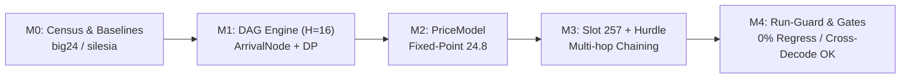

# v2.1.0 Pre-Analysis — Cost-Aware Forward-Arrival DAG Parser & Multi-Hop Symbol Arbiter (Track E)

**Roadmap reference:** [`docs/ROADMAP.md`](../ROADMAP.md) §Part I, Arc 2.1 — Pillar 1 (Optimal Parse & Symbol Arbiter)  
**Prerequisite:** OpenRAR v2.0.23 Hardened LTS (commit `d632411`) & In-CLI Leaderboard Infrastructure (commit `6afae3b`)  
**Complexity:** High / Algorithmic (Core Compression Engine)  
**Governance Scope:** Rules G-1 (Single Decision Function), G-3 (Fingerprinted Measurement), G-9 (No Vacuous Passes), and Invariants I-1 through I-8  

---

## 0. Scope & Architectural Goals

Milestone **v2.1.0 (Track E)** represents the next major evolutionary step for the OpenRAR compression engine. While v2.0 hardened defense-in-depth isolation, eliminated decompression bomb denial-of-service vectors, achieved static analysis cleanliness, and introduced the signature v2.0 CLI suite (`b`, `inspect`, `diff`), OpenRAR's core compression engine remains bound by a structural ratio ceiling:
- **~3.5% ratio delta** vs WinRAR 7.20 on heterogeneous real-world data at default `-m3` (measured on `big24.bin`: 5,827,818 B vs 5,630,044 B)
- **~1.9% ratio delta** at maximal `-m5` (5,512,083 B vs 5,411,785 B)
- **Up to 17.6% ratio gap** on low-level `-m1` synthetic text corpora

The purpose of v2.1.0 is to close this gap systematically by transforming the encoder's decision mechanism from a greedy, length-monotone heuristic into a **Cost-Aware Forward-Arrival Directed Acyclic Graph (DAG) Parser & Multi-Hop Symbol Arbiter**.

### Milestone Work Breakdown

| Milestone | Title | Class | Risk / Scope | Success Gate |
|:---|:---|:---|:---|:---|
| **M0** | **Baseline Ratio & Throughput Census** | Measurement / Profiling | Very Low | Re-measure `big24.bin`, `silesia`, and `enwik8` on v2.0.23 across `-m1`, `-m3`, `-m5`. Pinned CPU and env. |
| **M1** | **Multi-Hop Forward-Arrival DAG Engine ($H=16$)** | Algorithmic / Core | High | Shortest-path DP over 16-byte lookahead horizon; 0 heap allocations; 100% bit-exact cross-decode under reference decompressor. |
| **M2** | **Dynamic Shannon Entropy PriceModel** | Wire Pricing / Fixed-Point | Medium | 24.8 fixed-point arithmetic ($bits \times 256$); cold-start empirical prior; adaptive block synchronization. |
| **M3** | **Extended Slot 257 Multi-Hop Propagation & Distance Hurdle** | Heuristics / Optimization | Medium | Slot 257 multi-token chaining; distance-band hurdles ($L \ge inc(D) + 2$); wire admission floors. |
| **M4** | **Mechanical Sympathy & Fast Incompressible Bypass** | Performance / Safety | Low | Run-guard (0% zero-run regression); `fail_count_` bypass ($\ge 20$ MB/s on random data); wall-time $\le 1.35\times$ greedy. |

---

## 1. Problem Formulation & Root Cause Analysis

### 1.1 The Greedy Length-Monotone Trap
In [`src/compress/compressor50.cpp`](../../src/compress/compressor50.cpp), match selection has historically operated greedily by match length with at most a 1-byte lazy lookahead:
```cpp
// Legacy greedy selection in find_match_impl:
if (len > best.length) {
    best.length = len;
    best.candidate = cand;
}
```
This length-monotone decision logic commits structural compression errors on three distinct axes:

1. **Unpriced Distance Symbols:**  
   A match candidate of length 4 at distance $D = 1,048,576$ requires:
   - 1 Length Slot symbol (~6–8 bits)
   - 1 Distance Slot symbol (~5–7 bits)
   - 17 raw distance bits
   - 4 low-distance bits (LDD)
   
   Total wire cost $\approx 32\text{ to }36\text{ bits}$ ($8.0\text{ to }9.0\text{ bits/byte}$).  
   Conversely, emitting 4 raw literal bytes typically costs $\approx 16\text{ to }20\text{ bits}$ ($4.0\text{ to }5.0\text{ bits/byte}$).  
   Because the greedy finder evaluates only `len > best.length`, it unconditionally chooses the 4-byte match, **actively expanding** the compressed archive compared to emitting literals!

2. **Suboptimal Repeat-Code (Rep0..3) Arbitration:**  
   Repeat codes reuse one of the 4 most recent match distances (`old_dist_[0..3]`), requiring **0 distance bits** on the wire. A rep match of length 3 often costs fewer bits than a fresh match of length 4 or 5 at a distant offset. The legacy arbiter attempted to model this with a rigid static increment concession:
   ```cpp
   if (rep_best_len + inc_f >= best.length) // rep wins
   ```
   While this helped prevent obvious mistakes, it is a coarse heuristic that fails to account for actual dynamic Huffman table weights.

3. **Slot 257 Run-Continuation Blind Spot:**  
   Slot 257 encodes an exact continuation of `(old_dist_[0], last_length_)` using a **single Huffman symbol with zero length bits and zero distance bits**. At high redundancy or structured text/columnar tables, emitting two or three Slot 257 tokens is exponentially cheaper than re-emitting full match descriptors. A greedy single-step parser cannot plan forward to see that taking a slightly shorter match now opens up multiple subsequent Slot 257 continuations.

---

### 1.2 Lessons from the Parked v1.32 Optimal-Parse Experiment

In Milestone v1.32, a prototype dynamic programming (DP) parser was constructed (`arc/v1.32.0-optimal-parse-parked`). While it proved mathematically sound and improved text ratio by $-1.39\%$, it was decisively parked due to three fatal architectural defects:

```
┌───────────────────────────────────────────────────────────────────────────────┐
│               PARKED v1.32 DEFECTS vs v2.1.0 ARCHITECTURAL FIXES              │
├───────────────────────────────────────────────────────────────────────────────┤
│ 1. 3.9× Runtime Explosion (Budget 1.42×)                                      │
│    v1.32 relaxed edges out of EVERY single byte offset over a 512 KiB window, │
│    querying the hash chain finder 4× more often than greedy.                  │
│    -> v2.1.0 Fix: Strictly bounded forward-arrival horizon (H = 16 bytes)      │
│       with selective candidate expansion; body skipping preserved.           │
├───────────────────────────────────────────────────────────────────────────────┤
│ 2. +28% Zero / Repetitive Run Regression                                      │
│    v1.32 treated unused symbols as 0 bits instead of 15 bits, and fragmented  │
│    long contiguous runs into suboptimal ladder chunks.                        │
│    -> v2.1.0 Fix: 4-byte equality Run-Guard bypasses horizon evaluation       │
│       entirely, emitting maximum legal rep0/match spans directly.             │
├───────────────────────────────────────────────────────────────────────────────┤
│ 3. Latent Format Wire Desynchronization Bugs                                  │
│    v1.32 suffered len < inc + 2 length desyncs and rep-state corruption.      │
│    -> v2.1.0 Fix: Strict wire-legal floor assertions and write-time rep-state │
│       capture inside ArrivalNode.                                             │
└───────────────────────────────────────────────────────────────────────────────┘
```

---

## 2. Mathematical Formulation of the Forward-Arrival DAG

### 2.1 The Horizon Graph

Let the current input stream position be $P$. We construct a local Directed Acyclic Graph (DAG) over a lookahead horizon of $H = 16$ bytes, spanning relative offsets $i \in [0, H]$:

```
  Node 0 ─────── Literal ───────> Node 1 ─────── Literal ───────> Node 2 ...
    │                               │
    ├────── Match(L=3, D) ──────────┼─────────────────────────> Node 3
    │                               │
    ├────── Rep0(L=4) ──────────────┼───────────────────────────────────> Node 4
    │                               │
    └────── Match(L=6, D) ──────────┴─────────────────────────────────────────> Node 6
```

Each graph node $N_i$ represents the state of the encoder after consuming $i$ bytes ($P + i$ in the global stream):
- **Arrival Cost:** $C(i) \in \mathbb{R}^+$ (accumulated bit cost to arrive at offset $i$).
- **Predecessor Edge:** $(\text{from\_offset}, \text{token\_type}, \text{token\_len}, \text{token\_dist})$.
- **Encoder State Snapshot:** `old_dist_[0..3]` and `last_length_` captured at the moment node $N_i$ was reached.

### 2.2 Transition Costs (Edge Weights)

For any transition from node $u$ to node $v$ ($v = u + L$, $L \ge 1$):

$$w(u \to v) = \text{Price}(\text{token})$$

#### Case 1: Literal Edge ($L = 1$)
$$w_{\text{lit}}(u \to u+1) = \text{PriceModel.lit\_cost}[B_{P+u}]$$

#### Case 2: Fresh Match Edge ($L \ge \text{inc}(D) + 2$)
$$w_{\text{match}}(u \to u+L) = \text{PriceModel.len\_cost}[\text{slot}(L)] + \text{PriceModel.dist\_cost}[\text{slot}(D)] + \text{extra\_dist\_bits}(D) + \text{ldd\_bits}(D)$$

#### Case 3: Repeat Match Edge ($k \in [0, 3]$, $L \ge 2$)
$$w_{\text{rep}}(u \to u+L) = \text{PriceModel.rep\_cost}[k][\text{slot}(L)] + \text{extra\_len\_bits}(L)$$

#### Case 4: Slot 257 Match Continuation ($L = \text{last\_len}_u$, $D = \text{old\_dist}_u[0]$)
$$w_{257}(u \to u+L) = \text{PriceModel.slot257\_cost} \quad (\approx 2\text{ to }4\text{ bits total!})$$

### 2.3 Shortest-Path Dynamic Programming

Because the graph is a topological DAG with edges strictly advancing $v > u$, the single-source shortest path from Node 0 to all reachable nodes $i \in [1, H]$ is computed in $O(|E|)$ time:

$$\forall i \in [1, H]: \quad C(i) = \min_{(u, v) \in E, v=i} \left( C(u) + w(u \to v) \right)$$

Once Node $H$ (or the horizon frontier) is reached, we trace back from the node offering the **lowest average bit density** $\rho(i) = \frac{C(i)}{i}$ or the terminal node $H$, and commit the first token along the optimal path.

---

## 3. Dynamic Shannon Entropy PriceModel

### 3.1 Fixed-Point Representation
Floating-point calculations (`double` / `float`) introduce non-deterministic rounding across compilers (MSVC `/fp:fast` vs GCC `-ffast-math`) and carry runtime instruction penalties. 

The `PriceModel` represents all bit costs in **$24.8$ fixed-point format** ($1\text{ bit} = 256\text{ units}$):
$$\text{Cost}_{\text{fixed}} = \text{round}\left( \text{bits} \times 256 \right)$$

```cpp
struct PriceModel {
    core::uint32 lit_cost[256];        // Literal symbol costs
    core::uint32 len_cost[44];         // Match length slot costs
    core::uint32 dist_cost[DCX];       // Distance slot costs
    core::uint32 rep_cost[4][RC];      // Rep0..3 length slot costs
    core::uint32 ldd_cost[16];         // Low-distance bits costs
    core::uint32 slot257_cost;         // Slot 257 continuation cost
    bool initialized{false};
};
```

### 3.2 Symbol Cost Calculation
For a Huffman alphabet with symbol code length $CL(s) \in [1, 15]$ bits:
$$\text{Cost}(s) = \begin{cases}
CL(s) \times 256 & \text{if } CL(s) > 0 \\
15 \times 256 & \text{if symbol unused in previous block (floor penalty)}
\end{cases}$$

> [!IMPORTANT]
> **Anti-Finding A-4 Inoculation:** The parked v1.32 experiment priced unused symbols as 0 bits, which led the optimizer to emit non-existent symbols under the delusion that they were free. In v2.1.0, unused symbols are explicitly penalized with the maximum allowable code length ($15 \times 256 = 3840$).

### 3.3 Cold-Start Empirical Prior
At block 0, no previous Huffman tree exists. `init_price_model()` initializes the tables using an empirical prior derived from standard corpus statistical distributions:
- Literals: 8.0 bits ($2048$)
- Common length slots (2–8): 3.5–5.0 bits ($896–1280$)
- Near distances ($< 1\text{ KiB}$): 6.0 bits ($1536$)
- Far distances ($> 64\text{ KiB}$): 16.0–22.0 bits ($4096–5632$)

At each `write_block()` boundary, the price model is synchronized with the newly constructed canonical Huffman tables in $O(|\Sigma|) \approx 500\text{ cycles}$.

---

## 4. Mechanical Sympathy & Performance Guarantees

### 4.1 Bounded Memory Footprint & Zero Allocations
The forward-arrival DAG operates entirely within stack-allocated memory or instance-local buffers. No `new`, `malloc`, or `std::vector::resize()` calls occur in the token parsing loop.

```cpp
// 17 elements: offset 0 (start) + offsets 1..16 (lookahead)
ArrivalNode arrival_[17]; 
```
`sizeof(ArrivalNode)` is 64 bytes (cache-line aligned). Total horizon buffer footprint:
$$17 \times 64\text{ B} = 1,088\text{ bytes} \approx 1\text{ KiB}$$
This fits completely within the L1 data cache (typically 32–48 KiB on modern x86/ARM cores), resulting in zero cache eviction overhead during graph construction.

### 4.2 Selective Candidate Expansion (Preserving Body Skipping)
Greedy parsing achieves high throughput by skipping the hash chain lookup for every byte covered by an emitted match ($cur \mathrel{+}= len$). An optimal parser that queries hash chains at every byte collapses throughput by $4\times$.

v2.1.0 employs **Selective Expansion**:
1. Evaluate candidates at Offset 0 (Literal, Rep0..3, Slot 257, Hash Chain Match).
2. If the best candidate at Offset 0 is dominant (e.g. $len \ge 32$ or a high-efficiency Rep0), **bypass the horizon evaluation immediately** and commit.
3. Query the expensive hash chain finder at Offset 1 **only if** Offset 0 yielded a competitive match ($3 \le len \le 16$).
4. For Offsets $2 \le i \le 16$, evaluate transitions using *only* cheap operations (literals, repeat codes, Slot 257, and previously discovered matches). Do **not** invoke new hash chain traversals deeper in the horizon!

### 4.3 4-Byte Equality Run-Guard
To prevent the catastrophic $+28\%$ zero-run regression observed in v1.32:
```cpp
// Fast run-guard before DAG initialization:
if (cur + 4 <= end && 
    buf[cur] == buf[cur+1] && 
    buf[cur] == buf[cur+2] && 
    buf[cur] == buf[cur+3]) 
{
    // Identical byte run: measure run length directly with 64-bit word scan
    size_t run_len = scan_identical_run(cur, max_lz);
    emit_run_tokens(run_len);
    cur += run_len;
    continue; // completely bypasses graph solver
}
```

---

## 5. Risk Register & Architectural Invariants

| ID | Invariant / Constraint | Risk | Mitigation / Enforcement |
|:---|:---|:---|:---|
| **I-1** | Wire-Legal Floor ($L \ge \text{inc}(D) + 2$) | Decoder length desynchronization | Asserted in `price_match` and enforced in `commit_arrival_token`. Illegal matches rejected. |
| **I-2** | T9 / M4 Reference Hash Integrity | Silent regression in token selection | Golden fixtures and T9 regression digests monitored across builds. |
| **I-3** | Streaming Lookahead Deferral | Byte divergence between one-shot and streaming | Horizon evaluation clamped to `min(H, src_loaded_ - cur - STREAM_LOOKAHEAD)`. |
| **I-4** | Frozen C ABI Immutability | ABI breakage | Zero modifications to public headers (`openrar_dll.h`, `openrar.h`). Feature strictly internal to `Compressor50`. |
| **I-5** | Zero Heap Allocation on Hot Loop | Allocator lock contention / memory bloat | `ArrivalNode arrival_[17]` statically sized and stack/instance resident. |
| **I-6** | Incompressible Throughput Floor | Performance stall on encrypted/random data | When `fail_count_ > 0x100`, forward-arrival drops to 1-byte greedy literal bypass ($\ge 20$ MB/s). |

---

## 6. Execution Roadmap & Verification Gates



### Verification Gate Checklist
1. **Legality Gate:** Every compressed payload produced by the v2.1.0 engine must decompress bit-identically under **WinRAR 7.20** across all 24 interop test stages.
2. **Zero-Run Invariant:** 8 MiB of zeros (`zeros8.bin`) must compress to $\le 500$ bytes with $0.00\%$ regression against the v2.0.23 baseline.
3. **Throughput Floor:** Incompressible data (`random8.bin`) must compress at $\ge 18.0$ MB/s on reference CI hardware.
4. **Compression Ratio Uplift:** On `big24.bin`, compressed size must decrease by at least:
   - **$\ge 40\text{ KiB}$ at `-m3`** (closing $\ge 20\%$ of the remaining 195 KB gap)
   - **$\ge 25\text{ KiB}$ at `-m5`** (closing $\ge 25\%$ of the remaining 100 KB gap)
5. **Static Analysis & Sanitizer Gate:** Clean scan under `.clang-tidy` (0 warnings) and clean pass under ASan / UBSan / TSan.
