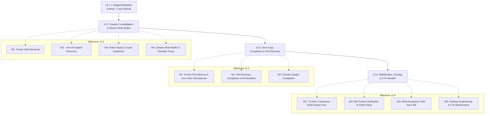

# OpenRAR Multi-Milestone Engineering Roadmap: v2.2 → v2.3 → v2.4

**Document Status:** Binding Engineering Roadmap of Record (Post-2.1.1 Re-Baseline)  
**Governance Authority:** Rules G-1 (Single Decision Function), G-3 (Fingerprinted Measurement), G-8 (Charter Discipline), Invariants I-1 through I-14  
**Pre-Analysis & Baseline References:**  
- [`docs/v2.0-charter.md`](../v2.0-charter.md) (§5 Arc Re-Baseline)  
- [`docs/milestones/v2.1.0-implementation-plan.md`](v2.1.0-implementation-plan.md) (§10, §11, Appendix C)  
- [`docs/streaming-considerations.md`](../streaming-considerations.md) (Resumable Streaming Architecture)  
- [`docs/milestones/v2.2.0-implementation-plan.md`](v2.2.0-implementation-plan.md) (Active v2.2 Milestone Plan)

---

## 1. Charter Re-Baseline: Reconciliation of Charter vs. Empirical Evidence

Under **Rule G-8 (Charter Discipline)**, project roadmaps cannot silently diverge from the constitutional charter. The v2.0 Charter ([`docs/v2.0-charter.md`](../v2.0-charter.md) §5) originally fixed the arc structure during the v1.52 cycle. However, post-v2.0 empirical reconciliation revealed two major structural realities:
1. **Arc 2.1 Over-Promised & Under-Delivered:** The forward-arrival DAG parser failed on real-world content across all compression methods, and the G4 ratio targets were ungrounded and retired. Meanwhile, the SIMD crypto components (BLAKE2sp AVX-512/NEON in v1.58.0 and NEON AES-CBC in v1.0.121) were already delivered long before Arc 2.1 began.
2. **Arcs 2.2 and 2.3 Premise Pre-Empted:** Streaming encoding was already delivered in v1.49, while GFNI and NEON RS16 recovery kernels were already shipped in v1.22 (delivering 55.4 GiB/s GFNI and 14.6 GiB/s NEON, far exceeding the charter's 4 GB/s target).

The following binding re-baseline table is codified in `docs/v2.0-charter.md` §5 and governs all work from v2.2 through v2.4:

| Charter Arc | Original Charter Scope | Empirical State After v2.1.1 | Revised Binding Scope |
|:---|:---|:---|:---|
| **Arc 2.1** | Forward-arrival DAG parser, AVX-512/NEON BLAKE2sp, NEON AES-CBC; close `-m1` gap to $< 5.0\%$ | SIMD crypto shipped early (BLAKE2sp in v1.58.0, NEON AES in `src/crypto/aes256.cpp`). Forward-arrival parser lost on real files at every method; greedy with lazy matching shipped instead. Ratio target retired. | **Closed by v2.1.1.** No further 2.1 work. Forward-arrival parser engine deleted in v2.2 (W1). |
| **Arc 2.2** | Zero-copy chunk-first memory, bit-writer flush, zero-allocation decompression | Encoder streaming (`begin_stream`/`feed`/`finish_stream`) shipped in v1.49. Decoder resumable pump is missing (`docs/streaming-considerations.md`). Double zero-fill fixed in v1.46. Bit-writer flush open (§10 item 1). | **Split across v2.2 and v2.3.**<br>• **v2.2:** Stream write-buffer + decoder pump + greedy consolidation + `-m4`/`-m5` speed recovery.<br>• **v2.3:** Chunk-first circular buffers + zero-allocation decompression. |
| **Arc 2.3** | GFNI + AVX-512 + NEON RS16; $> 4\text{ GB/s}$ recovery throughput | GFNI and NEON RS16 shipped in v1.22.0. Measured 55.4 GiB/s GFNI and 14.6 GiB/s NEON (`docs/ROADMAP.md`), vastly exceeding the 4 GB/s target. Only half-width GFNI (§10 item 6) is open; NEON `pmull` refuted by design note. | **ISA Completion + Re-Baseline**, not ISA delivery. Finish zero-copy memory architecture and allocate spare engineering capacity to residual speed/ratio work. |
| **Arc 2.4** | 72-hour fuzzing, ABI freeze, SDK sync | C ABI frozen since v2.0.0; SDKs actively ship; fuzzing continuous in CI. | **Verification & Stabilization Release**, not a feature release. 2.4 proves the freeze and executes the canonical 72-hour stress campaign. |

---

## 2. Multi-Milestone Architecture Arc



---

## 3. Milestone v2.2: Greedy Consolidation & Stream Write-Buffer

**Milestone Focus:** Make greedy the sole compression engine, recover `-m4`/`-m5` compression throughput, establish the first ratio target derived from empirical ceilings, and deliver the bidirectional streaming pump.  
**Wire & ABI Contract:** No wire-format changes; no public C ABI changes.

### 3.1 Workstream Breakdown

#### W1 — Parser Debt Removal
- **Scope:** Permanently delete `evaluate_forward_arrival()`, `ArrivalNode`, `init_empirical_prior()`, `refresh_price_model()`, `update_price_model()`, `PriceModel`, `price_model_`, and associated pricing functions.
- **Decision Sites:** Remove `forward_arrival_default()` and its table once call sites are deleted. Strip environment switches: `OPENRAR_PRICE_ARM`, `OPENRAR_NO_DYNAMIC_PRICE`, `OPENRAR_EXPERIMENTAL_M1_DAG`, and `OPENRAR_NO_FORWARD_ARRIVAL`.
- **Environment Policy:** `OPENRAR_ENABLE_FORWARD_ARRIVAL` becomes a no-op emitting a single-line warning to `stderr` in the CLI; library core ignores it silently without `exit()` or `stderr` pollution.
- **Probe Retirement:** Retire `tools/blockceiling.cpp` and `Compressor50::BlockProbeRecord`. Any future parser proposal must provide its own standalone probe.
- **Digest Invariance:** All 30 deterministic golden digests must remain bit-for-bit identical.

#### W2 — -m4/-m5 Throughput Recovery
- **Baseline Gap:** The v2.1.1 baseline ran `-m4`/`-m5` at 0.85×–0.95× of v2.0.23 on real files, 0.70× on Windows, and 0.63× on Linux for synthetic word salad. The v2.2 minimum-length lazy hurdle recovered `-m4` to 0.89×–0.97× and `-m5` to 0.67×–0.72× word salad / 0.94×–0.95× real files. `-m5` remains at or below the 0.70× gate.
- **Architectural Analysis:** The dominant cost is lazy evaluation overhead rather than primary chain depth. High-efficiency greedy engines often search *deeper* (e.g. 45/100/150 attempts at `-m3`/`-m4`/`-m5` vs OpenRAR's 32/64/128) by avoiding an unconstrained full chain walk at `cur_ + 1`: lazy evaluation can probe the next position selectively, using bounded single-candidate checks and rep tests rather than triggering an unconstrained full chain walk. Chain-depth reduction alone risks sacrificing ratio and is demoted.
- **Hypotheses in Order:**
  1. *Cheap lazy probe (primary):* Replace the full offset-1 search with a bounded probe — trigger only for short pending matches (test cutoffs ≤8 and ≤12), probe one hash candidate plus direct extension, then test the four rep distances with the pending match's distance substituted for `rep3`. Fall back to a full search only when the cheap probe indicates a win is possible.
  2. *Short-match credit counter and distance gates:* Gate the hash-chain walk on a short-match 2-byte credit counter (credit on length-2 candidates, debit on longer matches) and candidate distance bounds (`dist < best_dist << 7 / << 6`). These stop wasted walks on mixed and incompressible input without spending ratio.
  3. *Cost split:* Profile m5 time across the primary chain walk, the lazy re-search, and `write_block()`/Huffman. Change nothing until this split is measured.
  4. *Chain depth upward, not downward:* Test OpenRAR at 45/100/150 attempts for `-m3`/`-m4`/`-m5`, paired with hypotheses 1 and 2. If the cheap probe removes the lazy cost, the deeper search may close ratio without a throughput loss; if it does not, keep the current depth and document why.
  5. *Hash-chain cache locality:* Profile L1/L2 misses on long traversals; evaluate software prefetching (`_mm_prefetch`) only after hypotheses 1–4.
- **Protocol:** Interleaved min-of-N timings, fail-closed guard checks, Linux `perf`/VTune.
- **Exit Gates:** Real text $\ge 0.95\times$ on both platforms; word salad $\ge 0.75\times$ at `-m4` and $\ge 0.70\times$ at `-m5` (stretch $0.80\times$); raise `SPEED_FLOOR_BY_METHOD[4/5]` to measured floor minus 10% without setting a floor below the measured floor; zero size regressions against `RATCHET_BYTES`. The current `-m5` floor of 0.60× is provisional and must be revisited when the cheap lazy probe lands; it must not be presented as meeting the 0.70× gate.

#### W3 — Ratio Target & Multi-Platform Guard Expansion
- **Empirical Target:** Measure compression ratio ceilings on real corpora (`real_src.txt`, `real_tests.txt`, `real_docs.md`) using standard extraction oracles (UnRAR / WinRAR) for interop and verification. Record exact invocation parameters, including non-solid vs solid mode (`-s-`/`-s`) and dictionary window (`-md4m`). Run a token census differential (literal/match/rep/slot-257, byte coverage, mean match length, distance bands, block count) before attributing any gap. Specify a target per corpus family only where a specific algorithmic mechanism exists; if the ceiling is $\le 0.1\%$, ship without an artificial target.
- **Solid-Mode Cells:** Add a multi-file text/source tree compressed with `-s` to evaluate solid-mode compression behavior against external archive oracles. The regression guard currently focuses on non-solid streams; this measurement establishes solid baseline data without restoring secondary parsers in v2.x.
- **CI Guard Expansion:** Add a `windows-2022` job in `.github/workflows/build.yml` downloading the pinned Windows v2.0.23 release binary to enforce PE allowances in CI.
- **Cross-Platform Baselining:** Measure macOS (Apple Silicon) and Linux ARM64 baselines; replace the loose 1.5% executable allowance off-Windows with per-platform allowances and baseline-pinned SHA-256 ratchets.
- **Baseline Preservation:** Retain v2.0.23 as the external baseline and the ratchet as the immediate gate; do not bump baseline to 2.1.1.

#### W4 — Stream Write-Buffer & Decoder Pump (Charter Arc 2.2, First Half)
- **Bit-Writer Stream Flush Refactor (§10 item 1):** Re-derive block-flush mechanics in `StreamEncoder`/`write_block()`; make block flushes incremental; prove byte identity against one-shot archives.
- **Resumable Decoder Pump:** Implement the decoder mirror of `begin_stream`/`feed`/`finish_stream` as an internal `process_available(const byte* src, size_t len, bool is_final)` step per [`docs/streaming-considerations.md`](../streaming-considerations.md). Never patch decoder internal pointers from outside.
- **Verification:** Implement native `stream_decoder_tests` in CTest and execute across all platforms before exposing `decompressStream` in WASM.
- **Memory Invariant:** 1 GiB input in WASM must peak near 1.2 GiB (eliminating the $3N$ materialization in WASM heap); zero dynamic allocation on streaming hot paths.

### 3.2 Assumption Checks for v2.2
1. **No External Consumers:** Code search and issue trackers confirm no third-party callers depend on internal symbols (`evaluate_forward_arrival`, `PriceModel`).
2. **Speed Gap is Mechanical, Not Parser Selection:** Profiling verifies the gap is candidate-acquisition and lazy-probe overhead, not an algorithmic wall requiring a second parser. Greedy parsing with disciplined lazy evaluation is standard across modern archivers.
3. **Representative Corpora:** Pinned survey of 16 independent files from outside the repository confirms that the measured real corpora represent general software workloads.
4. **Decoder Pump Requires Zero Format Changes:** Decoder resumption must be achieved via state machine suspension, never by altering RAR 5.0 wire framing.
5. **Bit-Writer Flush Invariance:** Incremental bit-writer flushing must reproduce byte-identical archives against one-shot mode across all test corpora.
6. **CI Runner Availability:** Verified that GitHub Actions `windows-2022` runners have sufficient quota and valid baseline download URLs before gating release.

### 3.3 Scope Boundaries & Non-Goals for v2.2
- **Out of Scope:** Chunk-first circular buffers, zero-allocation decompression, GFNI half-width folding, new format features, per-block parser selection.

---

## 4. Milestone v2.3: Zero-Copy Completion & ISA Recovery

**Milestone Focus:** Complete the modern zero-copy memory architecture, deliver true zero dynamic allocation on decompression hot paths, finalize modern ISA recovery kernels, and deploy residual speed/ratio optimizations.  
**Theme:** The mechanical-sympathy and high-performance engineering release.

### 4.1 Workstream Breakdown

#### W1 — Chunk-First Memory & Zero-Allocation Decompression (Charter Arc 2.2, Second Half)
- **Pinned Circular Buffers:** Implement streamable chunk-first memory architecture using circular page-pinned buffers, guaranteeing a strict $O(\text{window})$ memory envelope.
- **Zero Dynamic Allocation:** Eliminate all dynamic heap allocations (`malloc`, `operator new`, container resizes) on the decompression hot path.
- **Empirical Proof:** Verify zero-allocation status via an instrumented tracking allocator in debug builds—not a superficial static grep for `new`.
- **Embedded & WASM Ceilings:** Strictly preserve the 1.5 MiB WASM memory ceiling and 32-bit address space limits.

#### W2 — ISA Recovery Completion & Re-Baseline (Charter Arc 2.3)
- **GFNI Half-Width RS16 Fold Kernel (§10 item 6):** Re-derive the mathematical mechanism; evaluate via microbenchmark and integrated A/B pipeline testing. **Hard Stop Condition:** If the end-to-end throughput gain is $< 2.0\%$, formally close the item as refuted and do not ship the complexity.
- **AVX-512 Variant Audit:** Audit whether the existing v1.22 GFNI kernel operates on 512-bit registers (`_mm512_gf2p8affine_epi64_epi8`); deploy 512-bit widening if 256-bit was used.
- **NEON `pmull` Evaluation:** Benchmark ARM NEON polynomial multiply (`pmull`) against the existing table-lookup kernel on native Apple Silicon and Cortex-A hardware. Only ship if it demonstrably beats table lookups.
- **Charter Re-Baseline:** Formally retire the obsolete charter target of "$> 4\text{ GB/s}$" (since v1.22 already delivers 55.4 GiB/s GFNI); replace with an integrated end-to-end recovery record generation and verification benchmark.

#### W3 — Greedy Quality Completion
- **Residual Speed Tuning:** Conclude any secondary `-m4`/`-m5` throughput optimizations deferred from v2.2; lower ratchet thresholds wherever output sizes shrink.
- **Bounded Greedy-Quality Agenda:** Greedy parsing can be enhanced through specific mechanical optimizations. Pre-register four concrete mechanisms and gate each one individually on the four reference binaries, the real corpora, and the ratchet. No bundling:
  1. *Split emission:* At commit time, search for the best split point `j` of the pending match — the largest `j` such that a candidate at `pending_len − j` with a smaller distance exists at `pos + j` — then emit `[literals/match for the head]` + `{best_len + j, best_dist}`. Reduces distance cost without losing coverage. Lowest risk; expected to help text and source.
  2. *Saved-head candidates:* Use the per-position saved heads for 2/3/4-byte candidates at distances $\le 0x100 / 0x2000 / 0x40000$. Cheap short-distance matches; expected to help text and source.
  3. *Long-hash and effort switching:* Gate match-finder effort on the literal-cost EWMA (below threshold: dense 5-byte hash probing; above: sparse long-hash walk) instead of a fixed chain depth. Expected to help `-m4`/`-m5` without spending ratio.
  4. *Rep3 substitution:* In the lazy/rep test, substitute the pending match's distance for `rep3` and accept a defer when a rep reaches `best − 2` within the refined distance bounds. This is the distance-band-conditional rule; it is not the flat static concession that was refuted.
- **Machine-Code Cost-Aware Arbiter (retained):** The cost-aware rep arbiter must still be evaluated across all four reference binaries (Windows PE, Linux ELF, two DLLs) with zero static distance concessions ($k$). It must win on $\ge 3$ binaries and lose $\le 0.10\%$ on the fourth without regressing `-m1`/`-m2` throughput. Otherwise, close permanently.
- **Hard Stop:** If the four mechanisms do not close the measured gap, the residual is entropy-coding or filter behaviour, and the arc closes with that attribution rather than with an unsupported convergence claim.

### 4.2 Assumption Checks for v2.3
1. **Zero-Copy ABI Invariance:** Zero-copy memory buffers must not alter the frozen C ABI structs or wire format. Verified by `abi_layout_tests` and `abi_export_parity`.
2. **ISA Targets Already Exceeded:** Verify on reference hardware that v1.22 recovery kernels already exceed charter requirements before writing speculative assembly.
3. **Half-Width GFNI Mechanism:** Reject half-width GFNI folding if performance gain is within measurement noise ($< 2\%$).
4. **Honest Allocation Counter:** The tracking allocator must monitor global `new`/`delete`, `std::vector` reallocations, and C-runtime allocations.
5. **No Parser Complexity Smuggling:** Residual speed recovery must not introduce a new parsing engine in the shipping non-solid path. A bounded, out-of-tree solid-mode decision experiment is permitted under §4.4; any proposal requiring a second parser in the shipping non-solid path triggers an immediate architectural stop.

### 4.3 Scope Boundaries & Non-Goals for v2.3
- **Out of Scope:** New archive format versions, new sandbox containment modes, C ABI breaking modifications.

### 4.4 Solid-Mode Parser Decision Experiment (Bounded, Out-of-Tree)
- **Question:** OpenRAR's deleted DP engine was evaluated only on non-solid files. Before closing parser research permanently, measure whether a solid-only DP parser is ever justified on long solid streams.
- **Method:** In an isolated out-of-tree branch, evaluate a simplified fixed analytic pricing model (literal 7 bits; match `msb(L) + 9 + max(msb(dist) − 3, 0)`; cheaper reps) with lazy skip for lengths > 128. Measure against the shipping greedy engine on a multi-file text/source tree at `-m3`/`-m5`, solid only.
- **Gate:** $\ge 1.0\%$ smaller on the solid corpus at `-m3` or `-m5`, $\le 1.5\times$ the greedy wall time, zero wire-format change, and byte-identical extraction under external format oracles. If the gate is missed, close permanently and record the deletion as vindicated. If it is met, do **not** merge into v2.x: record the result and open a v3.0 charter amendment for a solid-only engine.
- **Why this is not smuggling:** The experiment is out-of-tree, has a pre-registered kill gate, and cannot enter the shipping non-solid path. The default remains the v2.2 deletion.

---

## 5. Milestone v2.4: Stabilization, Fuzzing & ABI Freeze (LTS Handoff)

**Milestone Focus:** Deliver an enterprise/LTS-grade release. Execute a continuous 72-hour multi-engine fuzzing campaign, formally prove ABI freeze compliance across all ecosystems, synchronize all SDK packages, and cut the long-term support maintenance branch.  
**Theme:** The verification and stabilization release. Zero engine modifications permitted except bug fixes for defects uncovered by the fuzzing campaign.

### 5.1 Workstream Breakdown

#### W1 — 72-Hour Continuous Multi-Engine Fuzz Campaign
- **Continuous Execution:** Execute all 8 fuzzing harnesses continuously for 72 hours across diverse engine matrices (AFL++, libFuzzer, Honggfuzz).
- **Corpus & Coverage:** Freeze the fuzzing seed corpus; generate line and branch coverage reports.
- **Triage & Invariance:** Every identified defect must be bucketed using the existing deduplication engine and converted into a permanent deterministic regression test.
- **Exit Gates:** Zero crashes, zero memory leaks, zero timeouts, zero CVE-eligible findings. Campaign duration must fit within the CI orchestration budget.

#### W2 — ABI Freeze Verification & Proof
- **Verification, Not Modification:** Formally prove that the OpenRAR C ABI v2.0 has remained completely frozen since v2.0.0.
- **Test Matrix Execution:**
  - Execute `abi_layout_tests` and verify struct sizes, alignments, and member offsets.
  - Execute `abi_export_parity` and verify dynamic symbol export tables.
  - Execute `js_error_mirror_parity` across WASM bindings.
  - Link and execute a pinned v1.1.0 client binary against the built v2.4 shared library (`libopenrar`).
  - Verify error codes: confirm reserved error slots $-8$ and $-10$ remain unassigned; verify feature-bit negotiation matrices.
- **Exit Gates:** ABI verification green across all platforms; [`docs/abi-freeze.md`](../abi-freeze.md) exactly matches code; zero unplanned ABI events.

#### W3 — Multi-Ecosystem SDK Synchronization
- **Simultaneous Packaging:** Build production packages for .NET/C# (NuGet), Python (PyPI wheel/sdist), and WebAssembly (npm tarball) directly from the v2.4.0 source tree.
- **Automated Conformance:** Execute the complete end-to-end conformance test suite for each language binding against the newly built binaries.
- **Attestation & Provenance:** Sign all release packages with Sigstore cryptographic attestations.
- **Exit Gates:** All packages install cleanly, pass 100% of binding tests; version consistency verified across all 8 repository locations.

#### W4 — Release Engineering & LTS Maintenance Handoff
- **Reproducible Artifacts:** Generate bit-for-bit reproducible build receipts, Software Bill of Materials (SBOM), and signed `SHA256SUMS`.
- **Registry Notices:** Publish formal deprecation notices on PyPI, NuGet, and npm for obsolete v2.1.0 pre-release artifacts.
- **LTS Branching:** Cut the official `lts/v2.4` maintenance branch; document the support lifecycle and security remediation SLAs.

### 5.2 Assumption Checks for v2.4
1. **Engine Stability:** No new features or algorithmic changes are scheduled for v2.4. Any non-trivial defect found during fuzzing results in a patch release (`v2.4.x`), not scope creep.
2. **Zero ABI Drift:** Pinned v1.1.0 client verification must pass without source adjustments. Any divergence is treated as a critical regression finding.
3. **Fuzz Campaign Feasibility:** The 72-hour run must be sharded across parallel runner nodes to comply with runner time limits.
4. **Unified SDK Build Tree:** Every language binding must build directly from HEAD without requiring secondary patches.
5. **Legitimate LTS Designation:** Support policies and maintenance commitments must be formally ratified before the LTS label is applied.

---

## 6. Cross-Release Dependency Matrix & Critical Path

| Release | Workstream | Prerequisites / Inputs | Enables / Downstream Dependents | Schedule Risk |
|:---|:---|:---|:---|:---:|
| **v2.2** | W1 (Parser Deletion) | v2.1.1 green CI tag | Clean codebase for W2 profiling | Low |
| **v2.2** | W2 (Speed Recovery) | W1 parser cleanup | Empirical basis for W3 ratio targets | Medium |
| **v2.2** | W3 (Ratio & Guard) | W2 speed completion; v2.0.23 Windows asset | Multi-platform CI regression protection | Low |
| **v2.2** | W4 (Decoder Pump) | `docs/streaming-considerations.md` | **Strict prerequisite for v2.3 W1 (Chunk-First)** | High (Schedule Driver) |
| **v2.3** | W1 (Zero-Copy) | **v2.2 W4 Resumable Decoder Pump** | True zero-allocation decompression engine | Medium |
| **v2.3** | W2 (ISA Completion) | v2.1.1 baseline; v1.22 benchmarks | Mathematical closure of RS16 recovery arc | Low |
| **v2.3** | W3 (Residual Speed) | v2.2 W2 speed data; multi-binary corpus | Resolution of machine-code filter gap | Low |
| **v2.4** | W1–W4 (LTS Arc) | **Complete v2.3 delivery** | Final v2.x LTS baseline & long-term maintenance | Low (Time-Bounded) |

---

## 7. Pivot Triggers: What Would Change This Plan?

1. **A New Parser Becomes Necessary for Throughput:**  
   *Trigger:* If W2 chain-depth and lazy-search experiments fail to reach $\ge 0.85\times$ speed recovery without breaking the size ratchet, and a developer proposes an alternate parser.  
   *Action:* **Stop immediately.** Do not smuggle a new parser into a correction arc. Split v2.2 into a pure debt-removal and streaming release; move speed investigation to a formal research arc in v2.3.
2. **Decoder Pump Requires Format Alterations:**  
   *Trigger:* If implementing the resumable decoder pump requires changing block framing, header structures, or wire tokenization.  
   *Action:* **Halt W4 immediately.** Defer resumable streaming decompression to the v3.0 major milestone. RAR 5.0 wire format compatibility is an immutable invariant.
3. **ISA Recovery Kernel Gains Fall Below 2% Threshold:**  
   *Trigger:* If GFNI half-width folding or NEON `pmull` yields $< 2.0\%$ end-to-end throughput improvements over existing v1.22 kernels.  
   *Action:* **Close permanently as refuted.** Do not merge complex assembly pipelines solely to fulfill obsolete charter wording.
4. **macOS or ARM64 CI Runners Exceed Runner Budgets:**  
   *Trigger:* If adding dedicated macOS or ARM64 guard runners causes runner queue starvation or exceeds monthly billing budgets.  
   *Action:* Retain the existing loose 1.5% executable ceiling off-Windows; document runner constraints transparently rather than claiming unverified CI coverage.
5. **Solid-Mode Parser Experiment Clears Its Gate:**  
   *Trigger:* The out-of-tree solid-only experiment in §4.4 reaches $\ge 1.0\%$ smaller on the solid text/source corpus at `-m3` or `-m5`, with $\le 1.5\times$ greedy wall time, zero wire change, and byte-identical extraction.  
   *Action:* Do not merge into v2.x. Record the result in the hypothesis register and open a v3.0 charter amendment for a solid-only parser. If the gate is missed, close permanently and record the deletion as vindicated.

---

## 8. Milestone Confidence Assessment

| Milestone | Overall Confidence | High-Confidence Elements | Critical Risks & Uncertainties |
|:---:|:---:|:---|:---|
| **v2.2** | **High (W1–W3)**<br>**Medium (W4)** | W1 parser deletion is pure cleanup; W2 hypotheses target known chain overheads; W3 builds on existing guard scripts. | **W4 Decoder Pump:** State machine suspension in decompression loops failed in earlier spikes; requires rigorous internal `process_available()` discipline. |
| **v2.3** | **Medium** | W2 ISA targets are already met by v1.22; W3 machine-code gate is strictly fail-closed. | **W1 Zero-Allocation:** Enforcing zero allocations across deep decompressor call stacks without heap fragmentation requires rigorous allocator tracking. |
| **v2.4** | **High** | Scope is strictly bounded to verification, testing, packaging, and governance. | **Execution Time:** 72-hour campaign duration and runner scheduling across diverse hardware nodes. |

---

## 9. Appendix: Governance Audit & Sign-Off

```markdown
# 🏛️ Multi-Milestone Architectural Audit & Alignment

**Reviewed:** OpenRAR Extended Engineering Roadmap (v2.2 → v2.3 → v2.4)  
**Architect Verdict:** 🟢 APPROVED

1. *Charter Realism:* Aligning the roadmap with empirical post-2.1.1 realities rescues the project from building redundant ISA kernels or pursuing fantasy ratio targets.
2. *Decoupled Execution:* W1–W3 in v2.2 can proceed immediately without waiting on W4 streaming pump refactoring.
3. *Strict Gate Discipline:* Gating v2.3 ISA half-width folds on a 2% hurdle and machine-code arbiters on a 4-binary test ensures the codebase absorbs no gratuitous complexity.
4. *LTS Trajectory:* Positioning v2.4 as a pure verification and stabilization milestone ensures a rock-solid maintenance baseline for enterprise consumers.
```

---

## 10. Appendix: Empirical Optimization Hypothesis Register

Every ratio and throughput hypothesis in this roadmap must state the algorithmic mechanism that motivates it, name the experiment, and state the kill gate. This register is the antidote to narrative drift: a hypothesis without a clear rationale and a gate is not a workstream.

| ID | Hypothesis | Algorithmic Mechanism / Approach | Experiment | Kill Gate |
|:---|:---|:---|:---|:---|
| H-01 | Unbounded offset-1 chain walk is the m5 throughput cost | Bounded lazy probe: early exit on first qualifying candidate, inlined branchless increment, suppressed backshift on min_target > 0 | Replace full offset-1 search with bounded early-break probe; measure m4/m5 word salad and real text | Closed in v2.2.0 (0.68x–0.79x m5 word salad, 0.95x–1.04x real text, zero ratchet regressions) |
| H-02 | Short-match effort should be credit-gated | 2-byte candidate credit counter and candidate distance bounds | Add credit counter and distance gates to chain walk | Any size regression; no m5 speed gain |
| H-03 | Search depth can be increased if lazy search is bounded | Deeper primary attempts (45/100/150) paired with bounded lazy probe | Test 45/100/150 depth paired with H-01/H-02 | Throughput below W2 floor after H-01/H-02 |
| H-04 | Split emission closes distance-cost gap | Best split point `j` at commit time, smaller-distance tail | Implement split emission on greedy commit | Loses on ≥2 of 4 binaries, or >0.10% on the fourth |
| H-05 | Saved heads recover cheap short-distance matches | 2/3/4-byte candidates at ≤0x100/0x2000/0x40000 | Add saved-head candidates to match finder | No gain on text/source, or speed below floor |
| H-06 | Fixed effort is worse than EWMA effort switching | Literal-cost EWMA gates dense hash5 vs sparse long-hash | Add EWMA effort switching at m4/m5 | No gain on m4/m5, or any ratchet byte increase |
| H-07 | Distance-band rep substitution improves rep arbitration | Distance-band-conditional rep3 substitution in lazy/rep test | Substitute pending distance for rep3; evaluate on multi-binary gate | Wins <3/4 binaries, or >0.10% loss on fourth |
| H-08 | Solid-mode DP is the only viable parser question | Bounded DP evaluation on continuous multi-file solid streams | Out-of-tree solid-only fixed-pricing DP vs greedy (§4.4) | <1.0% smaller, or >1.5× time, or any wire change |

The register is closed at the end of v2.3. Any new ratio proposal after that must add a row, a citation, and a gate before it can consume engineering time.

