# OpenRAR v2.x Research Agenda: Low-Level Microarchitectural, SIMD & Assembly Optimizations

**Document Status:** Exploratory Architecture & Research Agenda of Record (v2.x Line)  
**Governance Authority:** Rules G-1 (Single Decision Function), G-3 (Fingerprinted Measurement), G-8 (Charter Discipline), Invariants I-1 through I-14  
**Target Milestones:** Milestone v2.3 (Zero-Copy & Mechanical Sympathy) / Milestone v2.4 (LTS & Hardening)  
**Cross-References:**
- [`docs/milestones/v2.2-v2.4-roadmap.md`](v2.2-v2.4-roadmap.md) (§4 Milestone v2.3, §10 Hypothesis Register)
- [`docs/invariants.md`](../invariants.md) (Invariants I-1 Deterministic Digests, I-6 Memory Ceilings, I-13 Zero Size Regressions)
- [`src/compress/arch/match_simd.hpp`](../../src/compress/arch/match_simd.hpp) (Existing SIMD Vector Match Scanner)
- [`src/crypto/arch/crc32_arch.hpp`](../../src/crypto/arch/crc32_arch.hpp) (PCLMULQDQ & ARM64 CRC32 Acceleration)

---

## 1. Executive Architectural Assessment: Assembly vs. Compiler Intrinsics in 2026

When evaluating lower-level assembly optimizations for a production systems codebase in C++20, an architect must separate 1990s micro-optimization lore from modern microarchitectural reality.

### 1.1 The Inlining & ABI Penalty of Standalone Assembly on Modern Toolchains
1. **MSVC x64 Inline Assembly Prohibition:**  
   On Windows x64, the Microsoft Visual C++ toolchain (`cl.exe`) **does not support inline assembly** (`__asm { ... }` is an x86-32 legacy construct). Standalone `.asm` files assembled via MASM (`ml64.exe`) or NASM reside outside translation units. Calling into them incurs the standard Microsoft x64 calling convention overhead:
   - Spilling volatile registers (`rax`, `rcx`, `rdx`, `r8-r11`, `xmm0-xmm5`) to the stack frame.
   - Setting up a 32-byte shadow store on the stack.
   - A `call` / `ret` control-flow transfer that defeats compiler instruction pipelining, constant propagation, and dead-code elimination.
2. **Superiority of Compiler SIMD / Architecture Intrinsics:**  
   Using C++ intrinsic primitives (`<immintrin.h>`, `<arm_neon.h>`) provides the optimal balance:
   - Emits the **exact 1:1 machine instruction** requested (e.g. `vpmulld`, `pshufb`, `bextr`, `vpcmpeqb`).
   - Allows the compiler (Clang 18+, GCC 14, MSVC 19.4x) to inline the instruction sequence directly into hot loops with zero call overhead.
   - Gives the compiler's backend complete freedom to allocate registers, unroll loops, and schedule instructions around out-of-order execution pipelines.
3. **When Standalone Assembly is Justified:**  
   Standalone `.asm` is strictly reserved for:
   - Kernel routines where the compiler persistently spills vector registers to the stack despite optimization hints.
   - Specialized OS/hardware-level entry points (e.g. context switches or raw syscall stubs).
   - In all other compression hot paths, **C++ architecture intrinsics within segregated compilation units (`src/compress/arch/`) are strictly preferred.**

### 1.2 ALU Bottlenecks vs. Memory Latency Realities
Not all slow code is CPU ALU-bound:
- **Compute / Vector Bound (High ROI for SIMD):** Vectorized string comparisons, pattern-doubling memory copies, multiplicative batch hashing, and bitfield extraction.
- **Memory Latency Bound (Low ROI for Raw Assembly):** Match-finder linked-list traversal (`prev_[cur & win_mask]`). Pointer chasing across multi-megabyte window buffers stalls CPU execution waiting for L2/L3 cache misses (~12–40 cycles). Writing assembly cannot make DRAM faster; only **software prefetching** and **interleaved chain walking** can hide memory latency.

---

## 2. Inventory of Existing Hardware Silicon Acceleration in OpenRAR

OpenRAR already exploits dedicated hardware execution units in key cryptographic, arithmetic, and scanning paths:

| Subsystem | Target Hardware / ISA Extensions | Codebase Implementation | Measured Throughput / Baseline |
|:---|:---|:---|:---|
| **CRC-32** | x86 PCLMULQDQ / Carryless Multiply<br>ARM64 Hardware CRC32 | [`src/crypto/arch/crc32_arch.hpp`](../../src/crypto/arch/crc32_arch.hpp) | ~12–18 GB/s (saturates memory bus) |
| **SHA-256** | Intel SHA-NI (`_mm_sha256rnds2_epu32`)<br>ARMv8 Cryptographic Extensions | [`src/crypto/sha256.cpp`](../../src/crypto/sha256.cpp) | ~2.5 GB/s per core |
| **AES-128/256** | x86 AES-NI (`_mm_aesenc_si128`)<br>ARMv8 AES (`vaeseq_u8`) | [`src/crypto/aes.cpp`](../../src/crypto/aes.cpp)<br>[`src/crypto/aes256.cpp`](../../src/crypto/aes256.cpp) | Hardware-accelerated wire encryption |
| **Match Scanning** | SSE2, AVX2, AVX-512 (`_mm512_cmpeq_epi8_mask`)<br>Hardware trailing bit count (`_BitScanForward64`) | [`src/compress/arch/match_simd.hpp`](../../src/compress/arch/match_simd.hpp)<br>`src/compress/arch/match_avx512.cpp` | Up to 64 bytes matched per cycle |
| **Galois Field RS16** | x86 SSSE3 / AVX2 Cauchy Matrix<br>x86 GFNI (`_mm512_gf2p8affine_epi64_epi8`) | [`src/recovery/rs16.cpp`](../../src/recovery/rs16.cpp) | 55.4 GiB/s GFNI, 14.6 GiB/s NEON |
| **Filters (Transforms)**| SSE4.1 / AVX2 Audio, Delta, ARM jump filters | [`src/compress/filters50.cpp`](../../src/compress/filters50.cpp) | Vectorized multi-byte stride delta |

---

## 3. High-Yield Research Areas for v2.x (Mechanical Sympathy)

```mermaid
flowchart TD
    subgraph "Research Area 1: Decompression Engine"
        D1["LZ Distance/Length Token"] --> D2{"dist < 16 or dist < len?"}
        D2 -->|dist == 1| D3["vpbroadcastb (16B/cyc)"]
        D2 -->|dist == 2, 4| D4["vpbroadcastw / vpbroadcastd"]
        D2 -->|dist in 5..15| D5["pshufb Pattern Doubling"]
        D2 -->|dist >= 16| D6["128/256-bit Unaligned Wildcopy"]
    end

    subgraph "Research Area 2: Compression Engine"
        C1["Match Accepted (pos, len)"] --> C2["hash_range(pos+1, pos+len)"]
        C2 --> C3["AVX2 _mm256_loadu_si256 (32B window)"]
        C3 --> C4["_mm256_shuffle_epi8 (extract 8 dwords)"]
        C4 --> C5["vpmulld _mm256_mullo_epi32 (8 parallel hashes)"]
        C5 --> C6["vpsrld _mm256_srli_epi32 (8 parallel indices)"]
    end

    subgraph "Research Area 3: Bitstream & Entropy"
        B1["Bitstream Buffer (64-bit)"] --> B2["BMI2 _bextr_u64 (Single-cycle field extract)"]
        B2 --> B3["Branchless 2-Level Direct Lookup Tables (cmov)"]
    end

    subgraph "Research Area 4: Match Finder Memory"
        M1["Walk Hash Chain: Candidate N"] --> M2["_mm_prefetch(prev_[N+1], _MM_HINT_T0)"]
        M2 --> M3["Interleaved Dual-Chain Walking (Hide L2/L3 Latency)"]
    end
```



---

### Research Area 1: Fast Overlapping LZ Wildcopy & Pattern Doubling (Decompression Hotspot)

- **Target Component:** [`src/compress/decompressor50.cpp`](../../src/compress/decompressor50.cpp) (`Decompressor50::process_available`, match copy loops).
- **The Microarchitectural Problem:**  
  Decompression spends ~35%–45% of total CPU time copying previously decompressed bytes from `window[pos - dist]` to `window[pos]` for `length` bytes.
  When `dist < length` (e.g. repeated single bytes where `dist == 1`, or 2/4-byte cyclic words), standard `std::memcpy` has undefined behavior due to overlapping buffers. The traditional fallback is a scalar byte-by-byte loop:
  ```cpp
  while (len--) {
      *dst++ = *src++;
  }
  ```
  This creates **catastrophic store-forwarding stalls** inside modern CPU load/store execution units: the CPU cannot forward a byte store to an immediately following byte load when addresses overlap with tight offsets, stalling the pipeline for 10–20 clock cycles per byte.
- **The Vectorized Solution (Pattern Doubling):**  
  Implement architecture-specific vector copy routines inspired by high-throughput engines (`zstd`'s `ZSTD_wildcopy`, `libdeflate`):
  1. **`dist == 1` (RLE Run):** Load 1 byte, broadcast across 128-bit register using `_mm_set1_epi8` (`vpbroadcastb`), and store 16 bytes per store instruction.
  2. **`dist == 2, 4`:** Broadcast 16-bit / 32-bit words using `_mm_set1_epi16` (`vpbroadcastw`) or `_mm_set1_epi32` (`vpbroadcastd`).
  3. **`dist in [3, 5..15]`:** Load the short pattern, use `_mm_shuffle_epi8` (`pshufb`) with a precomputed modulo-index permutation mask to replicate the pattern across all 16 bytes, and store 16 bytes per cycle.
  4. **`dist >= 16`:** Perform unconditional 16-byte or 32-byte unaligned SIMD loads/stores (`_mm_loadu_si128` / `_mm_storeu_si128` or AVX2 `_mm256_storeu_si256`), overshooting the match end into the allocated circular window margin and trimming the remainder.
- **Expected Speedup:** **+25% to +50% raw decompression throughput** across all compression methods (`-m1` to `-m5`).

---

### Research Area 2: Vectorized Batch Hash Updates in `Compressor50::hash_range`

- **Target Component:** [`src/compress/compressor50.cpp:721-746`](../../src/compress/compressor50.cpp#L721-L746) (`Compressor50::hash_range`).
- **The Microarchitectural Problem:**  
  Whenever an LZ match of length $L$ is emitted, OpenRAR executes `hash_range(pos + 1, pos + L)` to update hash table heads and link chain nodes for intermediate positions. Currently, this computes 32-bit multiplicative hashes sequentially in scalar code:
  ```cpp
  uint32_t val = (uint32_t(window_[p]) << 16) | (uint32_t(window_[p + 1]) << 8) | uint32_t(window_[p + 2]);
  uint32_t h = (val * 0x9e3779b1u) >> (32 - HASH_BITS);
  head_[h] = ...;
  prev_[p & win_mask] = ...;
  ```
- **The Vectorized Solution:**  
  Exploit AVX2 integer SIMD execution units (`vpmulld`, `vpsrld`, `vpshufb`):
  1. Load 32 consecutive window bytes with `_mm256_loadu_si256`.
  2. Use `_mm256_shuffle_epi8` to pack 8 unaligned 3-byte / 4-byte candidate words into eight 32-bit vector lanes.
  3. Multiply all 8 lanes in parallel using `_mm256_mullo_epi32` (`vpmulld`) by the constant vector `_mm256_set1_epi32(0x9E3779B1u)`. Modern Intel/AMD cores execute `vpmulld` with a latency of 10 cycles and throughput of 2 per cycle.
  4. Shift all 8 lanes simultaneously using `_mm256_srli_epi32` to produce 8 hash indices.
  5. Scatter the calculated indices into `head_` and `prev_` arrays. Although scattering to memory remains scalar (or utilizes AVX2 scatter where beneficial), the ALU math overhead is virtually eliminated.
- **Expected Speedup:** **+5% to +10% compression throughput** on text, source code, and synthetic corpora where large match spans trigger heavy `hash_range` executions.

---

### Research Area 3: Hardware Bitfield Extraction (BMI2 `BEXTR`/`PEXT`) and Branchless Bitstream Decoding

- **Target Components:** [`src/compress/bitwriter.hpp`](../../src/compress/bitwriter.hpp), [`src/compress/decompressor50.cpp`](../../src/compress/decompressor50.cpp) (Bit-buffer refill, canonical Huffman table decoding).
- **The Microarchitectural Problem:**  
  Variable-length code (VLC) decoding in Huffman decompression involves bit-level shifting, masking, and conditional branch decisions:
  ```cpp
  uint32_t code = (bit_buffer >> (64 - bit_count)) & mask;
  if (code >= table_threshold) {
      // Long code branch: secondary lookup or tree traversal
  }
  ```
  On high-entropy data, branch prediction units (BPUs) suffer frequent mispredictions (~15–20 cycle flush penalty per mispredict).
- **The Low-Level Solution:**  
  1. **BMI2 `_bextr_u64` (`bextr` instruction):** Replaces compound shift-and-mask sequences with a single hardware instruction that extracts arbitrary bit-offsets and bit-lengths without modifying arithmetic flags.
  2. **Branchless Two-Level Lookup Table:** Configure the primary direct lookup table for symbols up to 10 bits. If a symbol length exceeds 10 bits, the entry encodes a secondary table pointer. The secondary fetch is performed branchlessly using conditional select instructions (`cmov` on x86, `csel` on ARM64), eliminating pipeline stalls.
  3. **64-bit Barrel Shifting:** Maintain a full 64-bit sliding accumulator and refill in 32-bit chunks, ensuring that peak extraction loops never stall for intermediate bit-buffer reloads.
- **Expected Speedup:** **+10% to +15% throughput** in Huffman decoding/encoding hot loops.

---

### Research Area 4: Software Prefetching and Dual-Chain Pipelining in Match Finding

- **Target Component:** [`src/compress/compressor50.cpp:450-550`](../../src/compress/compressor50.cpp#L450-L550) (`Compressor50::find_match`).
- **The Microarchitectural Problem:**  
  The hash-chain walk (`cur = prev_[cur & win_mask]`) is a sequential pointer-chasing loop. When the dictionary window is 4 MiB to 64 MiB, candidate positions are scattered across large memory spans that do not fit in L1 or L2 data cache. Each iteration suffers an L3 or DRAM read stall (~30–60 ns).
- **The Prefetching & Interleaved Solution:**  
  1. **Hardware Prefetch Injection:**  
     Before comparing match strings for candidate $N$, read `prev_[N]` and immediately issue a non-blocking cache prefetch for candidate $N+1$:
     ```cpp
     _mm_prefetch(reinterpret_cast<const char*>(&window_[next_cand]), _MM_HINT_T0);
     ```
  2. **Dual-Track Interleaving (Pipelined Chain Walking):**  
     Walk two hash chains concurrently in an interleaved loop (e.g. searching candidate $N$ of position $P$ and candidate $M$ of position $P+1$). While candidate $N$'s string data is being fetched into cache, the ALU executes vector comparisons on candidate $M$'s data. This structural pipelining hides memory latency under useful compute cycles.
- **Expected Speedup:** **+8% to +15% throughput** on large dictionary windows (`-md16m`, `-md64m`) at high compression levels (`-m4`, `-m5`).

---

## 4. Empirical Optimization Hypothesis Register (v2.x Line)

Per **Rule G-3 (Fingerprinted Measurement)** and **Rule G-8 (Charter Discipline)**, no experimental assembly or SIMD code may be committed to shipping branches without pre-registering an empirical hypothesis card with explicit kill gates:

| ID | Hypothesis | Algorithmic Mechanism | Experiment Protocol | Kill Gate / Hard Stop |
|:---|:---|:---|:---|:---|
| **H-09** | Decompression match copy is store-forwarding bound | Pattern doubling (`vpbroadcastb/w/d`, `pshufb`) and 16/32-byte SIMD wildcopy in `Decompressor50` | Microbenchmark on synthetic RLE + real-world extraction timings (`openrar x`) | Gain $< 15\%$ on decompression, or any buffer overrun hazard |
| **H-10** | Intermediate match hash population is ALU-bound in `hash_range` | AVX2 8-way parallel vector multiply (`vpmulld`) and shift (`vpsrld`) in `hash_range` | A/B throughput benchmark on word salad and `real_src.txt` at `-m3`/`-m5` | Gain $< 3\%$ end-to-end, or any digest drift against 30 golden cells |
| **H-11** | Bitstream Huffman decode suffers BPU mispredicts | BMI2 `_bextr_u64` bitfield extract + branchless 2-level lookup (`cmov`) | Instrument hardware branch miss performance counters (`perf stat -e branch-misses`) | Branch miss reduction $< 10\%$, or portable build failure |
| **H-12** | Long hash-chain walks stall on L2/L3 cache misses | Prefetch candidate $N+1$ (`_mm_prefetch`) and 2-way interleaved chain walking | Cache-miss profiling (`perf stat -e L1-dcache-load-misses,LLC-load-misses`) at `-md16m` | Gain $< 4\%$ at `-m5`, or code complexity increase without speed win |

---

## 5. Architectural Implementation Guidelines for Engineers

1. **Compilation Unit Segregation:**  
   All SIMD architecture-specific implementations must reside in `src/compress/arch/` (e.g. `wildcopy_sse41.cpp`, `wildcopy_avx2.cpp`, `wildcopy_neon.cpp`), isolated behind compile flags (`/arch:AVX2`, `-mavx2`, `-march=armv8-a`). Never mix `/arch:AVX2` compile flags into base translation units to avoid illegal instruction exceptions on older hardware.
2. **Runtime CPU Dispatch:**  
   Route all low-level kernels through the established `cpu_supports(CpuFeature::...)` runtime dispatch infrastructure (`src/crypto/arch/crc32_arch.hpp`).
3. **Strict Digest Parity:**  
   Every optimization in the compression path must maintain **bit-for-bit golden digest identity** across all 30 ratchet cells in `tools/release_regression_guard.py`. Any bitstream drift violates **Invariant I-1 (Deterministic Digests)**.
4. **Platform Portability:**  
   Always provide a fallback standard C++20 path for non-x86/ARM platforms or compilers lacking specific intrinsic headers. Ensure WebAssembly (`emcmake`) continues to build cleanly without hardware SIMD collisions.

