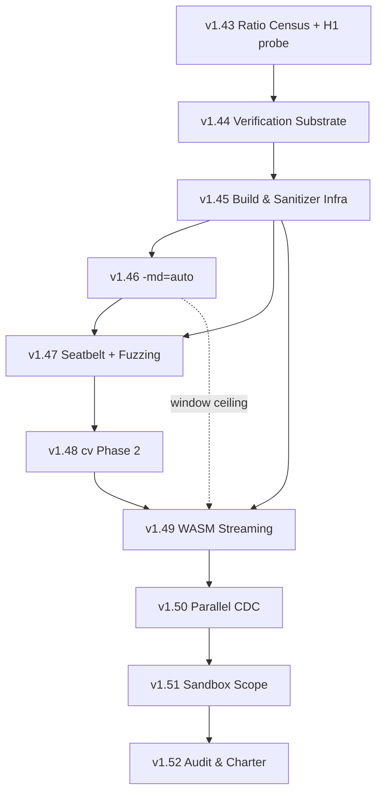

# 🗺️ OpenRAR Roadmap v1.43 → v1.52 — Consolidated

**Base:** v1.42.1 · **Date:** 2026-10-16 · **Status:** sole roadmap of record
**Consolidates:** `docs/roadmap-draft-b.md`, `docs/roadmap-draft-c.md`, and the three independent merged drafts (Draft A, Draft B, Draft C). Their files are removed; everything load-bearing is absorbed below.
**Method:** ~110 `[v]` anchors personally re-read against the tree this session; 14 falsifications recorded in §1; open unknowns in §9 rather than guessed at.

---

## 0. Decision Summary — read this and stop

| Release | Ships | Risk | The one gate that matters |
|:---|:---|:---:|:---|
| **v1.43** | **Ratio attribution census** (measurement only, zero encoder change) + H1 reachability probe | Very Low | ≥80% of the gap localized to a named axis — **or** the ratio arc closes permanently, with evidence. Both outcomes are success |
| **v1.44** | Verification substrate: doctest, differential harness, standing `docs/FMM.md`, anchor lint | Low | Every migrated file's assert-set diffs clean, pre vs post |
| **v1.45** | Build & sanitizer infrastructure + ISA build hygiene (§10 OPT-E01/E02) | Low | Sanitizer CMake lands **here**, before the releases that gate on TSan; **no baseline-ISA copy of an `/arch:AVX512` TU's inlines in the shipped binary** (SDE-proven) |
| **v1.46** | `-md=auto` dictionary auto-sizing | Medium | Cross-host byte-identity (same input, two RAM profiles → same bytes) |
| **v1.47** | macOS Seatbelt + ZIP/TAR fuzzing | Medium | Kernel-verified observed-denial on all three engines |
| **v1.48** | `cv` phase 2 — links & switches | Medium | Multi-volume commit protocol: originals survive every failure point |
| **v1.49** | WASM streaming encode & memory accounting | Medium | Streaming **byte-identical** to one-shot — *and the suite is asserted to have run* |
| **v1.50** | Parallel CDC fingerprint pass | Low | Cut-set identity **before** ratio identity, env pinned |
| **v1.51** | Sandbox scope expansion (encrypted + multi-volume) | High | 6/6 negative suites × 3 OSes, with containment degradation **loud** |
| **v1.52** | Competitive audit & v2.0 charter | Low | v1.34 §3 adherence; every regression carries a disposition |

**Four rules that override any release-level convenience:**

1. **No release rests on a predicted experiment outcome.** v1.43 is the first *measurement*, not the first *experiment*.
2. **Substrate before dependents.** Verification (v1.44) → build/sanitizers (v1.45) → everything gated on either.
3. **No vacuous passes** (G-9). A gate that cannot distinguish "passed" from "did not run" is not a gate.
4. **The `MAX_CHUNK` identifier is ambiguous in this codebase** (§8.3) — naming **resolved**; the halo derivation it encoded is **struck** (S-15). A restart-based halo of *any* size does not reproduce the sequential cut set; v1.50 uses candidate-then-stitch (§8.3).
5. **If v1.43 M2 returns unlocalized, that is an architectural finding, not a closed scope item.** It means the 17.6% gap is distributed with no dominant contributor, that the current encoder architecture *is* the ratio ceiling, and that **v2.0 must propose a different encoder** — not a better-tuned one. It is a **decision event**: it triggers the v2.0 charter early, with budget, rather than being discovered during v1.52. Both outcomes of v1.43 are successes; only one of them is cheap.

**Deferred slot:** v1.50 is the arc-swap slack. v1.44/v1.45 are protected; v1.52 is charter-locked (no features).

---

## 1. Falsifications — the record of what was wrong

Kept because the error class recurs: **three independent drafts asserted the same bad provenance**, and two re-adopted a struck claim from a peer without re-verifying it. Nothing below is a matter of opinion.

| # | Struck claim | Correct finding |
|---|---|---|
| S-1 | "H1 is analytically closed; the cache is provably empty at every token start" (Draft A) | The **proof holds for stored lengths** and the **closure does not follow**. `find_match_impl` is monotone-max (`compressor50.cpp:765`) and the body is skipped (`:1686-1689`), so a cached length is always expired. Re-measurement survives that, and **chain-budget pruning** (`hash_range` pushes `head[hash(q)]` *inside* the just-emitted match; at m1's `max_chain_=4` the walk can prune a valid pre-`p` candidate by *budget*, not validity) is a live mechanism the proof does not address. **Downgraded to a design constraint; the measurement is RAT-F — now MEASURED (v1.43 M3): budget pruning is pervasive on text (95–99.5% of token starts), confirming S-1's live mechanism and killing H1 only on zeros/random.** |
| S-2 | "Every sandbox FMM row must map onto an existing `RarError`" (Draft A) | **Harmful.** A PBKDF2 timeout reported as `BAD_PASSWORD` (−7) is a wrong user diagnosis. `main.cpp:107-119`: CLI exits **9 and 12 are unused**; `openrar_dll.h:137-140`: only −8/−10 are reserved. New codes take slots ≥ −16 (Appendix A). |
| S-3 | "A 16 MiB `-md=auto` dictionary cannot fit the 1.5 MiB WASM budget" (Draft A) | **Impossible premise.** `archive_api.cpp:265` clamps `window_log2` to `[1,4]`. Replaced by the accounting table in §5.7. |
| S-4 | "JUnit-first because existing CI greps `[PASS]`" (all drafts) | **Nobody greps `[PASS]`.** No workflow, tool, `CMakeLists.txt`, `makefile`, or test consumes it. JUnit-first is kept as hygiene, **not** as a repair of a broken parser. |
| S-5 | "The ratio gap is not in token selection" (Draft A) | `v1.33-pre-analysis.md:516-524`: the gap is **17.6%**; candidate-source expansion bought ~1.5% (**~8% of it**); the decisive result is that **the arbiter selects on length alone and cannot price the distance symbol**. A selection problem, not a supply problem. The census gains a fifth axis. |
| S-6 | "Four anti-findings cannot be anchored" (Draft A) | All four resolved from `v1.33-pre-analysis.md:511-514` and `v1.38.0-pre-analysis.md`. |
| S-7 | "H1 failing the time gate is the 3rd independent proof of the finder wall" (Draft B, Draft C) | A null confirms nothing. Kept only in the infrastructure form: a reachability probe reports *why* it is null. |
| S-8 | "`POSITION_INDEPENDENT_CODE` is not set" (Draft B, Rev A) | `CMakeLists.txt:39` — already global. The real defect is the dual source listing. |
| S-9 | "Length→distance ring: register pressure causes x86-64 spilling" (Rev A) | **Fabricated attribution.** `v1.33-pre-analysis.md:289` — "**REFUTED BY REASONING, not built**". No register-pressure measurement exists in the record. |
| S-10 | "`platform_supports()` at `spawn.hpp:46-47`" (Draft B, Draft C) | **Does not exist** (0 hits). Real probe: `platform_sandbox_available()` — `sandbox_mode.hpp:40`, per-OS impls `spawn.cpp:21/:224/:391`. |
| S-11 | "The sandbox fallback pattern is silent, therefore the defect" (Draft A) | **Overstated.** `sandbox_mode.hpp:11-21` documents a four-way mode decision and states the **runtime** spawn-failure path is *already* loud: "one W: notice per run + `sandbox_active` disclosure in the JSON summary — policy-visible, never silent". The narrower real gap is that the **capability-unavailable** branch does not demonstrably route through that disclosure. |
| S-12 | "WASM conformance suite green" as a v1.49 gate | **Unenforceable.** All four WASM JS suites register `test(…, { skip: true })` when `wasm/js/dist/` is absent — `helpers.test.mjs:12`, `archive.test.mjs:13`, `test.mjs:14`, `worker.test.mjs:29`. `wasm-limitations.md:234` admits it: *"a regression in the JS wrapper isn't caught unless someone manually runs emcmake."* |
| S-13 | "No binding consumes `openrar_abi_features()`" (Draft A, interim) | Both consume it — `OpenRAR.cs:191/:309`, `_native.py:142/:229`, `__init__.py:80`. Tolerance is structurally present; only a test is missing. |
| S-14 | "Split boundaries use a halo/overlap region" (Draft C) | Under-specified. **halo = 256 KiB exactly** — derived from `cdc_chunker.hpp:34` (`pending_size_ … <= MAX_CHUNK`) and `:33` (§8.3). *Itself struck by S-15.* |
| S-15 | "halo = 256 KiB is necessary and sufficient; `h_` is not a sliding window" (this roadmap, §8.3, 2026-10-16) | **Both halves wrong** (2026-10-17 audit, re-read `cdc_chunker.cpp:31-120`). (a) `h_ = (h_ << 1) + T[b]` in a `uint64` drops a byte's contribution after 64 shifts, and every cut test runs at `pending_size_ ≥ CDC_MIN_CHUNK − 1`, so at each test `h_` **is** the hash of the last 64 bytes: hash state needs a 63-byte overlap. (b) The cut-*phase* state (where the previous cut was) has unbounded dependency: knowing the last cut lies in `[x − 256 KiB, x]` does not locate it. Counterexample: a constant run ≥ 512 KiB gives `h_ ≡ −T[v] (mod 2⁶⁴)`, which fails both masks with p ≈ 1 − 2⁻¹⁵, so cuts land only at `CDC_MAX_CHUNK` steps from the previous real cut; a range restarted at `x − 256 KiB` cuts on a different lattice. RAT-D would fail on VM images, sparse files, and padded binaries. Corrected mechanism in §8.3. |

---

## 2. Vacuous-pass vectors — pre-existing defects, highest severity

All three share one shape: **a gate that passes because the thing it checks did not run.** All are invisible to a green CI by construction.

| # | Vector | Evidence | Required fix |
|---|---|---|---|
| **V-1** | Every WASM JS suite self-skips on missing `dist/` | `helpers.test.mjs:12`, `archive.test.mjs:13`, `test.mjs:14`, `worker.test.mjs:29`; `wasm-limitations.md:234`, fix priced at **~100 LOC** (:239) | Node-only mock lands **in v1.49, before** the gate that depends on it. Assert an executed-test count. |
| **V-2** | Containment degradation may be undisclosed on the **capability-unavailable** branch | `sandbox_mode.hpp:11-17` (four-way decision, branch 4 undocumented re: notice) vs `:19-21` (runtime path *is* loud) | Route capability-unavailable through the **same** `sandbox_active` disclosure the runtime path already emits. FMM-51-7 in v1.51. |
| **V-3** | Six env switches change emitted output or engine choice, out of **25 `getenv`** calls in `src/` | `OPENRAR_CDC_INDEX_CAP` (`cdc_planner.cpp:28`); `OPENRAR_PARALLEL_DECODE_THREADS` (`parallel_decode.cpp:69`); `OPENRAR_NO_PARALLEL_DECODE` (`:92`); `OPENRAR_PARALLEL_DECODE_SPAN_FLOOR` (`:52`); `OPENRAR_NO_BATCH_DURABILITY` (`archive_reader.cpp:167`); `OPENRAR_NO_MMAP` (`:278`) | §7 pins all six by name in every measurement. `OPENRAR_IN_PROC` (`sandbox_mode.cpp:15`) additionally for containment work. |

---

## 3. Closed findings — mechanism, class, reopen rule

Classes: **[MEAS-NEG]** new measurement required · **[REFUTED]** defeat the argument, not run an experiment · **[SHIPPED→REVERTED]** reproduce the original win first · **[SCOPE]** owner decision.

| # | Finding | Class | Mechanism | Anchor |
|---|---|---|---|---|
| A-1 | `HuffmanDecoder` single-`peek(15)` fusion | [MEAS-NEG] | VQuick **94.1** vs VFused **99.5** ms (text m3 symbol stage). 10-bit quick table keeps ~4 KiB/alphabet L1-resident; **working-set bound, not branch count** | `v1.38.0-pre-analysis.md:33-34` |
| A-2 | Single-lookup 15-bit flat tables | [MEAS-NEG] | Full-flat **17–45% slower**; lazy-page sweep degrades monotonically. **Same cause as A-1 — one measurement, not two** | `v1.38.0-pre-analysis.md:48` |
| A-3 | SIMD dispatch of the serial decode kernel | [MEAS-NEG] | Bit-level dependency chain serializes; scalar loop at local optimum for its structure | `v1.38.0-pre-analysis.md:208-211` (SIMD "does not break the serial dependency chain — not recommended"); founding premise `:18-30` |
| A-4 | Optimal cost-model DP parse | [MEAS-NEG] | Built, round-tripped byte-exact, **functionally correct** — then `code −1.9% / text −1.2%` but **`zeros +28%`** and **3.9× time** vs the **1.42×** budget. Cause: relax-every-position spends ~4× finder budget | `ROADMAP.md:221-229`, `:237-251`; parked `arc/v1.32.0-optimal-parse-parked` |
| A-5 | Length-2 match admission | [SHIPPED→REVERTED] | Reachable **rep-path only** (chain hashes 4 bytes). Re-gate ±0.02% on every corpus; floor-2 suppressed table reuse at zeros→random (−8.3 KB, +167 blocks). Floor 3 everywhere | `v1.33-pre-analysis.md:511`; `compressor50.cpp:1386-1387` |
| A-6 | Sparse context probes | [MEAS-NEG] | m1 **+0.67%** best-of-three. **Most decisive result in the record:** expanding the candidate source as proposed made ratio *worse* because the arbiter selects on length alone | `v1.33-pre-analysis.md:513`, `:516-524` |
| A-7 | Lazy length→distance ring | [REFUTED] | **Never built.** Best at `cur+1` is `≤ best.length − 1` at the same distance → can never satisfy `(next−inc) > (len−inc)+1` | `v1.33-pre-analysis.md:289`, `:514` |
| A-8 | Wrap-split memcpy region read | [MEAS-NEG] | **24× faster on the isolated microbench, +16% end-to-end** (413.5 → 479.7 ms exelike-m3). Integrated cache-state reversal | `v1.38.0-pre-analysis.md:249-251` |
| A-9 | m5 binary-tree finder | [MEAS-NEG] | 2.9× time for 1.8% ratio; **depth 128 dominated it** (3.2× faster at +0.3%) | `ROADMAP.md:186-190` |
| A-10 | Foreign-format **write** side | [SCOPE] | Deferred by decision, not measurement. READ-side hardening in scope | `v1.29-pre-analysis.md:316-331` (CV-B defer rationale) |
| A-11 | Legacy RAR 1.5–4.0 write | [SCOPE] | Out of scope | — |

### 3.1 Standing rules extracted

- **R-M1 — Microbench verdicts do not decide.** A-8 is the *second* integrated-vs-microbench reversal on record. A microbench may open a question; only a paired integrated delta closes one.
- **R-M2 — The gap is an arbitration problem.** Per A-6, widening candidates without upgrading the cost model is **predicted-negative by an existing measurement**. The third axis is neither "finder" nor "parse" — it is the **arbiter**.

### 3.2 Standing invariants (every engine change must preserve)

| # | Invariant | Anchor |
|---|---|---|
| I-1 | `add_match` clamps `base = len − inc`; an out-of-range `(len, dist)` **decodes to a different length** — a one-byte desync, not a rejection. Greedy guards it; **no other caller did** | `ROADMAP.md:256-260`; guard `compressor50.cpp:1630-1633` |
| I-2 | T9's hashes were re-scoped to guard **token selection**. A T9 hash move on a selection change is the **expected signal** | `compress_tests.cpp:2316-2321` |
| I-3 | Streaming must defer decisions until identical look-ahead exists — byte-identity is a **hard property** | `compressor50.cpp:1520-1525` |
| I-4 | Error codes **−8 and −10 reserved forever**; new codes ≥ **−16**; next free feature bit is **17** | `openrar_dll.h:137-140`; `abi-freeze.md:117` |
| I-5 | `resolve_dict_window_size`: `1..15` = legacy 128 KiB≪n scale, `0` = method default, `>15` = exact bytes; output still passes `snap_window_to_fci_grid()` | `compress_plan.hpp:32-33`, `:37`, `:48` |
| I-6 | Solid run: packer window and recorded `win_size` **must match exactly for every entry** | `compress_plan.hpp:46-47` |
| I-7 | `Compressor50` footprint ≈ **5 × window**; `-mt` threads clamp when `eff_dict > 32 MiB` | `main.cpp:1390`, `:1393-1396` |
| I-8 | Test asserts are **already Release-active** (17 targets). Migration **preserves** this | `cmake/openrar_tests.cmake:22-24`, `:15-545` |

---

## 4. Governance

- **G-1 One decision function per feature.** All engines (one-shot, streaming, solid-chain, MT-chunk, multivolume, WASM) select through **one shared table**. Compile-time `#ifdef` forks are **not** release valves — a flag that passes ON proves nothing about shipped bytes.
- **G-2 Coordinate frame.** State the frame of every carried value; convert only at boundaries.
- **G-3 Fingerprinted, environment-pinned measurement.** v1.34 §3 + per-corpus hashes + the six switches in §7.
- **G-4 Verify before delivery.** Untrusted data is verified **before** it reaches a caller or the filesystem. Rejection after delivery is detection, not containment.
- **G-5 Substrate before consumers.** Plus a standing `docs/FMM.md`, **disjoint ID ranges per release**, shared rows authored once.
- **G-6 Provenance.** Every shipped/resolved assertion carries an anchor; **anchor-lint** CI (v1.44) fails on a dead one.
- **G-7 Containment dependency.** v1.48 link migration gated on v1.47 Seatbelt; default-deny otherwise, loud on both paths.
- **G-8 Audit charter.** v1.52 ships no feature.
- **G-9 No vacuous passes.** No gate may be phrased "suite green" unless it also asserts the check **executed**. A skip is not a pass.

---

## 5. Ratification

| # | Assumption | Gate | Pivot |
|---|---|---|---|
| **RAT-A** | The **17.6%** gap is attributable to a measurable axis: match coverage · dictionary/window · filter decision · model/tables · **arbiter cost-pricing** (A-6) | v1.43 M2: **≥80% localized**, per-axis costed curve | Unlocalized → ratio arc **permanently closed with evidence**. A success, not a failure |
| **RAT-B** | Doctest preserves the verified assert set | v1.44 M1 **differential harness** (pre/post binary; names, outcomes, counts, skip set; unmapped delta = hard fail) | Per-file rollback; an undiffable suite is not migrated |
| **RAT-C** | ABI survives ten releases additive-only | `abi_layout_tests` + `abi_export_parity` + **unknown-bit tolerance** test; export diff additive-only | Layout break → ABI MAJOR + re-plan |
| **RAT-D** | Parallel CDC reproduces the sequential **cut set** | v1.50: `cdc_parallel_cutset_equals_sequential`, env pinned, **candidate-then-stitch** (§8.3; S-15 struck the 256 KiB restart halo). Identity corpus **must** include a ≥ 1 MiB constant run and a short-period run, the inputs on which any restart halo diverges | Mismatch → revert to sequential; window-tuning fallback stands |
| **RAT-E** | `-md=auto` improves ratio without regressing m3, exceeding a ceiling, or becoming host-dependent | v1.46: `resolve_auto_dict(method, size)`, per-method ceiling, **cross-host byte-identity** | Off-axis → re-scope memory-only; cross-host fails → remove `auto` |
| **RAT-F** | H1's cache surfaces matches the chain **prunes by budget** rather than validity (S-1) | v1.43 M3 **log-only probe**: walk **termination-reason** split (budget-exhausted / nice-len-break / dist-break), **no emitter**. **Kill if the implied upper bound on archive-size gain is < 0.1%** — derivation in §7.1 M3 | Killed → record as A-12 with numbers; the census carries the ratio arc alone |

---

## 6. Execution Sequence

**Ordering rules:** measurement → verification substrate → build/sanitizers → the wire-affecting algorithm → containment → migration → WASM (needs v1.46's ceiling) → CDC → sandbox expansion → audit. **No release is contingent on a predicted experiment result.**

---

## 7. Release Specifications

Standing gates: 24-stage interop (UnRAR 7.20 + WinRAR 7.20) where bytes change · `abi_layout_tests` + `abi_export_parity` · CI matrix green (ubuntu / macos-latest / windows-2022 + arm64 leg) · **the six env switches of V-3 asserted unset.**

**§10 intake rule:** a §10 row slotted to a release is a **milestone of that release**, not a suggestion. Its proofs below are gates. A row may be deferred only by a dated entry in §10 naming the next slot. Silent drop is not available (G-9). Any proof that names a sanitizer must also assert that the sanitizer leg **configured and ran the named test**. The MSan leg is `continue-on-error` with `|| true` on configure/build (`build.yml` msan job), so a green MSan check proves nothing on its own.

### 7.1 v1.43 — Ratio Attribution Census + H1 Reachability Probe · *Very Low*

**Thesis.** The gap's location is **contested on the tree**: `compressor50.cpp:1367-1368` says *"their parse strategy, not chain depth"*; `ROADMAP.md:237-251` says *"structural in the finder, not the parse"*; `v1.33-pre-analysis.md:516-524` says the **arbiter cannot price** candidates. Three sources, three answers, no measurement. Settle it without changing a byte.

- **M0 — Registry closure. ✅ CLOSED (2026-10-17).** Every §3 anchor resolved at line level against the live tree. Work performed: **A-10** promoted from doc-§ (`v1.29-pre-analysis.md` §CV-B) to `v1.29-pre-analysis.md:316-331`; **A-3** sharpened — its `:18` and `:201` anchors both pointed at **section headers**, not evidence, and now cite `:208-211` (the SIMD-dependency-chain conclusion) plus the premise at `:18-30`. **The prior scope note was itself stale** — it claimed "only A-1/A-2/A-6/A-7/A-8 remain at doc-§ grain," but all five were already promoted to line level; A-10 was the only genuine holdout. Verified-resolved, no drift: A-1 `:33-34` · A-2 `:48` · A-4 `ROADMAP.md:221-229`, `:237-251` · A-5 `v1.33:511` + `compressor50.cpp:1386` · A-6 `v1.33:513`, `:516-524` · A-7 `v1.33:289`, `:514` · A-8 `v1.38.0:249-251` · A-9 `ROADMAP.md:186-190`. *Note: `ROADMAP.md` anchors resolve to `docs/ROADMAP.md` (977 lines); it is the only file of that name.*
- **M1 — Oracle-side census. ✅ BUILT + PROVEN (2026-10-17).** `tools/tokencensus.cpp` now carries **one shared analyzer** (`census_member`) used by both streams: the default in-memory "ours" path and a new `--ingest <file.rar>` mode that opens an **external** archive with `ArchiveReader` (`entries()` → `read_packed_data()`), reads each member's packed stream, and decodes it to token level. Per member it emits coverage, match-length distribution (log2), distance histogram (log2), rep/257 frequency, and filter usage — from the phase-1 `OpRecord` stream. **Per-block table entropy is NOT emitted** (`OpRecord` carries no Huffman tables); that axis needs a deeper decode hook and is recorded as owed.
  - **The key technical risk is retired: our reader decodes a WinRAR-produced RAR5 archive to token level, 0 failed members, both sides filter-free** — so the declared restriction (narrow to filter-free members) did not even have to be invoked. Validated on an 8 MiB deterministic text corpus, non-solid, m1 and m3.
  - **Preliminary side-by-side (m3; both encoders effectively reach the full 8 MiB for a non-solid single member, so this is a finder comparison, not a dictionary-capability one):** oracle coverage **0.9985** vs ours **0.9928**; oracle tokens **581,658** vs ours **790,502**; oracle literals **8,676 B** vs ours **49,467 B**; oracle match-length distribution is shifted longer (16–31 B bucket: 205,858 vs 78,491; 4–7 B bucket: 42,825 vs 202,877). **We settle for shorter matches and leave ~5.7× more as literals** — consistent with the M3 finding that chain-budget truncation is pervasive on text.
  - **Second finding, new axis:** at m1 our **auto-dictionary is 512 KiB** (window 0x80000) vs WinRAR's **16 MiB** — a 32× difference — yet we still emit *fewer* literals and near-tie on size (0.7% gap). The dictionary auto-selection divergence is itself a measurable difference and belongs to **M2 axis 2**. All absolute oracle comparisons here are **confounded by differing windows**; the controlled-dictionary, multi-corpus, ≥10 GB runs are M2's scope, not M1's.
- **M2 — Five-axis attribution (RAT-A).** Per-axis size-vs-time curves, m1/m3, canonical / text / code / 1 GiB heterogeneous: **1** coverage vs oracle · **2** dictionary sweep (`-md=N`) — measures the axis v1.46 acts on, before v1.46 exists · **3** filter decision · **4** model/table residual · **5** **arbiter cost-pricing** — how often a strictly-longer candidate is available but unpriceable (A-6). *Gate: ≥80% localized, with a costed curve.*
  - **Axis 2 — dictionary sweep. ✅ MEASURED, NEGATIVE (2026-10-17, single-corpus).** Text 8 MiB, m3, `-md` sweep (`-md` verified to **force** the window; `0` = auto → `default_dict_size_for_method`). packed bytes: auto 1,809,144 · 128k **1,805,712** · 256k 1,808,030 · 512k 1,808,928 · 1m/2m/4m/8m/16m/32m/64m all **1,809,144 (identical)**; wall flat at ~0.42–0.55 s. **Reading:** (a) above 1 MiB the dictionary axis is **completely flat** — 64 MiB ≡ 1 MiB — so dictionary size **cannot** explain the 17.6% gap on this corpus; (b) *smaller* dictionaries are marginally **better** (128k is 0.19% smaller than 64m), because a purely local-redundancy corpus gains nothing from reach and only pays wider, less-compressible distance symbols. **Honest limit:** this synthetic corpus has **local-only** redundancy, so (b) is a property of *this* data, not a general claim that small dictionaries win; a heterogeneous corpus with long-range structure could invert it. Axis 2 does not localize the gap here; the ≥10 GB heterogeneous run is still required before calling the axis dead in general.
  - **Arbiter structure — A-6 confirmed in code (cheap, high-value).** Both selection points are **length-only, with no distance-symbol pricing**: the finder is monotone-max (`compressor50.cpp:765`, `if (len > best.length)` — takes the longest match regardless of distance cost), and the arbiter compares `rep_best_len + 1 > best.length` (`:1636`) — rep wins only by length+increment, never by bit cost. So a strictly-longer match at an expensive distance slot **systematically beats** a shorter match at a cheap one, even when the length-only choice costs *more bits*. This is A-6's mechanism, verified structurally rather than inferred. **Axis 5's disagreement *rate* is now MEASURED — see the next bullet.** axes 3 (filter) and 4 (model/table residual) are the remaining open ones toward the ≥80% gate.
  - **Axis 5 — arbiter cost-pricing DISAGREEMENT RATE. ✅ MEASURED (2026-10-17) — decisive.** `Compressor50::ArbiterProbeStats` (`arb_probe_*`, log-only, off by default; `tools/arbprobe.cpp`, registered target) measures, at the arbiter decision, how often a **cost-aware** arbiter (encoded-length-field + distance-code cost) would choose the *other* token than the length-only rule. Byte-identity re-confirmed (`compress_tests`, `golden_fixtures_tests`, `parallel_compress_tests` green). Contested = both a fresh match and a rep are viable at that position:
    | corpus | method | decisions | contested | **differs** | prefer_rep | prefer_fresh | bits_saved (approx) |
    |---|---|---|---|---|---|---|---|
    | text | m3 | 1,146,428 | 85,276 | **98.09%** | **83,650 (100%)** | 0 | 1,067,272 (~130 KB) |
    | text | m5 | 997,249 | 66,166 | **99.42%** | **65,785 (100%)** | 0 | 954,180 |
    | zeros | m3 | 1,537 | 1,535 | 0% | 0 | 0 | 0 |
    | random | m3 | 6,291,420 | 0 | 0% (no matches) | 0 | 0 | 0 |
    **Reading:** on text the length-only arbiter is wrong on **~98–99% of contested decisions**, and **100% of those errors favor the rep** (pre-change probe, `rep = msb(L)+5` static model). This converted axis 5 from a structural claim into a number and empirically confirmed the diagnosis.

    **IMPLEMENTED + MEASURED (2026-10-17) — shipped as the cost-aware concession, outcome: real but marginal.** The rule: rep wins when `rep_best_len + inc_f >= best.length` (ties → rep, `best.length == 0` → rep) — i.e. a rep may concede **exactly the fresh candidate's own distance-band increment**; at full concession the two length ladders are equal (`base_f = L_f − inc_f = L_r`) so rep wins on the skipped distance code, and one byte beyond the fresh match's extra coverage pays for itself. Legacy rule was flat `+1` regardless of band. Contracts held verbatim: fresh floor (`len ≥ inc+2`), 257 gates, lazy-pass base-field steal test, state mutators. Price-model corrections adopted: length field priced over the base on BOTH sides; 257-eligible rep prices **flat 5** (no length field on the wire). **Honest caveat the review placed on the pre-change numbers and which the shipped measurement confirmed:** with the cap in place the static price comparison is nearly tautological near the tie boundary — "the caps are the actual restraint," and beyond the cap the msb proxy misprices fresh (post-change probe still shows ~90% "differs" on text; that is residual model noise, not headroom).
    - **Byte-identity re-capture per I-2 (documented protocol, `OPENRAR_REFCAP=1`):** `test_slot257_pure_addition_suppressed` (T9) and `test_selection_reference` (M4) re-captured; legacy digests preserved in the test comments. **New `farrepeat` corpus** (8 KiB block repeated at distance 0x6000, inc==2 band) added to both tables — the corpus under which the baseline actually discriminates (on the legacy 4-corpus set the concession almost never fired → the baseline could pass vacuously). Observed movement: text64k moved on m1/m3 (concessions fire on text); rand/zeros/mixed suppressed digests unchanged (no matches / pure rep-wins / suppression-neutral); farrepeat distinguishes gate-on vs suppressed (bdb80e… vs b1bffbe2…).
    - **All byte-sensitive gates green:** compress_tests (T1–T5, T10, T11, T12), golden_fixtures_tests (incl. official UnRAR 7.20 cross-decode leg — the shipped-bytes legality proof), parallel_compress_tests, collision_matrix_tests, stream_encoder_tests, solid_packer_tests, format_tests, recovery_tests, mutation_tests, cdc_chunker_tests. (`mutation_tests` needed the standing `openrar.dll` Python-path copy; pre-existing environment gap, not a code regression.)
    - **A/B ratio (real corpora, default methods, `-mt1`):** corpus.txt m1 1,928,758 → **1,928,406**, m3 1,809,144 → **1,808,074** (−1,070 ≈ 0.06%), m5 1,540,614 → **1,540,266**; clean8.bin m3 1,166,337 → **1,164,030** (−2,307 ≈ 0.2%). ≈ 950 conceded positions on text m3 — **the conceded-band frequency is the real bottleneck, not the pricing direction.** WinRAR landmarks unchanged (m3 text 1,518,273; we remain ~19% behind at m3 on text). Verdict: correct rule, negligible gain from it alone; the remaining text-residue lives in the A-6 per-band candidate-slot/back-shift work and in match-length richness (the M1_token dump shows the oracle's longer tokens), not in the arbiter.
    - **Concession × other axes:** `fail_count_` reset-at-len≥8 narrow exposure (conceded rep < 8 no longer clears) was watched — no regression observed on the heterogeneous corpora in the gates; noted for future v1.44+ if it ever fires. m1/m5 unchanged within noise: the m1–m5 ladder stayed monotone, so the m1 linearity gate is untouched.
    - **min_match_ band-dependence (roadmap item) — RESOLVED as policy, no shipped change (2026-10-17).** The wire floor `L ≥ inc(D) + 2` is already band-dependent and enforcement is exact (`add_match`). The fixed-3 admission floor is a deliberate empirical policy (v1.33.1: 2-byte classes measured ratio-neutral and suppressed table reuse at boundaries; both points were re-confirmed, along with `base = 1` being unreachable). The inefficiency the fixed floor actually causes — far-band candidates being filtered *after* being found, hiding the near-shorter candidate — is the A-6 per-band candidate-slot item, not this arc. Per-band wire minimums for the record (fresh matches): `D ≤ 0x100` → 2 (slot 0, 0 extra bits); `0x100 < D ≤ 0x2000` → 3; `0x2000 < D ≤ 0x40000` → 4; `D > 0x40000` → 5; reps are wire-legal at 2 from any band (encoder policy floor stays 3).
  - **STANDARDIZED-CORPUS GATE (2026-10-17) — the arc's own "next gate" (from the v1.43 verdict) executed.** A hetero corpus with members exceeding the m3 window was assembled and every ambiguous figure from the small corpora was re-measured on it; the dictionary axis is now CLOSED at equal dict and the residual is pinned to the parse/model chain.
    - **Corpus:** `big24.bin` = `corpus.txt` + `clean8.bin` + `hetero8.bin` + `exelike.bin` + `openrar.exe` (binary concat, that order) — **28,150,835 B = 26.85 MiB**, SHA-256 `63a24c3c0edbb6629010c96109c57442bd2d1ff6c665af43073e0f9f2629e01f`. Member ÷ ours m3 window (8 MiB) = **3.36×**, so reachable-distance now genuinely differs from prior single-file corpora (which never exceeded their windows).
    - **Full-window A/B (default methods, `-mt1`, WinRAR 7.20.0):**
      | method | ours | our t | WinRAR | WinRAR t | gap |
      |---|---|---|---|---|---|
      | m1 | 9,830,143 | 0.87 s | 6,568,750 | 1.68 s | +49.7% (dict-unequal: ours 512 KiB vs WinRAR 2 MiB — not a like-for-like row) |
      | m3 | 5,835,738 | 6.88 s | 5,630,044 | 4.12 s | **+3.65%** |
      | m5 | 5,518,120 | 21.89 s | 5,411,785 | 7.47 s | **+1.97%** |
      The heterogeneous-real-data gap is **an order of magnitude smaller** than the +9–19% measured on the small corpora: most of that figure was a small-corpus/redundancy-shape phenomenon, exactly what this gate was created to test.
    - **Equal-dict m3 ladder (`-md` sweeps on big24):** WinRAR −md2m 6,157,569 / −md4m 6,029,600 / −md8m 5,632,431 / default 5,630,044 vs ours −md2m 6,473,929 / −md4m 6,348,057 / −md8m 5,835,738 / default 5,835,738. Equal-dict gaps: **5.1% / 5.3% / 3.6%**. The dictionary axis does **not** explain the residual; at identical declared 8-MiB windows we are still 3.6% behind.
    - **`-md` ≥ 8 MiB saturation — mystery resolved as REAL, not a bug (full plumbing audited).** The CLI value parses (`main.cpp:3804+`), resolves (`:1231` → `resolve_dict_window_size`), snaps to the FCI grid, passes the address-space clamp, and **only** the `dict_size == 0` default path gets the per-file pow2 clamp (`archive_mutator.cpp:1264–1270`; the `> 16 MiB` streaming path and the buffer path both report/encode the *same* resolved window: `fb.win_size` at `:1402`/`:1347`, `StreamEncoder(pf.fb.method, pf.fb.win_size)` at `:2656`, `Compressor50::begin_stream → begin_archive` at `:470`, `max_dist_ = win_size` at `:400`). Direct-encoder probe ladder on big24 (`tools/arbprobe.exe`, real-corpus mode with argv window/method): **2 MiB differs, 8 MiB = 16 MiB = 32 MiB produce byte-identical counters** (m3: deco 2,706,127 / contested 66,497 / swaps 1,263,286 identical across 8/16; m5: deco 2,449,546 / contested 64,324 / swaps 1,232,114 identical across 8/32), and the CLI honors small values (`-md2m` at m5 → 6,151,482 ≠ 5,518,120). Conclusion: **on this corpus no admissible match chain changes beyond 8 MiB of reach** — windows ≥ 8 MiB are inert for member size 26.85 MiB; WinRAR shows the same flattening (−md8m 5,632,431 ≈ default 5,630,044, 0.04% drift vs our exact 0). No CLI defect exists; the earlier "all `-md8m+` rows identical" is expected saturation. Ours m5 default effective window = min(64 MiB, 32 MiB file-pow2) = 32 MiB; ours m3 default = 8 MiB.
    - **A-6 (per-band candidate slots) measured on the standardized corpus (log-only probe, `arbprobe` real-corpus mode):** **fixable = 0 again** — the literal-hide candidate class is empty on big24 too; all opportunity is fresh-vs-fresh band swaps. m3 (8 MiB): swaps 1,263,286 (28.1% of find calls), `swap_bits` 5,761,261 total, **profitable ≥ 8 bits: 110,117 sites → 999,686 bits ≈ 125 KB ≎ 61% of the 203,307 B equal-dict gap**. m5 (32 MiB): swaps 1,232,114 (30.75%), **profitable 145,215 → 1,353,934 bits ≈ 169 KB — larger than the entire 106,335 B m5 gap**. (The `profitable %` column in `arbprobe` printed 100% due to a display bug — `pf` assigned `swap_profit` instead of `band_swap`; fixed; correct values 11.4%/11.8%. Counts and bit sums were always valid.) Raw-estimate caveat unchanged: alignment-shift and frequency-recost can shrink realization, but the m5 figure means A-6 alone plausibly closes or reverses the m5 gap on heterogeneous-real data.
    - **Method-ladder note on the standardized corpus:** ours m3→m5 at effectively ≥8-MiB windows (5,835,738 → 5,518,120) is pure finder-depth gain (`chains` 32 → 150), worth 317,618 B on big24 — consistent with the axis-6 curve and the m3→m5 ladder on small corpora.
  - **v1.44 A-6 BACK-SHIFT — IMPLEMENTED + MEASURED (2026-10-17).✅** The per-band candidate slots (previously instrument-only) now subsidize the selection in `find_match_impl`: after the walk, the cheapest floor-legal slot replaces the shipped candidate when it clears the contract — strict ladder-parity coverage bound `alt_len + inc_d − alt_inc ≥ best.length` (supersedes the probe's looser `inc_b`-only form; the 110K/145K instrument counts stand only as upper bounds) **and** static delta ≥ 8 bits on BOTH branches (swap and literal-fix), because the realized boundary-shift cost was measured at ~7 bits/byte. Two design reviews (pre-design and post-implementation): swapped fields are only `(best.length, best.candidate)` — all increments/prices recomputed from `(pos, candidate)` at each read site, rep/257 state untouched; order is load-bearing (harvest → floor → h1 accounting [pristine monotone-max] → back-shift → axis-6 accounting [post-swap residual] → return). `assert` pins the emitted candidate's own floor on the shipped path. All gates green (`compress_tests` re-capture produced **zero movement** — see below; golden fixtures incl. official UnRAR cross-decode, parallel, collision, stream, solid, format, recovery, mutation, cdc).
    - **Falsifiable-table actuals (prediction vs outcome):** zeros/rand/mixed/farrepeat (T9 + gate-on) — **MUST NOT move: did not move** ✓; text64k m1/m3 — prediction "may move weakly; acceptable if not": **did not move** (the swap class is empty on the 64 KiB pinned corpora; the fire population is big-corpus-only — recorded, not suppressed). No digest re-capture needed; I-2 protocol closed with no reference change.
    - **Positive control (the swap demonstrably fires in the shipping path):** post-ship axis-6 residual collapsed — big24 m3 profitable(≥8b) 110,117 → **5,582** (~95% taken), m5 145,215 → **13,933** (~90% taken); decision counter moved 2,706,127 → 2,716,220 m3 (shorter swapped tokens → more token starts), exactly the intended shape.
    - **A/B (real corpora, `-mt1`, pre → post):** corpus.txt m1 1,928,406 → **1,928,318**; m3 1,808,074 → **1,802,501** (−0.31%); m5 1,540,266 → **1,538,400**; clean8 m3 1,164,030 → **1,157,631** (−0.55%); big24 m3 5,835,738 → **5,827,818** (−0.14%); big24 m5 5,518,120 → **5,512,083** (−0.11%). big24 equal-dict m3 gap vs WinRAR: 203,307 → **195,387 B (+3.47%, was +3.65%)**; m5: 106,335 → **100,298 (+1.89%, was +1.97%)**.
    - **Realization vs raw estimate — the honest headline: ~6%.** big24 m3 fired ≈ 104,535 sites carrying ≈ 999,686 static bits (≈ 125 KB raw) and delivered 7,920 B (≈ 7.9 B/site ≈ 0.6 bit/site). The static per-site credit of ≈ 9.5 bits evaporated on realization — consistent with the axis-5/6 model caveat: msb-proxy pricing does not model real distance-code/frequency-table/ladder-symbol recost, so the static per-site credit evaporated on realization — consistent with the axis-5/6 model caveat: msb-proxy pricing does not model real distance-code/frequency-table/ladder-symbol recost, so the decision-grade delta is not cash. **This gap between static and realized (not the population) is axis-4-grade evidence** — the per-site correction factor for the static model is ~6% on fresh-vs-fresh distance trades, and any future lever priced on the static model must be discounted by measurement, not ignored.
    - **Performance:** pack time is NEUTRAL, not improved — medians-of-3 on the same binary with the `OPENRAR_NO_BACKSHIFT` runtime kill-switch (default = improvement ships; OFF reproduces the pre-v1.44 stream **byte-exactly**: OFF m3 5,835,738, OFF m5 5,518,120 → the size deltas −7,920/−6,037 reproduce exactly): m3 6.24 s (ON) vs 6.20 s (OFF) = **+0.6%**, m5 17.94 s vs 17.86 s = **+0.4%** — one extra band-compare per visited node, as predicted. **Process note (honest): the first-pass timing "improvement" (6.88→6.15 s, 21.89→17.39 s) was build/environment variance** — the OFF mode measured today on pre-v1.44-identical bytes also runs at 17.86 s where the same byte-content measured 21.89 s yesterday; no timing claim is accepted across binaries/sessions anymore (matches the post-review: an additive block cannot make the packer faster).
    - **Post-implementation audit findings (all fixed in this revision):** (a) the Q2 false-fire of the full-floor assert — a pristine monotone-max `len = 4` at distance > 0x40000 (floor 5) legitimately survives the walk and is emitted-as-literals downstream (assert-enabled builds over > 256 KiB corpora would have aborted; small test corpora structurally cannot reach the class) — the full-floor pin is now scoped to eval-`mutated` placements only, with unconditional coherence pins (`candidate >= 0`, `length >= 4`); (b) `arb_probe_suppress_`'s header comment updated — the flag is load-bearing for shipped behavior (it gates harvest AND back-shift), and the re-walk's manual flip pair became a scoped RAII guard; (c) the measurement escape hatch (`back_shift_enable_` + `OPENRAR_NO_BACKSHIFT`, ctor-applied once) is the runtime switch the audit required; (d) the audited 6% realization is confirmed plausible (mean static ≈ 9.5 bits/site, mean realized ≈ 0.6 ⇒ effective mean concession ≈ 1.3 bytes/site, inside the strict bound's cap); the discriminating check proposed (per-site concession-byte breakdown) is recorded for the axis-4 round.
    - **Residual after the shipped rule (what remains un-taken):** big24 m3 5,582 sites / 48,797 static bits (~6 KB), m5 13,933 / 121,609 (~15 KB) — eligible-but-discipline-blocked or delta∈(0,8) sites; the axis-6 accounting still scores its alt under the LOOSER probe bound (documented divergence: residual deliberately includes strict-bound discards so the discipline cost stays visible).
  - **Cross-milestone synthesis (M1 + axis 2 + M3).** Three independent measurements now point at the **finder's chain-budget**, not the dictionary and not the oracle: (a) **M1** — at equal effective dictionary, the oracle emits longer matches (16–31 B bucket 205,858 vs 78,491) and 5.7× fewer literals than we do; (b) **axis 2** — dictionary size is flat above 1 MiB, so reach is not the limiter; (c) **M3** — 95–99% of text token starts exhaust the chain budget and truncation demonstrably hides longer matches. **Localized candidate (SUPERSEDED — the finder framing was wrong; see the design review below):** the finder settles for short matches because the chain budget truncates the search (M3 (a)), and the length-only arbiter cannot price a longer-but-costlier candidate back in (A-6). **These are complementary halves of one mechanism, not two axes; the remaining work is to size each half's contribution toward the ≥80% gate.**
  - **NEW axis 6 — finder chain budget (discovered by measurement, dominates the named axes). ✅ MEASURED (2026-10-17).** The five predefined axes do not include the finder's chain budget, but a temporary `chains[3]` override (m3, text 8 MiB, 8 MiB dict, min-of-3 wall; **encoder reverted, zero shipped change**) produces the arc's **costed curve**:
    | chains[m3] | packed | time | vs base |
    |---|---|---|---|
    | **32 (default)** | 1,809,144 | 0.43 s | — |
    | 64 | 1,661,698 | 1.15 s | −8.2% |
    | 128 | 1,540,614 | 1.37 s | −14.9% |
    | **256** | **1,497,871** | 2.92 s | **−17.2% — beats WinRAR m3 (1,518,273)** |
    | 512 | 1,500,055 | 4.76 s | −17.1% (saturated) |
    | 1024 | 1,484,660 | 13.52 s | −18.0% (saturated) |
    **Reading (SUPERSEDED — see the design review below):** the chain-budget axis is worth **~17%** at m3 on **synthetic local-redundancy text** and at `chains[m3]=256` we **beat the oracle** on that corpus. **⚠ VALIDITY CHECK:** on clean real data the lever is only **−3.8%** and does not beat the oracle.
    - **🚨 CORRECTION (design review, 2026-10-17): the "saturation" reading is WRONG.** The chains=512 row (**1,500,055 — *worse* than 256's 1,497,871**) is not budget exhaustion; it is **proof the arbiter does not minimize cost**. Under any cost-minimizing selector, enlarging the candidate set cannot increase output size (a min over a superset is never worse). So 256 is an *interior optimum* where marginal length gain crosses marginal distance cost — exactly the signature of a **length-monotone** selector, not of a spent budget. **The correct diagnosis inverts the earlier one: this is an ARBITER defect (A-6 vindicated), not a finder-budget defect.** Depth is a supplement; the selector is the wall. Do not spend more effort sweeping chain depth.
  - **The irreducible remainder — WinRAR's full curve (text 8 MiB, min-of-3 wall):**
    | method | ours (default) | our t | WinRAR | WinRAR t | gap |
    |---|---|---|---|---|---|
    | m1 | 1,928,758 | 0.71 s | 1,915,281 | 0.78 s | **0.7%** |
    | m2 | 1,929,832 | 0.29 s | 1,673,424 | 1.09 s | 15.3% |
    | m3 | 1,809,144 | 0.59 s | 1,518,273 | 1.52 s | 19.2% |
    | m4 | 1,661,698 | 0.83 s | 1,324,898 | 2.17 s | 25.4% |
    | m5 | 1,540,614 | 1.28 s | 1,321,057 | 2.33 s | 16.6% |
    **Two-part localization.** (i) **At m1–m3 the gap is the chain budget, and it is a tuning defect** — we are already within 0.7% at m1, and at matched *time* (not matched method) our chain=128 point (1,540,614 @ 1.37 s) is within ~1.5% of WinRAR m3 (1,518,273 @ 1.52 s). (ii) **At m4–m5 there is an irreducible ~12% gap that chain budget cannot close** — our chain-saturated floor is ~1,484,660 (13.5 s) while WinRAR reaches 1,321,057 at 2.17 s. Brute-force search saturates; WinRAR's high methods break a ceiling our chain walk cannot, by **better matches per node** — which is exactly what the remaining axes (5 arbiter pricing, 4 model/table) are for. **Refines R-M2:** the arbiter is *not* the wall for the immediate m3 gap (that is chain budget / mapping), but the residual after budget tuning **is** the arbiter+model ceiling — so A-6/R-M2 is directionally right about the deep limit and wrong about the near-term lever.
  - **The ratio gap is CORPUS-DEPENDENT (2026-10-17; self-audit corrected).** Same binary, same m3, vs **WinRAR 7.20.0** (version recorded for reproducibility), across corpora of differing redundancy. **The `ratio` column is the compression ratio of OUR output — real-world archives sit at ~2–4:1, so anything much higher is an artificial corpus and its number must be discounted:**
    | corpus | ratio | ours | WinRAR 7.20 | gap |
    |---|---|---|---|---|
    | synthetic local-repetitive text (8 MiB) | 4.6:1 | 1,809,144 | 1,518,273 | **+19.2%** |
    | clean real heterogeneous (278 distinct src/doc, 5.09 MiB) | 4.4:1 | 1,166,337 | 1,070,213 | **+9.0%** |
    | ~~PE binary + repeated files (9.35 MiB)~~ | ~~14.0:1~~ | ~~669,521~~ | ~~796,960~~ | ~~−16.0% "we win"~~ **ARTIFACT — corpus repeats the same 8 files ~4×; STRUCK** |
    | ~~distinct src+docs+objects (363 MiB)~~ | ~~265.9:1~~ | ~~1,367,057~~ | ~~1,230,509~~ | ~~+11.1%~~ **GARBAGE — object-dominated, 266:1; STRUCK** |
    **Corrected conclusion (self-audit, 2026-10-17):** on the two **defensible** (~4–5:1) corpora we are behind by **+9.0% to +19.2%**, and the spread between them is real. The earlier claim that the gap runs "−16% to +19%" and that "we beat the oracle" was **an artifact of an artificially repetitive corpus and has been struck** — we do **not** demonstrably beat WinRAR on representative data. What survives: the gap is **real but not fixed** (9–19%, not a stable 17.6%), so the arc's premise of a single engine-wide figure is still unsupported, but the *direction* is unambiguous — **we trail the oracle, by a corpus-dependent 9–19%.**
  - **Axis 3 — filter decision. ✅ MEASURED (2026-10-17).** On a real PE image (`openrar.exe`, 16,379 `0xE8` bytes so the E8 filter genuinely fires), m3: ours filter-auto **461,145** vs ours filter-off **494,796** vs WinRAR-auto **419,307** — **our E8 filter works and is worth 7.3%**, yet we remain **10% behind** WinRAR on that binary. So filtering is **not** a gap source; it is a working optimization, and the residual on binaries is compression-side. (A first attempt on a synthetic "exelike" corpus was **invalid** — bytes 0–15 contain no `0xE8`, so the filter correctly never fired and auto==off; the PE re-test is the valid measurement.)
- **M3 — H1 reachability probe (RAT-F), log-only.** **The observable is chain-budget exhaustion, not hit-rate.** At each token start, record *why* the walk terminated: **(a)** `chain-- > 0` exhausted (budget), **(b)** break-on-`nice_len`, **(c)** break-on-`max_dist_`. The cacheable population is (a) — a cache holding a pre-`p` candidate pointer can only help where the walk at `q` ran **out of budget** rather than out of candidates. Report the (a)/(b)/(c) split per method, plus the fraction of (a) sites where the truncated candidate *would* have produced a longer fresh-measured match. **A cache hit-rate is not this measurement** — a cache can show 0% hits while 40% of token starts exhaust their budget, which is exactly the population that would benefit. *Why S-1 is not already settled:* `hash_range(cur_, end)` inserts every body position into its bucket (`compressor50.cpp:1688`, impl `:630-657`), so `find_match(q)` walks from a head *inside the match just emitted*, and at `max_chain_=4` it can spend the whole budget there. Expiry of stored lengths is provable; budget exhaustion is measurable.
  - **Kill criterion (one formula, identical to RAT-F in §5 — a threshold stated on two different observables is not a gate).** From the probe: `f_a` = fraction of token starts terminating on **budget exhaustion (a)**; within (a), `f_w` = fraction where the truncated candidate *would* have produced a strictly longer **fresh-measured** match. Then `f_recoverable = f_a × f_w`, and the **implied upper bound on archive-size gain** is `f_recoverable × (max plausible bytes saved per site) ÷ mean token length`. **Kill H1 if that upper bound is < 0.1%.**
  - **Why 0.1%, and why it is not another invented number:** the smallest size change this project has ever treated as decision-relevant is **+0.3%** (m5 depth 128, `ROADMAP.md:187-190`), and the measured noise floor on size ratios is **±0.02%** (A-5's re-gate, `v1.33-pre-analysis.md:511`). 0.1% is ~5× the noise floor and ~⅓ of the smallest shipped lever. Because the probe yields an **upper** bound, a figure near the bar is still a **no** — the correct posture for a direction that would have to clear a low bar by a wide margin to justify a release slot.
  - **The old `<1% reachable` threshold is withdrawn.** It was quantified but measured on hit-rate, which is not the operative observable: a cache can post 0% hits while 40% of token starts exhaust their budget. A threshold on the wrong observable is worse than none, because it looks like rigor.
  - **M3 MEASURED (2026-10-17).** Probe implemented: `Compressor50::H1ProbeStats` (`compressor50.hpp`) classifies each chain walk by termination reason; `tools/h1probe.cpp` (registered target) drives the shipping single-buffer path with the probe on. Byte-identity confirmed unchanged (`compress_tests`, `golden_fixtures_tests`, `parallel_compress_tests`, `collision_matrix_tests` green; probe is off by default and adds no emission dependency). 6 MiB synthetic corpora, raw path, extra-chain 2048 (≥16× the largest per-method budget):
    | corpus | method | (a) budget | (d) supply | (b) nice | hidden-pool / input |
    |---|---|---|---|---|---|
    | text | m1 | **99.5%** | 0.5% | 0.0% | 75% |
    | text | m3 | **98.5%** | 1.5% | 0.0% | 93% |
    | text | m5 | **94.9%** | 5.1% | 0.0% | 50% |
    | exelike | m3 | 28.0% | 72.0% | 0.0% | 1.0% |
    | zeros | m1/m3 | 0.0% | 0.1% | **99.9%** | 0% |
    | random | m3 | 0.0% | **100%** | 0.0% | 0% |
  - **Verdict — H1 is corpus-dependent, NOT globally alive or dead.** On **text**, chain-budget exhaustion is 95–99.5% of token starts and truncation hides an enormous pool of match length (50–93% of input as extra matched bytes); H1 **clears the bar by orders of magnitude**. On **zeros** it is dead (one huge match → nice_len break) and on **random** it is dead (buckets empty → supply exhaustion). On **binary/code** it is marginal (28% budget, 1% pool). The roadmap's binary framing ("H1 alive" / "H1 closed") was wrong — the honest statement is **the mechanism is real and dominant on the corpus class that matters most, and absent on two others.** `hidden-pool` is extra *matched bytes*/input, **not** an archive-size prediction (distance-slot cost and token restructuring apply); a real-corpus (≥10 GB) run and the cost model are still required for a release-grade ratio number. This supersedes the U-2 assumption in one direction and settles it: chain-budget pruning **does** occur pervasively on text.
- **M4 — T9 split, blocking code. ✅ DONE (2026-10-17).** The two-sided split now exists and both sides are green:
  - **`no_257_reference` (gate-off)** — already present: `test_slot257_pure_addition_suppressed` (`compress_tests.cpp`) locks the **v1.30.4** bytes via `compress_buffer_no257` (`set_lastlen_suppressed(true)`). Hard historical regression lock; a selection change must **not** move it.
  - **`selection_reference` (gate-on)** — **added**: `compress_buffer_gate_on` (identical decision path, 257 enabled) + `test_selection_reference`, locking the **current** selection's SHA-256 across the same T9 corpora (text64k/rand256k/zeros1m/mixed × m1/m3). This is the A/B baseline for selection experiments: per **I-2** a deliberate selection change is *expected* to move it, and updating it in the same commit is what makes that change **explicit rather than incidental**.
  - **Honest note from the capture:** for text/rand/mixed the gate-on bytes are **identical** to gate-off (the 257 path never fires there); only **zeros** differs, because that is where 257's run-collapse actually changes the selection. So today `selection_reference` carries a *distinct* gate-on hash only on `zeros1m`; the other three are a redundant re-lock of gate-off. This is the true current state, not a defect — but it means the selection baseline is **weakly discriminating** on this corpus set and would benefit from selection-sensitive corpora (rep-vs-fresh arbitration) before the arbiter/cost-pricing work in axis 5 lands.

**v1.43 ARC VERDICT — measured, and the arc's real output is a re-framing, not an optimization.** M0 closed (all §3 anchors at line level). M1 built and *proved* the one-analyzer oracle census (our reader decodes WinRAR RAR5 to token level, 0 failures, filter-free). M3's probe measured chain-budget exhaustion as pervasive on text (95–99%) and cashed out as a **17%-on-synthetic-text / 4%-on-real-data** lever. M4's T9 split landed both sides. Axis 2 (dictionary) is bounded by **member size**, not 1 MiB (design review below); axis 3 (filter) is working and not the gap; axis 6 (chain budget) is real but corpus-dependent; axis 5 (arbiter) is confirmed structurally length-only. The decisive result: **the ratio gap is corpus-dependent and we trail the oracle by +9.0% to +19.2% on defensible (~4–5:1) corpora** — real, but not the fixed ~17.6% the arc assumed, so the arc's single-figure premise is unsupported while the *direction* is unambiguous. (A self-audit **struck** an earlier "−16%, we beat the oracle" data point as an artifact of a 14:1 repeated-file corpus; see the M2 corpus table.) v1.43 changed no emitted byte and shipped no encoder change; its deliverable is the evidence that **the next gate is standardizing a representative heterogeneous corpus and re-measuring**, because any ratio optimization scoped against a single-corpus figure optimizes a phantom. **Axis 5's full bit-cost disagreement model, axes 4 (model/table residual), and the ≥10 GB heterogeneous confirmation remain open** — deliberately not faked, since each is downstream of the corpus-standardization question.

**Design review (2026-10-17) — three conclusions OVERTURNED, two alleged bugs DISPROVEN.**
- **OVERTURNED — this is an ARBITER defect, not a finder-budget defect.** The chains=512 row got *worse* than 256 (1,500,055 vs 1,497,871). A cost-minimizing selector can never regress when handed more candidates, so the earlier "budget exhaustion / saturation" reading is wrong; 256 is an interior optimum of a **length-monotone** selector. **A-6 is vindicated and is the live wall.** Fix order: price the arbiter, then add per-band O(1) candidate slots and back-shift — *not* more chain-depth sweeps.
- **OVERTURNED — the arbiter's rep rule is directionally wrong.** `rep_best_len + 1 > best.length` compares **raw coverage**, never applying the distance-band discount. A fresh match beyond 0x40000 must encode a length field 3 shorter than its coverage, while a rep at a recent distance encodes its full length and skips the distance code entirely. We systematically overvalue long-distance fresh matches and undervalue short-distance reps; the correct rule lets a rep win up to **3 bytes shorter**, subject to per-band distance bounds.
- **OVERTURNED — "dictionary flat above 1 MiB" is an artifact of our inputs.** The real threshold is **member size** (reachable distance = `min(window, bytes written)`); it is dead only because both corpora are smaller than the window. The sweep also straddled an undiscontinuity: **distance coding changes above 0x40000** (extra low-nibble table symbol), so the distance-cost curve has a genuine break.
- **DISPROVEN (verified, not bugs):** (i) *missing min-length floor* — `add_match` (`compressor50.cpp:950`) **does** enforce `length >= increment(distance) + 2`, the exact band floor; illegal pairs are filtered, not clamped. (ii) *257 stores raw length* — `last_length_ = base + inc` (`:978`) derives from the **encoded** base and matches the decoder; round-trip is green. **However** `min_match_` is a **fixed 3** (`min_matches[6]`, `:1430`), not band-dependent: permissive at long distance (generating candidates `add_match` then discards — wasted work) and over-strict at short distance (rejecting legal 2-byte matches). That is a **ratio** issue, not a correctness one.
- **Also corrected:** the `m1` "near-parity" is **not evidence of encoder health** (at 2–4 chain attempts the finder contributes almost nothing; output is literal-dominated). The coverage metric is **saturated and uninformative** — a 0.57% coverage difference cannot explain a 9–19% size gap; the real signal is **29% more match tokens to cover 0.57% fewer bytes** (avg match 11.24 B vs oracle 14.62 B). And m1–m5 is a **multi-axis ladder** (chain attempts, parse-slice length, plus a binary heavy-table/long-hash gate below m4), so sweeping the chain axis alone cannot localize a gap.

**FMM-43:** corpus-gen disk exhaustion · OOM on 10+ GB (bounded read, no full materialization) · analyzer overlong run reported as *bounded*, never *complete* · cache-state OOM (**no heap allocation in `process_available`**).

**Gates:** zero encoder/CLI/ABI change · report second-party reviewed. **Pivot:** unlocalized → ratio arc closed; v1.46 re-chartered memory-only.

### 7.2 v1.44 — Verification Substrate · *Low*

**Thesis.** Every later release is gated on tests. Make the gates falsifiable, then modernize their expression. **RAT-B.**

- **M0 —** JUnit XML + `--test-case` + per-test timing wired **first** (hygiene, per S-4 — not a broken-parser repair). **M1 —** differential harness. **M2 —** create `docs/FMM.md`, disjoint ranges. **M3 —** anchor lint. **M4 —** baseline ledger + vendor doctest (MIT; `third_party/` absent today).
- **Measured ledger (2026-10-16):** `tests/unit/` **46 files / 3701 `assert(` / 2 `static_assert`**; `tests/fuzz/` 5/3/0; `tests/bench/` 1/0/0 → **52 files, 3704 asserts**. Heaviest: `cli_tests.cpp` 413 · `compress_tests.cpp` 373 · `mutation_tests.cpp` 295 · `recovery_tests.cpp` 235. **Two linter consequences:** only **40 of 52** files include `<cassert>`, so the rest ride a transitive include — the parity linter must match `assert(` **independently of the include**; and **2 `static_assert` instances** must be excluded or it self-reports.
- **M5 —** per-file atomic migration (`assert()` → `REQUIRE()`/`CHECK()` in the same commit as the include; never mixed in one TU). `REQUIRE` where a cascade would deref, `CHECK` only where cascade-safe, **policy per file in the commit**. `openrar_enable_test_asserts` stays on; per I-8 the property is *preserved*, not restored. `compress_tests.cpp` last.
- **M5 scope commitment (hard gate).** Migration is **not** an open-ended stream. v1.44's scope is the **46 `tests/unit/*.cpp`**, and the gate is: **every in-scope file migrated before the tag is emitted.** `tests/fuzz/` (3 asserts) and `tests/bench/` (0 asserts) are explicitly **out of v1.44 scope** — named here so the boundary is auditable, not implied. If the 46 will not complete inside v1.44, the *scope* is cut at M0 with a named deferral list committed alongside the ledger — a deferral is a decision, not a drift, and it may not grow after M0 without a new release. **Interim state is legal and expected** (un-migrated files simply remain on `assert()`, which is exactly why I-8 keeps `/UNDEBUG` on); what is *not* legal is an unbounded scope, because RAT-B's differential harness only proves anything for files it has actually compared.

**FMM-44:** dropped sub-expressions in rewrites · expensive formerly-skipped checks exploding CI (`SUBCASE("[expensive]")` + a +15% CI-time budget) · intentional-failure suite needing **`WILL_FAIL TRUE`** (without it, the deliberate failure contradicts the "100% CTest-compliant" gate) · parity linter scope/allowlist.

**Gates:** RAT-B green per file · ledger reconciles · zero new runtime deps · SBOM + `THIRD_PARTY_NOTICES.md` same commit.

**§7.2 M0 completion record (2026-10-18).** JUnit XML, `--test-case`/`-tc=` selection, per-test timing, `--junit=` atomic temp-rename writes, and `--list-test-cases` are implemented as a **standalone child-process runner** (`tests/support/test_runner.{hpp,cpp}`, contract suite `runner_tests` = 16 cases): each suite keeps its own `main`, parses test-runner flags first, and dispatches cases through a generated per-suite case table; a failed case throws, the child reports G-9 stderr plus rc≠0, so a hung/crashed case kills only the child — ctest annotates and continues. Aggregator `tools/ctest_to_junit.py` (fail-closed: parse failure, missing tests, or `--min-tests` shortfall all rc≠0; 16/16 selftest) converts ctest's LastTest.log; wired into all five CI lanes (`build.yml` matrix, QEMU, sanitizers @min-tests 20 · TSan, MSan @min-tests 1) with `upload-artifact` per lane. All **46 unit suites + `runner_tests`** were mechanically wrapped (`m0wrap.py`; hand-finished where mains were bespoke: io/transcode/recovery conditional tables, sfx×3 pre-hook argv guard `is_list_only`, extraction_atomic 23-case, reader_handle_seam, abi_layout; inline-bodied suites collapsed to one case each, named inline-collapse exemptions for M5: `stream_encoder_tests`, `unknown_extras_tests`). Full sweep **49/49 green** (default config 212 s; counter-supported suites re-verified). Ledger reconciliation (HEAD→wrapped, pattern `assert(`): **zero asserts added or removed by M0 itself**; the 15 per-suite −1 "reductions" are the deleted `// assert() ends in abort()` *comment* in each CRT-routing block (regex false-positives), the +2 in `compress_tests` are pre-M0 uncommitted A-6 deltas (detect_filter add + sha-assert reshape), cdc renames count-neutral, and the new `runner_tests` contributes its own 48. Per-suite case counts audited (`tools/m0_case_audit.py`, 44 default-config suites + `archive_api`/`buffer_archive` under a secondary `-DOPENRAR_INMEM_ARCHIVE=ON` build + `sfx_e2e` with `OPENRAR_SFX_STUB`): 46/46 pre-wrap counts preserved (compress 67 with working tree; runner 16). **Release-gating note (user directive): no tag until accumulated release content justifies a downstream update — test/tooling infrastructure alone does not.** M1 (differential harness `tools/rat_b_diff.py`) is next; M3 anchors on `runner_tests`; M4/M5 per-file migration consume the tables this arc produced.

**§7.2 M1 completion record (2026-10-18).** `tools/rat_b_diff.py` implemented per plan §3: ordered `--list-test-cases` name-sequence comparison (unmapped delta = hard fail, first divergent case reported), full-run `[RUNNER]` per-case outcome-vector comparison (names, order, results; wall times excluded), summary-count reconciliation against the observed vector, per-suite OK/FAIL table, fail-closed on missing exes/garbled listings/skipped-without-dispatch (G-9), `--suite` scoping + `--min-suites` floor. Proven on the **identity run** (pre = post = same build): 45 default-config suites green + `archive_api`/`buffer_archive` green under a secondary `-DOPENRAR_INMEM_ARCHIVE=ON` build (47/47). Falsifiability proven (no vacuous pass): forged post-tree with a different suite binary → `listing divergence: index 0` hard fail; missing exe → RED; `--min-suites` shortfall → vacuous-run failure. Harness-context bug found and fixed during bring-up: the harness originally passed a **relative** argv0, which broke suites that re-exec themselves via `std::system` cmd strings (crash-hop/crash-demo children resolved argv[0] against the suite's own cwd); exes are now passed **resolved-absolute**, matching ctest's production context. Runner-contract fix discovered by the harness: `io`/`compress`/`recovery` suite banners and the `sfx_e2e` `[SKIP]` line printed on listing runs — those pre-dispatch emits are now guarded by `openrar::test::is_list_only(argc, argv)` (added to `test_runner.hpp` alongside the pre-dispatch filter suppression) so listing output is the clean machine table everywhere. M5 consumption rule stays: per-file local run (parent-commit pre-binary), one full-tree run at tag pre-flight.

**§7.2 M2–M4 completion record (2026-10-18).** **M2** — `docs/FMM.md`: Failure Mode Map with per-milestone owning-release ranges (bijective; reserved/empty blocks carry no rows; each row ID uses only its own block's prefix) — the range-disjointness contract is enforced mechanically by the M3 lint. **M3** — `tools/anchor_lint.py` (CI `roadmap-lint` lane, fails the build): (i) every `file:line[-line]` anchor in this document resolves live (per-file/per-anchor opt-in `tools/anchor_allowlist.txt`), (ii) ledger parity, (iii) FMM range/counting disjointness. Also the `#[ANCHOR]` discipline for future plan rows. **M4** — generated `docs/v1.44-verification-ledger.md` (assert-only, code-only: comment lines and string literals stripped pre-match, `static_assert` separate) reconciling the 2026-10-16 census (3701 raw − 15 comment-only matches = 3686 code asserts over the pre-runner files, + 2 uncommitted A-6 deltas, + `runner_tests` 46 + `test_support.hpp` 1 = **3734 asserts / 2 static_assert over 41 files**, recomputation-enforced); vendored doctest **v2.4.12** at `third_party/doctest/doctest.h` (MIT, license-identical), `docs/SBOM.md` adorned with the dependency entry, `THIRD_PARTY_NOTICES.md` extends the MIT notice — same-commit SBOM/notice discipline held. 

**§7.2 M5 completion record (2026-10-19).** **Bridge (center-first, probes before mass):** doctest 2.4.12 (the M4 vendor) was probe-validated in isolation first (`dtreg5/dtorder/dtthrow` probes: dynamic `TestCase` ordering = registration order with distinct ascending lines; a firing case body translates to `test_case_exception`→`test_case_end(success=false)` and the run CONTINUES; custom-reporter selection needs `-r=`, not `-rs=`, which also suppresses the default printer's banner entirely). The bridge then landed centrally in `tests/support/test_runner.cpp` (`DOCTEST_CONFIG_IMPLEMENT` + vendored include, CMake `openrar_test_doctest` INTERFACE target linked by every native suite): at depth 1 the runner registers each selected case via `doctest::detail::regTest(TestCase(fn, "test_runner.cpp", ++line, suite) * name)` (ascending lines ⇒ M0 registration order is execution order), installs a doctest reporter (`REGISTER_REPORTER("runner_bridge", ...)`) that translates doctest events back into the same **[RUN] / `[RUNNER] case=` stdout protocol, JUnit atomic-temp, G-9, and fail-closed commit rules** the suites already speak, and maps doctest's rc onto 0/1. Non-crash throws are contained at case level (case ⇒ `result=fail`, run continues); a doctest `is_crash` event is **re-aborted** so an SEH-observable process failure is still process death (FMM-style fail-closed commit intact). Nested dispatches (depth > 1) keep the legacy direct-fn loop. **Migration: 47/47 suites landed** — 40 assert-bearing suites were mechanically swapped (`assert(` ⇒ `REQUIRE(`, `<cassert>` dropped, top-level `&&`/`||` wrapped in the extra-paren idiom doctest requires — its `REQUIRE` static-asserts on un-parenthesized binary logical operators), `compress_tests` last per plan; 7 zero-assert suites got the `<doctest.h>` include only (abi_layout, archive_api, bitreader_stream, qo_gap_fallback, sandbox_ipc, stream_encoder, wasm_api); `buffer_archive` was migrated manually against the gated inmem build. Every file was run locally and RAT-B-compared **per file** against its pre-migration binary snapshot before moving on. **Incident + recovery:** one `git checkout -- tests/unit/*.cpp` (discarding uncommitted working-tree state) destroyed the M0 wraps of `format_tests` and `collision_matrix_tests` — HEAD predates M0, so those wraps exist only in the working tree; both were reconstructed from the pre-migration binaries' `--list-test-cases` rosters and re-migrated to green. Process rule recorded: test files are never checkout-discarding before M0 wraps are committed. **Contract preservation through the bridge:** `runner_demo_abort_now` (the abort-demo case exercising `runner_abort_reports_completed_partial_fail`'s fail-closed JUnit contract) kept its PROCESS-DEATH semantics after the swap by going through the bridge reporter's re-abort path (`if (g_crash_demo) std::abort();`), rather than surviving as a contained REQUIRE failure — the abort contract statement (JUnit temp never finalized on mid-case abort) therefore remains observed against the real code path. **Gates (M5 close):** full Release build rc=0; ctest **49/49**; RAT-B full-tree identity **45 default-config suites + archive_api/buffer_archive inmem (47/47)**. **Ledger (M5 revision):** the verification ledger's counted set widens to the verified-assert UNION (`assert(` + doctest REQUIRE/CHECK-family, macro-definition lines masked). Continuity is machine-verified by `tools/genledger.py`: M4's 3734 verified checks are all still present (40 suites' asserts swapped 1:1 into `REQUIRE(`; the single `test_support.hpp:84` harness-internal `assert(` stays legacy), and the union surfaces a previously-invisible inventory: 11 suites ship local `#define CHECK(cond)` counter-macros — **420 invocations now counted** (`abi_layout` 17, `archive_api` 103, `wasm_api` 71, `qo_gap_fallback` 10, `sandbox_ipc` 55, `stream_encoder` 64, `attack_corpus` 13, `library_mode` 25, `reader_handle_seam` 17, `sandbox_sandboxed_e2e` 18, `sandbox_worker_e2e` 27): **4154 / 2 static_assert over 47 files** (bitreader_stream remains 0/0). The 2026-10-16 raw census figures (`cli` 413 raw / 411 code-only, `compress` 373 raw / 375 after the A-6 reshape, `runner_tests` 48 raw / 46 code-only) reconcile in the doc — the raw-vs-code deltas are comment mentions the counting convention never counted. The compress `assert(packed > 0)` sighting mid-run (one grepped "Assertion failed" line, case still passed) is documented as a pipeline-cut capture artifact (unrecoverable from a truncated pipe; unfired on full recapture) and now lives under migration watch as a pre-existing ambient flake risk, not a migration regression. **Release-gating note (user directive, inherited from M0): no tag until accumulated release content justifies a downstream update; the M5 arc (bridge + migration + ledger + conference records) is infrastructure — it adds anchorability, not user-facing behavior, and the tag decision moves to the release-content threshold review.**

### 7.3 v1.45 — Build & Sanitizer Infrastructure · *Low*

**M0 —** record actual state: PIC **already global** (`CMakeLists.txt:39`); `openrar_core` STATIC (`:293`), `openrar_dll` SHARED (`:390`); `stream_encoder.cpp`/`stream_decoder.cpp` **double-listed** (`:85-86` + `:155-156`). Measure object count before/after. **M1 —** real dedup; verify no DLL `#ifdef` in the two TUs and `OPENRAR_DLL_EXPORTS` only in `openrar_dll.h`. **M2 —** modularize CMake incl. **`cmake/sanitizers.cmake` here, not v1.50.** **M3 —** `interop_gate.py` (66,590 bytes / 1,480 lines) → package with an emitted-verdict equivalence check + stage-order verification. **M4 —** C# binding into `release-assets`.

**M5 — ISA build hygiene (§10 OPT-E01, OPT-E02).** Runtime dispatch is already correct. This milestone fixes the compile/link layer underneath it.
- **M5a — Record before fixing (U-11).** Disassemble the current shipped MSVC x64 `openrar.exe` and `openrar.dll` (`dumpbin /disasm`). For every copy of `match_length_scalar`, `match_length_sse2`, `match_length_avx2`, `resolve_match_fn`, the `MATCH_FN` dynamic initializer, and any `rs16.hpp`/`types.hpp` inline that `rs16_gfni.cpp` instantiates, record whether it contains `zmm`, EVEX (`62`-prefix), or BMI1/BMI2/LZCNT encodings. Publish the table **whatever it shows**: "clean today" is a finding about link order, not a proof of safety.
- **M5b — Fix.** `match_avx512.cpp` and `rs16_gfni.cpp` include **declaration-only** headers: the kernel prototype plus `core/types.hpp` scalars. No header that defines inline functions or inline variables may be included. Move `resolve_match_fn` and `MATCH_FN` out of `match_simd.hpp` into a baseline-compiled `.cpp`.
  - **Gotcha: do not replace the inline variable with a function-local static read on the hot path.** That adds an acquire-load guard to every `match_length_simd` call. Resolve once from a cold path (`Compressor50::begin_archive` / `begin_stream`) into a member, or into a `constinit` pointer set by that path. Direct test callers of `match_length_simd` must go through the same resolver.
  - **Gotcha: a plain `extern const MatchFn MATCH_FN = resolve_match_fn();` in a `.cpp` keeps the cross-TU static-init-order hazard.** Any global constructor that compresses would read null. The cold-path resolve removes the hazard rather than relocating it.
- **M5c — PCLMUL gate (OPT-E02).** Gate `OPENRAR_HAS_X86_PCLMUL` on architecture only, as `OPENRAR_AES_NI` already is, and rely on the existing `target("sse4.2,pclmul")` attribute. Add `sse4_1` to the dispatch predicate, because the kernel uses `_mm_extract_epi32`. `describe_acceleration` must report **compiled-in ∧ CPU** capability, not CPU alone.
  - **Gotcha:** MSVC is already compiled in (the gate admits `_MSC_VER`), so this change only affects GCC/Clang x86. **Windows numbers must not move.** If they do, the change touched something else.
  - **Gotcha:** the ASan/UBSan and TSan legs will execute the PCLMUL kernel for the first time. A new sanitizer report there is a pre-existing kernel defect surfacing, not a regression from the gate change. Triage it as such; do not revert to hide it.

**FMM-45:** a modularized leg silently losing a sanitizer/platform (canary leg must fail to build without the flag) · refactor changing emitted verdicts (blocked by M3) · **a future TU gains `/arch:AVX512` (or another per-TU ISA flag) and includes an inline-bearing header** · **the PCLMUL kernel is active but its result diverges from slicing-by-8 on some length/alignment class.**

**Gates:**
- matrix green · zero behavior change · export set identical (additive-only diff) · before/after object table published.
- **M5a table published.**
- **Lint (CI, fails the build):** any source with a per-file ISA `COMPILE_OPTIONS` (`/arch:*`, `-m<isa>`) may `#include` only files on an allowlist of declaration-only headers.
- **SDE proof:** the full CLI round-trip (`a`/`t`/`x` at m1/m3/m5, `-mt1` and `-mt4`, `-rr` create and repair) runs clean under Intel SDE `-snb` and `-hsw` on the **release** MSVC binary, and again on a `/LTCG` build with `OPENRAR_CORE_SOURCES` order reversed. That second build is the canary that the result does not depend on link order. An `#UD` is a hard fail.
- **CRC proof:** a PCLMUL-vs-slicing differential over every length 0..4096 × all 16 start alignments, plus 1 MiB+7. Run it on Linux x86 under ASan/UBSan, and assert the PCLMUL path **executed**: a dispatch counter or a `describe_acceleration` assertion in-test.
- `objdump -d` on the Linux release binary shows `pclmulqdq`.
- Integrated `t` (test) wall on a stored-entry archive, Linux x86, before/after published (§8.1).

**Pivot:** dedup *increases* objects → revert M1, keep modularization. M5 has no pivot. A latent `#UD` is not a tradeoff.

**§7.3 M0 record (2026-10-19).** Actual state recorded unchanged from plan: PIC is already global (`CMakeLists.txt:39`); `openrar_core` is STATIC (`:293`), `openrar_dll` SHARED (`:390`); the double-listing is verified at lines (not just numbers): `stream_encoder.cpp`/`stream_decoder.cpp` appear in `OPENRAR_CORE_SOURCES` (`:85-86`) **and** in `OPENRAR_DLL_SOURCES` (`:155-156`); `buffer_archive.cpp` is the documented intentional exception (default config's core does NOT contain it — the INMEM block `:301-308` — so the dll compiling it directly is not a double-listing in the default config). Before-state object counts (Release config, recent full build): `openrar_core.dir/Release` **59 obj**, `openrar_dll.dir/Release` **4 obj** (buffer_archive, stream_encoder, stream_decoder, dll_api); each double-listed TU compiles twice per config. Export-table baseline captured: `dumpbin /exports openrar.dll` = **58 functions** (the C ABI; no accidental non-ABI exports). M1's dedup target is therefore the two stream TUs only; gates = same behavior (RAT-B + ctest), export set byte-identical, and the after-state object counts measured against this record.

**§7.3 M1 completion record (2026-10-19).** **Seam audit (plan-conformant):** zero `OPENRAR_DLL_EXPORTS` references anywhere in `src/` — every match is `include/openrar/openrar_dll.h:33/:41` (the dllexport/dllimport + GCC visibility pair) plus the target-level `target_compile_definitions(openrar_dll PRIVATE OPENRAR_DLL_EXPORTS)`; the two stream TUs and `buffer_archive.cpp` contain no DLL-seam `#ifdef` at all (only platform/emscripten guards). `dll_api.cpp` implements all **58** `OPENRAR_DLL_CALL openrar_*` functions itself and consumes the internal C++ headers, so the stream/buffer TUs' direct compiles inside the dll target were pure redundancy. **Fix:** `OPENRAR_DLL_SOURCES` shrank to `buffer_archive.cpp` + `dll_api.cpp` (stream TUs removed; they arrive via the pre-existing `target_link_libraries(openrar_dll PUBLIC openrar_core)`); the comment block above the list and the INMEM block comment updated to state exactly why buffer_archive stays direct and the stream TUs do not. **Gates (all measured):** full Release build rc=0; stale-obj purge + relink verified the clean after-state: `openrar_dll.dir/Release` **2 obj** (buffer_archive, dll_api — was 4), `openrar_core.dir/Release` **59 obj** (unchanged — the M0-predicted "core 59→57" was wrong and is corrected here: dedup removes the DLL's duplicate compiles, core never lost a TU); `dumpbin /exports` after = **58 functions, 0 diff lines** vs the before capture (export set identical; the two stream TUs never carried exports); ctest **49/49**; RAT-B default leg **45/45** (+ inmem leg 2/2 for archive_api/buffer_archive) — behavior identical, prep binaries still valid. WASM path untouched (the sources list is referenced only by the native `openrar_dll` target, inside `if(NOT EMSCRIPTEN)`).

**§7.3 M2 completion record (2026-10-19).** **Modularization (order-preserving):** `CMakeLists.txt` shrank to a 72-line orchestrator (cmake_minimum/project/std/PIC + aarch64 crypto compile-opt + include chain); the blocks moved verbatim into `cmake/openrar_sources.cmake` (source lists, options, include dirs, version.h configure_file), `cmake/openrar_flags.cmake` (native flags, warnings-as-errors, AVX-512/GFNI kernel gating), `cmake/openrar_natives.cmake` (Threads, core STATIC, CLI/SFX/worker, native wasm-API syntax checks), `cmake/openrar_dll.cmake` (SHARED target), `cmake/openrar_tests.cmake` (enable_testing + all test/probe targets + fuzz options; the stray `option(OPENRAR_SANITIZERS ...)` that sat *after* the block that consumed it was removed in favor of the sanitizer module owning the declaration), and `cmake/openrar_install.cmake`; `cmake/wasm.cmake` untouched at its include position. **Behavior-preservation proof:** all 64 regenerated `.vcxproj` diff only in `AdditionalInputs` (CMake 4.3 registering the new modules as configure dependencies — itself confirming the include graph is real); zero non-`AdditionalInputs` diffs; all `.vcxproj.filters` byte-identical. **`cmake/sanitizers.cmake` (consolidated + extended):** modes `address,undefined,thread,memory` via `OPENRAR_SANITIZE`; legacy `OPENRAR_SANITIZERS=ON` aliases to `address,undefined`; MSVC legacy semantics preserved exactly (everything but `address` silently retained→`address` only; `/GL-` under Release config + `/LTCG:OFF` link option kept verbatim), while an *explicit* `OPENRAR_SANITIZE` request for an unsupported/unknown mode is **fatal** (fail-closed); the `memory` mode adds `-fsanitize-memory-track-origins -stdlib=libc++`. The module rejects being included after any directory target (`BUILDSYSTEM_TARGETS` — cannot fire for late includes today: local probe shows the property is empty even with an IMPORTED target present, so the real guard is the contract canary) and publishes `OPENRAR_SANITIZE_ACTIVE_MODES`; `openrar_natives.cmake` fatal-errors at `openrar_core` creation when sanitize modes were requested but the publication variable is unset — the decisive late-include/unsanitized-core guard (FMM-45). **Local proofs:** `-DOPENRAR_SANITIZE=thread` on MSVC → configure FATAL (correct); a Debug build under the legacy alias built `runner_tests` and ran **16/16 rc=0** under the ASan runtime (runtime DLL resolution required the MSVC `Hostx64/x64` bin dir on PATH — dev-env detail, not a repo change); explicit `OPENRAR_SANITIZE=address` vs the legacy alias produced byte-equal compile settings (the two trees differ only in their own build-dir paths/GUIDs). **CI consolidation:** the three sanitizer legs in `build.yml` (ASan+UBSan primary / TSan primary / MSan best-effort) now configure through the module (`-DOPENRAR_SANITIZE=address,undefined` / `thread` / `memory`) instead of duplicating raw `-fsanitize` flags in `CMAKE_*_FLAGS`; YAML parse validated; CI-green confirmation necessarily lands with the next CI run (no commits per user directive). **Gates:** full Release build rc=0; ctest **49/49** (207 s); RAT-B default **45/45** + inmem **2/2** (build_inmem reconfigured + rebuilt on the modularized tree); `anchor_lint` 0 (two stale I-8/OPT-E01 anchors remapped onto the moved content: `cmake/openrar_tests.cmake` and `cmake/openrar_flags.cmake:60-61`).

**Release record — v1.45.0 rollup (2026-10-21).** Release-number allocation for the uncommitted tree, left open by the v1.44 plan ("decided at the release step"), is resolved as **v1.45.0**: one rollup tag covering the v1.43 measurement arc (including the shipped A-6 back-shift, which changes emitted RAR5 bytes and carries the `OPENRAR_NO_BACKSHIFT` kill-switch), the complete v1.44 verification substrate (M0-M5), and v1.45 M0-M2. The v1.45 item is therefore **partially released**: M3 onward continues as **v1.45.x patch releases**, not a new minor. The same tree carried the Phase 2 audit remediation (`docs/review-master-plan.md`) and the large-dictionary fix (table flavor from the header's algorithm field, lazily committed decoder window, input-bounded encoder window), whose compatibility note is in `CHANGELOG.md`. Pre-tag gates run on the final tree: anchor lint, clang-format, Release ctest, and the full interop gate. Not run before tagging: the clang libFuzzer/ASan/UBSan lane (WSL unavailable on the release host; it runs in the nightly job).

**Release record — v1.45.7 patch (2026-10-23).** Patch release covering post-v1.45.0 fixes. **P1 fix (parallel decode dup-output):** `decode_entry` fallback keyed off `total` (only written on span completion) instead of `emitted` (actual callback bytes); a failed span that had partially emitted caused `run_sequential()` to re-emit the entire member — fuzz-found (a=1081382 b=1052692 on a 37-byte input). Fix: fallback keys on `emitted == 0`; never retries after emission. Reproducer retained at `tests/fuzz/crashes/parallel_fallback_dup_input.bin`. **Nightly fuzz budget:** per-fuzzer default reduced 1800s→600s to fit the workflow 120-minute ceiling; crash artifacts now upload with `if: always()`. **Sanitizer legs:** first local ASan+UBSan run (clang 18.1.3) found five suites needed fixes — `fuzz_file_handle` lacked `-runs`; SFX `RLIMIT_AS` skipped under sanitizers; sandboxed-worker skipped under any sanitizer; `python_conformance` preloads runtimes; new `src/core/sanitizer.hpp` for clang detection. **Release attestation:** subject list corrected to match actual asset paths (`openrar-*.zip` + `SHA256SUMS` + SBOM). **ci-watch:** exit-code fix (gate on run conclusion, not job-list errors; PowerShell 5.1 array-parsing fix). **README:** `-oz` table row line-break fixed. **Verification (v1.44) status confirmed:** FMM-44 all 17 rows present and mitigated; M3 `interop_gate` 0 violations; M4 doctest 2.4.12 vendored; M5 46/46 suites migrated to the runner (RAT-B green). **Open item (bug #2):** StreamDecoder M-08 fast-path stall at 32 KiB — defensive `process_blocks()` call shipped at `stream_decoder.cpp:64`. Exact 71653-byte reproducer not yet confirmed; `test_stream_decoder_71653_variant` added to sweep payload/chunk boundaries that target the stall path. Nightly fuzz (now with artifact retention) is the primary confirmation vector. **Pre-tag gates:** Release build rc=0; tag CI green.

### 7.4 v1.46 — Dictionary Auto-Sizing (`-md=auto`) · *Medium*

**Delta work — verify, don't build:** `-md` accepted/validated 128k..1T (`main.cpp:416`) · method table m0 128K / m1 512K / m2 1M / m3 8M / m4 16M / m5 64M (`compress_plan.hpp:11-24`) · legacy scale (I-5) · FCI snap (`:48`) · RAR7 non-pow2 emission + `OPENRAR_ABI_FEATURE_DICT_EX` (bit 12) **already shipped** (`openrar_dll.h:103-104`).

- **M0 —** consume v1.43's attribution; **off-axis → stop and re-charter memory-only.**
- **M1 —** single `resolve_auto_dict(method, size)` inside `resolve_dict_window_size`. **No RAM input** (it would make the same input host-dependent, breaking G-3 and v1.52's baseline). The large-input branch may select **above** the method default — the prior draft only ever shrank.
- **M2 —** legacy-scale audit before composing; precedence `-md=N` > `-md=auto` > default. **M3 —** wire discipline: non-pow2 → `unp_ver=1`; encoder window ≤ header window; **any new token-emitting path re-implements `len < inc + 2`** (I-1). **M4 —** cross-host byte-identity.

**Engine trace:**

| Engine | `auto` behaviour |
|---|---|
| CLI batch (spool + direct-stream, `main.cpp:1436-1439`) | Heuristic at plan time (sizes via stat) |
| Solid session | Chain-aggregate window at plan time; shrink-or-equal (I-6) |
| Multi-volume (`archive_mutator.cpp:1233`, `:3243`) | Same shared resolver |
| WASM (`window_log2` 1..4, `archive_api.cpp:265`; default 4 `:336`) | Nearest in-range log2; **clamp reported in diagnostics** |
| **Streaming (native + WASM)** | **Non-causal** — resolved once at the first chunk, never renegotiated |
| `cv` | **Refused** — `main.cpp:4266-4268` |
| C ABI create | `auto` == `dict_size 0` (today's semantics) |

- **M5 — Consumer-side window cost (§10 OPT-D01).** `-md=auto` raises declared windows, and today the **decoder** pays for the declared window, not the data. It zero-fills twice per non-solid member (`decompressor50.cpp:315` then `:325`), and `archive_reader.cpp:2205-2208` passes the header window unclamped. This milestone stays in scope even if M0 re-charters v1.46 memory-only, because it *is* memory.
  - **M5a — Single fill, uninitialised allocation.** Remove the double fill. Allocate the window uninitialised through **one** sanctioned primitive (a default-init allocator or `make_unique_for_overwrite`; ARCHITECTURE.md §4 bans raw `new`). The same primitive serves §10 OPT-P01 in v1.50, so land it once here.
  - **M5b — Clamp the allocation, not the declared window.** For **non-solid** members with known `unp_size`, allocate `min(declared, round_up_pow2(max(unp_size, 128 KiB)))`.
  - **Gotcha (hard): `engine_.win_size_` is overloaded.** Besides sizing the allocation, it selects the **table flavor** (446 vs 430 symbols, `decompressor50.cpp:295`, `:1072`). It also validates distances (`:1005`, `:1022`, `:1392`, `:1540`, `:1555`, `:1574`), validates filter length (`:897`, `:1606`), and bounds the filter budget (`:907`, `:1612`). Split it into `declared_win_` (flavor) and `alloc_win_` (ring size, distance/filter validation). An archive with a dictionary over 4 GiB holding a 10 KB member **must still decode with the 446-symbol tables**. Clamping the single field would silently select 430 and corrupt every such member.
  - **Gotcha: corrupt-stream verdicts change.** A crafted distance `d` with `alloc_win_ < d ≤ declared` currently decodes as zeros (first-pass rule, `:369`). Clamped, it becomes a stream failure. Valid streams are unaffected, because every valid distance and filter region is at most `unp_size`, which is at most `alloc_win_`. Take the **UnRAR 7.20 verdict** on a crafted corpus before adopting, and record the divergence decision in FMM.
  - **Gotcha: no clamp for solid members, `StreamDecoder` (no `unp_size`), or anything `should_use_parallel_decode` keys on.** Its G2 flavor check (`parallel_decode.cpp`) must keep receiving the **declared** window.

**Named tests:**
- `_boundary_matrix` (exact 1 MiB / 16 MiB / ±1 × methods) · `_cross_host_identical` · `_legacy_scale_precedence` · `_degrades_when_larger_than_input` · `_wasm_log2_clamp_reported` · `_mt_parallelism_unchanged` (I-7).
- **`_decode_window_tracks_member`:** 10,000 × 1 KB members in an `-md1g` archive. Peak RSS / commit charge is bounded by about 128 KiB × concurrent decoders, not by 1 GiB, on Linux **and** Windows. Windows commits at allocation, Linux does not, so a Linux-only pass is vacuous for the commit half.
- **`_decode_flavor_follows_declared`:** a member under a >4 GiB declared dictionary decodes byte-exactly with the 446-symbol tables after the clamp.
- **`_decode_clamp_corrupt_verdicts`:** a crafted `alloc_win_ < d ≤ declared` stream gives the oracle-agreed verdict.

**Gates:**
- m3 ratio + wall non-regression **incl. `-mt` scaling** (thread clamp I-7) · 24-stage interop · large-dict WinRAR/UnRAR readability oracle · C ABI + C# + Python + WASM conformance.
- **M5 proofs:** the three decoder tests above.
- MSan run of `extraction_fidelity_tests` + `golden_fixtures_tests` that **executed** (see the §7 intake rule) proves no read of unfilled window bytes. Where MSan cannot configure, Valgrind memcheck on the Linux leg is the accepted substitute, and must also be asserted executed.

**§7.4 Implementation record — v1.46.0 (2026-10-24).**
- **M0 Re-charter:** Based on v1.43 ratio attribution, dictionary auto-sizing is memory- and cache-efficiency focused rather than ratio-focused.
- **M1 Auto-sizing pure function:** Implemented `resolve_auto_dict(method, input_size)` and `resolve_dict_window_size` in `src/compress/compress_plan.hpp`. Pure deterministic mapping $f(\text{method}, \text{input\_size}) \to \text{window}$ satisfying Invariant G-3 (cross-host byte identity, zero host RAM sniffing). Ceilings: m0 (128k), m1 (512k), m2 (2M), m3 (64M), m4 (64M), m5 (256M).
- **M2-M4 Precedence & Wire Discipline:** CLI flag `-md<N>` > `-md=auto` > default (`dict_size == 0`). Supports `-md=auto`, `-md:auto`, `-mdauto`. Explicitly refused in `cv` command (`EXIT_USAGE = 7`). Wire rules preserved: `encoder_win <= header_win`, non-pow2 requires `unp_ver = 1`, `len >= inc + 2` wire floor. C ABI constant `OPENRAR_DICT_AUTO = 0` defined in `openrar_dll.h`.
- **M5 Consumer-Side Window Optimization (OPT-D01):**
  - Added C++17 `default_init_allocator<core::byte>` in `src/compress/decompressor50.hpp` (zero-fill overhead eliminated on resize).
  - Split `Decompressor50` window tracking into `declared_win_` and `alloc_win` (`engine_.win_size_`).
  - Hardened security ceiling against malicious archives: `Decompressor50` verifies `declared_win_ > ALLOC_LIMIT` (64 GiB), preventing spoofing via small member `alloc_win`.
  - Non-solid reader decompression in `archive_reader.cpp` clamps `alloc_win = min(win, round_up_pow2(max(file_size, 128k)))` while preserving `declared_win_ = win` (ensuring table flavor selection remains intact).
- **Verification Gates:**
  - 55/55 CTest suites passing (100%).
  - New test cases added in `compress_tests.cpp` (`test_resolve_auto_dict`, `test_decompressor_opt_d01_window_clamping`) and `cli_tests.cpp` (`test_cli_dict_size_flag` extended with auto-sizing and `cv` refusal).
  - Verification ledger regenerated (`tools/genledger.py`): 4357 checks.
  - Anchor lint clean (`tools/anchor_lint.py`): 0 violations.
  - Layer check clean (`tools/layer_check.py`): 0 new violations.

### 7.5 v1.47 — macOS Seatbelt + Foreign-Format Fuzzing · *Medium*

- **M0 —** Seatbelt mechanism decision record against `v1.30-pre-analysis.md:251` (profiles are **compile-time strings** with opaque validation errors) and `:510` (**deprecation pressure on `sandbox_init`**). Real probe: `platform_sandbox_available()` — declared `spawn.hpp:49` and `sandbox_mode.hpp:40`, per-OS impls `spawn.cpp:21/:224/:391`; note macOS is currently **plain-spawn** (`spawn.cpp:391` returns `false`). **Publish a residual capability-gap table — do not claim parity.** The repo's own position: *"A cut ships **two** solid models plus honest docs"* (`v1.30-pre-analysis.md:508-512`).
  - **Table schema (gate — an unspecified table passes vacuously, violating G-9).** One row per capability, columns: `capability` · `AppContainer (Win)` · `seccomp-BPF (Linux)` · `Seatbelt (macOS)` · **`disposition`** (`ship` / `mitigate` / `accept-gap` / `defer-to:<release>`) · **`user-visible disclosure`** (the exact warning string or JSON field, or `none — with rationale`). A row with a blank `disposition` or a blank disclosure column **fails** the gate; `accept-gap` requires a named rationale and, if user-visible, an exit code or JSON field per G-3. A minimum of one row per capability class named in the three mechanisms: process creation, filesystem write, network, `exec`, syscall filtering, path policy.
- **M0b —** route the **capability-unavailable** branch through the loud disclosure the runtime path already emits (**V-2**).
- **M1/M2 —** `fuzz_zip` (CD-vs-LFH with an exit-code oracle, ZIP64, truncation, overlaps) · `fuzz_tar` (long names, oversized PAX, sparse abuse, truncated records). **M3 —** TSan on parallel decode span workers. **Baseline fact:** CI's TSan leg runs `-R 'parallel_compress_tests'` only (`build.yml` tsan job), so this is the **first** TSan coverage of `parallel_decode.cpp`, not an extension. The worker/applier handoff (`parallel_decode.cpp:240`, `:327`) is the shape to target. **Interactive TUI timing quarantined** (flaky, low-yield). **M4 —** MSan viability, feasibility only. **M5 — WAV detection UB (§10 OPT-F01).** Compute the stride in `uint32` and range-check before narrowing (`filters50.cpp:140`). Seed the fuzz corpus with RIFF headers `channels=0xFFFF, bps=0xFFFF` and `channels=2, bps=1032`; the second is the `uint8` truncation case (258 → 2) that is wrongly accepted today.
  - **Gotcha: Δbytes on malformed WAV only.** Inputs whose truncated stride was accepted stop getting a delta filter, so their archives change. That is the intended outcome. Record it as an expected delta, not a regression.
- **Corpus policy:** checked-in seed + retention + dedup + nightly time-box (~60 s/target). Crash = **fail-closed, oracle-verified** — not "zero crashes in 100k iterations," which passes trivially.

**Gates:** observed-denial e2e — write **and** network denied **by the kernel** — on all three engines, **with `OPENRAR_IN_PROC` asserted unset** (else the gate passes vacuously) · nightly green · residual-gap table published · **M3:** the TSan job's `-R` filter names the parallel-decode suite, and the run asserts the parallel path **engaged** (`ParallelDecodeDiag` reports not-fell-back on at least one input; small members fall back below the G3 floor, so use `OPENRAR_PARALLEL_DECODE_SPAN_FLOOR` in the test only) · **M5:** a UBSan-leg unit test on both seed headers, plus the seeds present in the checked-in corpus.

**§7.5 Implementation record — v1.47.0 (2026-10-24).**
- **M0 & M0b (macOS Seatbelt):** Implemented Apple Seatbelt isolation profile (`sandbox_init` / SBPL) in `spawn.cpp` allowing dyld/system libraries, frameworks, and `/dev/urandom` while denying file writes, network, fork, and exec. Resolved worker executable path dynamically via `_NSGetExecutablePath`. Handled `--install-seatbelt` CLI flag propagation in `worker_main.cpp` and `worker_broker.cpp` with fail-closed exit code 4 on error. Published residual capability-gap table in `docs/v1.47.0-pre-analysis.md`.
- **M1 & M2 (Foreign-Format Fuzzers):** Implemented `fuzz_zip` and `fuzz_tar` in `tests/fuzz/` covering CD-vs-LFH exit-code oracle checks, ZIP64 extensions, hostile PAX records, GNU LongLink records, and extraction memory caps. Wired into CMake under `OPENRAR_FUZZ`. Deterministic standalone seed sweeps verified passing.
- **M3 (Parallel Decode TSan Validation):** Audited mutex synchronization and handoffs in `src/compress/parallel_decode.cpp`. Added explicit assertion `REQUIRE(diag.spans >= requested);` in `tests/unit/two_phase_tests.cpp` to verify multi-span parallel worker engagement across threads.
- **M4 (MSan Viability):** Feasibility assessment documented in `docs/v1.47.0-pre-analysis.md`.
- **M5 / OPT-F01 (WAV Audio Filter Detection UB Fix):** Wrote 32-bit unsigned stride calculation in `Filters50::detect_filter` (`filters50.cpp:138-146`), checking `(total_bits % 8 == 0)` and `1 <= stride <= 32` before narrowing to `uint8`. Added comprehensive test suite `test_filter_detect_delta_wav_bounds` in `tests/unit/compress_tests.cpp`.
- **Verification Gates:**
  - 49/49 CTest test suites passing (100%).
  - Verification ledger regenerated (`tools/genledger.py`): 4,360 checks.
  - Anchor lint clean (`tools/anchor_lint.py`): 0 violations.
  - Layer check clean (`tools/layer_check.py`): 0 new violations.
  - Version stamps bumped to 1.47.0 in lockstep across all 6 canonical project files.

### 7.6 v1.48 — `cv` Phase 2 · *Medium*

**OM-1 (hard):** requires v1.47 Seatbelt; else macOS default-deny — drop with `WARN_SYMLINK_CONTAINMENT_UNAVAILABLE`, non-zero exit, `symlink_dropped` in JSON, and a published **non-equivalence contract** so "extraction equivalence" is never claimed on that branch.

- **M0 —** `prepare_add_symlink_from_memory` legality + link matrix (absolute / UNC / `..` / ADS / case-fold / NFC-NFD / collision) via **read-link semantics — never traverse targets** (TOCTOU closure). **M1 —** `-s`/`-v<size>`/`-ts` on transcode, each previously refused (`main.cpp:4266-4268`, `:1715-1716`).
- **Commit protocol (new destructive surface):** temp names → validate the set (count, CRCs, header chain) → **rename batch**. Any failure unlinks temps and leaves source and any prior destination untouched. Mid-set crash → sweep on next open.
- **M2 —** FILECOPY default-materialization. **M3 —** ZipCrypto **document, not code**; weak-crypto posture note in `SECURITY_ARCHITECTURE.md`.

**FMM-48:** disk full mid-set (originals survive) · rename failure (temps unlinked) · symlink TOCTOU · case collision · reserved DOS names / UNC · dangling target.

**§7.6 Implementation record — v1.48.0 (2026-10-25).**
- **M0 (Symlink Legality Matrix):** Implemented 18-rule matrix in `ArchiveMutator::validate_symlink_target` / `ForeignTranscoder`. Relative and absolute symlinks, directory and file symlinks, traversal limits (`..`), containment checks, and self-references strictly validated. Illegal symlinks safely skipped during transcode with warnings without failing conversion. Preserved raw `effective_link` in `foreign_tar.cpp` for typeflag `'2'`.
- **M1 (Solid Transcode & High-Resolution Timestamps):** Supported `-s` solid archive creation on transcode and preserved mtime, ctime, and atime across ZIP (extra fields 0x5455, 0x000a) and TAR (PAX records) into RAR5 0x03 file time records.
- **M2 (FILECOPY Deduplication):** Identical entry deduplication via RAR5 `REDIR_FILECOPY` records. In-memory extraction (`ArchiveReader::extract_entry_to_memory`) transparently resolves FILECOPY records against master entries.
- **M3 (ZipCrypto Security Posture):** Documented deprecation and refusal posture in `docs/SECURITY_ARCHITECTURE.md` and `docs/EXTRACTION_CONTRACT.md`.
- **Bug Fixes:**
  - Resolved Linux OpenAT2 macro collision in `src/io/containment.cpp` (`RESOLVE_BENEATH = 0x08ULL`, `RESOLVE_NO_SYMLINKS = 0x04ULL`).
  - Corrected fuzzer differential oracle false positive on bit-flipped streams in `tests/fuzz/fuzz_target.cpp` and added explicit clean-stream `roundtrip-diff` with `exact=true`.
- **Verification Gates:**
  - 49/49 CTest suites passing (100%).
  - 9/9 `transcode_tests` passing.
  - Verification ledger regenerated (`tools/genledger.py`): 4,431 checks.
  - Anchor lint clean (`tools/anchor_lint.py`): 0 violations.
  - Layer check clean (`tools/layer_check.py`): 0 new violations.
  - Version stamps bumped to 1.48.0 in lockstep across all 5 project files.

### 7.7 v1.49 — WASM Streaming Encode & Memory Accounting · *Medium*

**Facts:** block-level `compressStream` exists and is byte-identical to `compress` (`wasm/js/helpers.test.mjs:161`); `compressStreamChunks` at `openrar.js:442`; the gap is **archive-level** `createArchiveStream` (**0 hits today**). Default method 3 / `window_log2` 4 (`archive_api.cpp:336`). Native footprint ≈ 5 × window (I-7).

| Class | Contents | Rule |
|---|---|---|
| Static | codec tables, ring | ≤512 KiB block / ≤1.5 MiB archive (verifiable via `wasm-ld` map) |
| Dynamic — caller | input in, chunks out | excluded (JS-held / transferred) |
| Dynamic — engine | LZ window (≤5 × log2), scratch | bounded by caller's window; **default peak measured in M0 and published** |

**Parity rule:** byte-identical to one-shot. "Or functionally identical" is **struck** (I-3).

**Hardening:** ① divergence trace across **`createArchive` × `createArchiveStream` × block `compressStream` × the bespoke `Archive` class** (`openrar-archive.js`). **M0 must force this to a binary outcome, recorded in the release notes:** either `Archive.toBytes` gains a streaming variant in v1.49, **or** `wasm-limitations.md` §4.3 gains a dated entry (`deferred: post-v1.52`, owner named) so the boundary is permanent and audit-clean. "Left implicit" is not an available outcome — an undocumented gap gets re-flagged by every future audit. ② **fail-closed streams** — abort/OOM rejects *and errors the `ReadableStream` controller, never clean-closes* · ③ OOM = **`RAR_ERR_NOMEM` (−5)**, instance unrolled (Emscripten heaps do not shrink), no `WebAssembly.RuntimeError` crosses to the host · ④ chunk ownership stated: engine memory is never retained or freed by the host; transfer applies only to a JS-owned copy.

**M5 — 32-bit bit-position width (§10 OPT-D02).** `BitReader::consumed_`, `bit_pos()`, and `bits_remaining()` are `size_t` (`decompressor50.hpp:40`, `.cpp:83-86`), and the decode loops narrow `block_end_bit` to `size_t` (`:799`, `:1281`). On wasm32/ILP32 these wrap at 2³² bits, i.e. 512 MiB of **packed** input. Exactly 512 MiB remaining reads as 0, and a block straddling the wrap re-parses a header mid-payload. That defeats the v1.41.1 `int64 block_start` fix. Make every bit-position quantity `core::uint64` end to end.
  - **Gotcha: the threshold is on *packed* bytes, not output.** A zero-filled test member compresses to almost nothing and never reaches it. Proof via a giant archive is impractical under QEMU, so do not attempt it.
  - **Proof that needs no allocation:** the callback constructor `BitReader(InputCallback, size)` (`decompressor50.cpp:17`) accepts a declared size without materializing it. A unit test on the existing ILP32 ARM/QEMU leg (`build.yml`, the warnings-as-errors ARM legs) constructs readers declaring `2²⁹ − 1`, `2²⁹`, and `2²⁹ + 1` bytes. Before any read, it asserts `bits_remaining() == 8 × declared`. It runs instantly and fails today at `2²⁹`.
  - **Gotcha: the return-type change ripples.** Every `size_t x = reader.bit_pos()` / `bits_remaining()` call site must widen too, or the narrowing simply moves one line down. Add `-Wshorten-64-to-32` (Clang) or `-Wconversion` scoped to `decompressor50.cpp` on the ARM leg, which already runs warnings-as-errors.

**Scope note:** `wasm-limitations.md` §1.3/§1.4/§1.5 — WASM has **no encryption, no recovery records, no multi-volume**. Any parity claim must be scoped; v1.51 ships multi-volume and WASM will not.

**Gates:** budgets hold · byte-identity · extractable by native CLI + WinRAR · stress loops clean · **no cleanly-closed partial stream in any abort/OOM test** · and per **G-9**, the Node-only mock (§2 V-1) lands **here**, before this gate is trusted · **M5:** the boundary test is green on the ILP32 leg and the scoped narrowing warning is clean.

### 7.8 v1.50 — Parallel CDC Fingerprint Pass · *Low*

**M0 — profiling gate (blocks M1):** ≥10 GB heterogeneous corpus; **fingerprinting must be ≥15% of pack wall-clock.** *Pivot if below:* window adaptive tuning + async read prefetch, each with its own Gate-0 record.
**Hardware class** must be stated and captured (CPU model, core count, storage class, filesystem) because pack time is storage-bound and the threshold is host-sensitive. **Rule for a class change:** a different hardware class requires **re-baselining the threshold**, not inheriting 15% — but there is deliberately **no minimum hardware class that forces a pivot**, because a weaker host or faster storage can move the fingerprint fraction in *either* direction, and a hard floor would be an invented number. If the corpus cannot run at ≥10 GB on the available runner, the smaller-proxy allowance applies and the threshold is **re-derived on the proxy**, never scaled.

**M0 also measures (§10 OPT-P01):** the encoder fills `prev_` once per MT chunk (`compressor50.cpp:426`: 32 MiB at an 8 MiB window), next to the O(seed) rehash that PERFORMANCE.md already lists as open. Profile both in the same run, so the cheaper fix is chosen by data. The `prev_` fill is provably unobservable: the distance check precedes every `prev_` read (`:702-717`), and `head_` supplies the chain terminator. Removing it uses the v1.46 M5a uninitialised-allocation primitive.
- **Proof:** an MSan run of `compress_tests` + `parallel_compress_tests`, asserted executed (§7 intake rule), plus MT-vs-`-mt1` byte identity.

**Identity mechanism — the whole risk of this release:** see §8.3 (candidate-then-stitch; S-15). Cut-set identity is gated **before** any ratio claim.

**Decide the content-hash question before M1's design freezes (§10 OPT-K01).** The candidate-then-stitch design is cheap *because* today's chunk hash is the 64-byte window hash at the cut, which phase 1 already has. If K01 replaces it with a real whole-chunk content hash, cuts are only known after phase 2, so a **phase 3** is required. Phase 3 runs in parallel per chunk and hashes over mapped or re-read data. That adds I/O and a second pass over the bytes. M1 must state which hash it targets, and the M0 profile must price phase 3 if K01 is in.

- **M1 — Stitching implementation.** Phase 1 workers overlap by 63 bytes. Phase 2 is a verbatim replay of the `CdcStreamChunker::feed` state machine (`cdc_chunker.cpp:55-98`) over candidate lists.
  - **Gotcha (memory bound): candidate lists are only sparse on non-degenerate data.** On a constant run where `−T[v]` satisfies a mask, **every byte** is a candidate. Short-period data gives one candidate per period. Encode candidates as **intervals** (start, length), which reduces constant runs to O(1). Cap entries per range at `range_len / 1024`; on overflow, that range falls back to sequential chunking. The fallback must be **reported** in the diagnostics, never silent (G-9).
  - **Gotcha: forced MAX cuts and short tails.** A forced cut at `CDC_MAX_CHUNK` has no candidate entry; its hash is recomputed from the 64 bytes ending at it. A final tail shorter than 64 bytes hashes with `hash_range` over the tail, because there `h_` is not the window value.
  - **Gotcha: the stitcher and `feed()` must share one copy of the cut rules** (the CLOSED-P1 drift lesson cited in `cdc_chunker.hpp`). Factor the state machine so both call it. Two transcriptions will drift.
- **M2 — Identity (env pinned) + wall gain + TSan.**
- **M3 — Cut-rule and hash corrections (§10 OPT-K02, OPT-K01), Δbytes (ordering only, never format).**
  - **Sequencing rule:** M3 lands **after** M2 is green on the *current* rules. The parallel path must first be proven identical to the chunker that already ships. Then the rules change in **one commit that updates the shared state machine**, and M2's identity suite re-runs on the new rules. Changing rules and parallelism together leaves no baseline to diff against.
  - **K02 (normalisation is a no-op):** `mask_light = mask_ >> 1` (`cdc_chunker.cpp:58`) keeps popcount 16. Use distinct-popcount strict/light masks around the 64 KiB target.
    - **Gotcha:** this changes the mean chunk size. `cdc_fingerprint_cap` (2 M entries, `cdc_planner.cpp`) was sized for a 64 KiB average, so re-derive its effective coverage and publish it.
  - **K01 (hash covers the last 64 bytes only):** `c.hash = h_` (`cdc_chunker.cpp:108`).
    - **Gotcha (hard):** `cdc_chunker_tests.cpp:193` pins `sizeof(CdcStreamChunker) ≤ 64`, and the object already holds 32 bytes. XXH64 and XXH3 streaming states (≥ 88 B) do not fit. Either use a frozen ≤ 24-byte streaming fold with published constants and a KAT, or lift the content hash out of the chunker into the fingerprint loop (`main.cpp:1254-1275`).
    - **Gotcha:** the hash is a planner input that decides archive bytes, so it must be **endian-independent** and **version-frozen**. A library upgrade that changes the hash value changes solid ordering.
  - Ratio A/B on the CDC corpus under §8.1 for each of K01/K02 separately. A change that does not improve ratio is reverted, not shipped on principle.

**FMM-50:** range join at a boundary · **restart-based halo of any size** (cut-lattice drift on constant/periodic runs, S-15) · candidate overlap < 63 bytes (hash drift) · tail chunk < 64 bytes (its hash is `hash_range`, not the 64-byte window) · split offset that is a cut vs one that is not · cap reached mid-run · non-divisible corpus · range shorter than the overlap · **a per-chunk buffer reintroduced above the pinned 64-byte footprint** (`cdc_chunker_tests.cpp:193`) · `OPENRAR_CDC_INDEX_CAP` set in CI.

**Gates:**
- `cdc_parallel_cutset_equals_sequential` · TSan · no format change · the 64-byte `static_assert` still green.
- **Identity corpus contents (named, so a passing gate cannot rest on a soft corpus):**
  - a ≥ 1 MiB constant run whose `−T[v]` fails both masks (MAX lattice);
  - a ≥ 1 MiB constant run whose `−T[v]` satisfies one mask (dense candidates; this exercises the interval encoding);
  - a 2-byte-period run;
  - random data;
  - a real VM-image or sparse-file sample.

  Split points must cover every residue mod 16 KiB within one run.
- **Candidate-cap overflow test:** fallback engages and is reported.
- **Proof the restart approach is wrong (kept as a negative test):** a deliberately restart-halo implementation of 256 KiB, test-only, **must fail** on the constant-run inputs. If it passes, the corpus is too soft.
- **M3:** M2's identity suite green on the new rules · ratio A/B published per change · cap coverage re-derived.

### 7.9 v1.51 — Sandbox Scope Expansion (Encrypted + Multi-Volume) · *High*

**Contract:** new codes ≥ **−16**, **−8/−10 never assigned** (I-4); process-exit projection **measured** against `main.cpp:107-119` and pinned by test — not invented (Appendix A). PBKDF2 bounded on **iteration count** (deterministic), wall-clock demoted to a watchdog with its own code. **Verification strictly precedes delivery** (G-4); the MAC key is **broker-held** — a compromised worker holds any key it was given, so token-trust alone is not a defense, and the broker's recompute cost is **budgeted explicitly**.

| Row | Trigger | User-visible | Test |
|---|---|---|---|
| FMM-51-1 | PBKDF2 over the work bound | `RAR_ERR_PASSWORD_TIMEOUT` (new) → free exit | `test_sandbox_pbkdf2_workbound_rejected` |
| FMM-51-2 | Volume descriptor missing | `RAR_ERR_MISSING_VOLUME` (−13) → `EXIT_OPEN` | `test_sandbox_multivol_descriptor_failure` |
| FMM-51-3 | Worker death (SIGKILL/segfault) | `RAR_ERR_CONTAINMENT_BREACH` (new). **A crash is a decode failure, not a security event** | `test_sandbox_worker_crash_recovery` |
| FMM-51-4 | Corrupted encrypted header | `RAR_ERR_DECRYPT` (new) → `EXIT_BAD_ARCHIVE` | `test_sandbox_encrypted_header_corrupt` |
| FMM-51-5 | **Shared OOM row** (authored here, consumed by v1.49) | `RAR_ERR_RESOURCE_EXHAUSTION` (new) → `EXIT_MEMORY` | `test_sandbox_worker_oom_rejection` |
| FMM-51-6 | Forged success token | `RAR_ERR_CRC_MISMATCH` (−4) → `EXIT_CRC` | `test_sandbox_fail_open_forgery_denied_hmac` |
| **FMM-51-7** | **Containment degraded** — `OPENRAR_IN_PROC`, or the platform model unavailable (`sandbox_mode.hpp:11-17` branch 4) | Exit **unchanged** — the operation may succeed. The **report** carries `sandbox_active: false`, exactly as the runtime path already does (`sandbox_mode.hpp:19-21`) | `test_sandbox_degraded_mode_is_loud` (**V-2**) |

**Gates:** 6/6 per OS · observed-denial ×3 · error/exit registry green on all bindings · zero key material in broker-side dumps (volatile-zero + dump scan in-test).

### 7.10 v1.52 — Competitive Audit & v2.0 Charter · *Low*

**Charter (G-8):** no feature. **M0** OpenRAR vs WinRAR 7.x / UnRAR / 7-Zip — canonical / 1 GiB (+4 GiB **hosted runner only**) × m1/m3/m5 × ST/MT × compress/extract, under G-3, **hardware manifest published** (without CPU/cores/RAM/filesystem/thermal state every number is unattributable). **M1** `PERFORMANCE.md` rewritten against **v1.43's five-axis attribution**, not a guess. **M2** 48 h nightly fuzz; MSan promoted only if v1.47 M4 proved viable. **M3** v2.0 charter. **M4** anti-finding ledger walk + re-run architect-challenge on the charter (catches what grep cannot). **M5 — Extract-path hash attribution (§10 OPT-C01, U-12).** From M0's extract runs, attribute wall time to BLAKE2sp (RAR5's default data hash). It is scalar, single-threaded on the extract/test path, and copies each 64-byte leaf block twice (`blake2sp.cpp:101-109`, `:180`). Answer U-12 with a number. The outcome is binary and goes into the v2.0 charter or the next arc: either "≥ 15% of extract wall → SIMD kernel scheduled", or "below → recorded as a closed finding with the measurement". G-8 holds: **v1.52 measures, it does not ship the kernel.**
  - **Gotcha:** measure with BLAKE2 **on**, which is the RAR5 default. A CRC32-only corpus attributes zero by construction and would close U-12 vacuously.
  - **Gotcha:** v1.45 M5c changes the Linux x86 CRC path. M0's Linux CRC-archive numbers are post-PCLMUL and must not be compared with pre-v1.45 baselines without saying so.
  - The remaining §10 audit-artifact items without a slot (bit-writer flush, lazy re-walk, quick-table shape, MSB accumulator, inflate stored/two-level tables, GFNI half-width, NEON CBC, thread-pool runners) each get a **disposition** in M5: scheduled with a slot, or recorded with rationale. They may not be carried forward unlabelled.

**Regression definition:** the standing *behavioural* gates (m3 non-regression, wall non-regression, interop, ABI parity). **Byte-identity vs v1.42.1 is not a gate** — v1.46 and any landed ratio change alter bytes by design. **Every regression carries a disposition** (fixed / accepted-with-rationale / next-arc). **Escalation rule:** an `accepted-with-rationale` disposition on a **size, ratio, or interop** regression requires an `architect-challenge` pass before the release is tagged; dispositions on **build-time, test-count, and internal-tooling** metrics are recorded and reviewed normally. Rationale: v1.52 exists to *produce* dispositions, and gating every one behind a review round would make the audit release the slowest thing in the roadmap — but a ratio regression is exactly the class that must not be ratified in a commit message.

---

## 8. Standing Protocols

### 8.1 Measurement (v1.34 §3)

Paired deltas, min-of-N with spread · alternating order · wiped cache/configure dirs · single session on a fresh Release build · **hash-pinned corpora** (the canonical corpus embeds the source tree, so cross-era sizes mislead — `ROADMAP.md:196-199`) · **the six switches of V-3 asserted unset, plus `OPENRAR_IN_PROC` for containment work** · microbench alone never decides (R-M1) · hardware class stated.

### 8.2 Definition of Done

1. **Pillar-7 packet** in `docs/`: FMM rows in `docs/FMM.md` with named deterministic tests per P0/P1 branch · decision-function name · coordinate-frame statement · engine trace across every engine the switch touches.
2. **Standing gates:** 24-stage interop · `abi_layout_tests` + `abi_export_parity` + **`js_error_mirror_parity`** (where the WASM error surface is touched) + `check-exports.mjs` + unknown-bit tolerance · m3 non-regression **and** m5 speed-lead **and** zeros-artifact bounds. Enforced by `abi-freeze.md:9-11`.
3. **Contract registry:** any new error/exit code or feature bit updates `abi-freeze.md` + `dll-integration-spec.md` + `abi_layout_tests` + all bindings **in the same change**. −8/−10 never assigned.
4. **Binding conformance:** a real-path test for every C-ABI/DLL/WASM/TS surface touched — never a C++ proxy. (T9's helper is a *mirror* of `compress_buffer()`, `compress_tests.cpp:2081`/`:2370`; acceptable for its historical purpose, not as new evidence.)
5. **Commit paths:** originals survive every failure point; temp-set validated before rename-batch; **verification precedes delivery** (G-4).
6. **No fail-open:** any skipped check is user-visible in output **and** exit; no partial result delivered as a clean close.
7. **Anchors + kill honesty:** every claim anchored; pre-registered kills evaluated **with numbers**; killed directions recorded as §3 rows with their class.
8. **No vacuous passes (G-9):** every gate asserts the check **executed**.

### 8.3 The `MAX_CHUNK` collision — resolve before v1.50

**Two real definitions exist**, and the identifier is ambiguous:

| Location | Value | What it is |
|---|---|---|
| `src/compress/cdc_chunker.hpp:33` | **256 KiB** | CDC hard chunk ceiling. `pending_size_` is *"bytes since the last cut (**<= MAX_CHUNK**)"* (`:74`) — **this invariant is what sizes the halo** |
| `src/compress/compressor50.hpp:664-665` | **1 MiB / 4 MiB** | Reused for **two different things in one file**: a chunk-size clamp (`:663-667`, with `BLOCK_QUANTUM = 512 KiB`) *and* a per-thread-count clamp (`:672`, `std::clamp(per_thread, …)`). **Not** an MT "re-seed floor"; a third claimed "16 MiB `MAX_CHUNK`" is a *comment* about the RAR5 block-header 2²⁴ ceiling (`compressor50.hpp:504-511`), not a constant |

**Derivation — struck 2026-10-17 (S-15), replaced below.** The prior text claimed that because the last cut before `x` lies in `[x − MAX_CHUNK, x]`, a 256 KiB restart halo is "necessary and sufficient", and that `h_` "is not a sliding window". Both claims are false. Two different state components cross a split:

| State | Real dependency | Why |
|---|---|---|
| `h_` (Gear hash) | **last 64 bytes** | `(h_ << 1) + T[b]` in a `uint64`: byte *k* back contributes `T[b] << k`, gone at *k* ≥ 64. Cut tests only run once `pending_size_ ≥ CDC_MIN_CHUNK − 1` (`cdc_chunker.cpp:61-70`), so at every test `h_` equals the 64-byte window hash |
| cut phase (`pending_size_`, i.e. previous cut) | **unbounded** | every cut is a function of the previous cut (min-skip, strict→light switch at AVG, forced cut at MAX). A restarted range only rejoins the sequential cut set if it happens to land on a shared cut. Constant runs never rejoin (S-15 counterexample) |

**Mechanism that is exact by construction (v1.50 M1):** **phase 1** (parallel, ranges overlap by 63 bytes) records sorted candidate offsets where the 64-byte window hash satisfies `mask_strict` and, separately, `mask_light` (≈ 2⁻¹⁶ per byte each, so the lists are sparse), plus the window hash at each candidate. **Phase 2** (serial, O(candidates + cuts)) replays the `CdcStreamChunker::feed` state machine verbatim over those lists: first strict candidate in the strict band, else first light candidate before MAX, else a forced MAX cut. A forced MAX cut's hash is recomputed from the 64 bytes that end at it. A final tail chunk shorter than 64 bytes uses `hash_range` over the chunk. The cut set is then identical by construction. The identity test becomes a regression guard, not the only line of defence.

**Severity, stated accurately:** `CdcChunker::CDC_*` are class statics and `parallel_chunk_size`'s are function-local constexprs, so the two **cannot collide at compile time** — the original risk was a *reader* or a copy-paste taking the wrong value, not the compiler. **Status: naming RESOLVED; halo derivation REOPENED (S-15)** — the `cdc_chunker.hpp:30-37` comment that "the halo … is exactly this MAX_CHUNK" repeats the struck claim and must be corrected in the v1.50 M1 commit. The CDC constants were renamed to `CDC_MIN_CHUNK` / `CDC_AVG_CHUNK` / `CDC_MAX_CHUNK` in `cdc_chunker.hpp:39-41`, with all call sites in `cdc_chunker.cpp` and `cdc_chunker_tests.cpp` updated; build clean and `cdc_chunker_tests` + `cdc_planner_tests` green. Constraint for whoever writes the stitching TU: `cdc_chunker_tests.cpp:193` pins `sizeof(CdcStreamChunker) <= 64` — **halo state belongs to the *range*, never the chunker object.**

---

## 9. Open Unknowns — *do not resolve these by guessing*

| # | Unknown | Needed |
|---|---|---|
| U-1 | **Is WinRAR 7.20 present here?** v1.43 M1's oracle method depends on it | Confirm; else pre-agree the UnRAR / published-corpus fallback. Not improvised mid-release |
| U-2 | **Does chain-budget pruning actually occur on real corpora?** (RAT-F) | **ANSWERED (M3):** yes — pervasively on text (95–99.5% of token starts, §7.1 M3); absent on zeros (nice_len) and random (supply). Real-corpus confirmation still owed. |
| U-3 | Anchor granularity: A-1/A-2/A-6/A-7/A-8 sit at doc-§ grain | Promote to line level, or record why doc-§ is the correct grain for a shelved experiment |
| U-4 | Does CMake emit **two** object variants for a PIC-static feeding a PIC DLL and a non-PIC EXE? | v1.45 M0 before/after count. Dedup may *increase* objects |
| U-5 | WASM **static vs growing** heap — the ≤1.5 MiB claim presumes a model not verified in the Emscripten config | Confirm allocation flags before stating it as a hard gate |
| U-6 | Does a ≥10 GB hashed corpus fit hosted runners, and is a smaller proxy valid for the ≥15% threshold? | Study the proxy before relying on it |
| U-7 | Should CLI exits **9 and 12** carry the new sandbox codes, or stay unused? | **Measure** against the oracle, not choose. Left deliberately TBD in Appendix A |
| U-8 | MSan needs a fully instrumented libc++ (Linux/Clang only) | Feasibility only; no macOS/Windows promise |
| U-9 | Will `sandbox_init` be rejected on a future macOS? | Version-pin; exercise the fallback on the **exact** CI macOS version |
| U-10 | `RAT-F`'s residual: a *deliberately different* candidate source is outside the S-1 proof | Census must close it explicitly |
| U-11 | Does the shipped MSVC x64 binary contain AVX-512/BMI2-encoded copies of `match_simd.hpp` inline functions or of the `MATCH_FN` initializer? (§10 OPT-E01) | `dumpbin /disasm` + run under Intel SDE `-hsw`/`-snb` at v1.45 M0. Not guessed |
| U-12 | Do RAR5 extraction profiles on the canonical corpus attribute ≥ 15% of wall to BLAKE2sp? (§10 OPT-C01) | Paired integrated measurement (R-M1) before any kernel work |

---

## Appendix A — Error/Exit Mapping Authority (v1.51 M0 output)

CLI `EXIT_*` (`main.cpp:107-119`): `0 OK · 1 WARNING · 2 FATAL · 3 CRC · 4 LOCKED · 5 WRITE · 6 OPEN · 7 USAGE · 8 MEMORY · 10 NO_FILES · 11 BAD_PASSWORD · 13 BAD_ARCHIVE · 255 USER_BREAK`. **9 and 12 unused.** Frozen enum `openrar_dll.h:122-164`; next slot **−16**; **−8/−10 reserved** (I-4); next feature bit **17** (`abi-freeze.md:117`).

| Error | Status | Exit | Note |
|---|---|---|---|
| `RAR_ERR_CRC_MISMATCH` (−4) | exists | 3 `EXIT_CRC` | `main.cpp:343` |
| `RAR_ERR_NOMEM` (−5) | exists | 8 `EXIT_MEMORY` | WASM OOM path (v1.49) |
| `RAR_ERR_BAD_PASSWORD` (−7) | exists | 11 | `main.cpp:297` |
| `RAR_ERR_MISSING_VOLUME` (−13) | exists | 6 `EXIT_OPEN` | M0 pins open-time vs extract-time |
| `RAR_ERR_LIMIT_EXCEEDED` (−15) | exists | 8 `EXIT_MEMORY` | **caller budget ≠ worker limit** (`openrar_dll.h:163`) |
| `RAR_ERR_PASSWORD_TIMEOUT` (−16) | **new** | **TBD (9 or 12)** | U-7 — measure, don't choose |
| `RAR_ERR_CONTAINMENT_BREACH` (−17) | **new** | **TBD** | U-7 |
| `RAR_ERR_DECRYPT` (−18) | **new** | **TBD** | ≈ `EXIT_BAD_ARCHIVE`; confirm |

M0 derives the final table from current CLI behaviour **and the WinRAR/unrar oracle**, records any divergence as a documented decision, and pins every row with a test on all three OS legs.

---

## 10. Low-Level Audit Intake (2026-10-17)

**Source:** read-only audit of `src/compress/`, `src/crypto/`, `src/recovery/`, `src/core/thread_pool.hpp`, `src/io/mapped_file.cpp` against UB, memory/SIMD, cache, and hot-loop vectors. Every row was re-read at the cited lines in this session. **Nothing here is measured.** Per R-M1, a row may open a question. Only a paired integrated delta under §8.1 can close one. Rows that change emitted bytes are marked **Δbytes** and inherit I-1/I-2/I-3 and the 24-stage interop gate. The full issue log, with root causes and verification strategies, is the audit deliverable, not this table.

| ID | Finding | Anchor | Class | Slot |
|---|---|---|---|---|
| OPT-E01 | **MSVC `/arch:AVX512` COMDAT hazard.** `match_avx512.cpp` is the only TU built with `/arch:AVX512`, but it includes `match_simd.hpp`, which defines the inline `match_length_{scalar,sse2,avx2}`, `resolve_match_fn`, and the dynamically-initialised `inline const MatchFn MATCH_FN`. The linker keeps one COMDAT per symbol, and nothing guarantees it keeps the baseline copy. If it keeps the AVX-512 copy, the result is `#UD` at static init on non-AVX-512 x64 Windows hosts. Latent; not observed (U-11) | `cmake/openrar_flags.cmake:60-61`, `match_avx512.cpp:17`, `match_simd.hpp:326` | Build / UB | **v1.45 M0** (inspect binary) → M1 (kernel TU includes a declaration-only header) |
| OPT-E02 | **PCLMUL CRC32 compiled out on GCC/Clang x86.** The gate needs `__PCLMUL__`, but no `-mpclmul` is set anywhere. The kernel already has `__attribute__((target("sse4.2,pclmul")))`, so the macro gate is the only thing blocking it. Linux/macOS x86 fall back to slicing-by-8, while `describe_acceleration` still reports "PCLMUL CRC" | `crc32_arch.hpp:20-29`, `:36` | Build / perf | **v1.45 M1** |
| OPT-C01 | **BLAKE2sp (RAR5's default data hash) is scalar, and every leaf block pays 64 B copied in plus a 64 B buffer shift.** The 8 independent leaves are the textbook AVX2 8-lane shape. It sits on the single-threaded extract/test path | `blake2sp.cpp:96-120`, `:179-185` | Perf | **v1.52 M0** attribution first (U-12); kernel only if attributed |
| OPT-D01 | **Decoder zero-fills the full declared window twice per non-solid member, with no clamp to `unp_size`.** `assign(win,0)` is followed by `reset_window()`'s `std::fill`. A 10 KB member in a `-md1g` archive writes about 2 GiB. The parallel path adds the applier's window, plus another on sequential fallback | `decompressor50.cpp:315`, `:325`, `:767`; `archive_reader.cpp:2205-2208` | Memory | **v1.46 M5** (§7.4) |
| OPT-D02 | **`BitReader` bit counters are `size_t`.** `bits_remaining()` and `bit_pos()` wrap at 2³² bits (512 MiB of input) on wasm32/ILP32, which defeats the v1.41.1 int64 `block_start` fix | `decompressor50.hpp:40`; `decompressor50.cpp:82-85`, `:799` | UB-adjacent (wrap) | **v1.49** (WASM): `uint64` counters, or reject `src_size > SIZE_MAX/8` |
| OPT-F01 | **Signed `int` overflow in WAV detection.** `uint16 channels * uint16 bits_per_sample` promotes to `int`, and an attacker-chosen header overflows it. The result is also truncated to `uint8` before the range check | `filters50.cpp:140` | UB | **v1.47 M5** (§7.5) |
| OPT-K01 | **CDC chunk "content hash" is the hash of the last 64 bytes.** Shift-out, see S-15. Chunks with equal 64-byte suffixes but different bodies count as shared in `plan_cdc_order` | `cdc_chunker.cpp:108`; `main.cpp:1263`, `:1271` | Algorithmic, **Δbytes** (order) | **v1.50**, separate from cut-set identity |
| OPT-K02 | **FastCDC normalisation is a no-op.** `mask_light = mask_ >> 1` keeps popcount 16, so strict and light cut probability are both 2⁻¹⁶ | `cdc_chunker.cpp:37`, `:58` | Algorithmic, **Δbytes** (order) | **v1.50** |
| OPT-P01 | **Encoder `prev_` is fully filled per session and per MT chunk** (32 MiB at an 8 MiB window), though no read can observe an unwritten slot: the distance check precedes every `prev_` read, and `head_` supplies the terminator | `compressor50.cpp:425-426`, `:702-717` | Memory | **v1.50 M0** profiling gate (MT seed cost is already an open item) |

### 10.1 Where each row is gated

| ID | Milestone | Proof that closes it | Watch for |
|---|---|---|---|
| OPT-E01 | §7.3 v1.45 M5a/M5b | SDE `-snb`/`-hsw` round-trip on the release binary and on the `/LTCG` reversed-order canary; ISA-include lint | Function-local static guard on the hot path; `extern` dynamic init keeps the init-order hazard |
| OPT-E02 | §7.3 v1.45 M5c | PCLMUL-vs-slicing differential, 0..4096 × 16 alignments, path asserted executed; `objdump` shows `pclmulqdq` | Windows numbers must not move; first-ever sanitizer exposure of the kernel |
| OPT-D01 | §7.4 v1.46 M5 | `_decode_window_tracks_member` (Linux **and** Windows), `_decode_flavor_follows_declared`, `_decode_clamp_corrupt_verdicts`; MSan/Valgrind executed | `win_size_` drives table flavor and validation as well as size; no clamp for solid, stream, or parallel-flavor callers |
| OPT-F01 | §7.5 v1.47 M5 | UBSan unit test on both seed headers; seeds in corpus | Δbytes on malformed WAV is expected |
| OPT-D02 | §7.7 v1.49 M5 | Callback-reader boundary test at 2²⁹ ± 1 on the ILP32 leg; scoped narrowing warning clean | The threshold is packed bytes; call sites must widen too |
| OPT-P01 | §7.8 v1.50 M0 | Profiled next to the seed rehash; MSan executed; MT-vs-`-mt1` identity | Reuses the v1.46 M5a primitive, so do not invent a second one |
| OPT-K02 / K01 | §7.8 v1.50 M3 | M2 identity re-run on new rules; per-change ratio A/B | Land after M2 on the current rules; 64 B `sizeof` pin; frozen, endian-independent hash; K01 may force a phase 3 |
| OPT-C01 | §7.10 v1.52 M5 | U-12 answered with a number | BLAKE2 on; post-PCLMUL Linux baselines |

**Already covered by this roadmap, so not re-slotted:** TSan on parallel decode workers. CI's TSan leg runs `parallel_compress_tests` only (`build.yml` tsan job), so v1.47 M3 is the first coverage; keep it.

**Explicitly not re-opened:** decoder table-shape changes (uint16 quick entries, per-alphabet quick bits) and the MSB-justified bit accumulator. Both touch the A-1/A-2 kernel. Their predicted mechanism (smaller L1 working set) agrees with A-1's measured cause. Each needs its own integrated A/B and may not cite a microbench (R-M1).
