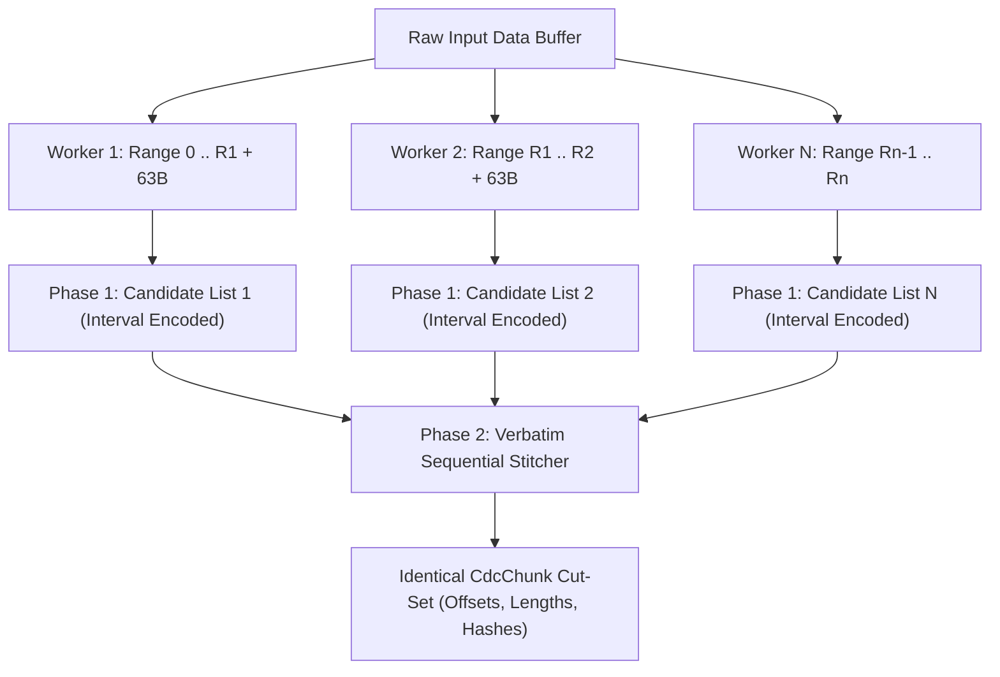

# v1.50.0 Pre-Analysis — Parallel CDC Fingerprint Pass & Memory Profiling

**Roadmap reference:** [`docs/roadmap-v143.merged.md`](ROADMAP.md) §7.8, §8.3, §10 OPT-P01, OPT-K01, OPT-K02  
**Prerequisite:** v1.49.0 WASM Streaming & BitReader Widening (shipped: commit `ed49f84`)  
**Complexity:** Medium / Algorithmic

---

## 0. Scope & Architectural Goals

Milestone v1.50 delivers high-throughput parallel content-defined chunking (CDC) for solid file grouping during archive creation, alongside key compression engine memory optimizations:

| Milestone | Title | Class | Risk / Scope |
|:---|:---|:---|:---|
| **M0** | Profiling Gate & Measurement (§10 OPT-P01) | Perf / Memory | Heterogeneous corpus profiling (fingerprint % of wall-clock); uninitialised `prev_` allocation in `Compressor50`. |
| **M1** | Candidate-then-Stitch Parallel Chunker | Algorithmic / MT | 63-byte overlap Phase 1 candidate scanning (interval encoded) + Phase 2 serial re-stitching matching `feed()` verbatim. Struck halo comment fix. |
| **M2** | Cut-Set Identity Gate & Fallback Verification | Conformance / TSan | `cdc_parallel_cutset_equals_sequential` on named identity corpus. Candidate-cap overflow fallback. 256 KiB restart-halo negative test. |
| **M3** | Cut-Rule & Hash Corrections (§10 OPT-K02, OPT-K01) | Algorithmic ($\Delta$bytes order) | FastCDC distinct-popcount strict/light masks; whole-chunk content hash vs last-64-byte window hash under `sizeof(CdcStreamChunker) <= 64`. |

---

## 1. Deep Dive: M0 Profiling & Encoder Memory (OPT-P01)

### 1.1 Profiling Gate
- **Requirement:** On a heterogeneous corpus, fingerprinting wall-clock must be measured. If $< 15\%$ of pack wall-clock, pivot allowances apply.
- **Hardware baseline capture:** CPU model, physical/logical core count, memory bandwidth, storage class (SSD/NVMe vs HDD), and filesystem (NTFS/ext4/APFS).

### 1.2 OPT-P01: `prev_` Uninitialised Allocation
- **Location:** [`src/compress/compressor50.cpp:478`](../src/compress/compressor50.cpp#L478)
  ```cpp
  prev_.assign(win_size_, static_cast<core::uint32>(-1));
  ```
- **The Issue:** For large sliding windows (e.g. 64 MiB to 1 GiB), filling `prev_` with `-1` writes hundreds of megabytes on every MT chunk / session start.
- **Invariance Proof:** In `compressor50.cpp:702-717` and `:803`, any traversal of `prev_` starts from `head_[h]`. If `head_[h] == -1`, `prev_` is never read. If `head_[h] != -1`, it was either written during this chunk, or if stale, `cur_ - cand <= max_dist` terminates the chain immediately. Therefore unwritten entries in `prev_` are provably unobservable.
- **Solution:** Factor `default_init_allocator` into [`src/core/default_init_allocator.hpp`](../src/core/default_init_allocator.hpp) and use it for `prev_` (and `prev64_`) with `.resize(win_size_)`.

---

## 2. Deep Dive: M1 & M2 Candidate-then-Stitch CDC Chunker

### 2.1 The Struck 256 KiB Restart Halo Fallacy (S-15 & §8.3)
- Prior designs assumed that since chunks are bounded by `CDC_MAX_CHUNK` (256 KiB), restarting chunking 256 KiB prior to a split point is "necessary and sufficient".
- **Why this fails (S-15):** The rolling Gear hash $h\_$ only depends on the last 64 bytes (`(h_ << 1) + T[b]`, shifted out at 64 bytes). However, the cut phase `pending_size_` is unbounded: every cut depends on the position of the previous cut. On constant runs (e.g. long strings of 'A'), a restarted range never rejoins the sequential cut lattice, leading to silent cut-set drift and ratio loss.

### 2.2 Exact-by-Construction Stitching Architecture



1. **Phase 1 (Parallel over Slices):**
   - Adjacent worker ranges overlap by exactly 63 bytes.
   - For each byte position where `(h_ & mask_strict) == 0` or `(h_ & mask_light) == 0`, record the candidate offset and window hash.
   - **Interval Encoding:** On repetitive/constant data where every byte matches, compress adjacent candidate positions into intervals `[start, len]` to prevent memory explosion ($O(1)$ representation).
   - **Range Overflow Cap:** If candidates exceed `range_len / 1024`, mark the range as overflowing and fall back to sequential chunking for that segment, explicitly logging/diagnosing the fallback (Invariant G-9).

2. **Phase 2 (Serial Stitching):**
   - Replays `CdcStreamChunker::feed` state machine:
     - When `pending < CDC_MIN_CHUNK - 1`: skip without cutting.
     - When `CDC_MIN_CHUNK - 1 <= pending < CDC_AVG_CHUNK - 1`: look for next strict candidate.
     - When `CDC_AVG_CHUNK - 1 <= pending < CDC_MAX_CHUNK`: look for next light candidate.
     - If no candidate before `pending == CDC_MAX_CHUNK`: emit a forced MAX cut. The forced cut's hash is recomputed from the 64 bytes ending at the cut.
     - Tail $< 64$ bytes: computed using `hash_range` over the tail bytes.

3. **Shared Cut Rule Source:**
   - Factor the state machine transition function so `CdcStreamChunker::feed` and the Phase 2 stitcher call the exact same logic.

---

## 3. Deep Dive: M3 Cut-Rule & Hash Corrections

### 3.1 FastCDC Normalisation Fix (OPT-K02)
- Current code ([`src/compress/cdc_chunker.cpp:58`](../src/compress/cdc_chunker.cpp#L58)):
  ```cpp
  const core::uint64 mask_strict = owner_.mask_;
  const core::uint64 mask_light = owner_.mask_ >> 1;
  ```
- Because `mask_` has 16 leading 1s, shifting right by 1 still has 16 1s!
- **Fix:** Use distinct-popcount masks:
  - `mask_strict` with 17 bits (probability $2^{-17}$, lower cut probability before 64 KiB target).
  - `mask_light` with 15 bits (probability $2^{-15}$, higher cut probability after 64 KiB target).
- **Sequencing rule:** Land M3 strictly *after* M2 cutset identity is validated on the baseline rules.

### 3.2 Content Hash vs Window Hash (OPT-K01)
- Currently, `chunk.hash = h_` is the 64-byte rolling window hash at the cut point.
- Evaluate whole-chunk content hashing (e.g. XXH64 / 64-bit folded hash) while honoring the `sizeof(CdcStreamChunker) <= 64` static assert constraint in [`tests/unit/cdc_chunker_tests.cpp:199`](../tests/unit/cdc_chunker_tests.cpp#L199).

---

## 4. Verification Gates & Test Strategy

1. **`cdc_parallel_cutset_equals_sequential`:**
   - Verify byte-for-byte identical `CdcChunk` output between sequential `chunk()` and parallel `chunk_parallel()`.
   - Comprehensive test corpus:
     - Constant byte run failing masks (e.g. all 0x00 or all 0xFF).
     - Constant byte run satisfying masks (dense candidate intervals).
     - 2-byte periodic pattern (e.g. `\xAA\x55`).
     - Pseudo-random data.
     - Real structured sample (sparse file / ELF / PE / text).
     - Range split boundaries testing all 16 residues mod 16 KiB.
2. **Negative Test (Proving Restart-Halo Flaw):**
   - Implement test-only 256 KiB restart-halo chunker; assert it FAILS on constant runs.
3. **Candidate-Cap Overflow Fallback:**
   - Verify fallback engages gracefully and reports non-silent diagnostics when candidate limits are exceeded.
4. **Footprint & Sanity:**
   - `static_assert(sizeof(CdcStreamChunker) <= 64)` remains green.
   - Clean CTest, anchor lint, layer check, and interop gate.
