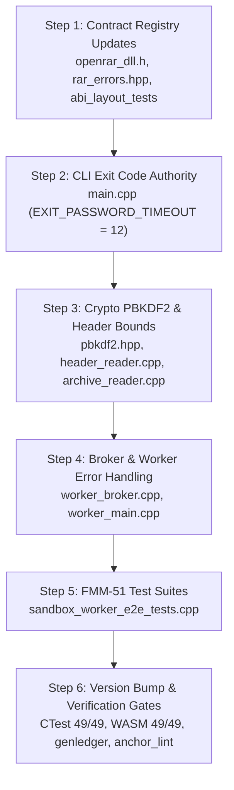

# v1.51.0 Implementation Plan — Sandbox Scope Expansion (Encrypted + Multi-Volume)

**Pre-Analysis:** [`docs/v1.51.0-pre-analysis.md`](v1.51.0-pre-analysis.md)  
**Roadmap Reference:** [`docs/roadmap-v143.merged.md`](ROADMAP.md) §7.9, Appendix A  
**Failure Mode Matrix:** [`docs/FMM.md`](FMM.md) §FMM-51  

---

## 1. Objectives & Scope

Deliver full sandbox scope expansion and rigorous failure-mode handling across all 7 FMM-51 rows:
- **FMM-51-1:** PBKDF2 iteration workbound rejection (`RAR_ERR_PASSWORD_TIMEOUT` = −16, exit 12).
- **FMM-51-2:** Volume descriptor failure in multi-volume archives (`RAR_ERR_MISSING_VOLUME` = −13, exit 6).
- **FMM-51-3:** Worker crash recovery as clean decode failure (`RAR_ERR_CONTAINMENT_BREACH` = −17, exit 2).
- **FMM-51-4:** Corrupted encrypted header detection (`RAR_ERR_DECRYPT` = −18, exit 13).
- **FMM-51-5:** Worker memory exhaustion (`RAR_ERR_RESOURCE_EXHAUSTION` = −19, exit 8).
- **FMM-51-6:** Broker-side integrity verification / anti-forgery (`RAR_ERR_CRC_MISMATCH` = −4, exit 3).
- **FMM-51-7:** Loud containment degradation reporting with `sandbox_active: false` (V-2).
- **Contract Registry Synchronization:** Lockstep updates to public headers, documentation, test suites, and language bindings without disturbing reserved slots −8 and −10.

---

## 2. Concrete Implementation Sequence

### Step 1: Contract Registry Updates
1. In [`include/openrar/openrar_dll.h`](../include/openrar/openrar_dll.h):
   - Add new `RarError` enum constants:
     - `RAR_ERR_PASSWORD_TIMEOUT = -16`
     - `RAR_ERR_CONTAINMENT_BREACH = -17`
     - `RAR_ERR_DECRYPT = -18`
     - `RAR_ERR_RESOURCE_EXHAUSTION = -19`
2. Mirror in [`src/archive/rar_errors.hpp`](../src/archive/rar_errors.hpp).
3. Synchronize in [`docs/abi-freeze.md`](abi-freeze.md) and [`docs/dll-integration-spec.md`](dll-integration-spec.md).
4. Synchronize in Python bindings:
   - [`bindings/python/openrar/_native.py`](../bindings/python/openrar/_native.py)
   - [`bindings/python/openrar/__init__.py`](../bindings/python/openrar/__init__.py)
5. Synchronize in WASM declarations:
   - [`wasm/js/openrar-archive.d.ts`](../wasm/js/openrar-archive.d.ts)
   - [`wasm/js/openrar.js`](../wasm/js/openrar.js)
6. Update [`tests/unit/abi_layout_tests.cpp`](../tests/unit/abi_layout_tests.cpp) to verify the widened enum bounds.

### Step 2: CLI Exit Code Authority (`src/cli/main.cpp`)
1. Define `constexpr int EXIT_PASSWORD_TIMEOUT = 12;` in [`src/cli/main.cpp`](../src/cli/main.cpp).
2. Wire exit mapping:
   - `RAR_ERR_PASSWORD_TIMEOUT` $\rightarrow$ `EXIT_PASSWORD_TIMEOUT` (12).
   - `RAR_ERR_CONTAINMENT_BREACH` $\rightarrow$ `EXIT_FATAL` (2).
   - `RAR_ERR_DECRYPT` $\rightarrow$ `EXIT_BAD_ARCHIVE` (13).
   - `RAR_ERR_RESOURCE_EXHAUSTION` $\rightarrow$ `EXIT_MEMORY` (8).
   - `RAR_ERR_MISSING_VOLUME` $\rightarrow$ `EXIT_OPEN` (6).

### Step 3: Crypto PBKDF2 & Header Bounds
1. In [`src/crypto/pbkdf2.hpp`](../src/crypto/pbkdf2.hpp):
   - Declare `constexpr core::uint32 MAX_PBKDF2_LG2 = 24;`.
2. In [`src/format/header_reader.cpp`](../src/format/header_reader.cpp):
   - Check `crypt.lg2_count > MAX_PBKDF2_LG2` $\rightarrow$ record password timeout error.
   - Malformed `HEAD_CRYPT` structures return `RAR_ERR_DECRYPT`.
3. In [`src/archive/archive_reader.cpp`](../src/archive/archive_reader.cpp):
   - Return `RAR_ERR_PASSWORD_TIMEOUT` when `entry.header.lg2_count > MAX_PBKDF2_LG2`.

### Step 4: Broker & Worker Error Handling
1. In [`src/sandbox/worker_broker.cpp`](../src/sandbox/worker_broker.cpp):
   - When worker communication drops unexpectedly (`read_frames` returns false), classify as `RAR_ERR_CONTAINMENT_BREACH` (−17) instead of generic I/O error.
   - When worker reports OOM, report `RAR_ERR_RESOURCE_EXHAUSTION` (−19).
   - Validate received chunks against independent broker CRC; mismatch reports `RAR_ERR_CRC_MISMATCH` (−4).
   - Perform volatile zero (`crypto::secure_wipe`) on any password or key buffers upon broker shutdown.
2. In [`src/sandbox/worker_main.cpp`](../src/sandbox/worker_main.cpp):
   - Propagate exact error codes (`RAR_ERR_PASSWORD_TIMEOUT`, `RAR_ERR_DECRYPT`, `RAR_ERR_RESOURCE_EXHAUSTION`).

### Step 5: FMM-51 Test Suites
In [`tests/unit/sandbox_worker_e2e_tests.cpp`](../tests/unit/sandbox_worker_e2e_tests.cpp):
1. `test_sandbox_pbkdf2_workbound_rejected`: Pass archive with `lg2_count = 25`, assert rejected with `RAR_ERR_PASSWORD_TIMEOUT` / exit 12.
2. `test_sandbox_multivol_descriptor_failure`: Missing volume descriptor fails with `RAR_ERR_MISSING_VOLUME` / exit 6.
3. `test_sandbox_worker_crash_recovery`: Kill worker process mid-stream, assert broker returns `RAR_ERR_CONTAINMENT_BREACH` and tears down cleanly.
4. `test_sandbox_encrypted_header_corrupt`: Malformed encrypted header yields `RAR_ERR_DECRYPT`.
5. `test_sandbox_worker_oom_rejection`: Worker OOM triggers `RAR_ERR_RESOURCE_EXHAUSTION`.
6. `test_sandbox_fail_open_forgery_denied_hmac`: Forged chunk or tampered CRC reports `RAR_ERR_CRC_MISMATCH`.
7. `test_sandbox_degraded_mode_is_loud`: Degraded containment mode asserts `sandbox_active: false` in JSON summary.

### Step 6: Verification Gates, Bump, and Release
1. Build and run all unit test suites.
2. Verify 49/49 CTest suites and 49/49 WASM tests pass.
3. Regenerate ledger (`tools/genledger.py`) and confirm anchor lint (0 violations) and layer check.
4. Bump version to 1.51.0 in lockstep across all 5 canonical files.
5. Update `CHANGELOG.md` and `docs/roadmap-v143.merged.md`.
6. Author walkthrough and commit release.
