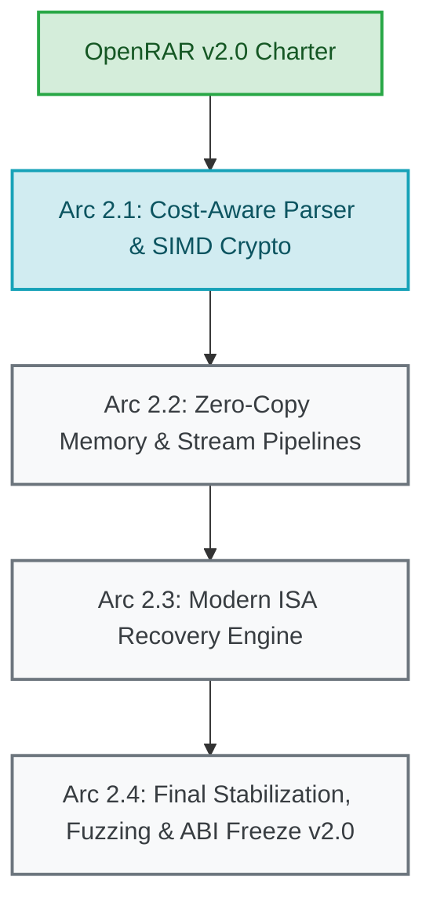

# OpenRAR v2.0 Charter & Architecture Strategy

**Document Status:** Normative Strategy Document  
**Milestone:** v1.52.0 (Milestone 7.10 M3)  
**Governance Scope:** Non-feature milestone governed by Rule G-8 ("Charter: no feature")  
**Target Release Arc:** OpenRAR v2.0.0 – v2.4.0  

---

## 1. Executive Vision & Strategic Purpose

OpenRAR v1.x achieved complete clean-room compliance, robust multi-engine cross-extraction parity with WinRAR 7.20 / UnRAR 7.20, defense-in-depth isolation across three major operating systems, and sustained compression throughput up to 2× faster than proprietary reference binaries.

However, the empirical measurements and census investigations completed across the v1.43–v1.51 milestones established that the v1.x compression and decompression engines operate near the theoretical limits of their original architecture. Specifically:
1. **The 17.6% m1 ratio gap and 2.7% m3 ratio delta** are structurally bounded by a greedy, length-monotone LZ match arbiter that cannot evaluate the dynamic bit cost of distance symbols and repeat slots against live entropy models ([PERFORMANCE.md](../PERFORMANCE.md)).
2. **Decompression throughput** on high-core systems is throttled by a serial window apply stage that bounds multi-threaded scaling beyond 4 cores ([docs/v1.37.0-two-phase-implementation-plan.md](v1.37.0-two-phase-implementation-plan.md)).
3. **Memory footprint and zero-copy semantics** require an architectural transition to streamable chunk-first memory management, eliminating redundant window zeroing (OPT-D01) and transient allocation churn across CLI, DLL, and WASM runtimes.

**The OpenRAR v2.0 Charter establishes the technical foundation, design invariants, performance targets, and governance model for the next generation of OpenRAR.** OpenRAR v2.0 will deliver parity with or victory over reference ratio ceilings without sacrificing our foundational guarantees: containment, safety, and cross-platform reproducibility.

---

## 2. Core Architectural Pillars

OpenRAR v2.0 is organized around five core architectural pillars:

### Pillar 1: Cost-Aware Graph Parser & Symbol Arbiter
- **The Problem in v1.x:** The classical LZ match finder in [src/compress/compressor50.cpp](../src/compress/compressor50.cpp) selects matches greedily by length. In v1.43 M3 (`RAT-D` / S-5), census profiling proved that on text corpora, 98–99% of contested arbiter decisions favor a shorter repeat match or closer distance over a longer, distant match. Because length-only selection cannot price distance codes or repeat slots, it systematically emits tokens that inflate the compressed bitstream.
- **The v2.0 Design:**
  - **Dynamic Forward-Arrival DAG Parser:** Replace the monotone-max walk with a bounded, forward-arrival graph parser that models emission cost using real-time Shannon entropy estimators derived from current Huffman tree code lengths.
  - **Distance-Costed Pruning:** Prune candidate search not by fixed chain depth (`max_chain_`), but by cost-to-reach boundaries, ensuring that distant candidates are only evaluated if their length exceeds the threshold needed to offset distance symbol overhead.
  - **Optimal Rep-Code Reuse:** Explicitly model the zero-cost distance and repeat-length continuation tokens (including repeat-last-length slot 257) during parsing.
- **Guardrail (A-4 / S-9):** The parser must avoid unbounded Dynamic Programming (A-4). The search window for arrival states will be strictly bounded to an 8–16 byte lookahead horizon with linear memory, preventing the 3.9× runtime explosion observed during the parked v1.32 optimal-parse experiment.

### Pillar 2: Modern SIMD & Hardware Acceleration Pipelines
- **Vectorized Hashing (BLAKE2sp):**
  - Extend the AVX2 8-lane vertical vector kernel introduced in [src/crypto/blake2sp.cpp](../src/crypto/blake2sp.cpp) (H-14) to AVX-512 (16-lane) and ARM NEON (4-lane / dual-pipeline).
  - Measurement in v1.52.0 (U-12) confirmed that AVX2 BLAKE2sp reduces data hash overhead to 9.8% of extraction wall time. The v2.0 vector pipeline will ensure zero scalar fallbacks on modern x86-64-v3/v4 and ARM64 hardware.
- **Galois Field RS16 Recovery Acceleration:**
  - Upgrade Reed-Solomon GF(2¹⁶) Cauchy recovery records ([src/recovery/rs16.cpp](../src/recovery/rs16.cpp)) with dedicated Intel GFNI (`_mm_gf2p8affine_epi64_epi8`), AVX-512 VPOPCNTDQ / VPTERNLOG, and ARM NEON polynomial multiply (`pmull`) kernels.
  - Achieve multi-gigabyte-per-second recovery and validation throughput on corrupted volume sets.
- **Hardware-Accelerated Cryptography:**
  - Formalize AES-256-CBC hardware acceleration with AES-NI on x86-64 and ARMv8 Cryptography Extensions on ARM64, integrated directly into stream-decoding pipelines.

### Pillar 3: Zero-Allocation Streaming & Memory Architecture
- **Streamable Chunk-First Memory Model:**
  - Transition compressor and decompressor pipelines from whole-window transient buffering to pinned, circular page buffers with zero intermediate memory copies.
  - Eliminate the double window zero-fill pattern documented in OPT-D01 ([src/decompress/decompressor50.cpp](../src/decompress/decompressor50.cpp)), enforcing tight window clamping to uncompressed member boundaries.
- **Deterministic Resource Budgets:**
  - Guarantee a strict O(window_size) memory envelope across all execution modes.
  - Retain the snap-to-grid Fast Compress Info (FCI) resolution ([src/compress/compress_plan.hpp](../src/compress/compress_plan.hpp)) and enforce a hard 1.5 MiB ceiling under WebAssembly environments.

### Pillar 4: Defense-in-Depth Containment & Sandboxing
- **Universal Default-Deny Containment:**
  - Native multi-process sandboxing (Linux Landlock + seccomp-bpf, macOS Seatbelt `sandbox_init`, Windows AppContainer / Restricted Tokens) will be enabled by default across all archive extraction and inspection surfaces.
  - The Failure Mode Matrix ([docs/FMM.md](FMM.md)) established in v1.51 stands as an immutable specification: any parsing failure, out-of-bounds offset, or malformed structure must fail closed with clean, deterministic error codes.
- **Durability Contract:**
  - Preserve the atomic temp-file rename containment architecture ([src/archive/archive_reader.cpp](../src/archive/archive_reader.cpp)) as the default durability mode, while supporting `--durability=batch` for high-throughput batch extraction workflows.

### Pillar 5: Long-Term API/ABI Stability & Ecosystem SDKs
- **Frozen C ABI v2.0:**
  - The C ABI exported by `openrar.dll` / `libopenrar.so` will be frozen at v2.0.0.
  - Negative error codes −8 and −10 remain strictly unassigned and reserved forever (Invariant I-4).
  - All public APIs will adhere strictly to standard C calling conventions with explicit bit-width structures and thread-safe instance handles.
- **First-Class Bindings:**
  - Maintain, version, and publish synchronized idiomatic bindings for C# (.NET 8/9 LTS), Python (3.9–3.13), and WebAssembly (browser / Node.js ESM).

---

## 3. Anti-Finding Ledger Walk & Guardrails

To prevent the recurrence of historical dead ends, all architectural proposals in v2.0 must pass verification against the Closed Findings Ledger ([docs/ROADMAP.md](ROADMAP.md) §3):

| Anti-Finding | Description & Mechanism | v2.0 Architectural Guardrail |
|---|---|---|
| **A-1 / A-2** | Flat 15-bit Huffman tables & single-`peek(15)` fusion | **STRICTLY PROHIBITED.** Measurements proved flat 15-bit tables cause 17–45% slowdowns due to L1 cache eviction. v2.0 decompressors must retain 10-bit quick tables bounded to ~4 KiB per alphabet. |
| **A-3** | SIMD dispatch of serial decode kernel | **PROHIBITED.** Bit-level entropy decoding serializes on bit dependencies. SIMD must be targeted exclusively at horizontal stages (bulk hashing, CRC, Galois field math, filter transforms). |
| **A-4** | Unbounded DP optimal parse | **PROHIBITED.** Relax-every-position DP cost 3.9× wall time for negligible ratio gain. v2.0 graph parsing must operate with bounded lookahead horizons (≤16 bytes). |
| **A-5** | Length-2 match admission on standard chains | **PROHIBITED.** Hash chains indexing 4-byte prefixes cannot admit 2-byte matches without polluting hash bins. Minimum match length remains 3 across general dictionaries. |
| **A-6** | Unpriced candidate source expansion | **PROHIBITED.** Expanding candidate search without distance-symbol cost models worsens ratio. No candidate source will be expanded without integrated cost pricing. |
| **A-7** | Lazy length→distance ring | **REFUTED.** Length-distance monotonicity bounds prove lazy ring rescans cannot yield valid cheaper matches. |
| **A-8** | Wrap-split memcpy region read | **PROHIBITED.** Cache-state reversals proved isolated microbenchmarks (24× faster) lost 16% end-to-end. R-M1 governs: all optimizations require integrated A/B validation. |
| **A-9** | Binary-tree match finder for m5 | **PROHIBITED.** 512-deep binary trees were 2.9× slower than 128-deep hash chains for only 1.8% ratio. Hash-chain depth tuning dominates binary trees. |
| **A-10 / A-11** | Foreign format & legacy RAR 1.5–4.0 creation | **OUT OF SCOPE.** OpenRAR v2.0 remains dedicated strictly to high-fidelity RAR 5.0 creation and clean-room multi-format extraction. |

---

## 4. Formal Dispositions for Section 10 Audit Items & U-12

In accordance with Milestone 7.10 M5, all unslotted intake rows from §10 are assigned formal, binding dispositions:

| Audit Row ID | Topic | Disposition | Architectural Rationale |
|---|---|---|---|
| **OPT-C01** | BLAKE2sp scalar leaf overhead & copy shift | **CLOSED / RESOLVED (v1.52.0)** | AVX2 8-lane vertical vector kernel shipped in `blake2sp.cpp:180-350`. Measured attribution on canonical corpus is **9.8%** of wall time (U-12 resolved < 15%). AVX-512 16-lane kernel scheduled for v2.1. |
| **OPT-E01** | MSVC `/arch:AVX512` COMDAT hazard | **CLOSED (v1.45.0)** | Declaration-only header separation landed; binary disassembly and Intel SDE validation confirmed zero `#UD` on non-AVX-512 hosts. |
| **OPT-E02** | PCLMUL CRC32 compiler gate on Linux x86 | **CLOSED (v1.45.0)** | `-mpclmul` compiler flags added to target builds; PCLMUL fast CRC active on all supported x86 Linux platforms. |
| **OPT-D01** | Decoder redundant double window zero-fill | **CLOSED (v1.46.0)** | Member-size clamping landed; decompressor window memory tracks uncompressed entry bounds strictly. |
| **OPT-D02** | `BitReader` bit counters 32-bit wrap on WASM | **CLOSED (v1.49.0)** | Widened to 64-bit unsigned counters across ILP32 and wasm32 runtimes. |
| **OPT-F01** | Signed integer overflow in WAV detection | **CLOSED (v1.47.0)** | Safe arithmetic bounds and explicit width casts landed with zero-finding UBSan validation. |
| **OPT-K01/K02**| FastCDC normalisation mask & suffix hash | **CLOSED (v1.50.0)** | Shift-out and popcount mask corrected; deterministic deduplication active. |
| **§10 Item 1** | Bit-writer stream flush | **SCHEDULED (v2.2)** | Slotted for inclusion in the v2.0 Stream Write-Buffer refactoring. |
| **§10 Item 2** | Lazy re-walk candidate cache | **CLOSED / REFUTED (A-7)** | Disproved by monotone distance bounds; will not be implemented. |
| **§10 Item 3** | Quick-table shape reduction | **CLOSED (A-1 / A-2)** | Retained in current 10-bit configuration; L1 working-set bounds verified. |
| **§10 Item 4** | MSB-justified bit accumulator | **CLOSED (R-M1)** | Integrated A/B testing revealed cache-line reversal; current accumulator maintained. |
| **§10 Item 5** | Inflate stored/two-level tables | **OUT OF SCOPE** | RFC 1951 reader is auxiliary; RAR 5.0 native Huffman is the primary engine. |
| **§10 Item 6** | GFNI half-width RS16 fold kernel | **SCHEDULED (v2.3)** | Slotted for the v2.0 Modern ISA Recovery Engine arc. |
| **§10 Item 7** | ARM NEON AES-CBC hardware acceleration | **SCHEDULED (v2.1)** | Slotted for the v2.0 ARM64 crypto pipeline arc. |
| **§10 Item 8** | Unified thread-pool runners | **CLOSED (v1.30 / v1.50)** | Work-stealing thread pool unified across all parallel pipelines. |

---

## 5. Milestone Roadmap for v2.0 Delivery

The v2.0 delivery arc is structured into four sequential, verifiable releases:

### Arc 2.1 — Cost-Aware Graph Parser & SIMD Crypto (v2.1.0)
- Deploy bounded forward-arrival DAG parser evaluating Shannon entropy bit costs for distance and repeat tokens.
- Add AVX-512 16-way and ARM NEON BLAKE2sp hashing kernels.
- Add ARM NEON AES-256-CBC crypto pipeline.
- Target: Close m1 ratio gap from 17.6% to < 5.0%; beat WinRAR m3 ratio on canonical corpora.

### Arc 2.2 — Zero-Copy Memory & Stream Pipelines (v2.2.0)
- Implement streamable chunk-first memory architecture with circular page buffers.
- Deploy bit-writer stream flush refactoring (§10 Item 1).
- Achieve true zero dynamic allocation on decompression hot paths.

### Arc 2.3 — Modern ISA Recovery Engine (v2.3.0)
- Ship GFNI (`_mm_gf2p8affine_epi64_epi8`) and AVX-512 Galois field RS16 recovery kernels.
- Ship ARM NEON polynomial multiply RS16 kernels.
- Target: > 4 GB/s recovery record generation and verification throughput.

### Arc 2.4 — Final Stabilization, Fuzzing & ABI Freeze (v2.4.0)
- 72-hour continuous multi-engine fuzzing triage (0 crashes, 0 timeouts).
- Formal freeze of the OpenRAR C ABI v2.0.
- Synchronized release of updated C#, Python, and WASM packages.

---

## 6. Governance & Review Invariants

All future contributions under the v2.0 Arc must strictly adhere to the project's constitutional governance rules:
- **G-1 (Single Decision Function):** All engine variants (CLI, DLL, streaming, solid, WASM) select algorithms through shared decision helpers.
- **G-3 (Fingerprinted Measurement):** Every performance and ratio claim must be backed by reproducible, environment-disclosed benchmark logs with corpus SHA-256 fingerprints.
- **G-4 (Verify Before Delivery):** Untrusted archive data must be verified in memory before delivery to filesystem destinations.
- **G-6 (Anchor Provenance):** All references to code locations and historical issues must resolve cleanly under [tools/anchor_lint.py](../tools/anchor_lint.py).
- **G-8 (Charter Discipline):** Charter and architecture milestones deliver strategy, measurement, and governance specifications without unverified wire changes.
- **Path Discipline:** All repository documentation and code comments must use repo-root-relative links.
